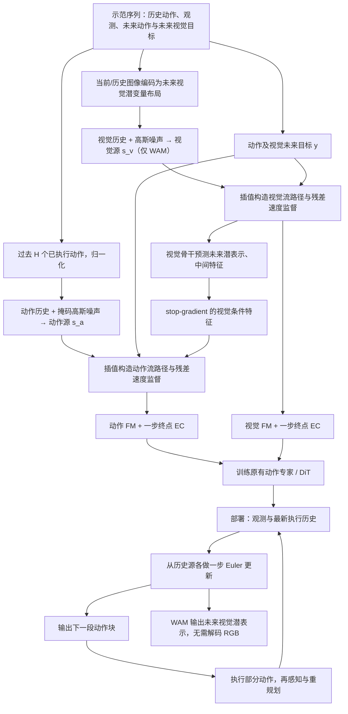

# Δ-flow：基于历史起点的一步式流匹配 / Δ Flow Matching for Robot Foundation Models

**论文：** [arXiv:2610.15794v1](https://arxiv.org/abs/2610.15794)（2026-10-11）｜**作者与机构：** Kuangji Zuo、Tuo An 等，南洋理工大学（Nanyang Technological University）MARS Lab｜[项目页](https://zuo-kuangji.github.io/delta-flow/)｜[官方仓库](https://github.com/NTUMARS/delta-flow-matching)（源码尚未发布）。

## 一句话定义

**Δ-flow 用近期执行的动作/已观察视觉状态加轻微噪声替代独立高斯噪声作为流匹配起点，使 VLA/WAM 学习历史到未来的残差，并通过一步 Euler 更新产生未来动作块（WAM 同时预测未来视觉潜表示）。**

## 英文缩写速查

| 缩写 | 英文全称 | 简要说明 |
|---|---|---|
| FM | Flow Matching | 沿源到目标路径回归速度场的生成训练 |
| EC | Endpoint Consistency | 直接监督单步 Euler 终点与真实目标的一致性 |
| VLA | Vision-Language-Action | 以图像、语言、状态为条件生成动作 |
| WAM | World-Action Model | 联合建模未来视觉表征和动作的模型 |
| DiT | Diffusion Transformer | ImageWAM / Fast-WAM 中用于预测的 Transformer 骨干 |
| NFE | Number of Function Evaluations | 每次生成对速度场的评估次数 |

## 为什么重要

- 标准高斯源与未来动作无直接对应关系，而机器人执行历史与将来的动作往往具有时间连续性；使用历史源可把大幅运输变成更容易拟合的残差。
- 方法主要调整流的源分布、目标与训练损失，**不新增网络模块或额外训练数据**；但不能理解为仅在部署时改随机种子——完整版还训练 FM 与 EC 两项损失。
- 适用对象既有仅预测动作的 π0.5，也有视觉与动作双分支的 ImageWAM / Fast-WAM；从论文层面说明了“改起点”与“减少积分步数”的差别。

## 流程总览

以下为根据论文 §4、Fig.2 和附录 A 整理的**算法数据流**，不是未公开源码的调用图。

注：π0.5 仅经过动作分支，不启用视觉生成路径；WAM 才启用视觉 Δ-flow 及条件化连接。

## 核心原理

**源与训练目标（论文 Eq.3–9）：**

- 历史源：s_m = α_m · h_m + σ_m · (b_m ⊙ ε_m)，其中 m 分别表示动作 a 或视觉 v，ε_m 为标准高斯，b_m 用于关闭夹爪或 padding 等维度的噪声。
- 插值：y_m(τ) = (1−τ) · y_m + τ · s_m，τ=1 为源、τ=0 为未来目标。FM 学习 s_m − y_m 的速度场。
- 一步终点：ŷ_m = s_m − f_θ(s_m, 1, c)，EC 对 ŷ_m 与真实 y_m 计算 L1。FM 监督整条路径，EC 专门保证单步结果。
- **VLA：** π0.5 保留原 PaliGemma/Gemma 视觉语言骨干和动作专家，只对动作分支使用历史源；损失为 action FM + 0.5 × action EC。
- **WAM：** ImageWAM 和 Fast-WAM 的视觉与动作分支都用历史源，视觉中间特征为动作预测提供条件；该连接采用 stop-gradient，防止动作损失直接改变视觉骨干。

| 基座 | 历史/预测长度 | 视觉源 | 逐段执行与重规划 |
|---|---|---|---|
| ImageWAM（FLUX.2-klein-base-4B + action DiT） | 16 动作历史 → 16 动作目标 | 当前图像编码、与高斯噪声混合；预测 t+16 视觉潜表示 | 执行 12 步，再获取观测 |
| Fast-WAM-joint-sparse（Wan2.2-TI2V-5B + action DiT） | 32 → 32 | 编码稀疏历史视频，在 32 步视野预测 4 帧视觉潜表示 | 保留联合视觉–动作注意力 |
| π0.5（PaliGemma + Gemma action expert） | 10 → 10 | **不生成未来视觉** | 执行 5 步，再重规划 |

动作源的共用实验参数为 α_a=1、σ_a=0.5；视觉 50% latent prior 使用 (h_v + ε_v)/√2（附录 A）。以上属于论文实现参数，并非已公开代码。

## 实验与评测

论文评测：LIBERO 的 Spatial / Object / Goal / Long 四套件；LIBERO-Plus 的七类相机、机器人初始状态、语言、光照、背景、噪声与布局扰动，后者**未额外微调**。

### 到达目标成功率所需 epoch

| 基座 / 口径 | 高斯起点 | Δ-flow | 注意 |
|---|---|---|---|
| ImageWAM 达到 ≥90% LIBERO 成功率 | 第 6 epoch | 第 1 epoch（91.30%） | 完整动作 + 视觉 Δ-flow；按 checkpoint 统计 |
| Fast-WAM 达到 ≥95% LIBERO 成功率 | 第 8 epoch | 第 2 epoch（95.65%） | 高斯 sparse-joint 对照 |
| π0.5 LoRA 超过 91.30% | 第 5 epoch 高斯十步为 91.30% | 第 1 epoch 92.20% | 并非总训练时间实测提速 5× |

### 单步推理 vs 十步高斯（论文 Fig.5；附录 B.3）

| 模型 | 高斯 10 步完整本地调用 | Δ-flow 1 步完整本地调用 | 加速比 |
|---|---:|---:|---:|
| π0.5（LoRA） | 82.91 ms | 53.99 ms | 1.54× |
| ImageWAM | 296.31 ms | 118.87 ms | 2.49× |
| Fast-WAM（Gaussian sparse-joint 对照） | 857.54 ms | 192.62 ms | 4.45× |

**口径：** 单张 NVIDIA A100-SXM4-80GB、batch=1；包含模型本地编码、历史源准备、预测和动作后处理，**不含**通信、仿真推进、渲染、加载/预热或未来 RGB 解码。加速比不能直接外推到实体机器人闭环。

### 最终成功率与平滑性

| 评测 | 高斯参考 | Δ-flow | 结论 |
|---|---:|---:|---|
| ImageWAM / LIBERO | 98.00% | 97.80% | 略降 0.20 个百分点 |
| ImageWAM / LIBERO-Plus | 82.49% | 88.55% | 提升 6.06 个百分点 |
| Fast-WAM-joint-sparse / LIBERO-Plus | 77.51% | 80.58% | 同配置对比 +3.07 个百分点 |
| π0.5 / LIBERO-Plus | 80.70% | 84.53% | 全参数设置中的结果 |

在 ImageWAM / LIBERO-Long 的匹配成功轨迹上，动作 jerk 均值：一步高斯 0.19399、完整一步 Δ-flow 0.04335、十步高斯 0.04221（论文 Table 9）；**4.5×** 的对比是与“一步高斯”相比，不是与十步高斯相比。

### 消融与设计结论

- ImageWAM 只改动作源时 LIBERO-Plus 为 85.82%；视觉 + 动作源一起改为 88.55%，相对原版 82.49%（Table 3）。
- 在 80% visual-latent prior 设置下，移除视觉 EC 将 LIBERO-Plus 从 87.37% 降至 84.96%（Table 4）。
- Fast-WAM 在相同 32 步视野下预测 4 帧比预测 8 帧泛化更好；stop-gradient 有利于视觉预测及扰动场景控制（§7）。
- 局部 delta 动作表征在 ImageWAM 实验的 LIBERO-Plus 中优于 7D 绝对动作（85.82% 对 61.07%），不可只看标准 LIBERO 决定表示方式。
- **无需重新训练的特例：** 冻结原始 ImageWAM / Fast-WAM 并只替换推理的动作源；LIBERO 一步分别从 97.50→98.10%、95.55→96.15%，但 Fast-WAM 在 LIBERO-Plus 从 68.28% 小幅降到 67.58%（Table 2）。

## 结论

**Δ-flow 的主要价值是把连续控制任务中的生成难题改写为历史到未来的残差学习；其训练效率、单步延迟和泛化获益都已在仿真评测中量化，但复现与真机部署仍有边界。**

1. 实施时先确保**最近已执行动作与未来动作块维度、归一化定义和时序对齐一致**，历史长度等于预测动作块长度。
2. 一步推理应配套 **FM + EC** 训练目标；仅把高斯模型的步数降为 1，会损害动作平滑性与任务成功率。
3. WAM 中视觉历史源及视觉/动作耦合有额外价值，不能直接将 π0.5 的“仅动作源”设置当作所有模型的完整方案。
4. 评测需同基座、同未来 token 数、同硬件与完整调用计时对照；论文的 epoch 比例不是 wall-clock 训练加速。
5. 冻结模型直接替换动作源是有限的 inference-time 试验结论，并非任意策略都能免训练获得收益。

## 工程实践

- **规划复现：** 论文报告 ImageWAM / Fast-WAM 使用 PyTorch、π0.5 使用 JAX，训练均为 8×A100；复现顺序应先做统一输入/历史缓存、历史源噪声构造、FM+EC 训练，再评测一步 Euler 及 chunk 边界 D1/D2 平滑指标。
- **需要记录：** LIBERO 成功率随 epoch、LIBERO-Plus 7 类扰动、policy-call latency、NFE、动作变化与 jerk、chunk 实际执行长度、动作与视觉损失曲线。
- **来源可用性：** 截至 2026-11-07，[NTUMARS 官方仓库](../../sources/repos/delta_flow_matching_robot_foundation_models.md)仅公开 README 与示意 assets，**训练/评估代码及权重待发布**；无法给出经源代码验证的命令或实机复现结果。

## 源码运行时序图

**不适用（截至 2026-11-07 官方尚无可运行研究源码）**。不沿用旧版推断出的 clone/train/eval 通用 sequenceDiagram；待官方实际发布训练或推理入口、读完对应源码后再补准确运行时序。

## 局限与风险

- 原论文在 §9 明确将**更多 VLA 基座和实体机器人验证**列为未来工作；目前所述提速与成功率是 LIBERO / LIBERO-Plus 仿真结果，不能宣称真机 100 Hz 或量产可靠性。
- 历史动作在碰撞、操作模式变化、长时间停滞或执行器饱和时可能不是未来动作的良好先验；作者在 §9 提出自适应源噪声，但尚未验证该扩展。
- Visual Δ-flow 的计算开销不能忽略：部分原始 WAM 在推理时跳过未来视觉，完整 Δ-flow 恢复未来潜表征生成，需用相同配置比较计算成本。
- 开放边界：已有论文、项目页与官方仓库，不代表训练、数据或 checkpoint 已开源。项目页互动动画标注为 illustration，不是独立本地测试证据。

## 与其他工作对比

- [Flow Matching 具身策略](../concepts/flow-matching-embodied-policy.md)：传统高斯源主要从噪声运输到目标；本工作换成“历史 + 轻噪声”源并增加一步终点监督。
- [World Action Models](../concepts/world-action-models.md)：把可观测视觉历史也作为 WAM 视觉分支的源，保留未来视觉条件对动作预测的作用。
- [CNP-Flow](./paper-cnp-flow-conditional-source-distribution.md)：同为改造源分布的方向，但 CNP-Flow 学习条件噪声预测器，Δ-flow 直接使用已执行历史，不增设源预测网络。
- [2026-10-14 论文技术地图](../overview/embodied-station-2026-10-14-41-papers-technology-map.md)：沿用既有唯一项目节点，不重复入库。

## 关联页面

- [Flow Matching 具身策略](../concepts/flow-matching-embodied-policy.md)
- [World Action Models](../concepts/world-action-models.md)
- [VLA](../methods/vla.md)
- [CNP-Flow](./paper-cnp-flow-conditional-source-distribution.md)
- [具身智能小站 41 篇技术地图](../overview/embodied-station-2026-10-14-41-papers-technology-map.md)

## 参考来源

- [Δ-flow 论文 v1：通读归档](../../sources/papers/delta_flow_matching_robot_foundation_models_arxiv_2610_15794.md)
- [项目页一手核验](../../sources/sites/delta-flow-matching-robot-foundation-models.md)
- [官方 GitHub README 核验](../../sources/repos/delta_flow_matching_robot_foundation_models.md)
- [arXiv HTML 全文](https://arxiv.org/html/2610.15794v1)
- [论文 PDF](https://arxiv.org/pdf/2610.15794)

## 推荐继续阅读

- [作者项目主页：方法、结果、消融](https://zuo-kuangji.github.io/delta-flow/)
- [南洋理工 MARS Lab 官方仓库（等待源码）](https://github.com/NTUMARS/delta-flow-matching)
