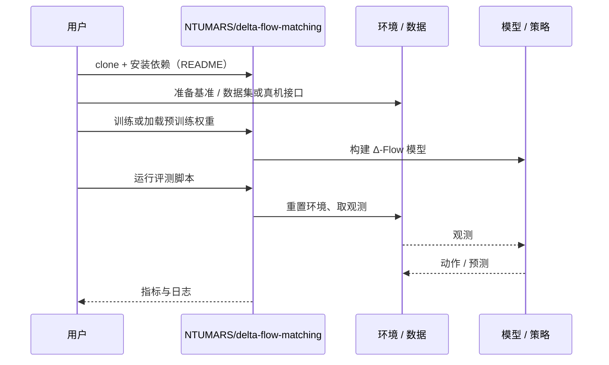

# Δ-Flow（arXiv:2610.15794）

**Δ-Flow**（*Δ Flow Matching for Robot Foundation Models*，[arXiv:2610.15794](https://arxiv.org/abs/2610.15794)，[项目页](https://zuo-kuangji.github.io/delta-flow/)，[代码](https://github.com/NTUMARS/delta-flow-matching)）来自 [具身智能小站 2026-10-14 盘点](../../sources/blogs/wechat_embodied_station_41_papers_streamingwam_2026-10-14.md)，属「VLA 与动作生成」组。

## 一句话定义

**用带轻微噪声的近期历史替代固定高斯起点，使动作与视觉生成成为残差预测，缩短生成路径并研究单步推理。**

## 英文缩写速查

| 缩写 | 英文全称 | 简要说明 |
|------|----------|----------|
| FM | Flow Matching | 流匹配 |
| WAM | World Action Model | 世界动作模型 |
| VLA | Vision-Language-Action | 视觉–语言–动作策略 |

## 为什么重要

- 从纯噪声起步浪费了动作/视频的时间连续性；历史起点让一步推理更可行。
- 开源结论：**已开源**（步骤 2.5，2026-10-14）。项目页链接的 GitHub 仓库可达。
- 同期同组工作见 [流式动作块与世界模型记忆：具身智能小站 10-14 期 41 篇阅读坐标](../overview/embodied-station-2026-10-14-41-papers-technology-map.md)。

## 核心机制

| 项 | 内容 |
|----|------|
| **arXiv** | [2610.15794](https://arxiv.org/abs/2610.15794) |
| **开源** | **已开源** |
| **要点** | 起点 = 噪声化历史；免重训替换仅限所述预训练 WAM 设置。 |
| **文内指标** | 在 VLA 与 WAM 上研究单步推理；数值以原文为准。 |

## 源码运行时序图

以下为按仓库入口（`NTUMARS/delta-flow-matching`）推断的通用运行链路；入库日仅核实仓库可达，未逐文件阅读，具体脚本名以 README 为准。

## 实验与评测

- 在 VLA 与 WAM 上研究单步推理；数值以原文为准。
- **读法：** 本页为索引级摘要，依据公众号转述的官方摘要与仓库信息整理；逐项数字与 baseline 以原文 PDF 为准。

## 与其他工作对比

- 横向索引见 [流式动作块与世界模型记忆：具身智能小站 10-14 期 41 篇阅读坐标](../overview/embodied-station-2026-10-14-41-papers-technology-map.md)；同 arXiv 不重复造页。

## 结论

**改起点比改求解器更省：残差式流匹配是 VLA/WAM 降延迟的通用技巧，但免重训结论有适用范围。**

1. 开源边界：**已开源** — 项目页链接的 GitHub 仓库可达。
2. 核心机制：起点 = 噪声化历史；免重训替换仅限所述预训练 WAM 设置。
3. 复现与选型前核对任务协议、硬件与基准口径，勿直接横比公众号摘录数字。

## 关联页面

- [flow-matching-embodied-policy](../concepts/flow-matching-embodied-policy.md)
- [world-action-models](../concepts/world-action-models.md)
- [vla](../methods/vla.md)
- [paper-cnp-flow-conditional-source-distribution](./paper-cnp-flow-conditional-source-distribution.md)
- [embodied-station-2026-10-14-41-papers-technology-map](../overview/embodied-station-2026-10-14-41-papers-technology-map.md)

## 参考来源

- [delta_flow_matching_robot_foundation_models_arxiv_2610_15794.md](../../sources/papers/delta_flow_matching_robot_foundation_models_arxiv_2610_15794.md)
- [wechat_embodied_station_41_papers_streamingwam_2026-10-14.md](../../sources/blogs/wechat_embodied_station_41_papers_streamingwam_2026-10-14.md)
- [arXiv:2610.15794](https://arxiv.org/abs/2610.15794)

## 推荐继续阅读

- [arXiv PDF](https://arxiv.org/pdf/2610.15794)
- [项目页](https://zuo-kuangji.github.io/delta-flow/)
- [https://github.com/NTUMARS/delta-flow-matching](https://github.com/NTUMARS/delta-flow-matching)
