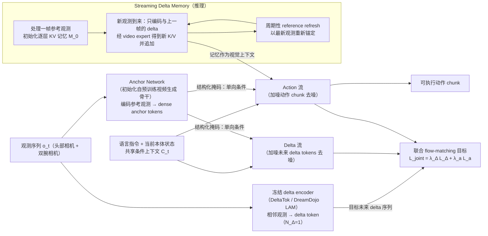

# DeltaWAM

**DeltaWAM: Delta World Action Models for Bimanual Manipulation**（[arXiv:2609.28811](https://arxiv.org/abs/2609.28811)，[项目页](https://aigeeksgroup.github.io/DeltaWAM)）收录自 [具身智能小站 12 篇盘点（恢复/WAM 专题）](../../sources/blogs/wechat_embodied_station_12_papers_recover_wam_2026-09-27.md)。

## 一句话定义

**预测视觉 delta 而非整帧重建，配合 delta 动作更新，降低 WAM 推理成本。**

## 英文缩写速查

| 缩写 | 英文全称 | 简要说明 |
|------|----------|----------|
| SR | Success Rate | 任务成功率 |
| WAM | World Action Model | 联合预测未来观测与动作 |
| VLA | Vision-Language-Action | 视觉-语言-动作策略 |
| RL | Reinforcement Learning | 强化学习 |

## 为什么重要

- 纳入 [12 篇技术地图](../overview/embodied-research-12-papers-recover-wam-technology-map.md) 与同期失败恢复、异步 WAM、接触感知、持续学习、安全 RL 条目横向对照。
- 步骤 2.5 开源结论：**已开源**。

## 流程总览

图依据：论文 §IV-A/B/C/D（Overview、Model Architecture、Joint Delta-Action Training Objective、Streaming Delta Memory）及 Fig. 1–3。

## 核心信息

| 项 | 内容 |
|----|------|
| **arXiv** | [2609.28811](https://arxiv.org/abs/2609.28811) |
| **项目页** | https://aigeeksgroup.github.io/DeltaWAM |
| **代码** | https://github.com/AIGeeksGroup/DeltaWAM |
| **开源** | **已开源** |

## 实验与评测（公众号口径）

- 指标与数字以 [公众号盘点](../../sources/blogs/wechat_embodied_station_12_papers_recover_wam_2026-09-27.md) 与 **原文 PDF** 为准；读复现前核对仿真/真机与 attempt 定义。

## 源码运行时序图

**不适用**（请按 GitHub README 入口自行补 sequenceDiagram；入库日未逐仓核对）。

## 与其他工作对比

| 对照 | 差异读法 |
|------|----------|
| [Fast-WAM](./paper-fast-wam.md) | 训练期视频共训、**推理期跳过未来视频去噪**；DeltaWAM 推理期仍预测视觉，但只预测 **delta** 而非整帧重建 |
| [GlanceWAM](./paper-glancewam.md) | 把想象减为 **异步单帧前瞻**、动作头走潜空间；DeltaWAM 减的是 **每步预测的内容量**（增量），不是预测频率 |
| [C³ache](./paper-rcl-2606-08962-c3-3ache-accelerating-world-action-models-with-c.md) | training-free，跨 inference chunk **缓存复用同去噪步残差**（Fast-WAM 骨干）；DeltaWAM 的「缓存锚点 + 增量更新」在 **预测目标层面** 引入 delta，而非推理期外挂缓存 |
| [Streaming-WAM](./paper-streaming-wam.md) | 同期「改 WAM 节拍」条目：Streaming-WAM 让推理与运动 **重叠** 以容忍延迟；DeltaWAM 直接 **降推理成本** |
| [LiMA](./paper-lima-async-dual-system-wam.md) | 同为双臂 WAM 提速：LiMA 用 **慢–快双系统 + Latent Schrödinger Bridge**；DeltaWAM 保持单一联合预测、改为 **视觉/动作增量** |

## 结论

**总判：DeltaWAM 适合作为「预测视觉 delta 而非整帧重建，配合 delta 动作更新，降低 WAM 推理成本。…」方向的入口页；机制细节以 arXiv 与项目页为准。**

1. 与 [12 篇技术地图](../overview/embodied-research-12-papers-recover-wam-technology-map.md) 对照，避免与其它 arXiv 混淆。
2. 开源为 **已开源** 时从项目页/GitHub 再核实一次再写复现计划。
3. 涉及异步 WAM 或恢复评测时，同时记录 **正常起点 SR** 与 **偏差后恢复率**（若适用）。

## 关联页面

- [具身研究 12 篇（恢复/WAM）技术地图](../overview/embodied-research-12-papers-recover-wam-technology-map.md)
- [Manipulation](../tasks/manipulation.md)

## 参考来源

- [论文归档](../../sources/papers/deltawam_arxiv_2609_28811.md)
- [DeltaWAM 仓库归档](../../sources/repos/deltawam.md)
- [公众号 12 篇清单](../../sources/blogs/wechat_embodied_station_12_papers_recover_wam_2026-09-27.md)
- [arXiv PDF](https://arxiv.org/pdf/2609.28811)：已通读方法部分（实验与附录以略读为准）：摘要、§I 引言、§III 预备知识（Delta Representation）、§IV 方法（A–D）、§V-A 实验设定（略读 §V-B）

## 推荐继续阅读

- [arXiv:2609.28811](https://arxiv.org/abs/2609.28811)
- [项目页](https://aigeeksgroup.github.io/DeltaWAM)
- [GitHub 仓库](https://github.com/AIGeeksGroup/DeltaWAM)

