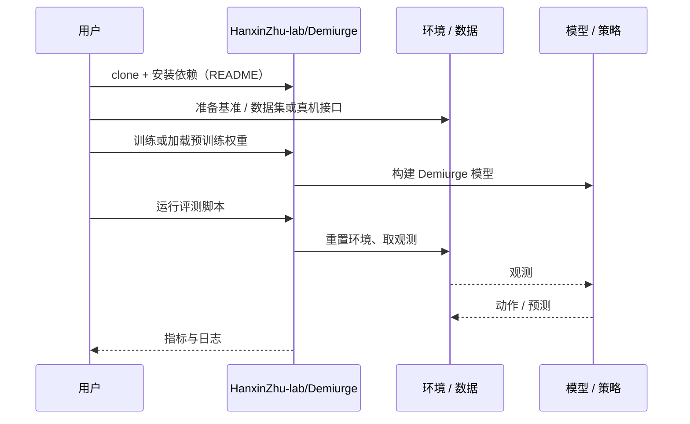

# Demiurge（arXiv:2610.14685）

**Demiurge**（*Demiurge: Forging Navigable 4D Worlds via Autoregressive Video Rerendering*，[arXiv:2610.14685](https://arxiv.org/abs/2610.14685)，[项目页](https://hanxinzhu-lab.github.io/demiurge_project_page/)，[代码](https://github.com/HanxinZhu-lab/Demiurge)）来自 [具身智能小站 2026-10-14 盘点](../../sources/blogs/wechat_embodied_station_41_papers_streamingwam_2026-10-14.md)，属「感知与 4D 世界」组。

## 一句话定义

**用动态 4D 点云缓存串联视频重渲染，结合深度补全、双流变形与几何细化维持跨轨迹一致性。**

## 英文缩写速查

| 缩写 | 英文全称 | 简要说明 |
|------|----------|----------|
| 4D | 3D + time | 时空点云 |
| AR | Autoregressive | 自回归生成 |
| NVS | Novel View Synthesis | 新视角合成 |

## 为什么重要

- 可导航视觉世界需要不同视角共享同一动态世界。
- 开源结论：**已开源**（步骤 2.5，2026-10-14）。项目页链接的 GitHub 仓库可达。
- 同期同组工作见 [流式动作块与世界模型记忆：具身智能小站 10-14 期 41 篇阅读坐标](../overview/embodied-station-2026-10-14-41-papers-technology-map.md)。

## 核心机制

| 项 | 内容 |
|----|------|
| **arXiv** | [2610.14685](https://arxiv.org/abs/2610.14685) |
| **开源** | **已开源** |
| **要点** | 尚不等同机器人闭环控制。 |
| **文内指标** | 以原文为准。 |

## 源码运行时序图

以下为按仓库入口（`HanxinZhu-lab/Demiurge`）推断的通用运行链路；入库日仅核实仓库可达，未逐文件阅读，具体脚本名以 README 为准。

## 实验与评测

- 以原文为准。
- **读法：** 本页为索引级摘要，依据公众号转述的官方摘要与仓库信息整理；逐项数字与 baseline 以原文 PDF 为准。

## 与其他工作对比

- 横向索引见 [流式动作块与世界模型记忆：具身智能小站 10-14 期 41 篇阅读坐标](../overview/embodied-station-2026-10-14-41-papers-technology-map.md)；同 arXiv 不重复造页。

## 结论

**4D 缓存是把视频生成变成可导航世界的桥梁，但距离控制闭环仍远。**

1. 开源边界：**已开源** — 项目页链接的 GitHub 仓库可达。
2. 核心机制：尚不等同机器人闭环控制。
3. 复现与选型前核对任务协议、硬件与基准口径，勿直接横比公众号摘录数字。

## 关联页面

- [generative-world-models](../methods/generative-world-models.md)
- [video-as-simulation](../concepts/video-as-simulation.md)
- [embodied-station-2026-10-14-41-papers-technology-map](../overview/embodied-station-2026-10-14-41-papers-technology-map.md)

## 参考来源

- [demiurge_navigable_4d_worlds_arxiv_2610_14685.md](../../sources/papers/demiurge_navigable_4d_worlds_arxiv_2610_14685.md)
- [wechat_embodied_station_41_papers_streamingwam_2026-10-14.md](../../sources/blogs/wechat_embodied_station_41_papers_streamingwam_2026-10-14.md)
- [arXiv:2610.14685](https://arxiv.org/abs/2610.14685)

## 推荐继续阅读

- [arXiv PDF](https://arxiv.org/pdf/2610.14685)
- [项目页](https://hanxinzhu-lab.github.io/demiurge_project_page/)
- [https://github.com/HanxinZhu-lab/Demiurge](https://github.com/HanxinZhu-lab/Demiurge)
