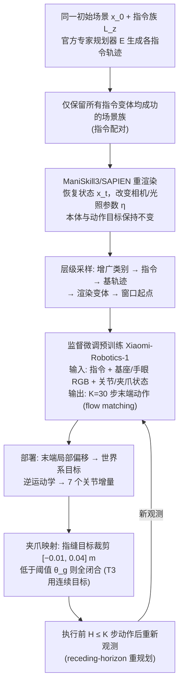

# 通过示范扩展与执行设计改善精细机器人操作

**示范扩展与执行设计**（*Improving Fine-Grained Manipulation through Demonstration Expansion and Execution Design*，[arXiv:2610.40430](https://arxiv.org/abs/2610.40430)）收录于 senlanke「具身运控lab」10-26–10-30 前沿论文动态（Manipulation）。本页依据**周报条目 + arXiv 摘要页**整理，流程图依据论文方法部分（见参考来源），未逐页核对实验数字；指标与结论以论文为准。

## 一句话定义

**通过示范扩展与执行设计改善精细机器人操作——提出 DEED，对同一物理轨迹生成不同语言指令、相机位置和光照条件下的训练示范。部署时结合逆运动学、任务专用夹爪映射和闭环动作块重规划，在 MetaFine 五项任务评测中取得 85.55% 的总体评分。**

## 英文缩写速查

| 缩写 | 英文全称 | 简要说明 |
|------|----------|----------|
| VLA | Vision-Language-Action | 视觉–语言–动作模型 |
| IL | Imitation Learning | 模仿学习 |

## 为什么重要

- 周报所述待解决的问题：精细操作不仅依赖策略预测，还受到示范覆盖范围、相机变化、动作执行周期和夹爪控制映射的影响。

## 流程总览

图依据：论文 §2.1–2.4 / Fig.1 / Table 1

## 核心机制

| 项 | 内容 |
|----|------|
| **arXiv** | [2610.40430](https://arxiv.org/abs/2610.40430) · [PDF](https://arxiv.org/pdf/2610.40430) |
| **作者（arXiv）** | Gu, Jingxu, Lian, Dongze |
| **机构（周报所述，未逐条核实）** | 待核实（作者：Jingxu Gu、Dongze Lian）。 |
| **arXiv 评论栏** | （无） |
| **开源** | arXiv 摘要页与评论未见代码或项目页链接（仅核对 arXiv 摘要页，不代表未发布）（2026-11-02） |
| **周报所述创新点** | 提出 DEED，对同一物理轨迹生成不同语言指令、相机位置和光照条件下的训练示范。部署时结合逆运动学、任务专用夹爪映射和闭环动作块重规划，在 MetaFine 五项任务评测中取得 85.55% 的总体评分。 |

### arXiv 摘要节选（英文原文）

> Fine-grained manipulation requires a robot policy to follow instructions, remain robust to visual variations, and translate predicted actions into precise robot control. We present Demonstration Expansion and Execution Design (DEED), a framework for adapting a pretrained vision-language-action policy to the five MetaFine tasks through structured demonstration expansion and execution design.

## 源码运行时序图

**不适用**：arXiv 摘要页与评论未见代码或项目页链接（仅核对 arXiv 摘要页，不代表未发布），无可对齐的官方代码流程。

## 实验与评测

- 周报与摘要给出的数字/场景已写入上表「创新点」与摘要节选；其余实验细节、基线与成功率定义请回到论文正文。
- 读法：先对齐任务设定、传感器与成功定义（仿真/真机），再解读 headline 数字，勿跨论文直接比较。

## 与其他工作对比

| 维度 | 读法 |
|------|------|
| **同周对照** | 见 [Manipulation周报技术地图](../overview/senlanke-weekly-2026-10-26-30-manipulation-technology-map.md)，按方向浏览同期论文 |
| **开源状态** | arXiv 摘要页与评论未见代码或项目页链接（仅核对 arXiv 摘要页，不代表未发布） |

## 结论

**通过示范扩展与执行设计改善精细机器人操作。**

1. 本页是入库级摘要，复现前请核对论文正文、附录与代码仓库。
2. 指标须连同实验条件解读。
3. 关注 arXiv 版本更新与代码发布。

## 关联页面

- [senlanke-weekly-2026-10-26-30-manipulation-technology-map](../overview/senlanke-weekly-2026-10-26-30-manipulation-technology-map.md)
- [manipulation](../tasks/manipulation.md)
- [vla](../methods/vla.md)

## 参考来源

- [demonstration-expansion-execution-design-fine-grained_arxiv_2610_40430.md](../../sources/papers/demonstration-expansion-execution-design-fine-grained_arxiv_2610_40430.md)
- [wechat_senlanke_weekly_manipulation_2026-10-26_30.md](../../sources/blogs/wechat_senlanke_weekly_manipulation_2026-10-26_30.md)
- [arXiv:2610.40430](https://arxiv.org/abs/2610.40430)
- [arXiv PDF](https://arxiv.org/pdf/2610.40430)：已通读方法部分（实验与附录以略读为准）：§1–§4（§2 方法：配对示教扩展、物理一致视觉扩展、层级采样、VLA 微调、闭环执行；§3 实验）

## 推荐继续阅读

- [arXiv PDF](https://arxiv.org/pdf/2610.40430)
