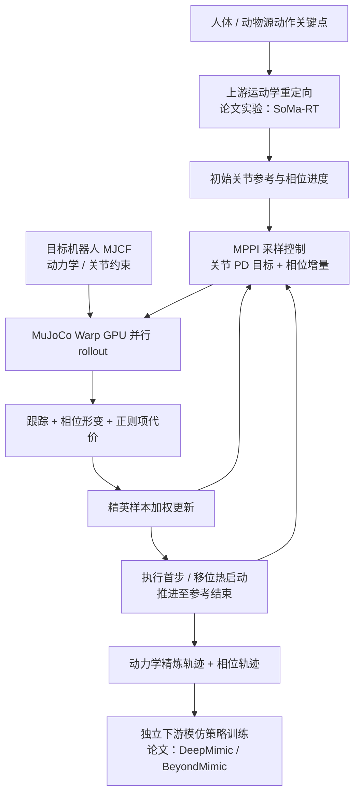
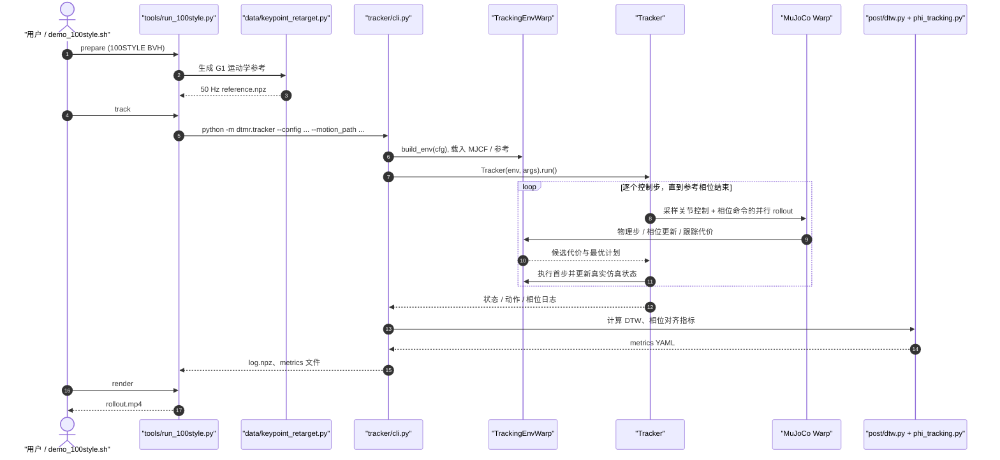

# Dense Temporal Motion Retargeting for Legged Robots｜面向腿式机器人的稠密时间动作重定向

## 一句话定义

**Dense Temporal Motion Retargeting（DTMR）** 是一种用于人形及四足机器人的动力学参考精炼方法：将参考动作**时间相位的推进速度**当作可控制量，和机器人的关节控制一起交给 GPU 并行采样式模型预测控制优化，使起跳、落地等难段局部变速，而不必拖慢整段参考。

## 英文缩写速查

| 缩写 | 英文全称 | 简要说明 |
|---|---|---|
| DTMR | Dense Temporal Motion Retargeting | 本论文：逐步优化参考动作时序与机器人控制 |
| MPC | Model Predictive Control | 有限时域滚动规划的模型预测控制 |
| MPPI | Model Predictive Path Integral | 基于并行采样 rollout 的优化器 |
| PD | Proportional–Derivative | 关节位置目标经 PD 变为执行器控制 |
| DTW | Dynamic Time Warping | 比较动作形态、尽量消除时间伸缩差异 |
| MPJPE-G | Global Mean Per-Joint Position Error | 全局关键点位置误差，用于评估下游动态可跟踪性 |

## 核心信息

| 字段 | 内容 |
|---|---|
| 论文 | [Dense Temporal Motion Retargeting for Legged Robots](https://arxiv.org/abs/2609.38617) |
| 中文题名 | 面向腿式机器人的稠密时间动作重定向 |
| 作者 | Jaeryeong Kim、Taerim Yoon（共同一作）、Jin Cheng、Sungjoon Choi、Stelian Coros |
| 机构 | 苏黎世联邦理工（ETH Zürich）；高丽大学（Korea University） |
| 版本 | arXiv:2609.38617v1，2026-09-29（预印本） |
| 官方项目 | [项目页](https://jaeryeongnicolekim.com/Dense-Temporal-Motion-Retargeting-For-Legged-Robots/) |
| 官方源码 | [nicolejrkim/DTMR](https://github.com/nicolejrkim/DTMR)，已开放 GPU MPC 追踪器和演示入口 |

## 为什么重要

把人的动作直接按原时间轴播放给人形机器人，跳跃等高动态片段可能超出机器人执行器与惯量允许的速度；将整段统一减速虽易于跟踪，却也改坏了原本可执行的片段。既有 STMR 用**分段时间伸缩 + 嵌套控制优化**处理此问题，优化慢、变形粗。DTMR 允许每个控制步独立调整相位推进量，并与动作一起求解，重点提升难段的可跟踪性。

## 流程总览

论文中的整体关系如下。**SoMa-RT 是评测所用的上游运动学重定向器；下游策略训练是离线参考生成之后的独立步骤。**

## 方法与核心原理

### 相位成为控制变量

参考序列通过相位 `φ∈[0,1]` 选择被跟踪的帧：扩展状态是 `(x_k, φ_k)`，扩展动作是 `(u_k, dφ_k)`，其中 `u_k` 是关节位置 PD 目标，`φ_(k+1)=φ_k+dφ_k`。相位速度相对源速的变形率是 `r_k = log2(dφ_k / (Δt/T))`；`r=-1` 代表半速，`r=+1` 代表两倍速。

对每个候选动作，物理 rollout 会同时推进机器人状态与源相位，再按**当前相位所选参考帧**计算位置、姿态、速度偏差。时间项控制变形预算，正则项抑制力矩与控制变化。论文采用的相位惩罚更强调减速项，避免无意义地拖慢参考；并不等于对所有情形硬性固定总时长。

### GPU 并行 MPPI

一次优化在同一个采样控制空间中处理时间和关节控制，不使用 STMR 的“外层贝叶斯时间优化 + 内层控制器”嵌套结构。MPPI 采样候选控制序列，在 MuJoCo Warp 上并行执行动力学、保留低代价精英，按权重更新计划；执行第一个动作后移位、热启动下一控制步。

**论文表 II 设置（非跨硬件默认值）：** 4096 条采样、40 步预测窗、8 个控制节点、冷/热启动采样迭代 5/2、20 ms 控制周期、5 ms 物理步。采样控制节点经插值得到完整控制序列，降低优化维度。

## 实验与评测

| 条件 | 一手结果 | 读法 |
|---|---|---|
| 数据规模 | BONES-SEED 人体动作 999 段、约 120 分钟；适配 Unitree G1 / R1 / H1-2、Booster T1 | 四种人形的**仿真**大规模评测；另含 Go1 四足小样本 |
| 可跟踪性 | 相对 SoMa-RT，四人形 MPJPE-G 中位误差平均下降 **13.4%**（论文表 III） | 通过下游 tracking policy 测试参考是否符合机器人动力学 |
| 语义保真 | 相对 SoMa-RT，四人形 DTW 对齐后的中位误差平均下降 **12.9%**（表 IV） | **不是“时间对齐误差下降 12.9%”**；DTW 弱化时序变形影响 |
| 难段收益 | 与 SoMa-RT 比，Q75 误差改善平均 14.9%，Q25 仅 1.8%（表 III） | 更适合需要局部变速的动态动作 |
| 相同时间优化基线 | 相对 STMR，G1 10 段总耗时 45.4 h → 2.4 h（约 **19.2×**），Go1 两段 2.4 h → 7 min（约 **20.8×**；表 VI） | **只适用于该论文对照设置**；不可当作每条动作或所有硬件的通用加速倍数 |
| 时长影响 | G1 数据集总时长差异在 1% 内；H1-2 可达 **9.5%**（VI-A） | 更多表现为局部时间再分配，而非所有本体都保持同一总时长 |
| 真机 | 论文 VI-F 用 BeyondMimic 训练、在 Unitree G1 上演示两段舞蹈；两段最终平均 tracking reward 分别从 40.8→42.5、38.9→41.7 | **真实部署有展示，但不能把仿真语料指标外推成真机成功率** |

## 结论

**DTMR 的核心收益不是全局“慢一点”，而是在物理可执行的前提下只调整需要变速的关键片段，同时用同一次优化求得控制轨迹。**

1. 先把运动学参考交给动力学精炼，再把重定向结果送入下游策略，不要将三者混为单个端到端模型。
2. 需要跳跃/快速重心转移等高动态参考时，优先检查相位曲线与下游 Q75 跟踪误差。
3. 比较时间伸缩方法时固定形变预算，同时统计精度与壁钟时间；不能只比较是否“放慢成功”。
4. 音乐、接触时刻等语义约束重要时，时间代价权重需要额外调节，但当前方法不能主动理解节拍。
5. 仿真误差、源参考的 DTW 保真度与真机策略表现必须分别呈现。

## 与其他工作对比

- [DynaRetarget](./paper-notebook-dynaretarget-dynamically-feasible-retargeting-us.md) 主要强调动力学可行轨迹生成与优化；DTMR 额外把**参考动作的逐步相位推进**放进控制优化。
- [Shooting for Contact](./paper-shooting-for-contact.md) 通过仿真求解接触相关的动态轨迹，而 DTMR 主要解决同一源动作对应的运动节奏和执行能力耦合。
- [STMR 四足时空重定向](./stmr-quadruped-retargeting.md) 使用粗粒度分段伸缩与嵌套优化，DTMR 以密集相位控制 + 单层并行 MPPI 替代；DTMR 在论文的有限 G1 / Go1 比较片段上取得约 19–21× 的重定向速度优势。

## 源码运行时序图

官方项目页已链接 [nicolejrkim/DTMR](https://github.com/nicolejrkim/DTMR)，并有可执行入口。以下根据官方 `demo_scripts/demo_100style.sh`、`tools/run_100style.py`、`tracker/cli.py`、`tracker/controller.py` 及 `env/env.py` 的实际调用边界整理，**展示的是开源的仿真重定向/跟踪流程，不是真机策略执行时序**。

复现入口：先参照 [官方安装说明](https://github.com/nicolejrkim/DTMR/blob/main/docs/install.md) 安装，再运行 `bash demo_scripts/demo_100style.sh Zombie`，或按 [LAFAN1 tutorial](https://github.com/nicolejrkim/DTMR/blob/main/docs/tutorial.md) 生成 `*_50Hz.npz` 并执行 `dtmr --config ... --motion_path ... --output_dir ... --no_viz`。

## 工程实践

1. **输入先对齐：** 使用运动学重定向器产出与目标机器人一致的 `*_50Hz.npz`，先渲染参考以检查姿态、地面穿透与坐标系，再运行 MPC。
2. **记录相位：** 对比 `φ`、`rdphi` 与动作类别，观察跳跃前准备与飞行阶段的局部加减速；不能只看总时长。
3. **看双重误差：** `*_phi_tracking_metrics.yaml` 给当前相位下姿态偏差，`*_dtw_metrics.yaml` 评估跨时间拉伸后的动作相似度；不要互相替代。
4. **资源预算：** 官方文档的 RTX 4090 示例称 10 秒 100STYLE Zombie 需约 11 min、TwoFootJump 约 28 min；属**离线 GPU 求解**，不能据此宣传实时机器人上机 MPC。
5. **开源范围：** 代码包含 MuJoCo Warp 追踪器、多机器人配置与动作导入，但本次未从仓库核实论文全部 BeyondMimic 训练与实机控制脚本；分别遵循数据及机器人资产许可。

## 局限与风险

- **语义时序缺失：** 时间形变只按动力学和设置的代价权衡；与音乐同步的节拍或交互时机可能被改变。
- **没有联动物体：** 论文 VII 明确指出尚未联合优化被操作物体的运动与接触时间。
- **仿真→真机仍有落差：** 大样本数值来自仿真训练/rollout，G1 真机演示是独立且较小的证据范围。
- **运行成本与依赖：** GPU 大规模 physics rollouts 依赖特定 CUDA / MuJoCo Warp 版本；发行仓库的七种机器人配置不等于论文已对七种机器人进行了同样规模的受控评测。

## 关联页面

- [动作重定向纵深路线：Stage 3 物理感知与时间优化](../../roadmap/depth-motion-retargeting.md)
- [Trajectory Optimization（轨迹优化）](../methods/trajectory-optimization.md)
- [DeepMimic：示例引导技能学习](../methods/deepmimic.md)
- [STMR 四足时空重定向](./stmr-quadruped-retargeting.md)
- [DynaRetarget](./paper-notebook-dynaretarget-dynamically-feasible-retargeting-us.md)
- [Shooting for Contact](./paper-shooting-for-contact.md)

## 参考来源

- [arXiv v1 原文通读核查](../../sources/papers/dtmr_arxiv_2609_38617.md)
- [项目页及最新开源状态](../../sources/sites/dense-temporal-retargeting-project.md)
- [官方源码与可运行入口核查](../../sources/repos/dtmr-official.md)
- [人形动作情报索引](../../sources/blogs/humanoid_motion_intelligence_day1_data_retargeting_2026_10_02.md)

## 推荐继续阅读

- [论文全文 HTML，arXiv:2609.38617v1](https://arxiv.org/html/2609.38617v1)
- [项目可视化、真机视频与交互数据](https://jaeryeongnicolekim.com/Dense-Temporal-Motion-Retargeting-For-Legged-Robots/)
- [官方源码与教程](https://github.com/nicolejrkim/DTMR)
