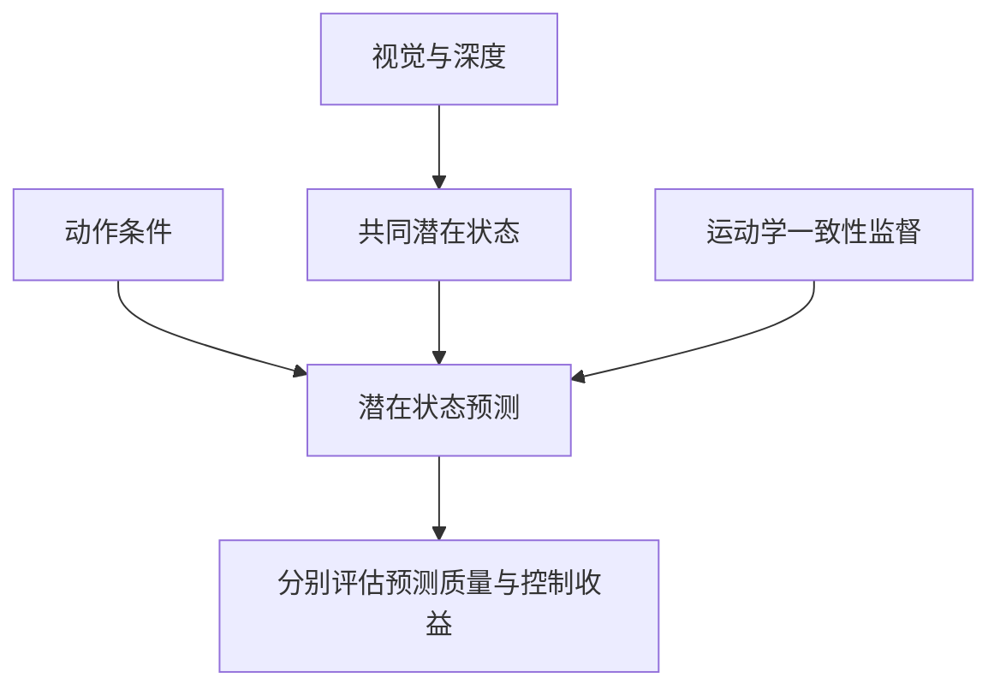
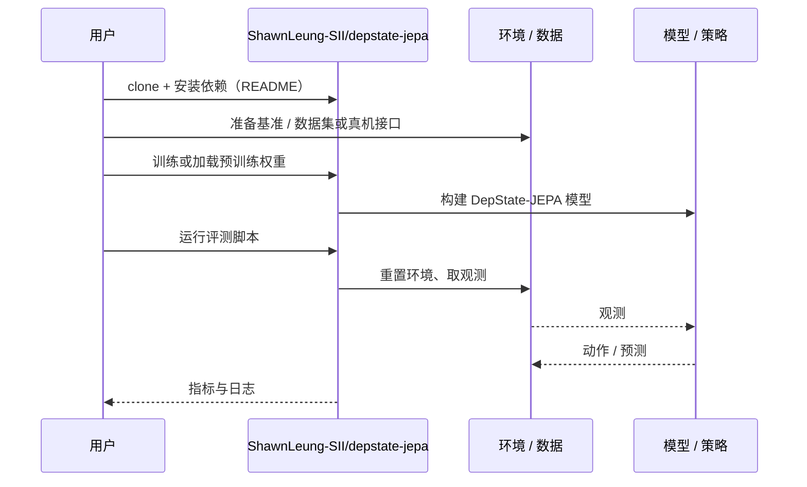

# DepState-JEPA（arXiv:2610.29246）

**DepState-JEPA**（*DepState-JEPA: Learning Depth-Grounded State Representation for Visual Perception and Manipulation*，[arXiv:2610.29246](https://arxiv.org/abs/2610.29246)，[项目页](https://shawnleung-sii.github.io/depstate-jepa/)，[代码](https://github.com/ShawnLeung-SII/depstate-jepa)）来自 [具身智能小站 2026-10-29 盘点](../../sources/blogs/wechat_embodied_station_58_papers_diverse_demonstrations_2026-10-29.md)，属「世界模型与表征」组。

## 一句话定义

**DepState-JEPA把视觉、深度和动作条件预测连接到共同潜在状态，并加入运动学一致性监督；表征及操作实验支持几何作用，应分别看预测质量与控制收益。**

## 英文缩写速查

| 缩写 | 英文全称 | 简要说明 |
|------|----------|----------|
| DepState-JEPA | DepState-JEPA: Learning Depth-Grounded State Representation for Visual Perception and Manipulation | 本文方法 / 基准的简称 |

## 为什么重要

- 用RGB与深度建立可预测的共享状态。
- 开源结论：**已开源**（步骤 2.5，2026-10-29）。仓库可达（git ls-remote）。项目页 HTTP 200。
- 同期同组工作见 [多样成功示范、触觉工具链与预见式感知：具身智能小站 10-29 期 58 篇阅读坐标](../overview/embodied-station-2026-10-29-58-papers-technology-map.md)。

## 核心机制

| 项 | 内容 |
|----|------|
| **arXiv** | [2610.29246](https://arxiv.org/abs/2610.29246) |
| **开源** | **已开源** |
| **要点** | DepState-JEPA把视觉、深度和动作条件预测连接到共同潜在状态，并加入运动学一致性监督；表征及操作实验支持几何作用，应分别看预测质量与控制收益。 |
| **文内指标** | 公众号未给具体数字，本页不引用。 |

## 核心流程图

以下概括本页所述的核心关系；具体实现与评测条件以原论文为准。

## 源码运行时序图

以下为按仓库入口（`ShawnLeung-SII/depstate-jepa`）推断的通用运行链路；入库日仅核实仓库可达，未逐文件阅读，具体脚本名以 README 为准。

## 实验与评测

- 公众号未给具体数字，本页不引用。
- **读法：** 本页为索引级摘要，依据公众号转述的官方摘要与仓库信息整理；逐项数字与 baseline 以原文 PDF 为准。

## 与其他工作对比

- 横向索引见 [多样成功示范、触觉工具链与预见式感知：具身智能小站 10-29 期 58 篇阅读坐标](../overview/embodied-station-2026-10-29-58-papers-technology-map.md)；同 arXiv 不重复造页。

## 结论

**用RGB与深度建立可预测的共享状态：DepState-JEPA把视觉、深度和动作条件预测连接到共同潜在状态，并加入运动学一致性监督；表征及操作实验支持几何作用，应分别看预测质量与控制收益。**

1. 开源边界：**已开源** — 仓库可达（git ls-remote）。项目页 HTTP 200。
2. 核心机制：DepState-JEPA把视觉、深度和动作条件预测连接到共同潜在状态，并加入运动学一致性监督；表征及操作实验支持几何作用，应分别看预测质量与控制收益。
3. 复现与选型前核对任务协议、硬件与基准口径，勿直接横比公众号摘录数字。

## 关联页面

- [world-action-models](../concepts/world-action-models.md)
- [generative-world-models](../methods/generative-world-models.md)
- [vla](../methods/vla.md)
- [embodied-station-2026-10-29-58-papers-technology-map](../overview/embodied-station-2026-10-29-58-papers-technology-map.md)

## 参考来源

- [depstate_jepa_arxiv_2610_29246.md](../../sources/papers/depstate_jepa_arxiv_2610_29246.md)
- [wechat_embodied_station_58_papers_diverse_demonstrations_2026-10-29.md](../../sources/blogs/wechat_embodied_station_58_papers_diverse_demonstrations_2026-10-29.md)
- [arXiv:2610.29246](https://arxiv.org/abs/2610.29246)

## 推荐继续阅读

- [arXiv PDF](https://arxiv.org/pdf/2610.29246)
- [项目页](https://shawnleung-sii.github.io/depstate-jepa/)
- [https://github.com/ShawnLeung-SII/depstate-jepa](https://github.com/ShawnLeung-SII/depstate-jepa)
