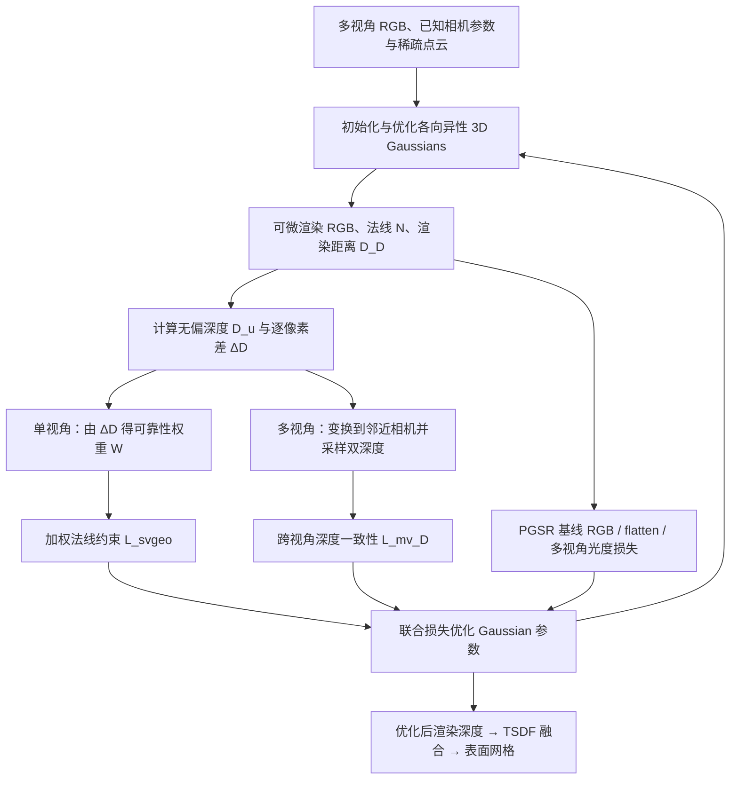

# DepthGS：深度引导的高斯溅射与自适应正则化高质量表面重建

**DepthGS**（*Depth-Guided Gaussian Splatting with Adaptive Regularization for High-Quality Surface Reconstruction*；[arXiv:2611.13628](https://arxiv.org/abs/2611.13628)）由南方科技大学等机构提出，发表于 **IEEE TPAMI（2026，online ahead of print）**。其核心是把高斯渲染中两种深度估计的差异变成可解释的几何可靠性信号，并用单视角与跨视角的正则化改善 3D 表面重建。

## 一句话定义

**对比无偏深度与渲染距离，用深度差自适应调节法线约束，并在相邻视角间约束这两种深度的重投影一致性，从而提升基于 3D Gaussian Splatting 的表面几何重建。**

## 英文缩写速查

| 缩写 | 英文全称 | 简要说明 |
| --- | --- | --- |
| 3DGS | 3D Gaussian Splatting | 显式各向异性高斯场与可微 splatting 渲染 |
| PGSR | Planar-based Gaussian Splatting for Efficient and High-Fidelity Surface Reconstruction | 本文沿用的无偏深度 / 几何正则基线 |
| TSDF | Truncated Signed Distance Function | 深度融合后提取评测网格的截断符号距离场 |
| CD | Chamfer Distance | DTU 重建表面差异指标，越低越好 |
| LPIPS | Learned Perceptual Image Patch Similarity | 视图感知差异指标，越低越好 |
| NVS | Novel View Synthesis | 新视角合成；与高质量几何重建不是同一个目标 |

## 为什么重要

- **渲染好不等于表面准：** 高斯原语布局不规则时，RGB 可依然清晰，却会出现几何伪影；将深度差作为可分析的中间信号，更能针对局部不可靠的几何施加合适约束。
- **错误正则可能伤细节：** 全局强法线约束会把局部不可靠的深度转换成误导性监督；DepthGS 在大深度差处降低法线项权重。
- **为机器人 Real2Sim 增加几何选项：** 研究价值是静态场景表面质量与多视角一致性；**不等价于**可直接用于碰撞的完整物理孪生。

## 核心信息

| 项 | 内容 |
| --- | --- |
| 论文 | [arXiv HTML v1（2026-11-10）](https://arxiv.org/html/2611.13628v1) · [PDF](https://arxiv.org/pdf/2611.13628) |
| 期刊 | IEEE Transactions on Pattern Analysis and Machine Intelligence (TPAMI)，[DOI: 10.1109/TPAMI.2026.3751295](https://doi.org/10.1109/TPAMI.2026.3751295) |
| 作者 | Xiao Ren、Yu Liu、Ning An、Jian Cheng、Xin Qiao、You-Fu Li、He Kong |
| 机构 | **南方科技大学**；**中煤科工矿山人工智能研究院**／煤矿智能开采与岩层控制全国重点实验室；**西安交通大学**；**香港城市大学** |
| 输入与基线 | 已知相机参数的多视图 RGB 与稀疏点云初始化；沿用 PGSR 的高斯渲染与原有损失 |
| 输出 | 优化后的 3D 高斯、渲染 RGB / 法线 / 深度；TSDF 融合提取表面网格 |
| 硬件 | 论文实验均为单张 NVIDIA GeForce RTX 4090；每场景 30,000 次迭代 |
| 开源状态 | **未核实有官方 DepthGS 训练 / 推理代码**（截至 2026-11-19）；论文提供完整方法但没有可运行入口 |

## 核心原理

### 1. 深度差与重建误差上界（论文 §IV-A）

从 PGSR 渲染器获取 **渲染距离** `D_𝒟`、渲染法线 `N` 和 **无偏深度** `D_u = D_𝒟 / (N·v)`，其中 `v` 为单位相机射线方向，令 `ΔD = D_u - D_𝒟`。这两种深度沿同一单位射线反投影，因此对应三维点之间的距离恰为 `|ΔD|`。对未知真实表面的几何误差，论文 Lemma 1 用三角不等式得到：

`ε_u(p) ≤ ε_𝒟(p) + |ΔD(p)|`。

这**不是**「仅凭深度差就知道真实误差」的等式：上界仍含 `ε_𝒟`，但说明在其不变时缩小深度差会收紧上界。

### 2. 单视角：深度差自适应法线正则

论文将 `|ΔD|` 按有效像素内 min-max 归一化后转换成可靠性权重 `W_ΔD`（深度差越大，权重越小），与 PGSR 原有图像边缘权重结合，再对 **无偏深度推导法线** `N_d` 与 **渲染法线** `N` 的 L1 差值施加权重：

`L_svgeo = mean[W_ΔD · (image-gradient-weight) · ||N_d - N||₁]`。

该项不会把 `|ΔD|` 直接当作需要最小化的单视角损失；它把深度差**用于调节其他几何约束的可信度**，避免不稳定的局部监督过强。

### 3. 多视角：双深度一致性（论文 §IV-B）

对当前视角的 `D_u` 与 `D_𝒟` 分别反投影到三维，再通过已知外参转换并投影到最近邻相机；对该相机深度图进行双线性采样，剔除无效坐标和非正深度，得到两种深度的重投影差 `δ_u` 与 `δ_𝒟`。采用

`L_mv_D = mean[α·δ_u + (1−α)·δ_𝒟]`，其中 **`α=0.8`**。

论文 Lemma 2 给出跨视角误差上界，并区分完整**向量**深度差残差与共享目标射线下**标量**残差：其关系还含视线夹角项，不能无条件把二者视为相等。

### 流程总览（依据原文 Fig.1、§IV）

**联合目标：** `L = λ₁L_rgb + λ₂L_s + λ₃L_mvgeom + λ₄L_svgeo + λ₅L_mv_D`；论文设置 `λ₅=0.008`、`τ_d=0.1`、`σ=10⁻⁶`，其余沿用 PGSR。

## 实验与评测

| 基准 | 论文报告 | 如何解读 |
| --- | --- | --- |
| DTU 几何 | 平均 CD **0.51 mm**；PGSR **0.53 mm**；GSPrior **0.50 mm** | 对 PGSR 约改善 3.8%；该表第二，**非全场第一** |
| DTU 训练 | **17.6 min**；PGSR 17 min | 时间接近基线；来自论文单卡设置 |
| Tanks and Temples | F1 **0.503**；PGSR **0.495**；GSPrior **0.507** | 略优 PGSR，仍略低于 GSPrior |
| Mip-NeRF360（总体） | PSNR **27.72 dB** / SSIM **0.841** / LPIPS **0.175** | PGSR 对应 27.45 / 0.841 / 0.181；改善 PSNR、LPIPS，SSIM 持平 |
| DTU 消融 | 仅自适应法线 CD **0.51**；完整模型 **0.51** | 跨视角项不额外降低该聚合 CD，但 E_MVC 曲线显示几何一致性受益 |
| 显存 | 完整模型平均 **6.77 GB**、峰值 **7.50 GB**；PGSR **6.41 / 7.12 GB** | 有额外计算资源代价 |

论文本身在 bicycle 场景报告 **test PSNR 相对 PGSR −0.05 dB**，不能解释成每个场景、每个视图始终更好。作者还通过跨视角深度差一致性指标 `E_MVC` 验证新增损失的直接作用。

## 结论

**DepthGS 为 3DGS 的几何优化提供了有推导依据的深度差可靠性信号；它在 PGSR 基线上改善几何与部分渲染指标，但不是全面最优或已验证可直接部署的机器人重建栈。**

1. 优先使用 `|D_u-D_𝒟|` 识别局部几何不可靠区域，不应简单把深度差等同真实几何误差。
2. 采用 **深度差越大、法线约束越弱** 的自适应权重，避免不可靠表面法线被强制拟合。
3. 多视角应单独比较 `D_u` 和 `D_𝒟` 的变换、重投影与采样误差，并统计有效像素。
4. 比较几何重建时以 DTU CD、Tanks and Temples F1 为主，不把 LPIPS 单独用作表面质量结论。
5. 只有论文与单卡实验、暂缺官方代码；实际工程复现还需要自行实现和复核训练、TSDF 提取及坐标约定。

## 源码运行时序图

**不适用（截至 2026-11-19）。** 原论文与 arXiv 入口未提供可核实的 DepthGS 官方训练 / 推理 / 网格提取源码仓库，故无法阅读真实程序入口并绘制可信的源码运行时序图。上方 Mermaid 是**论文方法流程**，不是可运行程序调用图；PGSR 的公开实现也不能冒充本文实现。

## 工程实践

- **复现路径（论文级、非现成 CLI）：** 以 PGSR 的无偏深度和渲染距离为起点，实现单视角自适应法线项及跨视角双深度重投影，按论文超参数训练高斯场，最终深度融合成 TSDF mesh；**尚不可提供经核实的 DepthGS 命令行入口**。
- **读指标：** 对同一数据与相机姿态设置至少记录 CD/F1、PSNR/SSIM/LPIPS、峰值显存与每场景耗时；跨视角项单独报告 `E_MVC`。
- **Real2Sim 对接：** 如需输入物理引擎，还需独立做尺度校验、闭合 / 碰撞 mesh、物性、关节与动态障碍；高质量可视化场景不自动具备这些性质。

## 局限与风险

- 未公开可核实的专属 DepthGS 源码，实验可复现性受限；论文仅报告单卡 RTX 4090 设置。
- 需要多视图相机标定和有效重投影；对重遮挡、噪声深度、视线夹角等区域，几何可靠性权重与有效掩码尤其重要。
- 作者明确将 **强光照、噪声几何、非结构化户外场景** 视为后续鲁棒性挑战；论文的 bicycle 反例说明跨场景收益并不一致。
- 本文针对**静态场景表面重建和 NVS**；没有提供接触力学、动态物体、物理材质或完整机器人闭环验证。

## 关联页面

- [具身感知六种空间表征](../concepts/embodied-perception-six-spatial-representations.md) — 区分深度、Gaussian 表示、点云和 TSDF mesh。
- [立体匹配基础模型与基准](../methods/stereo-matching-foundation-models.md) — 与深度前端的选型对照：该路线由双目视差估计度量深度；DepthGS 则在高斯渲染器内部约束两类渲染深度，**未使用该立体方法作为模型组件**。
- [CRISP：接触引导 Real2Sim](../methods/crisp-real2sim.md) — 下游物理可用性的互补路线：CRISP 用可碰撞平面原语与接触约束构建仿真资产；DepthGS 关注静态表面几何质量，两者目标和输入不同。
- [3D Gaussian Splatting 基础论文](./paper-rcl-2308-04079-3d-gaussian-splatting-for-real-time-radiance-fie.md) — 显式高斯与可微渲染的基础。
- [4D Gaussian Splatting](./paper-4d-gaussian-splatting-wu.md) — 时间变形的动态重建，目标不同。
- [GS-Playground](./gs-playground.md) — 3DGS 与仿真结合，强调图像渲染速度而非本论文几何精度。
- [Real2Sim 纵深路线 Stage 1](../../roadmap/depth-real2sim.md) — 几何与外观重建环节；Stage 2 才谈物理可用性。

## 参考来源

- [DepthGS 原文逐节归档](../../sources/papers/depthgs_arxiv_2611_13628.md) — 方法、表格、消融、开源边界。
- [arXiv 完整 HTML v1](https://arxiv.org/html/2611.13628v1) — §III–VI、公式 (3)–(39)、Tables I–V。
- [TPAMI DOI](https://doi.org/10.1109/TPAMI.2026.3751295) — 期刊出版标识。

## 推荐继续阅读

- [DepthGS 全文 PDF](https://arxiv.org/pdf/2611.13628) — 重点阅读 §IV 单 / 多视角几何误差推导与 §V 消融。
- [3DGS 基础论文](https://arxiv.org/abs/2308.04079) — 先理解高斯可微渲染，再看 DepthGS 的几何修正。
