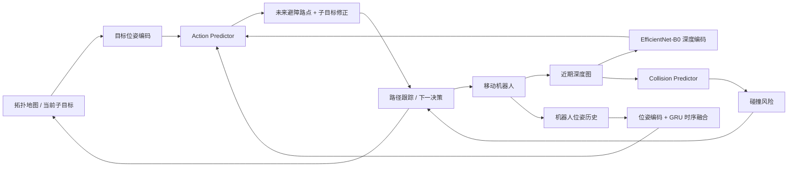
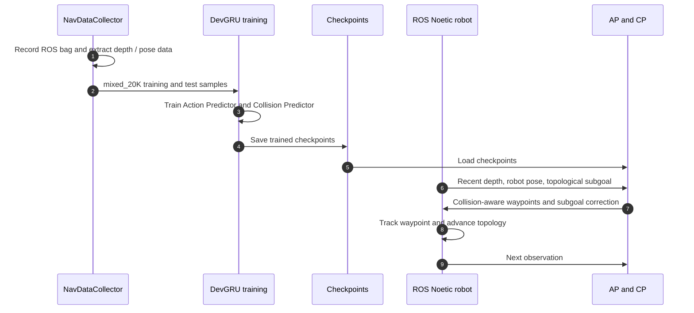

# DevGRU：深度引导的碰撞感知视觉导航

**DevGRU**（*Depth-guided Visual Navigation using a Collision-aware Recurrent Model*，[arXiv:2608.18470](https://arxiv.org/abs/2608.18470)，IEEE RA-L 2026）由梨花女子大学提出：在拓扑地图给定的点目标导航中，用深度图和循环策略预测短期避障路点，并主动修正累计漂移的后续子目标。

## 一句话定义

**DevGRU 是“深度 + 拓扑点目标 + 轻量循环策略”的长程室内导航系统：动作预测器给出碰撞安全路点与子目标位姿修正，碰撞预测器帮助系统提前识别近场风险。**

## 英文缩写速查

| 缩写 | 英文全称 | 简要说明 |
|------|----------|----------|
| DevGRU | Depth-guided Visual Navigation using a Collision-aware Recurrent Model | 结合深度、碰撞预测与 GRU 的视觉导航系统 |
| AP | Action Predictor | 预测短时路点轨迹及修正子目标位姿 |
| CP | Collision Predictor | 从深度观测预测即将发生碰撞的风险 |
| GRU | Gated Recurrent Unit | 融合近期观测、保留短期时间上下文的循环单元 |
| NC | Node Coverage | 统计拓扑导航中成功覆盖的路线节点比例 |
| SPL | Success weighted by Path Length | 衡量到达成功与路径效率的导航指标 |
| ROS | Robot Operating System | 仓库真机部署使用的机器人中间件 |

## 为什么重要

- **碰撞不只是即时避障问题：** 机器人绕开眼前障碍后，里程计偏差仍会累积；若高层继续追逐偏移的子目标，最终会偏离路线。
- **把预测与修正连进闭环：** AP 输出局部可行路点及当前子目标修正，CP 估计碰撞风险；风险升高时，修正量能影响后续拓扑子目标。
- **评价长程成功，而非只看近场安全：** 九张未见地图上的路线级 NC / SPL 能显示局部安全机制是否帮助完成全程。
- **复现入口清楚但许可受限：** 训练/部署代码、模型权重与 mixed_20K 数据均有公开入口；代码 LICENSE 限教育、研究和非营利用途。

## 核心信息

| 字段 | 内容 |
|---|---|
| 机构 | 梨花女子大学（Ewha Womans University） |
| 作者 | Kyung Min Han、Eunsom Kim、Young J. Kim（通讯作者） |
| 发表 | IEEE Robotics and Automation Letters (RA-L), 2026；DOI: 10.1109/LRA.2026.3730213 |
| 任务 | 基于拓扑地图的室内点目标导航；路线长 12.14–65.3 m |
| 传感器 | Intel RealSense D435 深度相机；SICK TiM571 用于采集和后分析，不参与在线导航 |
| 数据 | 约 10K 无碰撞样本 + 10K 碰撞样本；README 提供 mixed_20K 下载入口 |
| 模型 | EfficientNet-B0 图像特征、位姿编码器、GRU；AP 14.77M + CP 4.66M 参数 |
| 结果 | 九张拓扑图、六个未见校园地点；平均 NC 0.89、SPL 0.80 |
| 推理效率 | 19.44M 参数、50.01 ms/次；测试设备为 Ryzen 9 6900HX + RTX 3070 |
| 开源状态 | 代码、数据及预训练权重有公开链接；自定义许可仅允许教育、研究和非营利用途 |

## 核心原理（方法栈）

### 1. 拓扑子目标提供长程结构

系统沿拓扑地图给出的可见子目标逐段前进。每次决策使用近期深度图、机器人位姿和当前子目标作为条件，策略输出局部路点；长程路线由连续访问拓扑子目标组成。

### 2. Action Predictor 生成路点并校正子目标

深度和目标视觉特征由 EfficientNet-B0 编码，位姿编码器表达机器人位置及子目标相对位姿，GRU 汇总时序上下文。AP 输出一段碰撞感知的未来 waypoint trajectory，同时估计当前子目标位姿修正，避免只追踪受里程计漂移影响的目标坐标。

### 3. Collision Predictor 提供近场风险信号

CP 根据归一化深度观测预测即将碰撞的概率。完整 DevGRU 将风险判断与子目标修正结合，让避障影响后续路线，而不是避开当前障碍后仍朝错误目标前进。

## 流程总览

## 实验与评测

- **路线规模：** 六个未见校园地点上的九张拓扑地图，路径 12.14–65.3 m；每种方法各运行两轮。
- **总体指标：** 平均 NC 为 0.89，SPL 为 0.80；T-B6 场景中只有 DevGRU 完成全路线。
- **效率比较：** 同一笔记本硬件下，DevGRU 19.44M 参数、50.01 ms；NoMaD 为 19.05M、123.46 ms；ViNT 为 29.67M、176.57 ms；NavDP 为 135.72M、860.18 ms。
- **消融：** 完整 DevGRU 在两个额外地图上达到 NC 0.99、SPL 0.73；移除碰撞训练或子目标修正的变体未能同样完成路线，说明长程表现来自组件组合。

## 与其他工作对比

| 方法 | 输入与策略输出 | 风险处理 | 长程结构 |
|---|---|---|---|
| [NoMaD](./paper-notebook-nomad-goal-masked-diffusion-policies-for-navigat.md) | RGB 历史 → 扩散动作序列 | 局部策略 + 拓扑 planner | 图像节点记忆与高层规划 |
| [NavDP](./paper-notebook-navdp-learning-sim-to-real-navigation-diffusion.md) | RGB-D + 目标 → 多个候选连续轨迹 | 特权信息训练的 critic 选安全轨迹 | 可跨轮式、四足、人形复用 |
| **DevGRU** | 深度 + 位姿 + 拓扑子目标 → 避障路点与目标位姿修正 | 深度碰撞预测 + 子目标漂移修正 | 预建拓扑地图逐段导航 |

DevGRU 的重点是在拓扑导航的局部执行层同时应对障碍和目标定位漂移；它与 NavDP 的候选轨迹筛选、NoMaD 的目标条件扩散形成不同设计取舍。

## 结论

**DevGRU 的关键贡献是把局部碰撞规避与长程子目标纠偏连成闭环；较快的推理数据有硬件边界，不能脱离测试平台直接宣称嵌入式实时性。**

1. **长程避障也要处理路线状态漂移：** 单独学会绕开近处障碍，不足以防止误差累积；子目标修正必须影响后续决策。
2. **局部学习可保留拓扑高层：** 已有地图/子目标时，让策略专注短时控制与校正可缩小端到端学习范围。
3. **按硬件条件解读延迟：** 50.01 ms 是 Ryzen 9 6900HX + RTX 3070 的测量；低功耗 CPU、相机分辨率及 ROS 调度都需重新实测。
4. **开源不代表可商用：** 代码、权重、数据有公开入口，但 LICENSE 限教育、研究和非营利用途。

## 工程实践与开源状态

| 项 | 官方入口 / 注意点 |
|---|---|
| 环境 | Ubuntu 20.04、ROS Noetic、Conda；训练与部署使用独立环境 |
| 数据准备 | NavDataCollector 录制 ROS bag，离线提取数据并建立拓扑地图 |
| 训练 | `train/train_action_predictor.py` 与 `train/train_collision_predictor.py` 分别训练 AP、CP |
| 部署 | 权重放入 `deployment/model_weights`，配置 ROS master 与机器人地址，在 `deployment/src` 运行 `run_navigate_viz.py` |
| 数据及权重 | GitHub README 提供 Dropbox 下载入口 |
| 许可证 | LICENSE 仅授权教育、研究及非营利用途；商业使用需联系作者 |
| 复现边界 | README 示例以 FORMER 轮式机器人为主；代码不能直接等同于可迁移到腿式或人形机器人 |

## 源码运行时序图

## 关联页面

- [导航论文归档](../overview/paper-notebook-category-08-navigation.md) — 导航方向的论文索引
- [NoMaD](./paper-notebook-nomad-goal-masked-diffusion-policies-for-navigat.md) — RGB 视觉导航与拓扑记忆基线
- [NavDP](./paper-notebook-navdp-learning-sim-to-real-navigation-diffusion.md) — RGB-D 候选轨迹和仿真到真机导航对照
- [导航与 SLAM 自主系统栈](../overview/navigation-slam-autonomy-stack.md) — 导航模块的系统级上下游关系

## 参考来源

- [DevGRU 论文归档](../../sources/papers/devgru.md)
- [DevGRU 官方项目页](../../sources/sites/devgru.md)
- [DevGRU 官方代码仓库](../../sources/repos/devgru.md)
- 论文：<https://arxiv.org/abs/2608.18470>
