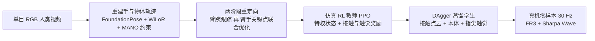
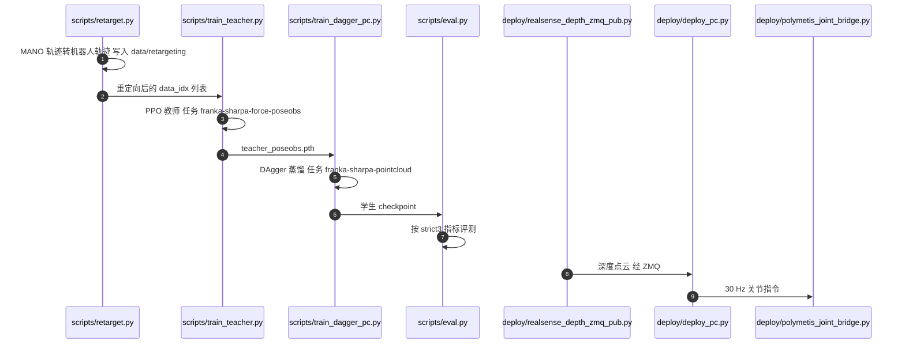

# Dex-X：从单目人类视频经仿真补全触觉，学习视触觉灵巧操作

**Dex-X**（*Dex-X: Learning Visual-Tactile Dexterous Manipulation From Human Videos with Simulated Interaction*，[arXiv:2609.07747](https://arxiv.org/abs/2609.07747)，[项目页](https://dexx-code.github.io/dexx-code/)，[代码](https://github.com/gcfy63821/dexx_lab)）由清华大学交叉信息研究院徐梦迪团队与 Sharpa Robotics 等合作完成：人类视频能告诉机器人手怎么动，却没有记录用了多大力；Dex-X 把视频只当作**运动参考**，让物理仿真里的接触动力学去**补全视频里看不见的触觉**，再把仿真教师蒸馏成能上真机的点云 + 触觉策略。

## 一句话定义

**Dex-X = 单目 RGB 人类视频 →（重建手-物轨迹）→ 仿真中 RL 教师跟踪并产生接触与触觉 → DAgger 蒸馏成只用点云、本体感知与指尖触觉的学生策略，零样本部署到 Franka FR3 + Sharpa Wave。**

## 英文缩写速查

| 缩写 | 英文全称 | 简要说明 |
|------|----------|----------|
| Dex-X | Learning Visual-Tactile Dexterous Manipulation From Human Videos with Simulated Interaction | 本文框架简称 |
| MANO | hand Model with Articulated and Non-rigid defOrmations | 参数化人手模型；本页用于人手关键点与时序一致性约束 |
| PPO | Proximal Policy Optimization | 仿真教师所用 RL 算法（非对称 actor-critic） |
| DAgger | Dataset Aggregation | 学生蒸馏所用在线模仿流程，30 轮迭代、β 逐轮衰减 |
| DoF | Degrees of Freedom | 自由度；FR3 臂 7 + Sharpa Wave 手 22 = 单臂 29 |
| DR | Domain Randomization | 教师训练对 PD 增益、质量、摩擦、动作延迟等随机化 |
| IK | Inverse Kinematics | 重定向阶段的臂关节求解与可达性检查 |

## 核心信息

| 项 | 内容 |
|----|------|
| **机构** | 清华大学交叉信息研究院（IIIS）、上海期智研究院、Sharpa Robotics、同济大学、中国人民大学（据 arXiv v3 HTML 署名；通讯作者 Mengdi Xu） |
| **arXiv** | [2609.07747](https://arxiv.org/abs/2609.07747)，v1 2026-09-07，当前 v3 2026-10-01 |
| **平台** | Franka Research 3 臂 + Sharpa Wave 手（单臂 29 DoF，双臂 58 DoF）、固定 RealSense 深度相机、指尖触觉传感器；Isaac Lab 训练，30 Hz 部署 |
| **发表** | CoRL 2026（项目页标注 Accepted） |
| **开源** | **已开源（教程版）**：[gcfy63821/dexx_lab](https://github.com/gcfy63821/dexx_lab)；完整训练数据集未见（见复现边界） |

## 为什么重要

- **补的是“视频缺力”这一环。** 文章转述：视频记录手怎么动，不记录用了多大力，而拧瓶盖、插接头这类任务的成败取决于接触之后的几毫米运动。互联网上体量最大的人类视频恰好没有触觉，Dex-X 回答“没有触觉的视频还能不能教出触觉策略”。
- **用仿真当“触觉补全引擎”。** 视频里不可见的手-物交互力学，由碰撞体与接触动力学在仿真里生成并作为监督；这比从像素里“猜”力更可控，也让教师能拿特权状态训练。
- **数据来源最便宜。** 不需要机器人在场，也不需要触觉手套；对照 [UVTA](./paper-uvta-human-tactile-dexterous-manipulation.md)（arXiv 2609.34182，用触觉动捕手套真采人类触觉演示），Dex-X 的触觉是仿真自洽的接触力，而不是测量值。
- **在 Sharpa 叙事里的位置。** 文章把 Dex-X 同时放进“主线一：击穿具身鸿沟”和“主线二：运动 / 交互解耦”，并称之为**点云接口**：上层用重建的运动参考，底层靠触觉点云处理接触。

## 流程总览

## 核心机制

### 1）视频重建与空间增强（论文自报）

30 Hz 单目视频中，物体位姿用 FoundationPose，手位姿用 WiLoR 并以 MANO 时序一致性与手-物穿模约束细化，输出腕轨迹、MANO 关键点与物体位姿轨迹。空间增强为共享的平面平移（±5 cm）与 yaw 扰动（±10°），一段视频由此扩成多个变体。

### 2）两阶段重定向

先做仅臂腕的跟踪，再做臂-手关键点联合优化，拇指、食指与远端关键点权重更大；平均末端误差超过 8 cm 的增强变体被剔除。这一步决定了教师能“跟”什么，也是后文局限里“部署策略仍依赖重定向动作参考”的来源。

### 3）仿真 RL 教师（特权状态）

| 项 | 设置（论文自报） |
|----|------------------|
| 算法 | PPO，非对称 actor-critic；Isaac Lab，4096 并行环境，30 Hz |
| 观测 | actor 557 维；critic 705 维（含 148 维特权） |
| 动作 | 29 维：7 个臂关节增量（α = 0.2 rad）+ 22 个手关节位置目标 |
| 奖励 | 腕 / 手 / 物体跟踪；接触塑形（指尖力、接近、不滑移）；动作正则；终端成功 |
| 域随机化 | 手臂 PD 增益、物体质量与质心、摩擦、动作延迟 0 到 3 步、物体位姿噪声 / 偏置 / 延迟 / 丢帧 |

### 4）触觉表示

- **仿真：** 每个指尖一个标量接触力幅值（取最近两次采样平均）；15 维接触位置通道保留但默认置零；噪声含乘性力噪声、每指 5% 丢失、逐元素保持上一值概率 0.005。
- **真机：** 论文只写“指尖触觉传感器”，未给型号与分辨率；学生使用同样的标量力幅值。
- **学生输入的“接触点云”：** 把指尖触觉点嵌进场景几何，与视觉、力、本体感知一起处理（文章转述的框架图说明）。

### 5）DAgger 蒸馏出可部署学生

学生输入为 417 维向量观测 + 64 维 PointNet 特征（1024 个场景点 + 6 个手关键点 + 25 个触觉点），共 481 维；DAgger 30 轮、每轮 4096 步、β 每轮乘 0.85、每轮 8 个 epoch。仓库里用 `--student_drop_slots` 去掉机器人无法提供的观测（物体形状码、演示指尖距离、物体位姿），所以部署不需要物体位姿。

## 源码运行时序图

图下说明：复现主路径是“retarget → 教师 → 学生蒸馏 → eval”，README 称随库提供教师与学生 checkpoint（本次未核对文件内容）；真机部署需三台机器（NUC 跑 Polymetis、相机主机发布 D455 深度、推理 PC 连 Sharpa Wave）。

## 工程实践

| 项 | 建议 |
|----|------|
| 环境 | README 固定 Isaac Sim 4.5、Isaac Lab v2.2.1、Python 3.10（torch 2.7, cu128）；先跑 `tutorial/00_setup/check_install.py` 与 `check_imports.py` |
| 数据寻址 | 序列用 `rt/<task>/<seq>` 标识；增强变体用 `@<aug>` 后缀；样例位于 `data/robotool_batch/` |
| 教师 | `python scripts/train_teacher.py --task franka-sharpa-force-poseobs ...`；README 示例 `--num_envs 2048` |
| 学生 | `python scripts/train_dagger_pc.py --task franka-sharpa-pointcloud --teacher_ckpt ...`；`--camera_extrinsic` 必须与部署所用外参文件一致 |
| 评测 | 默认完整协议 8000 个 episode；README 建议汇报 strict3 指标（物体最终位置距演示终点 3 cm 内且无漂移） |
| 真机 | Polymetis 为参考后端，ROS2 后端标注实验性；上线前读 `docs/DEPLOY.md` 与关节顺序文档 |
| 小坑 | README 安装命令克隆的仓库名为 `dex_learning_kit`，与实际仓库名 `dexx_lab` 不一致，克隆时以实际 URL 为准 |

## 实验与评测

以下数字除特别注明外均为**论文自报**（arXiv v3），仿真数字为教师策略。

### 仿真教师 vs 基线（成功率 %）

| 类别 | Dex-X | DAPG | ManipTrans | 运动学重定向 |
|------|-------|------|------------|--------------|
| Pick Up | 89.6 | 66.7 | 1.5 | 1.8 |
| Peg Insertion（< 1 cm） | 43.1 | 52.8 | — | 0.0 |
| Tool Use | 74.3 | 70.1 | 35.0 | 24.1 |
| In-hand Rotation | 36.8 | 0.7 | 56.9 | 0.0 |
| In-hand Translation | 64.8 | 12.5 | 11.5 | 0.0 |
| Bimanual Handover | 86.6 | — | 4.7 | — |
| **平均** | **65.9** | 40.6（仅五类单手；同五类 Dex-X 为 61.7） | 21.9 | 5.2 |

读法：插销与手内旋转上 Dex-X 并非最高（DAPG 插销 52.8，ManipTrans 旋转 56.9）；论文把优势归因于模仿类方法在长交互中容易丢失稳定接触。

### 表示消融（仿真）与真机模态消融

- **场景与触觉表示（仿真）：** 点云 + 触觉 44%（严格）/ 58%（放宽）；深度观测 32%（严格）；点云去触觉后放宽指标由 58% 降到 45%；标量力、二值接触、3D 力三种触觉编码表现相近，部署选标量力。
- **真机方块拾取（每格 30 次）：** 完整视触觉 28/30（93.3%）；去视觉 14/30；去触觉 11/30；仅本体 8/30。文章转述的“真机方块抓取 93%”即此项。

### 真机部署与未见物体

| 任务 | 成功次数 / 30 |
|------|----------------|
| 方块拾取（cube picking） | 28 |
| 倒杯（cup pouring） | 24 |
| 举杯（cup lifting） | 22 |
| squeegee 操作（摘要称“桌面清洁”） | 16（53.3%） |

未见物体（方块拾取，零样本）：薄方块 23/30，方形方块 8/30，大鸭 8/30，小鸭 7/30。仿真到真机的腕轨迹平均跟踪误差 2.83 cm，真机整体比仿真高约 5.7 mm（论文附录自报）。

## 与其他工作对比

| 工作 | 人类数据形态 | 触觉从哪来 | 运动与交互的接口 |
|------|--------------|------------|------------------|
| **Dex-X** | 单目 RGB 视频 | 仿真接触补全（标量指尖力） | 点云：视频重建作参考，仿真 RL 教师 + 点云学生 |
| [UVTA](./paper-uvta-human-tactile-dexterous-manipulation.md)（arXiv 2609.34182） | 触觉动捕手套真采示范 + 少量机器人遥操作 | 真实指尖 FSR | 联合训练扩散策略并预测未来触觉 |
| [Do as I Do](./paper-do-as-i-do.md) | 日常人类单目视频（UC Berkeley） | 未涉及（据其页摘要） | 重建 4D 手-物交互后做采样式优化重定向；文章归为同一“自上而下”路线 |
| [GALATEA](./paper-galatea.md) | 扩散模型生成的视频 | 文章未提触觉，用接触与抬升奖励 | 跟踪式 RL 把视频计划落成仿真控制器，再蒸馏单一控制器（文章转述） |
| [TacBPM](./paper-tacbpm.md) | 无，仿真专家 | 真实触觉作条件 | 隐空间：冻结先验 + 残差隐动作 |
| [T-Rex](./paper-trex-tactile-reactive-dexterous-manipulation.md) | 机器人侧 100 小时触觉同步遥操作（文章转述） | 真实触觉 | 变频率专家：约 20 Hz 触觉专家实时修正（文章转述） |

- 与 [Teacher-Student / DAgger](../methods/teacher-student-dagger-training.md) 的关系：本文教师吃特权状态与参考，学生去掉不可部署观测，是标准特权蒸馏在“视频参考 + 触觉点云”上的实例，见 [特权训练](../concepts/privileged-training.md)。
- 与 [运动重定向](../concepts/motion-retargeting.md) 的关系：重定向精度直接决定教师能跟踪什么，这是 Dex-X 的上游误差来源。

## 结论

**Dex-X 把人类视频降级为“运动参考”，把接触交给仿真 RL，再蒸馏成点云 + 触觉学生；在方块拾取上触觉与视觉缺一不可，但泛化与长程任务仍明显受限。**

1. **管线读法** — 视频负责“动哪里”，仿真负责“怎么接触”，学生负责“只用真机能拿到的观测”；三段各有独立的误差来源（重建、重定向、仿真保真）。
2. **触觉有真实贡献** — 自报：真机方块拾取去触觉后 28/30 降到 11/30，仿真放宽指标 58% 降到 45%。
3. **触觉表示不必复杂** — 仿真消融里标量力、二值接触与 3D 力相近，低成本指尖力传感即可对齐这条管线；但这只是单指尖幅值，不含剪切与滑移。
4. **泛化要保守读** — 未见物体里只有薄方块 76.7%，其余三件仅 23% 到 27%；“零样本泛化”不等于对任意几何都成立。
5. **任务难度有梯度** — 方块 28/30、squeegee 16/30，后者最大掉点在抓取获取阶段；长程与工具类任务仍是短板。
6. **选型边界** — 手内旋转上 ManipTrans 更高（56.9% 对 36.8%）；需要手内旋转时不要默认 Dex-X 更优。
7. **复现起点** — 先用教程版的 4 条样例示范与随库 checkpoint 跑通评测，再考虑自备视频与真机三机部署。

## 常见误区与局限

- **误区一：“视频里的触觉被恢复了。”** 实际是仿真里自洽的接触力，不是对视频中真实受力的测量；论文只在附录比较了仿真与真机指尖力的接触时序与分配，并指出真机读数更噪。
- **误区二：“完全不需要机器人侧工作。”** 仍需要重定向、相机标定、动力学系统辨识与部署调参；论文自陈部署策略依赖重定向得到的动作参考。
- **作者自陈局限：** 长程交互与广泛泛化仍难；对感知误差、控制器失配与大的几何 / 类别变化敏感；触觉仅是每指尖力幅值，不含压力分布、剪切、滑移与接触面。
- **未核实：** 真机指尖触觉传感器型号与规格，论文与项目页均未给出；本页不做推断。

## 复现边界

| 项 | 状态（2026-10-16 核查项目页与 GitHub README） |
|----|----------------------------------------------|
| 项目页 | [dexx-code.github.io/dexx-code](https://dexx-code.github.io/dexx-code/)，列 arXiv 与 GitHub 链接，无“coming soon” |
| 代码 | **已开源**：[gcfy63821/dexx_lab](https://github.com/gcfy63821/dexx_lab)，覆盖 retarget、教师、DAgger 学生、评测、真机部署；代码 MIT，随附 FR3 / Sharpa Wave 资产为 Apache-2.0；README 自称教程版 |
| 权重 | `checkpoints/` 目录列有 `teacher_poseobs.pth`、`teacher_poseobs_T0.pth`、`student_lean_v6_L1.pth`；本次未核对文件大小与内容 |
| 数据 | 仅 4 条样例示范；项目页未列数据集 / Hugging Face；论文所用完整视频与重定向数据未见发布 |
| 真机 | 需 Franka FR3 + Sharpa Wave + RealSense D455 与三机布局；ROS2 后端为实验性 |

## 关联页面

- [Sharpa Robotics（夏帕机器人）](./sharpa-robotics.md) — 本文所属的公司学术线与 System 0/1/2 叙事
- [TacBPM](./paper-tacbpm.md) — 同一叙事里的“隐空间接口”，对照点云接口
- [GALATEA](./paper-galatea.md) — 同属“视频 → 仿真 RL → 蒸馏”，但视频来自生成模型
- [UVTA](./paper-uvta-human-tactile-dexterous-manipulation.md) — 同属主线一：用真实人类触觉示范而非仿真补全
- [Do as I Do](./paper-do-as-i-do.md) — 同样从单目人类视频出发的自上而下重定向路线
- [Tacmap](./paper-tacmap.md) — Sharpa 线上把仿真与真实触觉统一到同一几何表示的工作，对照本文标量力的仿真触觉
- [T-Rex](./paper-trex-tactile-reactive-dexterous-manipulation.md) — Sharpa Wave 上的触觉真机数据路线
- [Manipulation](../tasks/manipulation.md) / [Bimanual Manipulation](../tasks/bimanual-manipulation.md) — 任务背景（含双手交接与开盖）
- [DAgger](../methods/dagger.md) / [Teacher-Student 与 DAgger 训练](../methods/teacher-student-dagger-training.md) / [PPO](../methods/ppo.md) — 教师与学生训练配方
- [In-hand Reorientation](../methods/in-hand-reorientation.md) — 手内旋转 / 平移类别的方法谱系
- [视触觉融合](../concepts/visuo-tactile-fusion.md) / [触觉感知](../concepts/tactile-sensing.md) / [Contact-Rich Manipulation](../concepts/contact-rich-manipulation.md) — 触觉与接触背景
- [Sim2Real](../concepts/sim2real.md) / [特权训练](../concepts/privileged-training.md) / [运动重定向](../concepts/motion-retargeting.md) — 迁移与重定向背景
- [Franka Research 3](./franka-research-3.md) / [Isaac Lab](./isaac-lab.md) — 硬件与仿真平台

## 参考来源

- [dex-x_arxiv_2609_07747.md](../../sources/papers/dex-x_arxiv_2609_07747.md) — arXiv 摘要、项目页、v3 全文与 GitHub README 摘录
- [wechat_sharpa_dexterous_manipulation_2026-10-16.md](../../sources/blogs/wechat_sharpa_dexterous_manipulation_2026-10-16.md) — 机器之心文章来源页
- [arXiv:2609.07747](https://arxiv.org/abs/2609.07747)

## 推荐继续阅读

- [arXiv PDF](https://arxiv.org/pdf/2609.07747) 与 [v3 HTML 全文](https://arxiv.org/html/2609.07747v3)
- [项目页](https://dexx-code.github.io/dexx-code/)
- [官方代码仓库](https://github.com/gcfy63821/dexx_lab) 的 `docs/EVAL.md`、`docs/DEPLOY.md`
