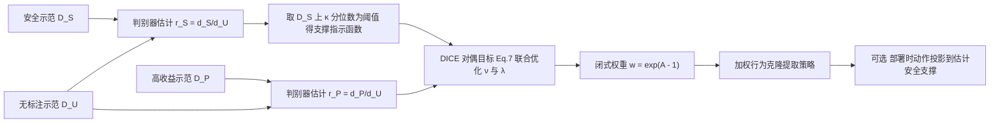

# DexDICE：双专家离线模仿学习（arXiv:2611.09433）

**DexDICE**（*Reconciling Safety and Performance via Dual-Expert Offline Imitation Learning*，[arXiv:2611.09433](https://arxiv.org/abs/2611.09433)，NeurIPS 2026，KIST / KAIST / 现代汽车 / 延世大学 / KIAS）是一篇离线模仿学习论文，不是专门的灵巧手工作，名字里的 Dex 是 Dual-expert 的缩写。

## 一句话定义

**把示范拆成「安全但可能次优」和「高收益但可能不安全」两份，用前者估计允许的状态-动作支撑集，在这个支撑集内用 DICE 式分布校正去逼近后者，全程不需要奖励和代价标注。**

## 英文缩写速查

| 缩写 | 英文全称 | 简要说明 |
|------|----------|----------|
| IL | Imitation Learning | 模仿学习 |
| DICE | stationary DIstribution Correction Estimation | 平稳分布校正估计，在状态-动作分布上做凸优化的离线方法族 |
| DexDICE | Dual-expert offline IL via DICE | 本文方法 |
| D_S / D_P / D_U | Safe / Performant / Unlabeled demonstrations | 安全示范、高收益示范、无标注示范（含前两者） |
| BC | Behavioral Cloning | 行为克隆 |
| CMDP | Constrained Markov Decision Process | 带代价约束的马尔可夫决策过程 |
| DSRL | Datasets for Safe RL | 离线安全强化学习基准（论文重新整理标签后使用） |
| FNR | False-Negative Rate | 假阴性率，此处指安全样本被误拒的比例 κ |
| ICL | Inverse Constraint Learning | 从示范反推约束 |
| PU | Positive-Unlabeled | 正例加无标注样本学习 |

## 为什么重要

- 作者指出两种现有路线各有难处：显式代价函数很难设计（第 1 节，作者自述）；要求示范同时安全又高收益则采集成本高。双专家设定只要求分别采集两类示范。
- 对机器人而言，「保守遥操作」和「激进遥操作」都容易采，这个设定贴近实际（作者举自动驾驶、机器人、医疗为例，第 1 节）。
- 与本库 [安全强化学习](../methods/safe-rl.md) 中显式代价约束的路线形成对照：这里把安全信息放在示范的支撑集里，而不是代价函数里。

## 核心原理

### 问题形式（第 3.3 节）

目标：min D(d^π ‖ d_P)，约束 supp(d^π) ⊆ supp(d_S)，称为安全支撑约束。论文要求存在策略的支撑集落在 supp(d_S) ∩ supp(d_P) 内；作者说这比「示范同时安全又高收益」弱。

### 方法栈（第 4 节、附录 F）

- **支撑约束替代散度正则：** 传统 DICE（如 DemoDICE）用 KL(d‖d_S) 把策略拉向安全示范，会连带继承其次优；DexDICE 只限制「能去哪」，不限制「去多频繁」（第 4.1 节，作者自述，表格玩具实验见附录 C，本页未复核）。
- **支撑估计：** 训练 D_S 对 D_U 的判别器；不直接反推类先验 η，而是利用排序一致性，取 D_S 上 r_S 的 κ 分位数当阈值（第 4.2 节，Eq. 8–9）。
- **策略提取：** 连续空间无法直接从 d* 得到策略，沿用 DemoDICE 的加权 BC（附录 F.3）。

### 理论保证（第 4.3 节）

定理 3：在判别器误差、i.i.d. 校准、安全裕度等假设下，若 κ > κ0 + O(|D_S|^{-1/2})，**理想的支撑约束策略** π_κ 以不低于 1−δ 的概率有 d^{π_κ}(N)=0。附录 E 还假设示范出现过的支撑集本身对环境是安全的（pointwise soundness）；这条假设不满足时保证只说明「与示范支撑一致」。

## 实验结果

| 实验 | 设置 | 结果（论文数字） |
|------|------|------------------|
| 仿真基准（第 5.1 节 Table 1） | 重整的 DSRL 38 任务，N_DS=N_DP=10 条轨迹，5 种子，κ=0.01 固定 | 31/38 任务满足代价约束；19 个任务为安全方法中回报最高；Safety Gymnasium 21 任务中 17 个安全、9 个最优 |
| 数据效率与质量（第 5.2 节 Figure 2） | 6 个 Safety Gymnasium 任务，扫数据量与示范质量 | 作者称保持安全且回报最高；N_DS=2 与 quality(D_P)≤5% 时失效 |
| 真机导航（第 5.3 节 Figure 3） | SUMMIT-XL-Steel + 2D LiDAR，114 条遥操作轨迹，10 次试验 | DexDICE 10/10 成功、违规率 0.00%、16.9 ± 0.5 s；DemoDICE-U 8/10、0.69%；BC-Safe 8/10、36.0 s、3.81% |
| 部署时投影（附录 G.11） | 6 任务，N_DS=N_DP=10 | 支撑失配比例 14.88% → 0.88%，回报 0.650 → 0.623 |

## 工程实践

- **数据：** 需要三份数据（D_S、D_P、D_U）；仿真里 D_U 取整个离线数据集，真机里是 114 条遥操作轨迹（第 5.3 节）。
- **关键超参：** κ 是唯一的安全旋钮。仿真固定 0.01（第 5.1 节），真机用 0.2、初始 λ0=5（附录 H.3），两者不同，说明换平台需要重新选 κ（推测：论文未讨论如何自动选）。
- **真机栈：** 状态 7 维加 10 条最近 LiDAR 束的稀疏编码，动作是机体系三维速度指令，10 Hz，动作分块用于平滑控制；上机前在按遥操作日志标定的 2D 仿真器里验证（附录 H.2–H.4）。违规定义为最近障碍距离小于 0.65 m（附录 H.1）。
- **代码：** [tzs930/dexdice](https://github.com/tzs930/dexdice) README 列出 `dsrl_code/`（PyTorch）与 `real_code_data_demo/`（JAX，含遥操作示范数据）；本页只读了 README，未运行。

## 局限

**论文自己承认的：**

- 需要可行性条件：安全与高收益示范要有非平凡重叠，且安全支撑可分（结论节）。
- 精确保证只针对理想策略；加权 BC 得到的高斯策略有全支撑，投影只能减小失配不能消除（第 4.3 节、附录 G.11）。定理条件是总体层面的，靠经验诊断监控而非可证（结论节）。
- 结果依赖构造数据集所用的回报与代价阈值（附录 G.10）。
- 只处理单一安全约束，多约束与多目标留作未来工作。

**我看到的未验证之处（本页判断）：**

- 真机只有一个场景、一个操作者、每方法 10 次试验（第 5.3 节），0.00% 违规率的统计置信度有限。
- 真机违规的定义是与障碍的距离，只是一种安全含义；论文未在机械臂或灵巧操作上验证（推测：从摘要和实验看，没有操作任务）。
- 真机 κ=0.2 是否经调参、如何选取，正文未说明。
- 附录 G.3 中 DexDICE 的「最佳 κ」是事后按评测结果挑的，作者已标明为探索性比较。
- 基线都是作者按「相同信息量」改造的（如用伪标签喂给 CDT、TraC、FISOR-IL，第 5 节），并非各方法的原设定。
- 证明部分我没有复算。

## 关联页面

- [模仿学习](../methods/imitation-learning.md)
- [行为克隆](../methods/behavior-cloning.md)
- [安全强化学习](../methods/safe-rl.md)
- [安全过滤器](../concepts/safety-filter.md)
- [奖励设计](../concepts/reward-design.md)
- [Learned Safe Sets](../entities/paper-learned-safe-sets.md)

## 参考来源

- [dexdice_arxiv_2611_09433.md](../../sources/papers/dexdice_arxiv_2611_09433.md)
- [arXiv:2611.09433](https://arxiv.org/abs/2611.09433)
- [官方代码仓库](https://github.com/tzs930/dexdice)

## 推荐继续阅读

- [arXiv PDF](https://arxiv.org/pdf/2611.09433v1)
- [模仿学习](../methods/imitation-learning.md)
- [安全强化学习](../methods/safe-rl.md)
