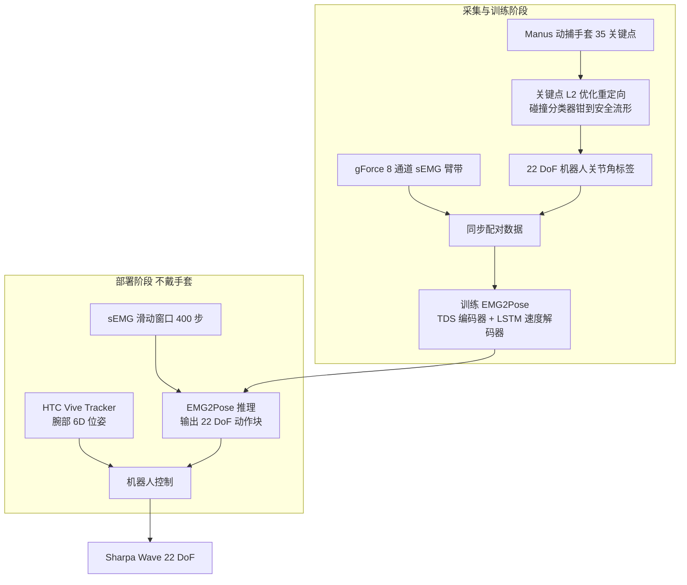

# DexEMG：用前臂肌电驱动灵巧手的轻量遥操作

**DexEMG**（*DexEMG: Towards Dexterous Teleoperation System via EMG2Pose Generalization*，[arXiv:2603.05861](https://arxiv.org/abs/2603.05861)）由 **Sharpa** 与 **上海交通大学（SJTU）** 的作者提出（作者：Qianyou Zhao、Wenqiao Li、Chiyu Wang、Kaifeng Zhang；机构取自论文 PDF 首页）。它针对灵巧手遥操作的老矛盾——视觉动捕贵且怕遮挡、机械外骨骼笨重——给出第三条路：用戴在前臂的 **表面肌电（sEMG）** 直接读出手指运动意图。

## 一句话定义

**DexEMG = 8 通道 sEMG 臂带 + 腕部追踪器：EMG2Pose 网络从肌肉活动连续回归 22 DoF 手部关节角并实时驱动 Sharpa Wave，部署时既不戴手套也不依赖相机。**

## 英文缩写速查

| 缩写 | 英文全称 | 简要说明 |
|------|----------|----------|
| sEMG | surface Electromyography | 表面肌电；贴在前臂皮肤上测肌肉电活动，本文唯一的手指运动输入 |
| EMG2Pose | EMG to Pose（论文用名，沿用既有 EMG2Pose 架构） | 从肌电连续回归手部关节运动学的神经网络，本文感知引擎 |
| TDS | Time-Depth Separable (convolution) | EMG2Pose 编码器中的时间–深度可分离卷积阶段，共两个 |
| LSTM | Long Short-Term Memory | 解码器用 LSTM + MLP 预测关节速度，再积分成绝对姿态 |
| MoCap | Motion Capture | 采集期用 Manus 动捕手套提供手姿真值，部署期摘掉 |
| DoF | Degree of Freedom | Sharpa Wave 为 22 DoF，模型输出 22 维动作块 |
| MAE | Mean Absolute Error | 关节角平均绝对误差，单位 rad，评价姿态回归精度 |
| SR / DR | Success Rate / Drop Rate | 抓取并放到目标位置的比例 / 抓住后又掉落的比例 |

## 为什么重要

- **便携与精度的取舍。** 论文开篇把现有方案归为两类：外骨骼保真但笨重、机械结构刚性，且「同构设计」使机器人手一改外骨骼就得重做；视觉动捕不接触但贵，依赖多相机和受控环境。sEMG 是穿戴式、低成本、无需外部基础设施的第三种输入。
- **抗光学遮挡。** 视觉方案在手指被手掌或物体遮挡时失效；sEMG 读的是肌肉信号，论文称不受光学遮挡影响，可在杂乱、狭小空间里使用；这里的抗遮挡指手指姿态估计，腕部 6D 位姿仍靠 Vive Tracker 与基站。
- **采集门槛下沉。** 微信文章把 DexEMG 放在「主线一：击穿具身鸿沟」，称它「进一步降低采集门槛」，与 UVTA、Dex-X 一起让人类数据成为动作燃料（文章转述）。论文自己的定位是「面向可扩展灵巧数据采集的实用平台」，但**并未用这些数据训练下游自主策略**。
- **读法（本页推断，论文未写）：** 标签在 Sharpa Wave 的 22 维关节空间里生成，因此模型是针对该手训练的；换手需重新重定向标签并重训，与外骨骼换手要重做硬件相比，代价从硬件移到了数据与训练。

## 核心信息

| 项 | 内容 |
|----|------|
| **机构** | Sharpa（夏帕机器人）、上海交通大学（SJTU） |
| **arXiv** | [2603.05861](https://arxiv.org/abs/2603.05861)，v1 2026-03-06（截至 2026-10-16 仅 v1） |
| **输入硬件** | gForce 8 通道 sEMG 臂带；训练期 Manus 动捕手套（35 个关键点）；部署期 HTC Vive Tracker 腕部 6D 位姿 |
| **执行端** | Sharpa Wave 灵巧手，22 DoF；推理在本地工作站 |
| **模型** | EMG2Pose：Conv1d + TDS 编码器 + LSTM/MLP 速度解码器，输出 `(22, T*)` 动作块 |
| **项目页 / 代码** | 均未找到（见复现边界） |

## 流程总览

## 核心机制

### 1）标签生成：关键点重定向 + 碰撞钳制

采集时操作员同时戴 sEMG 臂带和动捕手套，做多样的抓取与手内操作。人手关键点（如指尖、掌心）被映射到机器人手，求解 `q* = argmin Σ ‖p_h − p_r(q)‖²`，强调与任务相关的关键点以保住指尖位置精度；再用一个在机器人构型空间预训练的 **碰撞分类器** 检测自碰撞，若检出就把姿态钳到安全流形，得到与 sEMG 同步且物理可执行的 22 DoF 关节角标签。

### 2）EMG2Pose：预测关节速度而非绝对角

- 输入 `(B, 8, T)`；两个 Conv1d 块后接两个 TDS 阶段（2D 卷积、LayerNorm、前馈层、LayerNorm），特征 `(B, 32, T*/4)` 重采样回 `T*`。
- 解码器用 LSTM + MLP 估计关节速度 `θ̇`，绝对姿态迭代重建 `θ_t = θ_{t−1} + θ̇_t`，`θ_0` 为预设休息姿态。
- 论文称这种速度中心的做法把肌肉激活强度与静态姿态解耦，能缓解持续抓握中的信号漂移，并降低对传感器位移与会话间噪声的敏感度。

### 3）部署：滑动窗口 + 动作块

部署时在 sEMG 滑动窗口上在线推理，得到关节角动作块，只执行每块的前几帧再推进窗口，以获得平滑连续的姿态估计；窗口取 400 步，论文称更长的时间上下文滤噪更稳、但时延更高，此设定偏向桌面操作的可靠性。腕部位移由 HTC Vive Tracker 提供。

### 4）一处表述需对读

摘要与结论说预测姿态再经「重定向算法」映射到灵巧手；方法节则写标签已在重定向后的机器人关节空间中生成、模型直接回归 22 维关节角。本页按方法节理解，两处措辞的出入论文未进一步解释。

## 实验与评测

以下数字均为 **论文自报**（PDF v1）。

### 姿态回归精度

验证集 MAE：抓取任务 **0.09 rad**，手内旋转任务 **0.15 rad**；论文称旋转任务关节耦合强、切换快，误差只小幅上升，快速转换段有轻微偏差。

### 泛化（Table I）

每个条件在每个物体类别上做 20 次试验；SR 为成功抓取并放到目标位置，DR 为抓取成功后掉落的比例。

| 场景 | Tiny | Cylinder | Sphere | Irregular | Deformable | 总体 SR / DR |
|------|------|----------|--------|-----------|------------|--------------|
| 训练物体 | 80.0% | 90.0% | 85.0% | 50.0% | 75.0% | **76.0% / 14.5%** |
| 未见物体 | 70.0% | 75.0% | 75.0% | 40.0% | 70.0% | **66.0% / 18.2%** |
| 新场景（随机摆放 + 杂乱遮挡） | 45.0% | 70.0% | 80.0% | 25.0% | 60.0% | **56.0% / 28.6%** |

论文把新场景的下降主要归因于臂级规划难度（杂乱桌面、随机摆放使接近阶段更不确定），而非 EMG2Pose 本身失效，依据是对称的 Sphere 在新场景仍有 80.0%。这是作者的解释，论文未做对照实验。

### 长程任务（Table II，各 20 次）

| 任务 | 抓取 | 执行 | 一次性成功 | 允许重试成功 |
|------|------|------|-----------|--------------|
| Packaging（桌面打包） | 17/20 | 13/20 | 12/20（60%） | 16/20（80%） |
| Wiping（擦桌） | 15/20 | 11/20 | 8/20（40%） | 14/20（70%） |

擦拭的执行成功率较低，论文归因于持续扫擦需要稳定接触力，EMG 预测姿态的细微漂移就会让抹布打滑。

### 文章转述

微信文章对 DexEMG 只有定性转述（降低采集门槛、不依赖相机、遮挡下仍可遥操作），**没有给出数字**。

## 与其他工作对比

- **外骨骼 / 数据手套：** 论文相关工作称机械外骨骼保真但笨重、易疲劳，传感手套携带方便但有漂移且需频繁重标定；DexEMG 的低负担是相对优势，代价是目前对新用户仍要标定（见局限）。库内对照见 [数据手套 vs 视觉遥操作](../comparisons/data-gloves-vs-vision-teleop.md)。
- **视觉动捕：** 光学动捕精度高但成本与基础设施重，消费级深度 / 骨架方案有自遮挡。论文并未在同一任务上与视觉或手套方案做并列数字比较，因此「更鲁棒」是机制层论证，不是实测结论。
- **[TeleDexter](./paper-teledexter.md)：** 同样用 Sharpa Wave 做灵巧遥操作，但解决的是另一层问题——TeleDexter 用光学 MoCap 的指尖与物体目标，由仿真 RL 低层控制器负责接触执行；DexEMG 解决的是「人手姿态如何便携地读出来」的输入接口。两者任务集与指标不同，数字不可直接比较，且 DexEMG 缺少接触执行层。
- **[Dex-X](./paper-dex-x.md) / [UVTA](./paper-uvta-human-tactile-dexterous-manipulation.md)：** 文章同属「主线一」。Dex-X 从单目视频补全接触，UVTA 把人类触觉数据与遥操作联合训练；DexEMG 只负责降低采集接口门槛，本身不含触觉。

## 结论

**DexEMG 证明肌电可以在 22 DoF 灵巧手上作为便携、抗遮挡的遥操作输入，但它给出的是「采集接口」而非「接触能力」：一次性成功率约 40–60%，需要重试、个人标定和人在回路兜底。**

1. **价值在输入端** — 摘掉手套和相机后仍能连续回归 22 维关节角，对杂乱、遮挡场景有机制优势；这是降采集门槛的接口创新，不是接触控制创新。
2. **速度回归 + 碰撞钳制是稳定性来源** — 预测关节速度并积分、标签经碰撞分类器钳到安全流形，让输出物理可执行；复现时这两点比网络大小更关键。
3. **泛化数字要分层读** — 训练物体 76.0%、未见物体 66.0%、新场景 56.0%（自报）；新场景下降被作者归因于臂规划而非肌电解码，但未做对照，读作假设。
4. **长程任务靠可重试** — Packaging 一次性 60%、重试后 80%；Wiping 40% 与 70%；做数据采集时这意味着需要流程上允许重抓，不能假设一次成。
5. **主要缺口** — 新用户仍需个人标定（摘要说无需「密集」的个人重标定，局限节说新用户仍需标定，需对读）、无力反馈、精度不足以支撑极致触觉任务；后续要靠跨用户基础模型与触觉反馈补。
6. **选型读法** — 要便携、抗遮挡、可接受重试的灵巧数据采集可参考此路线；要接触丰富的高精度操作，需叠加低层接触控制（如 TeleDexter 一类）或触觉反馈。

## 局限与风险

- **个人标定：** 论文自述新用户目前仍需个人标定；摘要则称「无需密集的个人重标定」，两者口径不同。
- **无力反馈：** 对易碎物体不友好；论文把触觉反馈集成列为后续工作。
- **精度上限：** sEMG 信噪比不足以支撑极致触觉精度，高精度任务仍需人在回路；Irregular 类物体最差（训练物体 50.0%、新场景 25.0%）。
- **证据口径窄：** 评测是单一桌面抓取放置与两个长程任务，每格 20 次试验；未披露训练数据时长、受试者人数，也没有与手套 / 视觉遥操作并列对比。
- **二手转述的数字口径：** Sharpa 研究博客把 MAE 0.09 rad 写成灵巧手本身的精度；论文原文该数字是 EMG2Pose 在抓取任务上的关节角误差，引用时以论文为准。

## 复现边界

| 项 | 结论 |
|----|------|
| 项目页 | **未找到**（arXiv 摘要页、论文 PDF 均未列） |
| 代码 / 权重 / 数据 | **未找到**；论文未承诺发布，正文也未披露采集规模；Sharpa 官方 GitHub 组织无 DexEMG / EMG 相关仓库（2026-10-16 查） |
| 源码运行时序图 | **不适用**（无官方可运行代码） |
| 自建所需 | gForce 类 8 通道 sEMG 臂带、Manus 手套（仅训练期）、HTC Vive Tracker、Sharpa Wave 手，以及自采的同步 sEMG–手姿数据 |
| 可参考的既有架构 | 论文引用的 emg2pose 基准架构（NeurIPS 2024）；本页未核对其代码许可 |

## 关联页面

- [夏帕机器人（Sharpa Robotics）](../entities/sharpa-robotics.md) — 公司页与「数据—接触—跨本体」叙事
- [Teleoperation（遥操作）](../tasks/teleoperation.md) — 遥操作任务页与系统对照
- [数据手套 vs 视觉遥操作](../comparisons/data-gloves-vs-vision-teleop.md) — 输入模态选型对照
- [Motion Retargeting Pipeline](../concepts/motion-retargeting-pipeline.md) — 人手到机器人手的重定向背景
- [Data Flywheel](../concepts/data-flywheel.md) / [灵巧操作数据采集指南](../queries/dexterous-data-collection-guide.md) — 采数通道选型
- [TeleDexter](./paper-teledexter.md) — 同一手上的 MoCap co-tracking 遥操作
- [Dex-X](./paper-dex-x.md)、[UVTA](./paper-uvta-human-tactile-dexterous-manipulation.md) — 文章「主线一」的另两项工作

## 参考来源

- [dexemg_arxiv_2603_05861.md](../../sources/papers/dexemg_arxiv_2603_05861.md) — 原始摘录与开源核查
- [机器之心 / Sharpa 微信文章归档](../../sources/blogs/wechat_sharpa_dexterous_manipulation_2026-10-16.md) — 文中 DexEMG 段落转述
- [arXiv:2603.05861](https://arxiv.org/abs/2603.05861)

## 推荐继续阅读

- [arXiv PDF](https://arxiv.org/pdf/2603.05861)
- [Sharpa 研究博客解读页](https://www.sharpa.com/blogs/research/breaking-the-barriers-of-teleoperation-how-dexemg-and-sharpa-wave-are-revolutionizing-dexterous-manipulation)（厂商二手解读，数字以论文为准）
