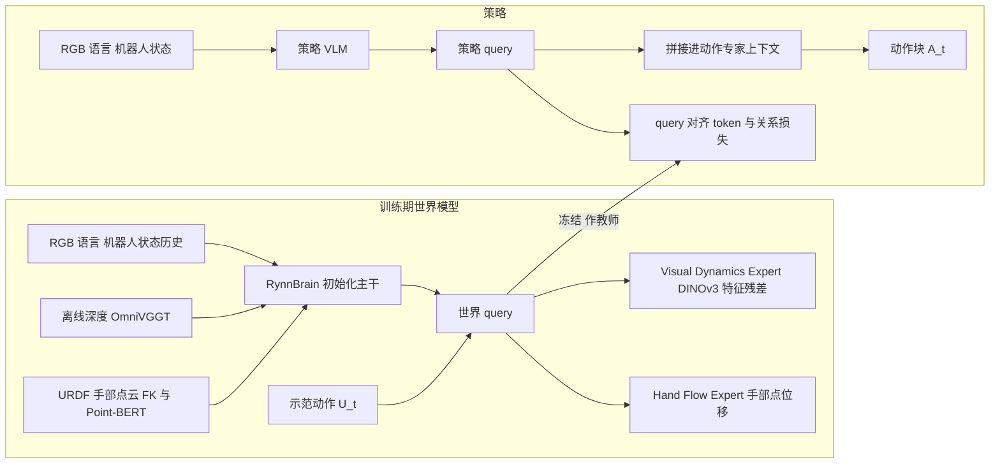

# DexForesight（arXiv:2611.11166）

**DexForesight**（*DexForesight: Grounding Dexterous Policies with Implicit Spatial Foresight*，[arXiv:2611.11166](https://arxiv.org/abs/2611.11166)，Sharpa Robotics / 上海交通大学等，2026-11-08 提交 v1）。项目页 <https://dexforesight.github.io/>（静态抓取只得到脚本骨架，内容未核实）。论文与项目页均未给出代码仓库，因此本页不填 `code:`。

## 一句话定义

**训练时先学一个「动作条件的空间世界模型」（预测手部 3D 点位移与视觉特征变化），再冻结它并把其 query 特征对齐到灵巧策略的隐空间；部署时世界模型、深度与未来解码全部移除，策略只吃 RGB、语言与机器人状态。**

## 英文缩写速查

| 缩写 | 英文全称 | 简要说明 |
|------|----------|----------|
| WAM | World Action Model | 把未来预测与动作生成耦合的模型（论文第 1 节） |
| VLA | Vision-Language-Action | 视觉-语言-动作策略；本文基座 GR00T N1.7 与 QwenVLA |
| VLM | Vision-Language Model | 策略主干的视觉语言模型 |
| URDF | Unified Robot Description Format | 机器人描述文件，用来在连杆上采样手部点（第 3.1 节） |
| FK | Forward Kinematics | 正运动学，由关节状态得到手部点位置，不依赖相机可见性 |
| DexJoCo | Dexterous manipulation on MuJoCo | 论文使用的 MuJoCo 灵巧操作仿真基准（参考文献 [10]） |
| SR | Success Rate | 成功率 |
| CI | Confidence Interval | 表 3 中的 95% episode bootstrap 置信区间 |
| WLA | World-Language-Action model | 真机对照之一，在 QwenVLA 上加 Wan 世界专家（第 4.1 节） |

## 为什么重要

- 灵巧手操作要预判多指相对物体的运动，且部分手指常被遮挡；仅识别当前场景不够（第 1 节，作者自述）。
- 显式未来生成的 WAM 在部署时每个控制步都要多算一遍；本文把预测知识留在训练期，部署只比基座多 3.0 ms（第 4.2 节，真机同硬件同推理设置）。
- 对读者而言，它给出一个「世界模型当老师、策略做学生」的具体配方，并且用消融回答了「直接加预测头」与「表征对齐」谁更有效（表 4，仅仿真）。

## 核心原理与流程总览

要点（均出自第 3 节）：

1. **手部几何：** 在手的 URDF 连杆上采样固定点，经 FK 变换到基座系，每点保留连杆归属与局部坐标，因此对被遮挡手指也有目标；Point-BERT 编码当前点云与短历史。
2. **深度融合：** 真机深度由 StereoAnyVideo 离线估计，仿真深度直接由 MuJoCo 渲染；深度只条件化当前场景几何，不需要未来深度目标。
3. **动作条件 query：** N 个可学习世界 query 读主干第 12/20/28 层；K=4 个未来槽位，在 16 帧窗口内每 4 帧一档取一个偏移；示范动作经 query adapter 条件化，并做 future-horizon dropout。
4. **预测目标：** 手部点位移 F = P(t+δ) - P(t)，视觉残差 ΔV = Φ(I(t+δ)) - Φ(I(t))，Φ 为冻结 DINOv3 池化特征；世界模型损失含 hand、visual、context 三项（式 4）。
5. **三阶段训练：** 预热、动力学预训练（均无深度）、深度注入（100 小时子集）。
6. **策略对齐：** 世界模型冻结，策略 query 用 token 余弦损失加关系（pairwise 相似度矩阵）损失对齐教师，并拼接进动作专家上下文（式 5）；策略看不到 U_t，所以对齐只是辅助目标，不是对教师预测的精确重构（作者原话含义）。

## 工程实践

- **数据：** 真机约 370 小时、60 任务、五类（空间摆放、装配接触、旋转关节、可变形物体、工具使用）；深度只在其中 100 小时、前三类上估计（第 3.1 节、图 3）。
- **平台：** 真机为 Sharpa North 机器人配 22 自由度 Sharpa Wave 手；仿真为 Franka Panda 配 16 自由度 Allegro 手（图 4 图注）。
- **基座：** 仿真在 GR00T N1.7 上增强；真机在经 370 小时语料预训练的 QwenVLA 上实现（第 4.1 节）。两者是不同基座，不能把仿真和真机的绝对数字混着比。
- **评测规模：** 仿真 11 个 DexJoCo 任务、每任务 100 次；真机 3 个任务（Close Box、Insert Battery、Screw On Lid）、每任务 20 次、held-out 物体位置，各方法微调 30 个 epoch（第 4.1 节）。
- **部署：** 保留 query reader 与上下文投影，上下文每个观测只算一次并在动作采样中复用（第 3.2 节）。
- **复现：** 无公开代码，世界模型的核心超参在「Appendix ??」，v1 PDF 未附，**未核实**。

## 关键结果（作者报告）

| 设置 | 结果 | 出处 |
|------|------|------|
| 仿真总成功率 | DexForesight 60.5%；GR00T N1.7 49.4%；Fast-WAM 50.9%；Cosmos3 49.5%；π0.5 35.1% | 表 1 |
| 仿真分组 | 单臂 76.3%，双臂 41.6%；双臂只比 Fast-WAM 的 39.8% 高 1.8 点 | 表 1 |
| 真机总成功率 | DexForesight 58.3%（Screw 50 / Close 45 / Insert 80）；WLA 50.0%；GR00T N1.7 48.3%；Cosmos3 30.0%；QwenVLA 30.0%；Fast-WAM 10.0% | 表 2 |
| 推理耗时 | QwenVLA 227.4 ms，DexForesight 230.4 ms；Cosmos3 生成 16 帧视频 930 ms | 第 4.2 节 |
| 冻结 latent 线性探针（0.13/0.27/0.54 s） | DexForesight 3.92/6.33/10.01 mm；QwenVLA action-only 4.12/7.70/13.59 mm | 表 3 |
| 直接加预测头（仿真总） | DINO 残差头 45.5%；手部流头 53.1%；两头合用 49.5%；深度加 AttnRes 47.4% | 表 4 |
| 教师目标消融（仿真总） | 动作前 query 52.7%；打乱动作条件 41.5%；未来动作目标 48.4% | 表 4 |
| 世界模型消融 | 无离线深度 49.7%（真机 43.3%）；context 深度 token 42.0% | 表 4、第 4.4 节 |

## 与文章说法的核对

文章（公众号《机器人动作块太长，什么时候该重新规划？》2026-11-11 的 53 篇速览，第 41 条）原文：「先学习手部三维运动与视觉变化预测，再将空间前瞻表征对齐到策略。训练用深度和运动学，执行只需图像与状态；真机验证规模有限，跨任务泛化仍需继续检验。」逐条核对：

| 文章说法 | 论文是否支持 | 说明 |
|----------|--------------|------|
| 先学手部 3D 运动与视觉变化预测 | 支持 | Hand Flow Expert 与 Visual Dynamics Expert（第 3.1 节）。「视觉变化」具体是 DINOv3 特征残差，不是像素级未来图像 |
| 再将空间前瞻表征对齐到策略 | 支持 | 冻结世界模型后做 query 对齐（第 3.2 节、式 5） |
| 训练用深度和运动学 | 支持，但有限定 | 深度只用于 100 小时子集的最终阶段；运动学指 URDF 手部点云加 FK；还用到示范动作作为教师条件（文章未提，对结果影响大：打乱动作条件掉到 41.5%，表 4） |
| 执行只需图像与状态 | 基本支持 | 论文写的是 RGB、语言、机器人状态（摘要、第 3.2 节），文章省略了语言；多视角 RGB |
| 真机验证规模有限 | 与论文一致（属文章判断） | 论文无局限性小节；事实是 3 个任务、每任务 20 次、一个机器人平台（第 4.1 节） |
| 跨任务泛化仍需继续检验 | 论文未自述，属合理判断 | 真机只测 held-out 物体位置（Screw 另变杯子颜色），未测新任务或新物体类别；370 小时 60 任务只用于预训练，评测只在其中 3 个任务上微调 |

文章没有给出具体数字，因此无数字对不上之处；摘要中的「60.5% / 58.3%」与表 1、表 2 一致，两者的基座和平台不同。

## 局限

**论文自己承认的：**

- 论文没有单独的局限小节。第 4.2 节明说 WLA、Fast-WAM 是「外部对照」，架构与训练差异使其不能视为单变量因果对照。
- 深度仅有 100 小时子集，且只覆盖三类任务（第 3.1 节）；可变形物体与工具使用类别没有深度阶段，也没有真机评测。
- 作者对 context 深度 token 表现差给出的是「假设」（拼接会扰动预训练多模态特征，第 4.4 节），未做进一步验证。

**我看到的未验证之处（作者之外的判断）：**

- 真机每任务仅 20 次，表 2 没有置信区间；DexForesight 与 WLA 在 Screw（50 对 50）持平、Insert 差 10 点（相当于 2 次试验），总体 8.3 点差距的统计可靠性未知（推测：噪声可能不小）。
- 仿真与真机用了不同基座（GR00T N1.7 对 QwenVLA）。真机上基座 GR00T N1.7（48.3%）比 QwenVLA（30.0%）高，但 DexForesight 的真机版本建立在 QwenVLA 上，所以「+28.3 点」是对自身基座的增益，对强基座的增益未知。
- 仿真基座 GR00T N1.7 的对照中，Fast-WAM / Cosmos3 与 DexForesight 的预训练、数据规模是否对齐，论文未写清（推测：未必对齐）。
- 表 4 的消融全在仿真，仅「无离线深度」一项给了真机数字；其余真机消融缺失。
- 双臂任务提升很小（41.6% 对 Fast-WAM 39.8%），收益主要来自单臂。
- 附录与图（Appendix ??、Figure ??）在 v1 中缺失，真机失败案例的可视化无法核对。
- 无代码、无公开模型，独立复现目前不可行。

## 与其他工作对比

| 工作 | 关注点 | 与 DexForesight 的区别 |
|------|--------|------------------------|
| [Fast-WAM](./paper-fast-wam.md) | 训练期视频共训、推理期跳过未来视频去噪 | 同样把未来预测留在训练期，但预测目标是视频；DexForesight 预测手部 3D 点位移与 DINOv3 特征残差，再做 query 对齐。仿真 60.5% 对 50.9%，真机 58.3% 对 10.0%（表 1、表 2，外部对照非单变量） |
| [Cosmos 3](./cosmos-3.md) | 全模态世界模型，可显式生成未来视频 | 部署时生成 16 帧视频需 930 ms；DexForesight 部署只比基座多 3.0 ms（第 4.2 节） |
| [ACG-WAM](./paper-acg-wam-geometric-latent-prediction.md) | 冻结 VGGT 提供多时域几何目标，监督共享表征 | 同属「几何教师 + 部署剥离」思路；DexForesight 额外用 URDF + FK 手部点云覆盖被遮挡手指，面向灵巧手 |
| [GR00T N1.7](./paper-gr00t-n1-7.md) | 本文仿真基座 VLA | 不带空间前瞻对齐；仿真 49.4%，加 DexForesight 后 60.5%（表 1） |

## 结论

**DexForesight 表明，把动作条件空间世界模型当作训练期教师、通过 query 对齐把前瞻知识蒸进灵巧策略，比直接给策略加预测头更有效，且几乎不增加部署开销。**

1. 仿真 11 个 DexJoCo 任务总成功率 49.4% → 60.5%，真机 3 任务 58.3%，均高于所列对照（表 1、表 2）。
2. 直接加预测头只有 45.5%–53.1%，打乱教师的动作条件掉到 41.5%，说明动作条件与对齐方式是关键（表 4）。
3. 部署只吃 RGB、语言与状态，推理 230.4 ms 对基座 227.4 ms（第 4.2 节）。
4. 局限：真机仅 3 任务 × 20 次且无置信区间，仿真与真机基座不同，双臂增益很小，附录缺失、无代码。

## 关联页面

- [World Action Models](../concepts/world-action-models.md)：本文要对照的「显式未来生成」路线
- [VLA（Vision-Language-Action）](../methods/vla.md)
- [接触丰富操作](../concepts/contact-rich-manipulation.md)：Insert Battery、Screw On Lid 一类任务
- [灵巧手运动学](../concepts/dexterous-kinematics.md)：URDF 点与 FK 的背景
- [模仿学习](../methods/imitation-learning.md)：策略保留行为克隆目标
- [ACG-WAM（几何潜变量预测）](paper-acg-wam-geometric-latent-prediction.md)：同属训练期预测、几何相关的 WAM 工作
- [动作条件潜在前瞻](paper-action-conditioned-latent-foresight.md)：相近主题的另一篇
- [Cosmos 3](cosmos-3.md)：本文的对照基线之一

## 参考来源

- [dexforesight_arxiv_2611_11166.md](../../sources/papers/dexforesight_arxiv_2611_11166.md)（本页「通读」依据）
- [arXiv:2611.11166v1 PDF](https://arxiv.org/pdf/2611.11166v1)
- [项目页](https://dexforesight.github.io/)（静态抓取，内容未核实）

## 继续阅读

- [World Action Models](../concepts/world-action-models.md)
- [arXiv 摘要页](https://arxiv.org/abs/2611.11166)
- 论文参考文献中的 Fast-WAM（arXiv:2603.16666）、WLA（arXiv:2606.05979）、DexJoCo（arXiv:2605.16257）、Spatial Forcing（ICLR 2026）
