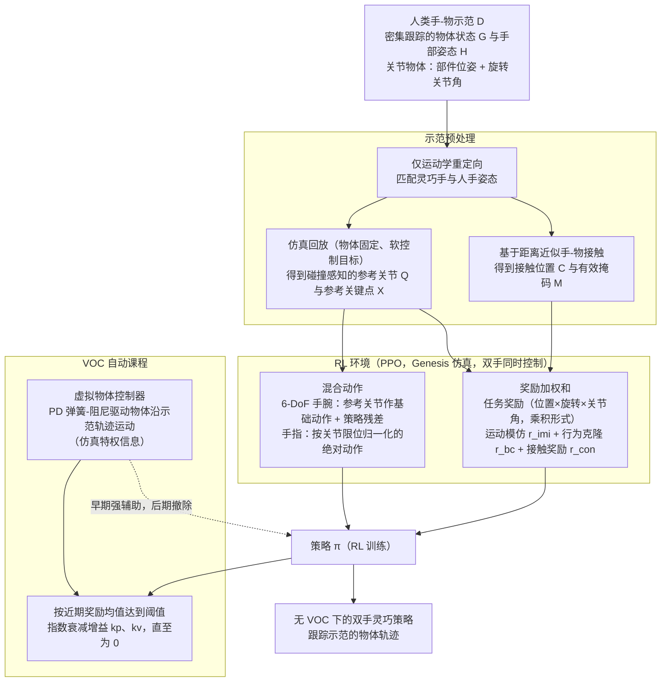

# DexMachina（arXiv:2505.24853）

**DexMachina**（Mandi Zhao, Yifan Hou, Dieter Fox, Yashraj Narang, Ajay Mandlekar, Shuran Song；Stanford University; NVIDIA；[arXiv:2505.24853](https://arxiv.org/abs/2505.24853)，[项目页](https://project-dexmachina.github.io/)）— 从人类手–物示范学习机器人双手灵巧策略：虚拟物体控制器（VOC）课程 + 多奖励 RL，在仿真 benchmark 上做功能重定向。

## 一句话定义

从人类手–物示范学习机器人双手灵巧策略：虚拟物体控制器（VOC）课程 + 多奖励 RL，在仿真 benchmark 上做功能重定向。

## 英文缩写速查

| 缩写 | 英文全称 | 简要说明 |
|------|----------|----------|
| VOC | Virtual Object Controller | 强度衰减的物体辅助控制 |
| RL | Reinforcement Learning | 策略学习范式 |
| DM | DexMachina | 本文算法与 benchmark 名 |
| IK | Inverse Kinematics | 对比的功能重定向基线 |

## 为什么重要

双手灵巧操作动作空间大、时空不连续、人机手形态差大，直接模仿易失败。

## 流程总览

图依据：论文 §4.1–4.3 / Fig. 2 / Algorithm 1

## 核心原理（方法）

从示范提取任务/运动/接触奖励；VOC 先驱动物体到目标再让策略接管；多灵巧手多任务 benchmark。

## 实验与评测

仿真多任务显著优于 IK/位置引导等基线；支持跨硬件功能比较。

## 结论

DexMachina 把 VOC 课程做成可复现的灵巧功能重定向平台，但真机过渡仍是开放问题。

- VOC 降低早期探索难度
- benchmark 覆盖多灵巧手与关节物体
- 可比较硬件设计的功能差异
- CHORD 等后续工作将其作位置引导基线
- 真机 VOC 平滑过渡鲁棒性未充分验证

## 源码运行时序图

**不适用**（截至 2026-08-18：无统一公开可运行代码仓库，或本文为综述/控制器论文以项目页演示为主）。

## 局限与风险

主要在仿真验证；接触奖励设计敏感；与 interaction mesh 方法（REGRIND）路线不同。

## 与其他工作对比

相对 CHORD 的 wrench 空间奖励，DexMachina 偏位置+VOC；相对 REGRIND，缺交互 mesh 语义。

## 关联页面

- [paper-chord-contact-wrench-dexterous-manipulation](./paper-chord-contact-wrench-dexterous-manipulation.md)
- [DemoMimic](./paper-demomimic.md) — 项目页将 DexMachina* 作 sim 高、真机低的对照基线（接触中心 AR/SCR）
- [regrind-retargeting-guided-rl](../methods/regrind-retargeting-guided-rl.md)
- [bimanual-manipulation](../tasks/bimanual-manipulation.md)
- [REALab 14 篇技术地图](../overview/realab-14-papers-technology-map-2026.md)

## 参考来源

- [dexmachina_arxiv_2505_24853.md](../../sources/papers/dexmachina_arxiv_2505_24853.md)
- [wechat_shenlan_realab_14_papers_2026.md](../../sources/blogs/wechat_shenlan_realab_14_papers_2026.md)
- [arXiv PDF](https://arxiv.org/pdf/2505.24853)：已通读方法部分（实验与附录以略读为准）：§1 引言、§3 功能重定向问题定义、§4 方法（§4.1 RL 环境与任务奖励、§4.2 动作与辅助奖励、§4.3 虚拟物体控制器自动课程）；§5 实验仅略读，附录未读

## 推荐继续阅读

- 论文：<https://arxiv.org/abs/2505.24853>
- 项目页：<https://project-dexmachina.github.io/>
