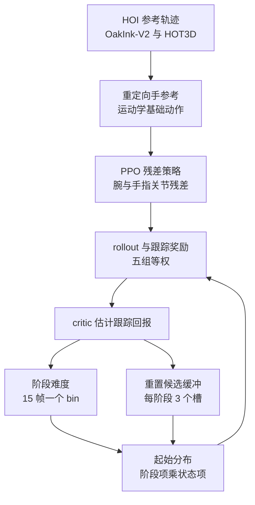

# DexMimic：用价值引导的重置分配训练通用手-物体跟踪策略

**DexMimic 把灵巧手-物体交互跟踪从「每条轨迹训一个专家」改成「跨大量轨迹联合训练一个通用策略」，并用 critic 的价值估计在线决定把 rollout 起点放在哪个阶段、哪个状态，使训练预算花在难阶段上。**

论文 *DexMimic: A Generalist Dexterous Hand-Object Tracking Policy via Value-Guided Reset Allocation*（[arXiv:2610.19089](https://arxiv.org/abs/2610.19089)，[项目页](https://zhexiluo.github.io/DexMimic/)）。

## 英文缩写速查

| 缩写 | 英文全称 | 简要说明 |
|------|----------|----------|
| HOI | Hand-Object Interaction | 人类手-物体交互数据（OakInk-V2、HOT3D） |
| RSI | Reference State Initialization | 从参考轨迹状态重置的常用基线，论文消融中成功率 66.51% |
| PPO | Proximal Policy Optimization | 论文使用的 RL 算法，actor 与 critic 共享 MLP 主干 |
| FastFail | 快速失败比例 | 重置消融表中的指标，数值定义以论文为准（未核实） |

## 为什么重要

- 逐轨迹专家难以复用；联合训练的瓶颈是「收集有用的交互经验」，而不是网络容量（项目页措辞）。
- 重置分配只改初始化分布，不改奖励与网络，可叠加到其他跟踪式 RL 流程上（推测）。
- 零样本到未见物体与轨迹的成功率随训练轨迹数上升，给出了数据规模曲线。

## 核心信息

| 项 | 内容 |
|----|------|
| **机构** | 新加坡国立大学（NUS）、RoboScience |
| **数据** | OakInk-V2 与 HOT3D：1,944 任务、140 物体（1,302 单手 + 642 双手轨迹） |
| **平台** | 仿真 MANO / Wuji / Inspire / Shadow / Allegro 手；真机 7-DoF xArm + 20-DoF Wuji 右手 + RealSense D435i |
| **开源** | **未列开源链接**（2026-10-17 核查）：项目页与论文均无代码、数据、权重链接，也无 "coming soon" 标注 |

## 核心原理

### 流程总览

PPO 训练残差策略跟踪重定向后的手-物参考；critic 估计的跟踪回报用于给阶段难度打分，并为每个阶段维护若干重置候选，按分数比例采样起始状态。

- 观测含手与物体状态历史（偏移 0,-1,-2,-4,-8）、未来参考（0,1,2,4,8）与 128 维物体几何编码。
- 阶段难度向前传播 5 个 bin、衰减 0.8，EMA 平滑；0.1 概率回到固定参考锚点；候选存活比例须大于 0.1 才入缓冲。

## 源码运行时序图

**不适用**：项目页与论文均未提供官方代码（2026-10-17 核查），无可对齐的仓库入口。

## 工程实践

| 项 | 建议 |
|----|------|
| 源码运行时序图 | **不适用**（无官方代码） |
| 复现判断 | 超参数在论文中较完整（见上），但无代码，需自建 HOI 重定向与仿真 |
| 关键超参 | bin 15 帧、传播 5、衰减 0.8、候选槽 3、锚点概率 0.1、存活阈值 0.1、分数衰减 1e-5 |
| 真机管线 | 开环回放仿真成功 rollout；物体位姿 FoundationPose++，逆运动学 PyRoki |
| 换手 | 同策略框架在 Wuji、Inspire、Shadow、Allegro 上 1,000 次 rollout 成功数分别为 872/861/832/759（20 任务） |

## 实验与评测

- **对基线（50 条双手轨迹）：** DexMimic 88.40%、0.12 h/轨迹；ManipTrans 56.64%、1.86 h；SPIDER 39.68%、0.78 h。
- **零样本规模曲线（20 到 500 条）：** L1 8.00% 到 68.50%，L2 10.63% 到 55.89%，L3 2.00% 到 51.65%。
- **微调：** 20 条未见轨迹上达 80% 训练成功率，比从头训练快 5.3 倍（0.24 h 对 1.27 h）。
- **重置消融（500 条）：** Uniform 82.59% / 18.60 min；DexMimic 84.73% / 5.76 min；最差轨迹成功数 0/50 到 38/50。
- **失败分析：** OakInk 子集 826/1,017 成功，主要失败为物体跟踪。

## 结论

**DexMimic 的增益主要来自训练分布的调度而非新网络；但真机部分仅为开环回放，不能当作闭环通用控制的证据。**

1. **重置分配省时间** — 相对 Uniform 重置训练时间降 69.0%，成功率略升 82.59% 到 84.73%。
2. **覆盖最差轨迹** — 最差轨迹成功数 0/50 到 38/50，说明收益在难样本上。
3. **数据规模有效** — 训练轨迹 20 到 500 条，零样本成功率全面上升，但 L3 仍只有约 51.65%。
4. **看对比口径** — 对 ManipTrans 与 SPIDER 的时间比较为每轨迹训练时间，DexMimic 的联合训练时间按 50 条平均。
5. **真机谨慎解读** — 论文未报告真机量化指标。

## 与其他工作对比

| 对照 | 差异读法 |
|------|----------|
| [SPIDER](../methods/spider-physics-informed-dexterous-retargeting.md) | 论文基线 SPIDER（是否即该页方法为推测，未核实）；成功率 39.68% |
| [运动重定向](../concepts/motion-retargeting.md) | DexMimic 以重定向结果为基础动作，在其上学残差 |

## 局限与风险

- 受 HOI 数据规模限制（论文自述）；对含噪重建的手-物交互鲁棒性留作后续。
- 真机仅开环回放，无成功率；机器人与手型号来自论文 HTML，项目页未命名。
- 无代码，难以验证表中数字；FastFail 等指标定义未核实。
- 物体跟踪是主要失败模式。

## 关联页面

- [PPO](../methods/ppo.md) — 训练算法
- [SPIDER 物理信息灵巧重定向](../methods/spider-physics-informed-dexterous-retargeting.md) — 对比基线
- [运动重定向](../concepts/motion-retargeting.md) — 参考轨迹来源
- [双手操作](../tasks/bimanual-manipulation.md) — 基准任务类别
- [Wuji Robotics](wuji-robotics.md) — 真机使用的 Wuji 灵巧手厂商页

## 参考来源

- [dexmimic_arxiv_2610_19089.md](../../sources/papers/dexmimic_arxiv_2610_19089.md) — 论文摘录与开源核查
- [dexmimic-project.md](../../sources/sites/dexmimic-project.md) — 项目页归档
- [arXiv:2610.19089](https://arxiv.org/abs/2610.19089) — 原文

## 推荐继续阅读

- [DexMimic 项目页](https://zhexiluo.github.io/DexMimic/)
- [论文 HTML v2](https://arxiv.org/html/2610.19089v2)
