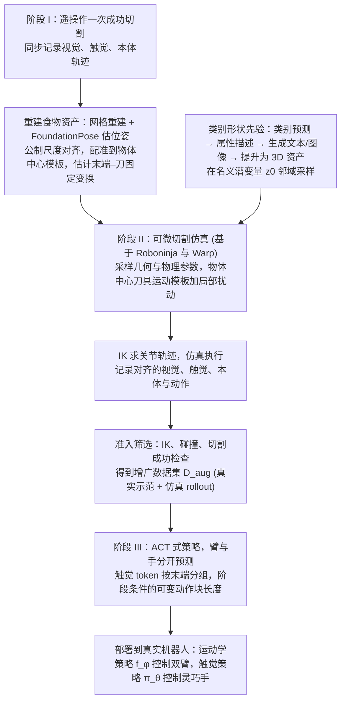

# DexNinja：真实到仿真再到真实的灵巧切割

**DexNinja 用少量真实切割示范构建仿真数据引擎，再把仿真中学到的切割策略部署回真实机器人，缓解切割这类拓扑变化任务的数据稀缺问题。**

## 英文缩写速查

| 缩写 | English | 简要说明 |
|------|---------|----------|
| Real2Sim2Real | Real-to-Sim-to-Real | 真实采集、仿真扩增、真实部署的闭环数据流程 |
| — | Topology-changing interaction | 拓扑变化类交互，如切割后物体分开 |
| — | Elasto-plastic | 弹塑性，兼有弹性形变与永久形变的材料行为 |

## 为什么重要

摘要指出，切割中每次尝试都会污染或损坏食物，真实数据昂贵；而切割涉及的接触、摩擦与材料响应，使仿真–真实差距尤其明显。

## 流程总览

图依据：论文 §3 问题设定与 §4（Stage I–III）、§5 形状流形数据增广 / Fig. 3、Fig. 4。

## 核心信息

| 项目 | 内容 |
|------|------|
| arXiv | [2610.17208](https://arxiv.org/abs/2610.17208) |
| 作者 | Haozhe Lou, Runyi Yang, Wanqi Zhong, Caiyun Liu, Yicheng Liu, Wenhao Liu, Wenlong Ma, Jiawei Xia（arXiv 作者列表） |
| 机构 | 未核实（公众号标注"待核实"） |
| 开源状态 | **未核查代码**（摘要页未列代码链接） |

## 核心原理

1. **重建：** 从少量真实示范重建物体形态与材料参数（摘要称重建物体，细节以原文为准）。
2. **仿真扩增：** 生成稠密、贴近真实的训练分布。
3. **部署回真实：** 策略回到真实机器人上执行，结果再用于修正数据流程。

## 工程实践

- 未发现官方代码入口；源码运行时序图：**不适用**。

## 评测与结果

摘要在灵巧切食物任务上报告三点：

1. **少量真实 + 仿真扩增：** 数十条真实示范加数百条仿真增强数据，成功率可超过 60%。
2. **增强数据的增益：** 与只用真实数据相比，加入增强数据后成功率提升超过 20%（摘要措辞，未说明是百分点还是相对提升）。
3. **分布外泛化：** 策略可迁移到形状与尺寸不同的分布外物体。

- 仿真器为自研可微仿真，同时耦合机器人动力学、触觉接触与可变形切割。
- 摘要未给出各食材、各物体尺寸的逐项结果。

## 与其他工作对比

| 路线 | 数据来源 | 与 DexNinja 的差异 |
|------|----------|--------------------|
| 只用真实示范训练（论文对照） | 少量真实切割 | 每次尝试都会消耗食材；加入仿真增强后成功率提升 20% 以上 |
| 纯仿真训练 + [域随机化](../concepts/domain-randomization.md) | 全部来自仿真 | 随机化范围不受真实实例约束；DexNinja 从真实采集重建实例，并按类别约束随机化物理参数 |
| 通用 [可微仿真](../concepts/differentiable-simulation.md) 的系统辨识 | 用梯度拟合参数 | DexNinja 的可微仿真用于生成增强数据，而不只是辨识参数 |

第一行来自摘要中的对照；后两行为路线层面的定性比较，无共享评测口径。

## 结论

**一句话总判：对拓扑变化的接触任务，real2sim2real 的价值在于用少量真实数据撬动大量仿真样本，但仿真的材料模型必须可信。**

1. **真实数据用于校准而非训练全部** — 少量示范驱动仿真分布。
2. **仿真材料模型是瓶颈** — 切割对弹塑性响应敏感（摘要明确指出）。
3. **真机结果是最终判据** — 摘要报告的成功率超过 60%，但仅为单一切割任务。

## 局限与风险

- 食物的几何与材料随品种变化，重建误差会影响策略迁移（推测）。
- 仅切割任务，对其他可变形物体的适用性未知。

## 关联页面

- [Sim2Real](../concepts/sim2real.md)
- [接触丰富操作](../concepts/contact-rich-manipulation.md)
- [可微仿真](../concepts/differentiable-simulation.md)

## 参考来源

- [论文归档](../../sources/papers/dexninja_arxiv_2610_17208.md)
- [公众号综述摘录（33 篇 Manipulation）](../../sources/raw/wechat_senlanke_manipulation_33_papers_2026-10-12_16.md)
- [arXiv PDF](https://arxiv.org/pdf/2610.17208)：已通读方法部分（实验与附录以略读为准）：§3 问题设定、§4 DexNinja 流程（Stage I–III）、§5 形状流形数据增广；§6 实验设定略读

## 推荐继续阅读

- [arXiv:2610.17208](https://arxiv.org/abs/2610.17208)
