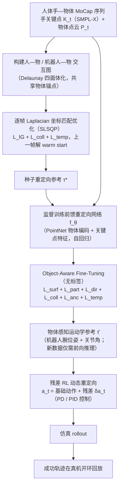

# DexOAK（arXiv:2610.26762）

**DexOAK**（*DexOAK: Object-Aware Kinematic Retargeting*，[arXiv:2610.26762](https://arxiv.org/abs/2610.26762)，[项目页](https://fspinola.github.io/dexoak/)）来自 [具身智能小站 2026-10-31 盘点](../../sources/blogs/wechat_embodied_station_50_papers_scenerig_photo_to_sim_2026-10-31.md)，属「数据采集与示范迁移」组。

## 一句话定义

**DexOAK用手—物交互图保留相对几何，再学习可快速推理的重定向网络；结合动力学修正提升双手操作，并完成真机开环回放，不能只看手姿态相似。**

## 英文缩写速查

| 缩写 | 英文全称 | 简要说明 |
|------|----------|----------|
| DexOAK | DexOAK: Object-Aware Kinematic Retargeting | 本文方法 / 基准的简称 |

## 为什么重要

- 重定向人手动作时，把物体一起考虑。
- 开源结论：**项目页未列 GitHub**（步骤 2.5，2026-10-31）。项目页 HTTP 200，未见 GitHub 链接或 coming soon 字样。
- 同期同组工作见 [单图重建仿真、VLA 适配评测与跨形态世界模型：具身智能小站 10-31 期 50 篇阅读坐标](../overview/embodied-station-2026-10-31-50-papers-technology-map.md)。

## 流程总览

图依据：论文 §III（Fig.2、§III-A/B）、§IV 物理动态重定向、Fig.1。

## 核心机制

| 项 | 内容 |
|----|------|
| **arXiv** | [2610.26762](https://arxiv.org/abs/2610.26762) |
| **开源** | **项目页未列 GitHub** |
| **要点** | DexOAK用手—物交互图保留相对几何，再学习可快速推理的重定向网络；结合动力学修正提升双手操作，并完成真机开环回放，不能只看手姿态相似。 |
| **文内指标** | 公众号未给具体数字，本页不引用。 |

## 源码运行时序图

**不适用（项目页未列 GitHub）** — 项目页 HTTP 200，未见 GitHub 链接或 coming soon 字样。 不编造运行脚本；代码公开后再补。

## 实验与评测

- 公众号未给具体数字，本页不引用。
- **读法：** 本页为索引级摘要，依据公众号转述的官方摘要与仓库信息整理；逐项数字与 baseline 以原文 PDF 为准。

## 与其他工作对比

- 横向索引见 [单图重建仿真、VLA 适配评测与跨形态世界模型：具身智能小站 10-31 期 50 篇阅读坐标](../overview/embodied-station-2026-10-31-50-papers-technology-map.md)；同 arXiv 不重复造页。

## 结论

**重定向人手动作时，把物体一起考虑：DexOAK用手—物交互图保留相对几何，再学习可快速推理的重定向网络；结合动力学修正提升双手操作，并完成真机开环回放，不能只看手姿态相似。**

1. 开源边界：**项目页未列 GitHub** — 项目页 HTTP 200，未见 GitHub 链接或 coming soon 字样。
2. 核心机制：DexOAK用手—物交互图保留相对几何，再学习可快速推理的重定向网络；结合动力学修正提升双手操作，并完成真机开环回放，不能只看手姿态相似。
3. 复现与选型前核对任务协议、硬件与基准口径，勿直接横比公众号摘录数字。

## 关联页面

- [embodied-data-collection-four-layers-taxonomy](../concepts/embodied-data-collection-four-layers-taxonomy.md)
- [teleoperation](../tasks/teleoperation.md)
- [imitation-learning](../methods/imitation-learning.md)
- [dexterous-kinematics](../concepts/dexterous-kinematics.md)
- [motion-retargeting](../concepts/motion-retargeting.md)
- [embodied-station-2026-10-31-50-papers-technology-map](../overview/embodied-station-2026-10-31-50-papers-technology-map.md)

## 参考来源

- [dexoak_arxiv_2610_26762.md](../../sources/papers/dexoak_arxiv_2610_26762.md)
- [wechat_embodied_station_50_papers_scenerig_photo_to_sim_2026-10-31.md](../../sources/blogs/wechat_embodied_station_50_papers_scenerig_photo_to_sim_2026-10-31.md)
- [arXiv:2610.26762](https://arxiv.org/abs/2610.26762)
- [arXiv PDF](https://arxiv.org/pdf/2610.26762)：已通读方法部分（实验与附录以略读为准）：§I 引言、§III-A 交互图 Laplacian 优化、§III-B 学习式重定向网络（监督训练与 object-aware fine-tuning）、§IV 物理动态重定向、§V-A 实验设定

## 推荐继续阅读

- [arXiv PDF](https://arxiv.org/pdf/2610.26762)
- [项目页](https://fspinola.github.io/dexoak/)
