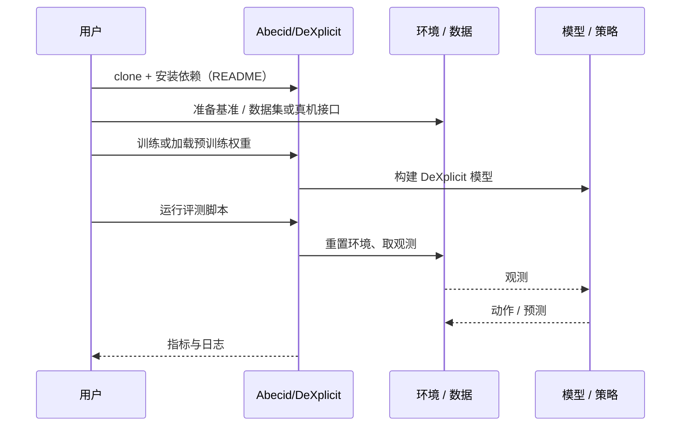

# DeXplicit（arXiv:2610.30781）

**DeXplicit**（*DeXplicit: Making Physical State Explicit in Dexterous Manipulation World Models*，[arXiv:2610.30781](https://arxiv.org/abs/2610.30781)，[项目页](https://dexplicit.github.io)，[代码](https://github.com/Abecid/DeXplicit)）来自 [具身智能小站 2026-10-29 盘点](../../sources/blogs/wechat_embodied_station_58_papers_diverse_demonstrations_2026-10-29.md)，属「世界模型与表征」组。

## 一句话定义

**DeXplicit先预测物体运动和形变，再以几何结果引导视频合成；多数据集对照支持这种拆分，生成加速来自特定配置比较，不宜当成统一硬件上的通用倍数。**

## 英文缩写速查

| 缩写 | 英文全称 | 简要说明 |
|------|----------|----------|
| DeXplicit | DeXplicit: Making Physical State Explicit in Dexterous Manipulation World Models | 本文方法 / 基准的简称 |

## 为什么重要

- 先显式预测三维物理状态，再生成视频。
- 开源结论：**已开源**（步骤 2.5，2026-10-29）。仓库可达（git ls-remote）。项目页 HTTP 200。
- 同期同组工作见 [多样成功示范、触觉工具链与预见式感知：具身智能小站 10-29 期 58 篇阅读坐标](../overview/embodied-station-2026-10-29-58-papers-technology-map.md)。

## 核心机制

| 项 | 内容 |
|----|------|
| **arXiv** | [2610.30781](https://arxiv.org/abs/2610.30781) |
| **开源** | **已开源** |
| **要点** | DeXplicit先预测物体运动和形变，再以几何结果引导视频合成；多数据集对照支持这种拆分，生成加速来自特定配置比较，不宜当成统一硬件上的通用倍数。 |
| **文内指标** | 公众号未给具体数字，本页不引用。 |

## 源码运行时序图

以下为按仓库入口（`Abecid/DeXplicit`）推断的通用运行链路；入库日仅核实仓库可达，未逐文件阅读，具体脚本名以 README 为准。

## 实验与评测

- 公众号未给具体数字，本页不引用。
- **读法：** 本页为索引级摘要，依据公众号转述的官方摘要与仓库信息整理；逐项数字与 baseline 以原文 PDF 为准。

## 与其他工作对比

- 横向索引见 [多样成功示范、触觉工具链与预见式感知：具身智能小站 10-29 期 58 篇阅读坐标](../overview/embodied-station-2026-10-29-58-papers-technology-map.md)；同 arXiv 不重复造页。

## 结论

**先显式预测三维物理状态，再生成视频：DeXplicit先预测物体运动和形变，再以几何结果引导视频合成；多数据集对照支持这种拆分，生成加速来自特定配置比较，不宜当成统一硬件上的通用倍数。**

1. 开源边界：**已开源** — 仓库可达（git ls-remote）。项目页 HTTP 200。
2. 核心机制：DeXplicit先预测物体运动和形变，再以几何结果引导视频合成；多数据集对照支持这种拆分，生成加速来自特定配置比较，不宜当成统一硬件上的通用倍数。
3. 复现与选型前核对任务协议、硬件与基准口径，勿直接横比公众号摘录数字。

## 关联页面

- [world-action-models](../concepts/world-action-models.md)
- [generative-world-models](../methods/generative-world-models.md)
- [vla](../methods/vla.md)
- [embodied-station-2026-10-29-58-papers-technology-map](../overview/embodied-station-2026-10-29-58-papers-technology-map.md)

## 参考来源

- [dexplicit_arxiv_2610_30781.md](../../sources/papers/dexplicit_arxiv_2610_30781.md)
- [wechat_embodied_station_58_papers_diverse_demonstrations_2026-10-29.md](../../sources/blogs/wechat_embodied_station_58_papers_diverse_demonstrations_2026-10-29.md)
- [arXiv:2610.30781](https://arxiv.org/abs/2610.30781)

## 推荐继续阅读

- [arXiv PDF](https://arxiv.org/pdf/2610.30781)
- [项目页](https://dexplicit.github.io)
- [https://github.com/Abecid/DeXplicit](https://github.com/Abecid/DeXplicit)
