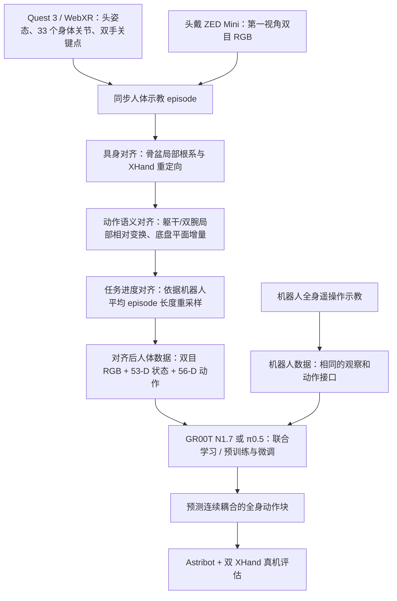
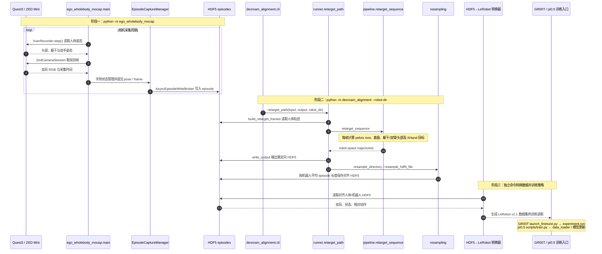

# DexRoam: Learning Mobile Bimanual Dexterous Manipulation from Egocentric Whole-Body Human Demonstrations｜DexRoam：基于第一视角全身人体示教学习移动双臂灵巧操作

## 一句话定义

**DexRoam** 将第一视角双目 RGB 与连续人体全身动作，经具身、动作语义和任务进度三阶段对齐到机器人控制接口，和真实机器人示教共同训练统一全身动作的 VLA 策略（CoRL 2026）。

## 英文缩写速查

| 缩写 | 英文全称 | 简要说明 |
|------|----------|----------|
| VLA | Vision-Language-Action | 结合视觉、指令和本体状态预测全身动作块 |
| MoCap | Motion Capture | 头显获取全身姿态与手指关键点 |
| RGB | Red-Green-Blue | 头戴相机记录双目第一视角图像 |
| HDF5 | Hierarchical Data Format version 5 | 人体与机器人示教 episode 存储格式 |
| IK | Inverse Kinematics | 检查重定向姿态能否被机器人执行 |
| MMD | Maximum Mean Discrepancy | 评价人体与机器人动作分布差异 |
| SWD | Sliced Wasserstein Distance | 通过随机投影比较两域动作分布 |
| TCS | Task Completion Score | 按分阶段里程碑衡量部分任务进度 |

## 为什么重要

移动双臂灵巧操作需要底盘、躯干、双臂、视线和手指**在一段连续动作中相互配合**。只收机器人示教成本高；仅模仿第一视角视频又缺乏高维动作监督。DexRoam 的关键是保留人体的全身耦合运动，而不是将行走和操作割裂为两个阶段。

**不要把它解读成「只戴一副头显、做一遍、机器人零样本学会」：** 人体采集还需头戴 ZED Mini；VLA 训练中仍包含机器人示教。原文数据效率消融中 0 条机器人示教时成功率为 0。

## 核心方法栈

### 1. 同步第一视角采集与机器人平台

- **人体采集：** Meta Quest 3 + 头戴 ZED Mini；WebXR 获取头部 6-DoF、33 个全身关节、每只手 25 个关键点，并录制第一视角双目图像。无需外置动作捕捉器，但并非只用一台未加相机的 VR 头显。图像在头显中实时显示，采集约 30 Hz，头显预览约 20 Hz。
- **机器人示教：** 单人借助 Quest 3S、VR 控制器和 MANUS Pro 手套遥操作 Astribot + 双 XHand；该链路与上述「免外置追踪器的人体自然示教」**不是同一硬件配置**。
- **目标机器人：** 全向底盘、可动躯干、双 7-DoF 手臂、2-DoF 主动头部、双 12-DoF XHand 灵巧手。

### 2. 具身对齐（Embodiment Alignment）

从骨盆投影到地面的局部根坐标系描述人体运动；将根部轨迹变换为底盘平面运动，躯干、头部与双腕姿态变为根坐标系下的相对目标。头部仅取 yaw/pitch，手部使用 [dex-retargeting](https://github.com/dexsuite/dex-retargeting) 转成双 XHand 关节目标。转为机器人可执行的全身连续轨迹，而非直接复制人体关节角。

### 3. 动作语义对齐（Action-Semantic Alignment）

绝对人体位姿残留身高、臂长和初始站位偏差；因此将躯干与双腕位姿改写成每个组件自身局部坐标系中的逐步相对动作，底盘改写为局部平面位移与转角；头部和灵巧手已经是机器人关节目标，直接沿用。原文公式（§III-B2）：

```text
Delta T_t^J = inverse(T_t^J) × T_(t+1)^J
Delta base = (delta x, delta y, delta yaw)
```

### 4. 时间对齐（Temporal Alignment）

按归一化任务进度 `s ∈ [0, 1]`，把人类轨迹重采样到该任务机器人 episode 的**平均时间步数**；位置线性插值、旋转 SLERP、图像及离散信号最近邻取样。这里是**改变轨迹采样步数**，而非调整控制频率或策略 action horizon。

### 5. 统一 VLA 监督

两种 backbone（GR00T N1.7 / π0.5）接收左/右 `640×480` RGB、53-D 本体状态和语言指令，预测**56-D 连续全身动作**。原文 §III-B4 泛称 proprioceptive history；附录 D 明确公开实现是**单帧**本体状态，没有显式堆叠多帧。

| 接口 | 维度及组成 |
|---|---|
| 输入本体状态 | **53-D**：双臂位姿 9+9、躯干位姿 9、双手关节 12+12、主动头部关节 2 |
| 输出全身动作 | **56-D**：双手关节 12+12、双臂相对位姿 9+9、躯干相对位姿 9、头部关节 2、底盘平面增量 3 |
| 输出形式 | 同一 VLA 联合输出动作块，运行时不按「导航/操作阶段」切换独立策略 |

### 流程总览（依据原文 Fig. 1–3、§III）



## 源码运行时序图

基于公开仓库 [DexRoam](https://github.com/zhourui9813/DexRoam) 的 `ego_wholebody_mocap/__main__.py`、`main.py`、`episode_manager.py`、`dexroam_alignment/__main__.py`、`cli.py`、`runner.py`、`pipeline.py`、`resampling.py` 与 [策略训练仓](https://github.com/zhourui9813/DexRoam-Policy-Training) 的数据转换器及训练入口核对。以下为**分阶段离线工作流**；不是上述模块在一次 Python 进程内相互调用。



源码边界：采集 / 对齐 CLI 可运行；GR00T 和 π0.5 为**两个独立训练环境**，均需另备预训练权重及相应数据。以上时序仅基于可见入口与调用关系，不表示已实测完整真机部署。

## 工程实践

公开实现拆为三段离线过程，**不是同一实时运行程序**：

1. **人体采集：** 在 Quest 3、ZED Mini SDK、WebXR 等环境配置就绪后，执行 `python -m ego_wholebody_mocap`，经手势状态机记录同步人体姿态、手指关键点及双目 RGB，保存为 HDF5 episode。
2. **人机对齐：** 在 `human_robot_alignment/` 执行 `python -m dexroam_alignment <人体 HDF5 路径> -o <输出目录> --robot-dir <机器人 HDF5 目录>`。该参数用于计算机器人 episode 的平均长度，实际逐帧重定向走 `runner.retarget_path → pipeline.retarget_sequence`，再经 `resampling` 输出对齐数据。
3. **策略数据转换：** 运行训练仓 `data_scripts/dexroam_hdf5_to_lerobot.py`，将对齐的 HDF5 转换成 LeRobot v2.1（含 stereo RGB、53-D state 和 56-D action），并和机器人示教按同一模态准备。
4. **两条训练路径：** GR00T 依据 `docs/gr00t_training.md` 执行 `bash scripts/run_train_gr00t.sh`；π0.5 依据 `docs/pi05_training.md` 先执行 `bash scripts/run_compute_norm_stats.sh` 再 `bash scripts/run_train_pi.sh`。二者需要不同软件环境及各自预训练权重。

**验证范围：** 以上命令与源码调用链已静态核对；未在本环境执行硬件采集、GPU 微调或完整真机评测。官方 HF 50 条 episode 为单任务机器人数据示例，不包含论文完整训练语料。

## 实验与评测

论文 §IV 在五项真机任务中，每个方法/任务 20 次试验：Pick Chips Can、Pour Water、Throw Trash、Deliver Fruit、Push Chair & Close Laptop。

| Backbone | 仅机器人数据 | 最佳人机联合方式 | 提升 |
|---|---:|---:|---:|
| GR00T N1.7 | 29% | 56% | +27 个百分点 |
| π0.5 | 32% | 57% | +25 个百分点 |

最佳策略为 **Human Pretrain + Cotrain FT**，即先用人体数据预训练，微调时仍保留人体与机器人混合示教。三种结合方式（包括直接 cotrain 与 human pretrain + robot-only finetune）均优于 robot-only。

- **数据效率（图 8）：** 固定 50 条人类示教/任务，比较机器人示教数 0、10、25、50。三个评测任务中 GR00T 用 25 条机器人示教 + 人类数据，可匹配/超过 50 条纯机器人基线；π0.5 结果距基线不超过 5 个百分点。**人类单独训练在 0 条机器人示教时没有成功案例**。
- **人机分布：** 五任务 MMD 和 SWD 分别平均下降 41.7%、31.1%；项目页 Pick Chips Can 示例从 0.598/0.926 降到 0.313/0.563。
- **轨迹重放：** 15/15 轨迹成功且无 IK 失败；平均误差躯干 12.54 mm、左臂 4.01 mm、右臂 6.30 mm。
- **关键消融（表 III，仅两任务）：** 绝对动作替换相对动作导致三种策略均 0% 成功；移除时间重采样平均成功率从 **68.3% 降至 44.2%**。此数值来自消融子集，不能当作五任务总均值。
- **泛化（Pick Chips Can）：** 新背景下 robot-only 50%→20%，human-pretrain+cotrain 90%→55%；论文还测试了未见指令措辞。

## 与其他工作对比

| 路线 | 主要监督 | 相对于 DexRoam 的差别 |
|---|---|---|
| 纯机器人遥操作 | 实机对应的全身动作 | 示教可执行性直接，但采集硬件/人力门槛高 |
| 纯第一视角视频学习 | RGB 图像/视觉表征 | 易扩量，但不直接提供 56-D 全身目标动作 |
| DexRoam | 人体全身运动 + 对齐的人机混合示教 | 保留底盘、躯干、双手耦合，但仍要求任务级机器人示教 |

相关方向：[双臂操作](../tasks/bimanual-manipulation.md)、[移动操作](../tasks/loco-manipulation.md)、[模仿学习](../methods/imitation-learning.md)。

## 结论

**一句话总判：贡献来自可迁移的连续全身动作监督与三阶段对齐，不是「头显一戴、做一次、机器人马上会」。**

1. **采集工程：** 区分自然人体示教的 Quest 3 + ZED Mini 与机器人遥操作的 Quest 3S + 控制器 + MANUS 手套。
2. **表示优先级：** 绝对姿态转局部相对动作非常关键；两任务消融中删除该步导致成功率归零。
3. **时序一致性：** 重采样到任务级机器人平均步数，而非简单改变 Hz 或 action chunk 长度。
4. **策略训练：** 使用双目 RGB、53-D state、56-D action；论文推荐先人体预训练再混合微调。
5. **机器人数据：** 「节省一半」对应三项数据效率实验中的 25 vs 50 条机器人示教，并非纯人体数据可独立学会。
6. **复现重点：** 检查坐标系、关节目标范围、图像时间戳同步及是否存在 XHand 接触饱和。

## 局限与风险

- **缺力/触觉反馈：** XHand 位置控制难以保证闭指力，作者 §VII 与 Appendix C 明确报告轻触抓不住、携带中滑落、投掷释放时序误差等失败。
- **复现边界：** 官方公开采集 / 对齐代码与两种策略训练代码，但没有把论文完整五任务原始训练集及所有实机权重等价公开；HF 的 50 条 episode 是 Push Chair & Close Laptop 的机器人示例。
- **硬件适配：** 重定向参数针对 Astribot + XHand，换底盘或灵巧手需重新校核几何、可达性和动作分布；未证明跨任意硬件直接零样本迁移。
- **时序范围：** 本文的 0 机器人示教实验无成功；不能把视频宣传语理解为一条人体 demonstration 的 one-shot policy 学习结论。

## 关联页面

- [双臂操作](../tasks/bimanual-manipulation.md)
- [移动操作](../tasks/loco-manipulation.md)
- [全身追踪与动作重定向流程](../concepts/whole-body-tracking-pipeline.md)
- [模仿学习](../methods/imitation-learning.md)

## 参考来源

- [DexRoam arXiv:2609.35761v1：全文与附录核对](../../sources/papers/dexroam_arxiv_2609_35761.md)
- [官方项目主页与 CoRL 状态](../../sources/sites/dexroam-github-io.md)
- [官方人体采集与对齐源码](../../sources/repos/zhourui9813-dexroam.md)
- [官方 GR00T / π0.5 训练源码](../../sources/repos/zhourui9813-dexroam-policy-training.md)
- [HF 单任务示例数据集](https://huggingface.co/datasets/zhourui9813/DexRoam_Realworld_Data)

## 推荐继续阅读

- [官方项目主页（图表与视频）](https://dexroam.github.io/)
- [arXiv 论文 HTML 全文](https://arxiv.org/html/2609.35761v1)
- [采集 / 对齐运行说明](https://github.com/zhourui9813/DexRoam)
- [训练 README](https://github.com/zhourui9813/DexRoam-Policy-Training)
