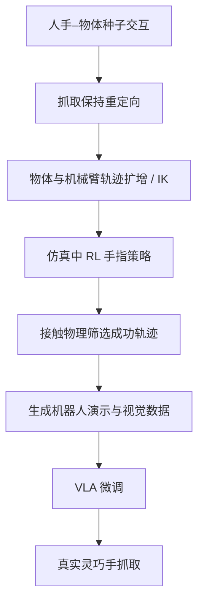

# DexSeed： 将人手–物体交互扩展为灵巧操作示范

## 一句话定义

DexSeed 是把少量人手–物体交互映射、扩增并物理验证为机器人灵巧抓取示范的数据合成框架。

## 英文缩写速查

| 缩写 | 英文全称 | 简要说明 |
|---|---|---|
| VLA | Vision-Language-Action | 以视觉、语言条件输出机器人动作 |
| RL | Reinforcement Learning | 在仿真中学习灵巧手接触控制 |
| IK | Inverse Kinematics | 将末端轨迹映射到机器人关节 |

## 为什么重要

灵巧手示范采集昂贵，直接将人手姿态重定向容易破坏接触关系；DexSeed 试图先保留抓取物理可行性，再把合成数据用于真实机器人学习。

## 核心原理

以人手-物体交互演示为种子，重定向时显式维持手-物抓取关系；再扩增对象几何和机械臂轨迹，并通过逆运动学筛查可执行性。仿真中机械臂按参考轨迹运动，由 RL 策略生成灵巧手指控制，保留成功的交互轨迹并渲染视觉观察以训练 VLA。最终在真实机械臂与多指手上迁移。

## 流程总览

> **注意：** 此图仅抽象论文所述方法模块与数据/控制流，非未公开代码的实际调用路径。

## 实验与评测

论文报告由 19 条种子人手交互生成约 25,270 条机器人示范；仿真已见对象组合成功率 97.5%、未见组合配置约 91.25%；真实机器人所列八种抓取方式中，基线到方法的表现跨度约 20%→80%。实验协议与汇总方式需对照原表，不能误写成所有任务统一 80%。

## 结论

**DexSeed 的主要价值是把抓取接触保持与物理可行性验证放在机器人示范生成环节，而不只是对人类动作做外观拟合。**

1. 优先核验抓取关系是否在重定向后保持。
2. 区分 IK 预筛选、RL 手指控制和 VLA 微调三种不同职责。
3. 真机成功率按原论文任务与基线表述，避免把局部提升写成总体数值。
4. 代码待发布阶段保留复现阻塞。

## 与其他工作对比

[MetaWAM](paper-metawam.md) 以频域元帧建立视频–动作统一输入，而 LaST0.5 通过交互中心潜变量连接世界与动作专家。

## 源码运行时序图

官方仓库截至 2026-11-12 仅有 README 与 assets，并标注 Code release coming soon；无公开可运行训练/推理入口，故源码时序图不适用。

## 工程实践

验证时要区分「几何上能到达」与「动力学上可持续抓稳」，确保手指 RL 轨迹在仿真接触参数变化后仍可复现。原始网页附带的官方 GitHub 当前仅有 README、assets，写明代码待发布。

## 局限与风险

框架集中于抓取/放置，不应外推为复杂手内操作或双手协作；合成接触物理和渲染域差仍会影响真实表现。训练源码尚未发布。

## 关联页面

- [CIALLO](paper-ciallo.md)
- [动作重定向](../concepts/motion-retargeting.md)
- [VLA](../methods/vla.md)
- [LaST0.5](paper-last05.md)

## 参考来源

- [arXiv:2611.14092 归档](../../sources/papers/dexseed_arxiv_2611_14092.md)
- [官方项目页核验](../../sources/sites/dexseed.md)
- [官方仓库核验](../../sources/repos/dexseed.md)

## 推荐继续阅读

- [论文原文](https://arxiv.org/abs/2611.14092)
- [项目主页](https://robbyant-research.github.io/DexSeed/)
- [官方代码](https://github.com/robbyant-research/DexSeed)

> **复核状态（2026-11-12）：** 论文关键方法与结果已核对，但全文与全部附录尚未逐项通读，故本节点保持 draft；不得将自报数值视为独立复现。
