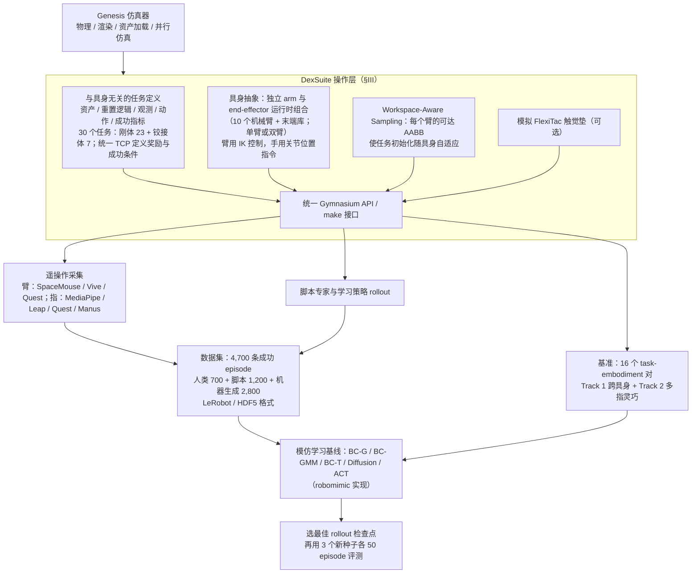

# DexSuite（arXiv:2610.37799）

**DexSuite**（*DexSuite: An All-in-One Framework for Dexterous Manipulation Across Arms, Hands, and Tasks*，[arXiv:2610.37799](https://arxiv.org/abs/2610.37799)，[项目页](https://dexsuiteorg.github.io/)）来自 [具身智能小站 2026-10-30 盘点](../../sources/blogs/wechat_embodied_station_28_papers_event2reward_progress_rewards_2026-10-30.md)，属「灵巧操作与抓取」组。

## 一句话定义

**DexSuite 基于 Genesis 整合任务、机器人组合、遥操作与模拟触觉，并提供示范和基准。**

## 英文缩写速查

| 缩写 | 英文全称 | 简要说明 |
|------|----------|----------|
| DexSuite | DexSuite: An All-in-One Framework for Dexterous Manipulation Across Arms, Hands, and Tasks | 本文方法 / 基准的简称 |

## 为什么重要

- 为不同机械臂和灵巧手提供统一实验接口。它强调仿真实验流程复用，工具使用和长序列操作仍是现有策略难点。
- 开源结论：**待发布**（步骤 2.5，2026-10-30）。项目页 HTTP 200，Code 与 Paper 均标注 coming soon（数据已在 Hugging Face）。
- 同期同组工作见 [进度奖励、接触监督与规划验证：具身智能小站 10-30 期 28 篇阅读坐标](../overview/embodied-station-2026-10-30-28-papers-technology-map.md)。

## 流程总览

图依据：论文 §III（Fig. 2 架构、III-A/B/C）、§IV（基准与数据集）、§V-A 实验设定；各模块之间的箭头为按各节叙述归纳的数据流。

## 核心机制

| 项 | 内容 |
|----|------|
| **arXiv** | [2610.37799](https://arxiv.org/abs/2610.37799) |
| **开源** | **待发布** |
| **要点** | DexSuite 基于 Genesis 整合任务、机器人组合、遥操作与模拟触觉，并提供示范和基准。 |
| **文内指标** | 公众号转述：它强调仿真实验流程复用，工具使用和长序列操作仍是现有策略难点。 |

## 源码运行时序图

**不适用（待发布）** — 项目页 HTTP 200，Code 与 Paper 均标注 coming soon（数据已在 Hugging Face）。 不编造运行脚本；代码公开后再补。

## 实验与评测

- 公众号转述：它强调仿真实验流程复用，工具使用和长序列操作仍是现有策略难点。
- **读法：** 本页为索引级摘要，依据公众号转述的官方摘要与仓库信息整理；逐项数字与 baseline 以原文 PDF 为准。

## 与其他工作对比

- 横向索引见 [进度奖励、接触监督与规划验证：具身智能小站 10-30 期 28 篇阅读坐标](../overview/embodied-station-2026-10-30-28-papers-technology-map.md)；同 arXiv 不重复造页。

## 结论

**为不同机械臂和灵巧手提供统一实验接口：它强调仿真实验流程复用，工具使用和长序列操作仍是现有策略难点。**

1. 开源边界：**待发布** — 项目页 HTTP 200，Code 与 Paper 均标注 coming soon（数据已在 Hugging Face）。
2. 核心机制：DexSuite 基于 Genesis 整合任务、机器人组合、遥操作与模拟触觉，并提供示范和基准。
3. 复现与选型前核对任务协议、硬件与基准口径，勿直接横比公众号摘录数字。

## 关联页面

- [manipulation](../tasks/manipulation.md)
- [dexterous-kinematics](../concepts/dexterous-kinematics.md)
- [contact-rich-manipulation](../concepts/contact-rich-manipulation.md)
- [embodied-station-2026-10-30-28-papers-technology-map](../overview/embodied-station-2026-10-30-28-papers-technology-map.md)

## 参考来源

- [dexsuite_arxiv_2610_37799.md](../../sources/papers/dexsuite_arxiv_2610_37799.md)
- [wechat_embodied_station_28_papers_event2reward_progress_rewards_2026-10-30.md](../../sources/blogs/wechat_embodied_station_28_papers_event2reward_progress_rewards_2026-10-30.md)
- [arXiv:2610.37799](https://arxiv.org/abs/2610.37799)
- [arXiv PDF](https://arxiv.org/pdf/2610.37799)：已通读方法部分（实验与附录以略读为准）：摘要、§I–§V-A（§III 框架架构、§IV 基准与数据集、§V-A 基线协议）

## 推荐继续阅读

- [arXiv PDF](https://arxiv.org/pdf/2610.37799)
- [项目页](https://dexsuiteorg.github.io/)
