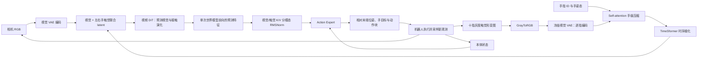
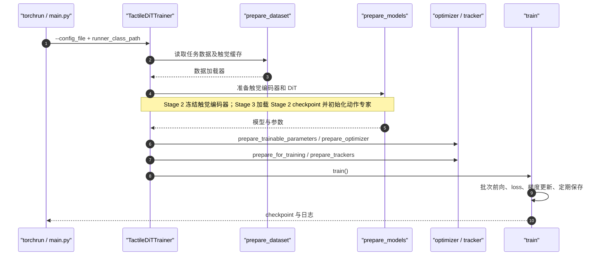

# DexTacWAM：面向灵巧操作的视触觉世界—动作模型
*DexTacWAM: A Visuo-Tactile World-Action Model for Dexterous Manipulation*

## 一句话定义

DexTacWAM 把十指视觉触觉通过手指身份/手姿态感知压缩成双手 latent，与视频扩散世界模型联合预测**未来接触演化**，再让动作专家用预测性视触觉特征执行接触密集操作。

## 英文缩写速查

| 缩写 | 英文全称 | 简要说明 |
|---|---|---|
| WAM | World-Action Model | 世界预测与动作生成联合建模 |
| VAE | Variational Autoencoder | 冻结的预训练 LTX 视频特征编码器 |
| DiT | Diffusion Transformer | 执行视触觉联合世界模型的 Transformer |
| K/V | Key / Value | 动作 cross-attention 键/值；分模态归一化 |
| RMS | Root Mean Square | 归一化视觉与触觉不同特征尺度 |

## 为什么重要

视觉在自遮挡、指间传递、拧盖、持续擦拭时不能可靠观测接触和滑移。直接将当前触觉送入策略仍缺乏对接触动力学的显式预测。本文把**触觉作为预测世界状态的一部分**，而非只是一项额外动作输入（论文 `1–3）。

## 核心信息

| 项目 | 一手资料确认 |
|---|---|
| 论文版本 | [arXiv:2609.24976v1](https://arxiv.org/abs/2609.24976v1)，2026-09-21，22 页 |
| 作者 | Haoran Yuan、Zekai Wang、Boning Shao、Haoran Lu、Trevor Darrell、Ismini Lourentzou、Wei Zhan |
| 机构 | 伊利诺伊大学厄巴纳-香槟分校（UIUC）、加州大学伯克利分校（UC Berkeley）、美国西北大学（Northwestern University） |
| 平台 | 22-DoF 双臂操作平台，左右十指 Sharpa 视觉式触觉 |
| 官方资源 | [主页](https://dextacwam.github.io/) · [源码](https://github.com/dextacwam/DexTacWAM) · [权重与数据](https://huggingface.co/collections/JensenYuan/dextacwam-6aba3aa25d3362d882cdefbc) |
| 阅读状态 | 论文 `1–6 与附录 A.1–A.11、关键图表已核对；官方源码按 README 与主要运行入口核验，未实际训练或实机复现 |

## 流程总览

依照原文 `3 与 Figures 2–3 表达数据及控制流；底层动作块执行会更新下一轮观测。

## 核心原理

**1. 十指触觉的结构化编码。** 每个指尖灰度形变图通过 1×1 GrayToRGB 进入**冻结**的预训练视觉 VAE。引入 finger embedding、hand query、手姿态后，将每手五指通过 self-attention pooling 压缩为一个 hand-level latent；TimeSformer 细化时序，融合前后形变重建损失约束局部接触保持（`3.1–3.2、附录 A.5）。

**2. 联合世界状态预测。** 两只手的触觉 latent 沿 view 轴和视觉 latent 拼接，DiT 对视觉与触觉分别加权计算 flow-matching 去噪目标。动作专家直接消费一次世界模型前向的**预测性特征**，无需等待完全生成的未来视频（`3.3）。

**3. 动作专家。** 视觉 token 与触觉 token 特征统计不同，交叉注意力前分别做无参数 K/V RMS 归一化。统一动作目标含十指 6D 力相关监督（60 维）、相对末端位姿、手目标、本体状态等，附录 A.6 给出的完整目标为 194 维。**部署动作专家没有额外真实力输入；力项是训练动作监督**（`3.4，附录 A.7）。

**4. 三阶段连续适配。**

| 阶段 | 训练内容 | 数据与冻结策略 |
|---|---|---|
| Stage 1 触觉编码器 | 训练灰度适配与压缩/姿态/时间头 | 488 轨迹、250 指令，论文约 4h（README 统计约 3.5h），冻结 LTX 视觉 VAE |
| Stage 2 视触觉世界模型 | 冻结触觉编码器，微调预训练视频 DiT | 各任务约 100 条示范；**无视频模型触觉 midtraining** |
| Stage 3 动作专家 | 加载本任务 Stage 2 世界模型，新动作专家随机初始化训练 | 同任务示范，**没有额外动作预训练** |

## 实验与评测

| 六项真机操作（每方法各 20 次） | 任务分数（%） |
|---|---:|
| 遮挡下放置方块（Cube Place） | 90.0 |
| 双手传递方块（Handover） | 71.6 |
| 双手擦拭（Wipe） | 77.0 |
| 夹钳转移番茄（Tongs） | 60.0 |
| 分离碗堆（Bowl） | 65.0 |
| 拧开瓶盖（Bottle Cap） | 60.0 |
| **平均** | **70.6** |

- **对照（Table 1）：** 最强基线 Reactive Diffusion Policy（RDP）平均 **38.0**。但 **70.6 是综合任务分数，不是统一二元成功率**：Handover/Wipe 为分阶段加分，另外四任务为二元评分（附录 A.1）；基线使用各自原始动作参数化。
- **消融（Table 2）：** 保持相同触觉编码器、数据与动作专家，只移除触觉世界预测、让策略直接使用触觉输入，四任务平均 **74.7→26.6**。移除模态 K/V RMSNorm 后模型不收敛，未进行闭环评测。
- **压缩与速度（Table 3，`4.2）：** 十指→两手后，接触 recall 保留 **89.4%**（**不是操作成功率**）；视图 token 3168→864。RTX 4090 上训练迭代 3.87→1.71 s（**2.26×**），每动作块推理 363.0→281.6 ms（**1.29×**），对应动作块执行时间 1.8 s。
- **预测品质（Tables 4–5）：** 触觉 latent cosine 0.967，contact F1 0.737，预测误差相对复制最后一帧为 0.561×；仅在 Handover/Wipe 配对对照中，视觉 PSNR 变化为 +0.06/−0.07 dB，不可泛化到所有机器人任务。

## 与其他工作对比

以下比较依据[论文原文归档](../../sources/papers/dextacwam_arxiv_2609_24976.md)中的 Table 1–2 与附录 A.1，区分方法路线和受控消融：

| 对照 | 与 DexTacWAM 的关键差异 | 评测读法 |
|---|---|---|
| [Reactive Diffusion Policy（RDP）](./paper-sa-2503-02881-reactive-diffusion-policy-slow-fast-visual-tacti.md) | 视触觉反应式策略，与显式预测未来接触演化的世界—动作模型对照 | Table 1 六任务平均分为 38.0 对 70.6；各方法保留原始动作参数化，不能将差值全部归因于世界预测 |
| 同触觉编码器、无触觉世界预测的消融 | 保持数据、触觉编码器和动作专家相同，仅让策略直接使用触觉输入 | Table 2 四任务平均分为 26.6 对 74.7；这是分离「触觉输入」与「触觉预测」贡献的更直接证据 |

这些分数遵循各任务评分协议，不是可与其他数据集或平台直接横比的统一成功率；方法族关系见[世界—动作模型](../concepts/world-action-models.md)。

## 结论

**在论文所用 Sharpa 视觉式触觉平台与六项任务中，预测接触演化的联合世界模型较单纯触觉条件化显著更有效，但失败恢复和跨硬件迁移仍未验证。**

1. 将“有触觉输入”与“能预测接触演化”分开比较，优先看保持特征和数据不变的消融。
2. 用手指身份、姿态与时间结构压缩触觉；视觉/触觉 cross-attention 使用分模态归一化。
3. 70.6 是按任务协议打分；89.4% 是触觉接触召回保留率，不能写作真机成功率。
4. 可以复用官方 Stage 1 权重，但 Stage 2/3 仍需新任务数据和训练。
5. 针对漏抓、滑移、掉落后的恢复，应补充失败/干预数据并评估闭环安全性。

## 源码运行时序图

根据官方 `README.md`、`main.py` 动态选择 `runner/tactile_dit_trainer.py:TactileDiTTrainer` 的真实调用序列绘制，覆盖 Stage 2/3；Stage 1 对应 `runner/visual_vae_adapter_trainer.py` 入口。

**离线推理代码入口：** `main.py --mode infer --runner_class_path runner/tactile_inferencer.py --runner_class TactileInferencer` → `prepare_val_dataset` → `prepare_models` → `infer`。**真机部署**入口另外放在 `deploy` 分支，不将其误写为 main 里的直接调用链，细节见 [源码归档](../../sources/repos/dextacwam-official.md)。

## 工程实践

- 先从[官方 Stage 1 编码器权重](https://huggingface.co/JensenYuan/DexTacWAM_multi_finger_tactile_encoder)出发；作者建议新任务**直接从 Stage 2 开始**。数据应遵守 LeRobot 格式及 `n_previous=4`、`action_chunk=54`。
- 用 `scripts/get_statistics.py` 和 `scripts/preprocess_dex_vtam_cache.py` 生成归一化统计与缓存，再以 `torchrun ... main.py --runner_class TactileDiTTrainer` 依次训练 Stage 2/3。模型和统计键不一致可能产生“看起来正常、实际错误”的动作。
- 发布物包括完整三阶段代码、六任务配置、488 条预训练语料、每任务约 96–100 条示范和 Stage 1 权重；**未发布 Stage 2 世界模型与 Stage 3 动作专家任务 checkpoint**，不能仅靠克隆仓库直接复现作者真机评分。
- README 参考环境为 4× H200 NVL；`deploy` 分支要求先 `dryrun_relative_server.py` 再离线回放、检查布局并部署 HTTP server/client。正式上机需配置现场安全支撑和急停。
- **商用许可注意：** 代码包含 Apache-2.0 与 Genie-Envisioner 衍生文件的 CC BY-NC-SA 4.0 非商业许可，LTX 上游权重另有开放权重许可。详见 [源码归档](../../sources/repos/dextacwam-official.md)。

## 局限与风险

论文仅验证 Sharpa 视觉式触觉及其 22-DoF 平台；其它触觉硬件和本体适配尚无证据。数据主要为成功示范，掉落、未抓牢及失滑后的恢复不在充分训练分布内（`6、附录 A.9）。作者的 281.6 ms 是对应显卡和动作块的推理时延，**不代表高频接触力控周期**。本页未实际训练或真机部署；开放训练源码并不等于开放所有训练后检查点。

## 关联页面

- [触觉感知](../concepts/tactile-sensing.md) — 指尖接触观测
- [视触觉融合](../concepts/visuo-tactile-fusion.md) — 当前输入融合与预测世界状态之别
- [接触丰富操作](../concepts/contact-rich-manipulation.md) — 摩擦、滑移、抓取
- [Manipulation 任务](../tasks/manipulation.md) — 真实操作任务和评价

## 参考来源

- [论文一手通读归档](../../sources/papers/dextacwam_arxiv_2609_24976.md)
- [项目主页开放核查](../../sources/sites/dextacwam-project.md)
- [官方源码与运行时序](../../sources/repos/dextacwam-official.md)

## 推荐继续阅读

- [arXiv HTML 全文含附录](https://arxiv.org/html/2609.24976v1)
- [DexTacWAM 官方主页](https://dextacwam.github.io/)
- [官方 GitHub（代码与许可）](https://github.com/dextacwam/DexTacWAM)
