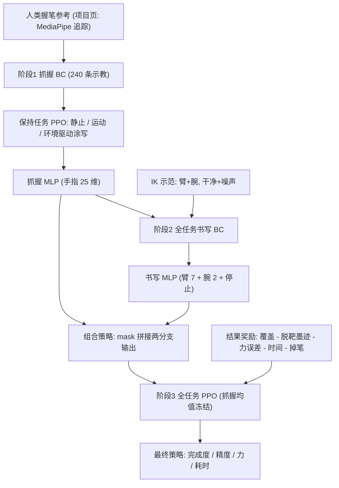

# Grip, Trace, Write（arXiv:2611.10451）

*Grip, Trace, Write: Force-Aware Imitation and Reinforcement Learning for High-DoF Robotic Handwriting*（[arXiv:2611.10451](https://arxiv.org/abs/2611.10451)，Daxo Robotics，v1 于 2026-11-07）。项目页 [dexwriting.github.io](https://dexwriting.github.io/)，代码 [WillChan9/DexWriting](https://github.com/WillChan9/DexWriting)。

## 一句话定义

**在 MuJoCo 仿真里让 UR5e + 25 关节拟人手用「只靠摩擦」握住的自由笔写字：把握持与书写拆成两个策略分支，先学抓握、再用 IK 示范做行为克隆、最后用墨迹 / 力 / 时间 / 掉笔的结果奖励做 PPO 微调。**

## 英文缩写速查

| 缩写 | 英文全称 | 简要说明 |
|------|----------|----------|
| BC | Behavior Cloning | 行为克隆，本文用 IK 示范初始化书写分支 |
| IK | Inverse Kinematics | 逆运动学，本文既是示范来源也是基线 |
| RL / PPO | Reinforcement Learning / Proximal Policy Optimization | 本文最终阶段用 PPO |
| DoF | Degrees of Freedom | 自由度；手 25 指关节 + 2 腕 + 7 臂 |
| MAE | Mean Absolute Error | 平均绝对误差，本文用于接触力误差（单位 N） |
| MLP | Multi-Layer Perceptron | 多层感知机，两个分支各一个 |
| GAE | Generalized Advantage Estimation | PPO 的优势估计，λ=0.95 |
| 5D cursor | position, height, force, time 光标 | 论文的 5D 指 (x, y, 高度, 目标力, 到期时间)，不是五自由度 |

## 为什么重要

- 作者的论点（§1）：自由握笔时，指–笔接触、笔–纸接触与臂运动互相影响；只给笔尖轨迹不足以决定是否出墨，力太小断笔，力太大会扭曲轨迹、改变笔姿甚至破坏抓握。已有系统常把笔固定在机械臂上，或只做有限的单笔画。
- 它把「握持稳定 + 笔尖运动 + 接触力」放进同一个闭环，并用大量任务（描摹、数字、字母、英文词、汉字）评测，可作为灵巧工具使用的仿真试验台（摘要自称 testbed）。
- 对 wiki 读者：这是「示教初始化 + 结果奖励 RL」在灵巧手工具操作上的一个干净案例，见下文奖励设计。

## 核心机制

### 方法栈

| 层 | 内容 | 出处 |
|----|------|------|
| 环境 | MuJoCo；UR5e + 25 指关节 + 2 腕关节 + 7 臂关节；自由笔三指握；25 Hz；无虚拟抓握辅助 | §2.1、表 2 |
| 观测 | 137 维状态（本体、触觉、任务与几何）+ 16 个未来轨迹样本×5 维（步长 2），共 217；无图像编码器 | 表 3、附录 B.3 |
| 策略 | 抓握 MLP 与书写 MLP 各 217→256→256；固定 mask 选输出：手指来自抓握分支，臂 / 腕 / 停止来自书写分支；34 维物理动作 + 1 个停止输出 | §2.2、式 3 |
| 阶段 1 | 抓握：BC（240 条示教 episode）→ 保持任务 PPO | §2.3、附录 A.1 |
| 阶段 2 | 全任务书写 BC：IK 控制臂 / 腕 + 学到的抓握控制手指；干净与噪声示范，逆方差加权 MSE | §2.3、式 1 |
| 阶段 3 | 全任务 PPO：抓握均值与观测统计冻结，书写均值与高斯 log-std 可训练 | §2.3 |

### 奖励（式 2 / 式 5，表 5）

r_t = λC·ΔC_t − λP·ΔP_t − λE·ΔE_t − λτ·Δτ_t + λq·(‖p_{t−1}−q_t‖ − ‖p_t−q_t‖) − D_t，其中 C 为 1 mm 内的有序覆盖、P 为归一化脱靶墨迹、E 为运行中的力 MAE、τ 为归一化耗时，q_t 是位于纸面下 1.5 mm 的「第一个未覆盖点」（防止悬停刷分），D_t 在掉笔时收回已得覆盖奖励并对提前终止收费。权重 1000 / 500 / 200 / 300 / 5000。作者强调奖励里没有 BC 或 IK 时序项，所以 IK 只是初始化而不是上限（§2.3）。

### 任务接口（附录 B）

目标是带力标注的笔画：每个笔画点有目标力（默认 0.9–2.5 N，裁剪到 [0.15, 4.0] N）和由力推出的线宽；策略读取的是数值轨迹窗口而非图像。

## 实验与结果

**协议（§3）：** IK、全任务 BC、最终 RL 三者在八个主任务上各用 50 个匹配种子，策略执行确定性均值与自身停止输出。

| 指标（八任务均值，表 1） | IK | BC | RL |
|------|-----|-----|-----|
| 完成度 (%) | 92.0 | 91.3 | 94.8 |
| 精度 (%) | 80.6 | 79.0 | 87.6 |
| 力 MAE (N) | 0.537 | 0.773 | 0.362 |
| 耗时 (s) | 8.11 | 8.19 | 7.67 |

- 作者自述：RL 在 8 个主任务中 7 个提升完成度，精度与力误差 8 个全部提升（§3.1）；线任务是例外（RL 97.5% vs IK 98.2%，附录 C.2）。
- 零样本（表 1 右三列）：未见英文词完成度 IK 87.7 / BC 87.2 / RL 91.6；成语 92.1 / 91.6 / 92.9；未见汉字 87.7 / 86.9 / 91.6。这三列不计入均值。
- BC 本身略低于 IK，作者将其定位为初始化（§3.1）。IK 与 BC 轨迹有可见的笔画抖动，导致脱靶墨迹，RL 抑制了这一点（图 6，附录 C.2）。
- 训练成本：39,845,888 个 transition、193.8 分钟（表 3）。

## 工程实践

- 复现入口：仓库 `WillChan9/DexWriting`，README 列出 `dexcraft` 环境包（Python 3.10、MuJoCo、PyTorch）与 `grasp.pt`、`bc.pt`、`rl.pt` 等 checkpoint；是否能复现表 1 数字未核实（笔者只静态读了 README 前段，未运行）。
- 落地要点（论文内）：先单独学抓握，使后续书写失败可归因到臂 / 腕而不是掉笔（§2.3）；示范需在「已带学到的抓握」的系统里采集，避免与理想化固定笔不匹配；RL 阶段冻结抓握均值与观测归一化，防止绘画奖励换走抓握策略。
- 复现注意（论文自述）：主表为 8 任务（cursive 与 word 分开），当前源码为 7 个书写任务（cursive 并入 word）+ 3 个仅评测任务，字体池更新也改变了分布，所以当前代码重跑不应期待逐数字对上（附录 A「评测套件变更」、附录 B）。

## 局限

论文自己承认的：
- 附录 A 与 B 承认评测套件在开发中变更，当前源码目录不代表归档 checkpoint 在后续任务变更后重训过；BC 的设置「是可用的采集 / 训练配方，而非最终克隆的逐 shard 清单」（表 3 注）。
- KL 约束是「经验预算，非硬保证」（附录 A.2）；覆盖是最终对齐的在线代理（附录 A.2）。
- 线任务 RL 反而低于 IK；种子 26254 零墨迹仍保留在均值里（附录 C.2）。
- 中间检查点来自同一次 RL 运行而非独立训练种子；12 种子监测均值（BC 90.2%）与 50 种子均值（91.3%）不可互换（附录 C.3）。RL 过程非单调。

笔者看到的未验证之处（推测 / 观察）：
- 全文只有仿真，没有真机实验，也未涉及 sim-to-real（全文无相关实验；此为对文本的观察）。
- 表 2 注明「共享的训练 / 评测内容池」，即八个主任务的评测内容与训练内容来自同一池，仅表 1 右三列是真正的未见内容；因此「泛化」证据主要来自这三列。
- 零样本三列里 IK 是同一基线，成语任务 RL 相对 IK 完成度仅 +0.8 个点（92.9 vs 92.1），论文未给显著性检验或种子间方差（推测：单次训练运行，未报置信区间）。
- 力目标（0.9–2.5 N）下 RL 的力 MAE 约 0.36 N，仍是相当比例的误差；论文没有按任务给目标力量级归一的相对误差（笔者观察）。
- 力数据来自仿真接触模型，真实纸–笔摩擦与墨迹沉积是否同构未知。

## 与其他工作对比

| 对照 | 差异读法 |
|------|----------|
| [Rapid Dexterous Pen Writing](./paper-rapid-dexterous-pen-writing.md) | 论文参考文献 [8]，通过实时 Jacobian 估计学在手笔写；本文把力与笔滞留纳入奖励并覆盖完整书写谱系 |
| [OnOff Handwriting](./paper-onoff-handwriting.md) | 同属手写主题的相邻页面；是否同为机器人写字请以该页为准 |
| [PPO](../methods/ppo.md)·[行为克隆](../methods/behavior-cloning.md) | 本文的「BC 初始化 + PPO 精修」是方法层面可对照的通用配方 |
| [手内重定向](../methods/in-hand-reorientation.md) | 论文相关工作认为这类在手策略多不涉及与外部表面的持续受力接触 |

## 结论

1. 作者在仿真里给出了「抓握 → IK 引导 BC → 结果 RL」的完整流水线，并在八任务表上报告均值完成度 94.8%、力 MAE 0.362 N（§3.1，表 1）。
2. 价值主要在环境与奖励设计的可借鉴性；证据范围限于仿真与单次训练运行。

## 关联页面

- [Rapid Dexterous Pen Writing](./paper-rapid-dexterous-pen-writing.md)
- [OnOff Handwriting](./paper-onoff-handwriting.md)
- [MuJoCo](./mujoco.md)
- [PPO](../methods/ppo.md)
- [行为克隆](../methods/behavior-cloning.md)
- [模仿学习](../methods/imitation-learning.md)
- [手内重定向](../methods/in-hand-reorientation.md)
- [奖励设计](../concepts/reward-design.md)
- [接触丰富操作](../concepts/contact-rich-manipulation.md)
- [力控基础](../concepts/force-control-basics.md)

## 参考来源

- [dexwriting_arxiv_2611_10451.md](../../sources/papers/dexwriting_arxiv_2611_10451.md)
- [arXiv:2611.10451](https://arxiv.org/abs/2611.10451)
- 项目页 <https://dexwriting.github.io/>；代码 <https://github.com/WillChan9/DexWriting>

## 推荐继续阅读

- [arXiv PDF（v1）](https://arxiv.org/pdf/2611.10451v1)
- [奖励设计](../concepts/reward-design.md)
- [接触丰富操作](../concepts/contact-rich-manipulation.md)
