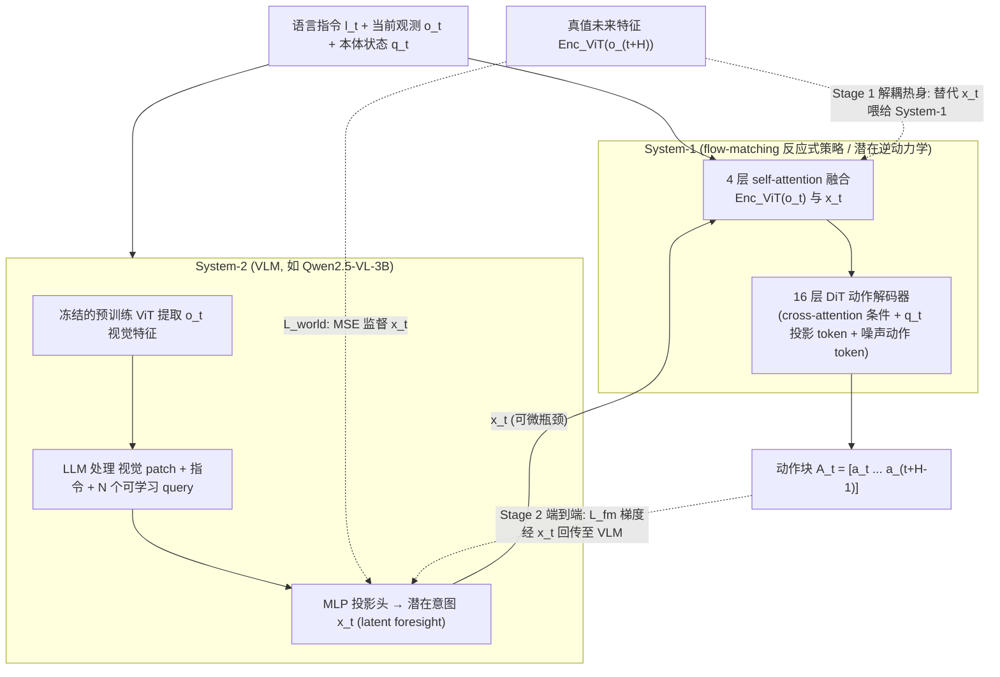

# DIAL

**DIAL**（*Decoupling Intent and Action via Latent World Modeling for End-to-End VLA*，Chen et al.，[arXiv:2603.29844](https://arxiv.org/abs/2603.29844)）指出：多数端到端 VLA 把预训练 VLM **仅当 encoder 直出 action**，既浪费 **高层决策**，又带来 **训练不稳定与语义退化**。DIAL 让 VLM 侧学习 **latent world / visual roadmap**，再解耦生成低层动作。

## 一句话定义

**在 VLA 里用 latent 世界模型先把语言指令 ground 成结构化「视觉计划」，再出动作，而不是 VLM 特征一步映射到 motor。**

## 英文缩写速查

| 缩写 | 英文全称 | 简要说明 |
|------|----------|----------|
| VLA | Vision-Language-Action | 视觉–语言–动作策略 |
| VLM | Vision-Language Model | 预训练多模态大模型骨干 |
| GR-1 | General Robot 1 | RoboCasa 人形桌面操作基准平台 |
| E2E | End-to-End | 端到端联合训练 |
| WM | World Model | 预测/表征环境动态的 latent 模块 |

## 为什么重要

- **Light-O1 对照：** [Light-O1 Tech Blog](https://www.lightorigins.com/en/blog/light-o1) 在 **RoboCasa GR-1 24 任务** 上与 GR00T N1.7、π0.5、**DIAL** 等 **同数据训练** 对比；Light-O1 报告 **79.3% macro success**。
- **VLA 结构论战：** 与「VLM+action expert / flow head」路线并列，强调 **intent 层 world modeling**。

## 流程总览

图依据：论文 §3.1-3.4 / Fig.1 / Fig.3

## 核心机制

1. **Intent 分支：** VLM 生成/维护 **latent visual roadmap** — 抽象语言 → 连贯空间-时间计划。
2. **Action 分支：** 在 latent 结构上输出 **低层控制**，避免语义特征被 action 梯度破坏。
3. **可视化：** 论文展示 latent 如何把 linguistic instruction **ground** 到 structurally aligned 路线图。

## 实验与评测

- **RoboCasa GR1 Tabletop Simulation** 为主要仿真 benchmark 之一（与 Light-O1 同设定：24 厨房任务、1000 demo/task 训练、50 ep 评测）。
- 具体 macro success **以原文 Table 为准**；Light-O1 blog 将其列为 **published baseline** 而非本库复现数值。

## 与其他工作对比

| 维度 | DIAL（本文） | 直出式端到端 VLA（VLM 当 encoder） | [π0.5](./paper-pi05-open-world-vla.md) |
|------|--------------|------------------------------------|-----------------------------------------|
| VLM 的角色 | 产出 **latent visual roadmap**（高层意图） | 特征提取器，一步映射到 motor | 预训练多模态骨干 + 动作专家 |
| 意图/动作耦合 | **解耦**，动作梯度不直接冲刷语义特征 | 强耦合，易训练不稳/语义退化 | 分层但以动作 token 为主 |
| 主张的收益 | 语言 grounding 更结构化、训练更稳 | 结构简单 | 开放世界泛化 |
| 主要代价 | 多一层 latent 世界建模与其监督 | — | 预训练规模成本 |

- **同 benchmark 才可比：** 本页数值口径是 **RoboCasa GR-1 Tabletop**（24 厨房任务 / 1000 demo per task / 50 ep 评测）；[Light-O1](./light-o1.md) 在同设定下报告更高 macro success，但那是 **该博客引用的 published baseline**，不是本库复现值。
- **与世界模型路线的边界：** DIAL 的 latent world 服务的是 **意图 grounding**，不是像素级未来 rollout；与 [Generative World Models](../methods/generative-world-models.md) 一支的评测口径（预测保真度）不同，别拿视频质量指标横比。
- **逐项数值：** macro success 与消融 **以原文 Table 为准**（[arXiv:2603.29844](https://arxiv.org/abs/2603.29844)）。

## 结论

**DIAL 代表 VLA 设计谱系中「先 latent 计划、后 motor」一支，与 Light-O1 的 human prior + BFM 路线正交但共享 RoboCasa 评测坐标。**

1. **解耦 intent/action** 缓解 VLM 语义被 low-level 梯度侵蚀。
2. **Latent roadmap** 使语言指令可检验是否 **ground 到空间结构**。
3. **RoboCasa GR-1** 是 humanoid tabletop 的 **标准对照场** — 读 Light-O1 79.3% 必对照 DIAL 等发表线。
4. **开源状态** 以作者发布为准；本页仅归档 **方法与对照角色**。
5. **部署** 仍依赖仿真 teleop 数据分布；真机 zero-shot 未作为本文主 claim。

## 关联页面

- [ThinkWorld](./paper-thinkworld.md) — 用未来特征预测强化动作推理，并利用人类视频学习技能组合。

- [Light-O1](./light-o1.md) — 同 benchmark 更强 reported macro success
- [RoboCasa](./robocasa.md) — 仿真环境与数据协议
- [π0.5](./paper-pi05-open-world-vla.md) — 同类 VLA 对照

## 参考来源

- [dial_arxiv_2603_29844.md](../../sources/papers/dial_arxiv_2603_29844.md)
- 论文：<https://arxiv.org/abs/2603.29844>
- [arXiv PDF](https://arxiv.org/pdf/2603.29844)：已通读方法部分（实验与附录以略读为准）：摘要、§3（模型总览、System-2、System-1、两阶段训练）、§4.1 实验设定

## 推荐继续阅读

- [Light-O1 Tech Blog — Humanoid Manipulation 节](https://www.lightorigins.com/en/blog/light-o1)
