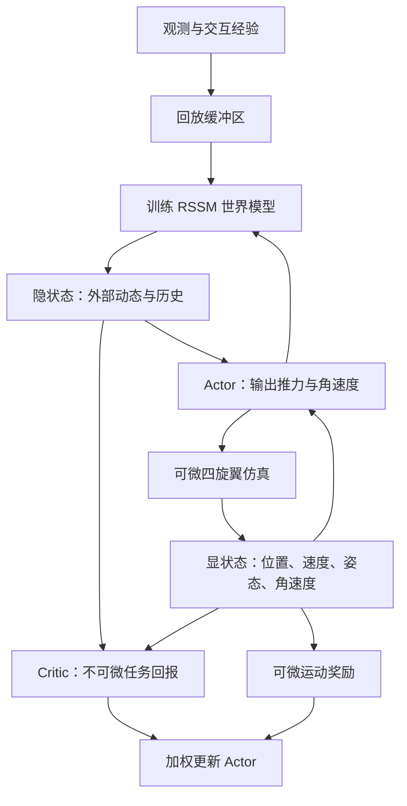

# DiffDreamer：耦合世界模型与可微仿真的敏捷四旋翼控制

## 一句话定义

DiffDreamer 将学习到的外部动态预测与可微机器人动力学同步展开，并结合价值估计与物理梯度优化策略。

## 英文缩写速查

| 缩写 | 英文全称 | 简要说明 |
|------|----------|----------|
| RSSM | Recurrent State Space Model | 历史条件潜状态模型 |
| BPTT | Backpropagation Through Time | 时间展开反向传播 |
| CTBR | Collective Thrust and Body Rate | 总推力与机体系角速度指令 |
| MPC | Model Predictive Control | 模型预测控制 |

## 核心信息

| 字段 | 内容 |
|------|------|
| 论文 | [arXiv:2610.31617v1](https://arxiv.org/pdf/2610.31617v1) |
| 作者 | Fanxing Li、Yuxiang Huang、Shengyang Wang 等 |
| 发表信息 | PDF 页眉标注 IEEE Robotics and Automation Letters；正式出版信息待核实 |
| 任务 | 敏捷目标跟踪、动态门竞速 |

## 流程总览

依据论文 §III-D、图 1–2：两条前向轨迹使用同一动作。图示训练关系；Actor 的潜状态输入使用 stop-gradient，不能把它理解为运动奖励穿过 RSSM 反向传播。

## 核心机制

- RSSM 表达移动目标或门的历史依赖状态；已辨识的可微刚体模型传播无人机自身状态。Actor 和 critic 读取隐状态与显状态的组合。
- 过门等不可微奖励由 critic 估计回报；平滑运动奖励沿物理 rollout 反向传播。Actor 损失是两条目标的加权和，更新 Actor 时世界模型和 critic 参数固定。
- 跟踪观测包含目标相对位置与里程计；竞速观测包含最近两个门的相对位置与机体状态。策略输出 CTBR 指令。

## 源码运行时序图

不适用：截至 2026-11-03，未找到可确认的官方 DiffDreamer 可运行实现，无法核实代码入口。论文使用 VisFly 仿真，但不能据此将其视为该论文完整实现。

## 评测与指标

训练在 VisFly 中与 PPO、DreamerV3 和 BPTT 对比，各五个随机种子；作者报告两项任务均有更快收敛及更高最终回报。

- 跟踪距离误差：DiffDreamer 为 **0.381 ± 0.282 m**，Elastic Tracker 为 **0.793 ± 0.404 m**；评测基于随机轨迹与时间步，数值为均值及标准差。
- 动态门最高速度分别为 1.0、1.5、2.0 m/s 时，512 仿真步内通过门数均值为 **16、12、8**；MPC 对照为 **12、4、1**。每个场景含连续运动的门，统计可超过四个门。
- 消融中，移除离散过门奖励或可微运动奖励均降低过门数；相对位置结合里程计的表示优于文中去除里程计的绝对位置变体。
- 实机使用 3.5 英寸四旋翼、Jetson Orin NX 与 Betaflight，板载推理超过 100 Hz；外部动捕提供机体及目标或门的状态，结果属于概念验证。

## 结论

该研究表明，已知自身动力学与学习到的外部动态可以组合，为敏捷控制提供互补训练信号。

- 复现时需区分 RSSM 潜状态与可微物理状态，保留动作同步和潜状态输入的梯度截断。
- 奖励拆分要结合具体任务检查：过门事件与连续运动项分别贡献价值信号与物理梯度。
- 真机结论受动捕、系统辨识和室内受控环境约束，不能视为机载视觉闭环验证。
- 推广到接触丰富的机器人需要处理接触不连续、执行器限制及感知误差。

## 关联页面

- [基于模型的强化学习](../methods/model-based-rl.md)
- [时间反向传播](../concepts/bptt.md)
- [Sim2Real](../concepts/sim2real.md)

## 参考来源

- [论文资料归档](../../sources/papers/diffdreamer_arxiv_2610_31617.md)
- [论文全文 v1](https://arxiv.org/pdf/2610.31617v1)：通读方法、实验和局限。

## 推荐继续阅读

- [DreamerV3](https://arxiv.org/abs/2301.04104)
