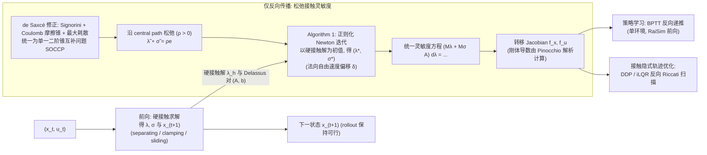

# Differentiable Contact Legged（arXiv:2610.35852）

**Differentiable Contact Legged**（*Differentiable Contact Dynamics for Legged Locomotion: Policy Learning and Contact-Implicit Trajectory Optimization*，[arXiv:2610.35852](https://arxiv.org/abs/2610.35852)，[项目页](https://diffcontact.github.io/)）来自 [具身智能小站 2026-10-28 盘点](../../sources/blogs/wechat_embodied_station_59_papers_human_video_to_robot_experience_2026-10-28.md)，属「灵巧与接触操作」组。

## 一句话定义

**只在反向传播替换摩擦接触灵敏度，前向仍使用硬接触求解。**

## 英文缩写速查

| 缩写 | 英文全称 | 简要说明 |
|------|----------|----------|
| Differentiable Contact Legged | Differentiable Contact Dynamics for Legged Locomotion: Policy Learning and Contact-Implicit Trajectory Optimization | 本文方法 / 基准的简称 |

## 为什么重要

- 接触前向保持硬约束，反向平滑。平滑梯度帮助跨越接触模式边界，应用于腿式策略与接触隐式轨迹优化，并展示无需微调的硬件迁移。
- 开源结论：**项目页未列 GitHub**（步骤 2.5，2026-10-28）。项目页 HTTP 200，未见 GitHub 链接或 coming soon 字样。
- 同期同组工作见 [潜在动作、免渲染事件仿真与机器人评测：具身智能小站 10-28 期 59 篇阅读坐标](../overview/embodied-station-2026-10-28-59-papers-technology-map.md)。

## 流程总览

图依据：论文 §III、§V-A 至 §V-C、§VI-A / Fig.5 / Algorithm 1

## 核心机制

| 项 | 内容 |
|----|------|
| **arXiv** | [2610.35852](https://arxiv.org/abs/2610.35852) |
| **开源** | **项目页未列 GitHub** |
| **要点** | 只在反向传播替换摩擦接触灵敏度，前向仍使用硬接触求解。 |
| **文内指标** | 公众号转述：平滑梯度帮助跨越接触模式边界，应用于腿式策略与接触隐式轨迹优化，并展示无需微调的硬件迁移。 |

## 源码运行时序图

**不适用（项目页未列 GitHub）** — 项目页 HTTP 200，未见 GitHub 链接或 coming soon 字样。 不编造运行脚本；代码公开后再补。

## 实验与评测

- 公众号转述：平滑梯度帮助跨越接触模式边界，应用于腿式策略与接触隐式轨迹优化，并展示无需微调的硬件迁移。
- **读法：** 本页为索引级摘要，依据公众号转述的官方摘要与仓库信息整理；逐项数字与 baseline 以原文 PDF 为准。

## 与其他工作对比

- 横向索引见 [潜在动作、免渲染事件仿真与机器人评测：具身智能小站 10-28 期 59 篇阅读坐标](../overview/embodied-station-2026-10-28-59-papers-technology-map.md)；同 arXiv 不重复造页。

## 结论

**接触前向保持硬约束，反向平滑：平滑梯度帮助跨越接触模式边界，应用于腿式策略与接触隐式轨迹优化，并展示无需微调的硬件迁移。**

1. 开源边界：**项目页未列 GitHub** — 项目页 HTTP 200，未见 GitHub 链接或 coming soon 字样。
2. 核心机制：只在反向传播替换摩擦接触灵敏度，前向仍使用硬接触求解。
3. 复现与选型前核对任务协议、硬件与基准口径，勿直接横比公众号摘录数字。

## 关联页面

- [manipulation](../tasks/manipulation.md)
- [contact-rich-manipulation](../concepts/contact-rich-manipulation.md)
- [dexterous-kinematics](../concepts/dexterous-kinematics.md)
- [embodied-station-2026-10-28-59-papers-technology-map](../overview/embodied-station-2026-10-28-59-papers-technology-map.md)

## 参考来源

- [differentiable_contact_legged_arxiv_2610_35852.md](../../sources/papers/differentiable_contact_legged_arxiv_2610_35852.md)
- [wechat_embodied_station_59_papers_human_video_to_robot_experience_2026-10-28.md](../../sources/blogs/wechat_embodied_station_59_papers_human_video_to_robot_experience_2026-10-28.md)
- [arXiv:2610.35852](https://arxiv.org/abs/2610.35852)
- [arXiv PDF](https://arxiv.org/pdf/2610.35852)：已通读方法部分（实验与附录以略读为准）：摘要、§I、§III（背景与接触模式、de Saxcé SOCCP、灵敏度）、§IV、§V（松弛灵敏度与 Newton 迭代）、§VI（实现）、§VII 起首；§VII-VIII 实验以略读为准

## 推荐继续阅读

- [arXiv PDF](https://arxiv.org/pdf/2610.35852)
- [项目页](https://diffcontact.github.io/)
