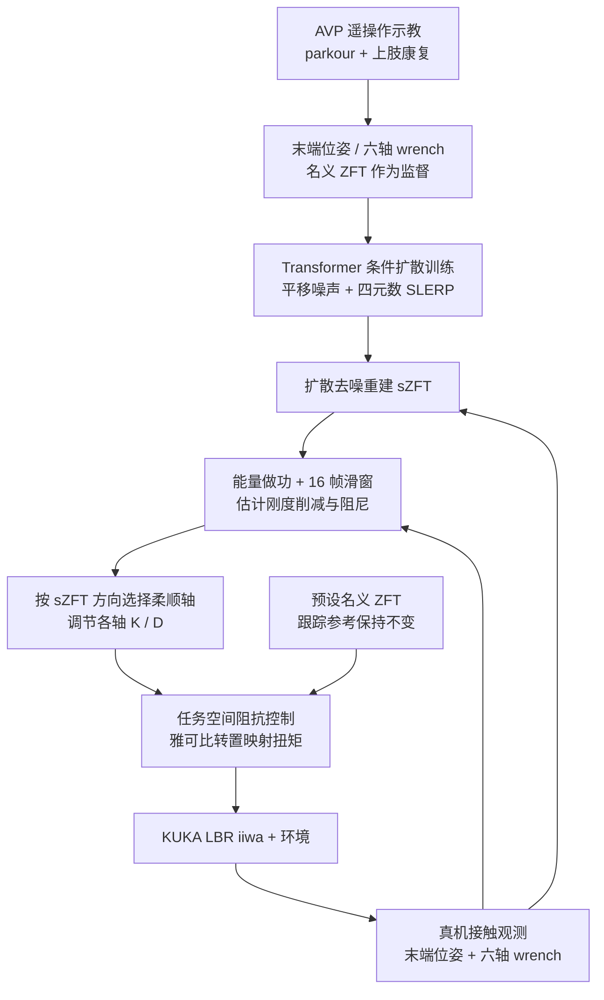
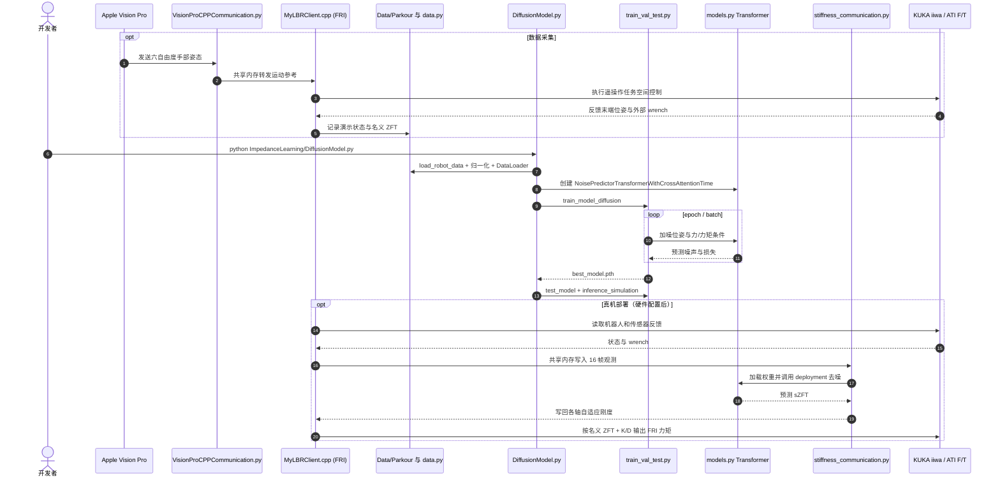

# Diffusion-Based Impedance Learning for Contact-Rich Manipulation Tasks｜面向接触丰富操作任务的基于扩散模型的阻抗学习

## 一句话定义

**Diffusion-Based Impedance Learning**（Geiger 等，IEEE T-RO 2026；[arXiv:2509.19696](https://arxiv.org/abs/2509.19696)）把**外力条件扩散模型**用于重建接触下的模拟零力轨迹（sZFT），再将这一估计送入**能量法阻抗估计与分方向刚度调节**，使机器人沿任务方向有力、在非任务方向顺从，而非让扩散模型直接输出电机力矩或刚度。

## 英文缩写速查

| 缩写 | 英文全称 | 简要说明 |
|---|---|---|
| ZFT | Zero-Force Trajectory | 名义零力轨迹：预编程、真机执行时仍作为运动参考 |
| sZFT | simulated Zero-Force Trajectory | 扩散模型根据接触反馈重建的虚拟平衡轨迹，供阻抗估计使用 |
| F/T | Force/Torque | 外部接触力/力矩（六轴 wrench） |
| SLERP | Spherical Linear Interpolation | 在单位四元数球面插值，构造几何一致的旋转噪声 |
| FRI | Fast Robot Interface | KUKA iiwa 力矩控制接口 |
| AVP | Apple Vision Pro | 六自由度遥操作演示采集设备 |

## 为什么重要

- [阻抗控制](../concepts/impedance-control.md)在装配、探索接触时需要分方向选择刚度/阻尼：过硬卡死，过软又无法插入。
- 传统手调或按预设任务阶段切换增益，在未知接触几何上很难泛化；纯学习动作的[扩散策略](../methods/diffusion-policy.md)也不等于物理交互所需的能量一致力控。
- 本论文把**信息域的接触平衡估计**与**能量域的机械阻抗**分开处理，且在有限示教量下用力觉而非已知孔形状实现接触适应。

## 核心信息

| 项目 | 核实信息 |
|---|---|
| 论文 | Noah Geiger, Tamim Asfour, Neville Hogan, Johannes Lachner |
| 机构 | 卡尔斯鲁厄理工学院（KIT）Institute for Anthropomatics and Robotics / H²T；麻省理工学院（MIT）机械工程系、脑与认知科学系 |
| 出版 | IEEE Transactions on Robotics, 42:3160–3177, 2026；DOI [10.1109/TRO.2026.3717255](https://doi.org/10.1109/TRO.2026.3717255) |
| 数据 | AVP 遥操作 parkour + 上肢康复交互；parkour 约 17,000 条、混合 72,000 条样本（论文 III-D） |
| 模型 | Cross-attention Transformer diffusion；平移噪声 + SLERP 四元数旋转噪声 |
| 控制 | KUKA LBR iiwa 7 DoF，FRI 5 ms / 200 Hz，外置 ATI Gamma F/T |
| 开放 | [官方主页](https://strokeairobotics.github.io/Diffusion-Based-Impedance-Learning_T-RO/)；[MIT 协议源码](https://github.com/StrokeAIRobotics/Diffusion-Based-Impedance-Learning_T-RO)；论文 / CAD / 部分数据与遥操作接口 |

## 核心原理

### ZFT 与 sZFT 的职责不能混淆

1. **名义 ZFT**：由拖动示教关键点，采用 minimum-jerk 与 SLERP 插值生成；在控制循环里是**保持不变的跟踪参考**，可以故意穿过障碍物。
2. **接触观测**：机械臂末端位置、四元数与外部力/力矩的时间序列，来自 F/T 传感器及机器人状态。
3. **扩散重建 sZFT**：Transformer 的 cross-attention 使用 wrench 上下文，逐步去噪平移与四元数旋转误差，推断接触一致的虚拟平衡轨迹；四元数使用 SLERP 保持球面几何。
4. **能量法刚度估计**：用当前位姿与 sZFT 的虚拟弹簧形变及外力做功，按轴推得非负刚度削减项，再结合末端速度加入阻尼反馈。
5. **方向性调节**：相对 sZFT 沿意图方向的比例越高，越保持预设高刚度；在非任务方向允许更大幅度松弛。最终仍由阻抗律与雅可比转置产生关节力矩。

论文 III-E 的简化形式（完整实现含数值正则、速度项、阈值与截断）：

- 平移能量：$E_t = \frac{1}{2}K_t \|\hat e_t\|^2$，接触做功：$W_t = f_{\rm ext}^{T}\hat e_t$。
- 等效刚度削减：$k_t^* \propto 2W_t/(\|\hat e_t\|^2+\varepsilon)$；转动按角轴误差与外力矩同理。
- 方向系数：$\psi_i=|\hat e_i|/\|\hat e\|$，$\rho_i=1-\psi_i$；最终 $K_i = K_{i,\max} - \rho_i k_i^*$，并截断至合法范围。
- 力矩指令：$\tau_{\rm ctrl}=J(q)^T[f_{\rm ctrl};m_{\rm ctrl}]$（论文 Eq. 15）；传感器坐标系与零力参考不同，不能直接替换。

**重要边界：** 文中称能量一致的估计/交互框架，但不能据此推断“任何学习模型/接触条件下都已经数学证明全局被动性或安全性”。

## 流程总览

## 源码运行时序图

根据[官方源码归档](../../sources/repos/diffusion-based-impedance-learning-tro.md)的入口，训练与在线部署分别如下；这是**静态代码调用链核对**，不代表本次运行或真机验证。

## 工程实践

| 步骤 | 入口 / 核查重点 |
|---|---|
| 离线训练 | 在官方仓根目录建 conda 环境后运行：python ImpedanceLearning/DiffusionModel.py；首先检查 Data/Parkour 数据、路径、序列长度、归一化和模型保存目录 |
| 推理与测试 | DiffusionModel.py 顺序调用 train_model_diffusion → test_model → inference_simulation，选用最优 checkpoint |
| 训练模型 | models.py 的 NoisePredictorTransformerWithCrossAttentionTime；可选输入外力和外力矩，旋转误差按四元数处理 |
| 在线通信 | stiffness_communication.py 读 shared_memory 的 16 帧窗口并调 train_val_test.deployment；需要配置硬编码 checkpoint、Python 路径和内存布局 |
| 真机闭环 | Deployment/RobotController/src/MyLBRClient.cpp 使用 FRI 力矩控制，FT 采样、刚度与阻尼限幅及碰撞停止需按实际机器人核验 |
| 复现实测 | 对每类 peg 分别记录插入成功、力峰值、速度上限、接触持续时间、各轴刚度、sZFT 与 ZFT 偏差；不可仅报 100% |

原文实验参数：最大平移刚度 800 N/m，最大旋转刚度 150 Nm/rad；估计窗口 16×5 ms；力/力矩触发阈值 1 N / 1 Nm。**这些是作者装置参数，不是通用安全推荐值。**

## 实验与评测

| 论文实验（每类 peg 30 次） | 圆柱 | 方形 | 星形 |
|---|---:|---:|---:|
| 完整扩散 + sZFT + 方向自适应 | 30/30 | 30/30 | 30/30 |
| 扩散模型，但不做方向自适应 | 0/30 | 0/30 | 0/30 |
| 只基于名义 ZFT 做方向自适应 | 30/30 | 0/30 | 0/30 |
| 固定均匀高刚度 | 30/30 | 4/30 | 0/30 |
| 固定均匀中刚度 | 30/30 | 13/30 | 5/30 |
| 人工最佳非均匀刚度 | 30/30 | 26/30 | 21/30 |

*依据 arXiv v4 §IV-C / Table III；均为作者实验结果，不是本仓运行数据。*

- **模型精度（III-D Table II）**：512 hidden / 4 heads / 6 layers 的 parkour 模型位置误差 0.994 mm、角幅值误差 0.249°；混合 72k 样本训练进一步到 0.883 mm / 0.233°。误差是测试数据上的轨迹重建量，**不是装配定位精度**。
- **parkour 真机**：固定基线在第一障碍物触发保护停止；自适应沿三处障碍继续运动，未触发论文设置的 0.24 m/s、20 N 停止阈值。
- **泛化说明**：训练数据未包括 peg-in-hole 专用示范；成功基于单一 KUKA 平台、指定 peg 几何与试验协议，不能外推为任意装配任务通用成功率。
- **细分形状**：星形 peg 在固定均匀高刚度下 0/30，是检验旋转接触补偿的重要场景；论文还报告 x/y 约 ±1 mm 的星形侧向偏差容忍度。

## 结论

**本论文的实际增益来自“预测接触一致的虚拟平衡 sZFT，再以物理阻抗做分方向调节”的组合，而非直接用扩散模型替代力矩闭环。**

1. 保留**名义 ZFT**作轨迹参考；只用 sZFT 调阻抗，避免将两种零力轨迹混为一个控制命令。
2. **方向性是关键机制**：只有扩散而无方向调节在三类 peg 均 0/30；单凭名义 ZFT 做方向调节也无法完成方/星形插入。
3. **按接触环境选限值**：基线 800 N/m、150 Nm/rad 和传感器阈值是特定平台设置，接触安全不能直接照搬。
4. **精度与成功率要拆开报告**：0.883 mm 重建误差不代表实际孔位误差；peg 的 30/30 是限定样本量内的成功记录。
5. **源码复现需接通 F/T、IPC、FRI、控制回路**：公开 Python 训练代码不足以独立复现真机闭环。
6. **适合接在高层 VLA/IL 之后**，作为可感知接触的低层执行接口；论文未验证这一层级组合的实机效果。

## 与其他工作对比

| 路线 | 与本文的区别 / 适用场景 |
|---|---|
| 固定阻抗 / 人工阶段调参 | 不需要训练扩散模型，但多几何装配需重新调参；作者最佳手调非均匀刚度在星形 peg 为 21/30 |
| [Diffusion Policy](../methods/diffusion-policy.md) | 学习多模态动作分布/轨迹；本文的模型预测 sZFT 供能量估计，仍由经典阻抗控制产生力矩 |
| [触觉阻抗控制](../methods/tactile-impedance-control.md) | 基于力/触觉反馈改变顺从性；本文特别使用扩散去噪恢复接触平衡、按方向算自适应刚度 |
| [ForceHarness](./paper-forceharness-2611-21099.md) | ForceHarness 是冻结多模态模型 + 快速自终止力原语；本文是论文训练的连续低层阻抗调节，不提供上层任务规划 |
| [接触丰富操作](../concepts/contact-rich-manipulation.md) | 本论文是其中“未知接触下可变阻抗”的具体实现，不等于解决视觉对象识别或抓取全部步骤 |

## 局限与风险

- 单臂 KUKA iiwa、作者设备的 200 Hz FRI 与 ATI Gamma 传感器；换机器人、负载、执行器和工件刚度需重新验证模型与控制稳定性。
- 作者训练数据来自 parkour 和上肢康复任务；peg 几何外推只在论文三类工件和限定试验上被验证。
- 算法设计面向接触控制，**没有替代未知物体的抓取规划、精确几何估计或高层任务决策**。
- 模型推理与 F/T 的网络、共享内存以及端到端时延是部署风险；官方 Python 部署脚本含本机路径和初始化配置，不宜直接移植上线。
- 能量法用做功关联刚度，不等于单凭实验就获得形式化全局稳定与安全保证；实机仍需保护停止/力矩限幅。

## 关联页面

- [阻抗控制](../concepts/impedance-control.md)
- [接触丰富操作](../concepts/contact-rich-manipulation.md)
- [Diffusion Policy](../methods/diffusion-policy.md)
- [触觉阻抗控制](../methods/tactile-impedance-control.md)
- [ForceHarness：力觉物理接口](./paper-forceharness-2611-21099.md)
- [接触操作纵深路线](../../roadmap/depth-contact-manipulation.md)

## 参考来源

- [原文精读及 DOI 归档](../../sources/papers/diffusion-based-impedance-learning-2509-19696.md)
- [官方项目页与实验视频归档](../../sources/sites/diffusion-based-impedance-learning.md)
- [官方训练/推理/真机代码归档](../../sources/repos/diffusion-based-impedance-learning-tro.md)

## 推荐继续阅读

- [arXiv 2509.19696 v4 全文](https://arxiv.org/html/2509.19696v4)
- [IEEE T-RO 出版记录](https://doi.org/10.1109/TRO.2026.3717255)
- [官方项目演示视频](https://strokeairobotics.github.io/Diffusion-Based-Impedance-Learning_T-RO/)
- [官方源代码](https://github.com/StrokeAIRobotics/Diffusion-Based-Impedance-Learning_T-RO)
