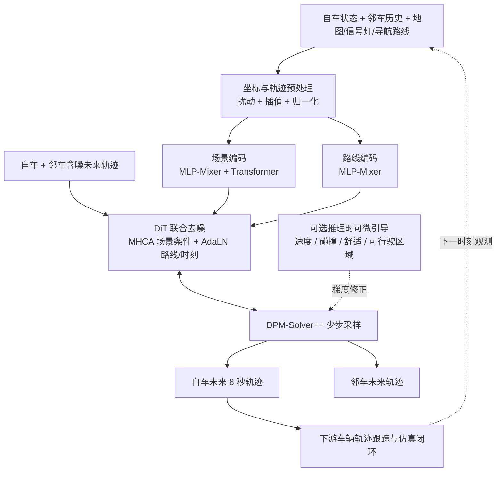
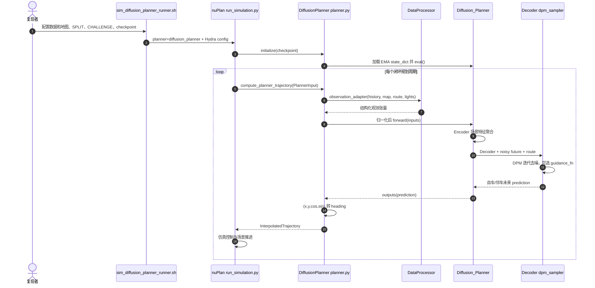

# Diffusion Planner：基于扩散模型与灵活引导的自动驾驶闭环规划 / Diffusion-Based Planning for Autonomous Driving with Flexible Guidance

**Diffusion Planner**（[论文 arXiv:2501.15564v2](https://arxiv.org/html/2501.15564v2)，[ICLR 2025 Oral](https://openreview.net/forum?id=wM2sfVgMDH)，[项目主页](https://zhengyinan-air.github.io/Diffusion-Planner/)，[官方源码](https://github.com/ZhengYinan-AIR/Diffusion-Planner)）由清华大学、中国科学院自动化研究所、香港中文大学、上海交通大学、毫末智行与上海人工智能实验室合作研究，提出面向**自动驾驶车辆（而非直接面向人形执行器）**的学习型局部轨迹规划器。

## 一句话定义

**在统一的 DiT 扩散去噪空间里联合生成自车规划与邻车预测轨迹，并用推理时可微能量引导调整速度、安全与舒适偏好，使主实验可以直接使用模型轨迹、不依赖规则式输出后处理。**

## 英文缩写速查

| 缩写 | 英文全称 | 简要说明 |
|---|---|---|
| DiT | Diffusion Transformer | 自车/周车联合轨迹生成的 Transformer 去噪骨干 |
| MHCA | Multi-Head Cross-Attention | 将道路及邻车上下文注入去噪轨迹 |
| AdaLN | Adaptive Layer Normalization | 注入路线编码和扩散时刻条件 |
| DPM-Solver | Diffusion Probabilistic Model Solver | 少步数值采样，减少多轮去噪时延 |
| LQR | Linear Quadratic Regulator | 由下游控制器跟踪输出的未来车辆轨迹 |
| NR / R | Non-Reactive / Reactive | nuPlan 闭环非响应/响应式交通参与者两种不同评测 |

## 为什么重要

- **联动预测与规划：** 不把邻车预测和自车规划做成互不相干的两个模型；允许在生成时建模相互作用。
- **把多峰轨迹直接做成闭环输出：** 区别于只回归单条轨迹且依赖候选筛选的学习式方案，主实验比较的是不经规则后处理的输出。
- **推理时可组合引导：** 速度目标、碰撞余量、drivable area、jerk 可各自写成可微能量，在采样过程中介入，不必为每个偏好重训。
- **跨领域启发：** 与[机器人 Diffusion Policy](./paper-diffusion-policy.md)共享迭代去噪/滚动决策思想，但这里的动作空间是**车辆未来位姿轨迹**，不是机械臂关节 action chunk。

## 核心信息

| 项 | 经原文核对的范围 |
|---|---|
| 机构 | 清华大学；中国科学院自动化研究所；香港中文大学；上海交通大学；毫末智行（HAOMO.AI）；上海人工智能实验室 |
| 论文 | ICLR 2025 Oral；arXiv v2（2025-02-09） |
| 输入 | 自车当前状态、邻车 2 s 历史、矢量化车道/静态对象、路线和信号灯等结构化信息 |
| 输出 | 自车 + 选定邻车未来轨迹；每点 (x, y, cos heading, sin heading) |
| 默认规模（附录 Table 5） | 预测 10 辆邻车；3 encoder + 3 decoder blocks；hidden 192；6 heads；10 次去噪 |
| 时域与速度 | 未来 8 秒、轨迹 10 Hz；**推理约 20 Hz**（单张 NVIDIA A6000，非车规设备实测） |
| 开放程度 | 训练、数据处理、仿真评测、引导代码及 HF checkpoint 已公开；200 h 配送车数据仍待发布 |

## 核心原理

1. **联合轨迹变量（论文 §4.1）：** 将自车与最多 10 个选定邻车的未来序列拼为同一个待去噪张量；单点使用平面位置及航向角正余弦，不直接输出油门、制动或转向力矩。
2. **条件编码（§4.2）：** 邻车/车道的结构化向量通过独立 MLP-Mixer 编码，静态对象用 MLP，聚合后经 Transformer encoder 得到场景条件；导航路线经另一 MLP-Mixer 编码，并和时间嵌入一起注入 DiT 的 AdaLN；轨迹通过 MHCA 读取场景 token。
3. **训练：** 用随机扩散时刻的含噪联合轨迹作为输入，监督去噪网络恢复无噪轨迹；论文 Eq. (5) 为 MSE 类重建损失。训练前的自车状态扰动、未来五次插值和 ego-centric/z-score 归一化是关键配方。
4. **推理/闭环：** DPM-Solver++ 从初始随机未来轨迹逐步采样，约 10 步生成未来 8 秒轨迹；nuPlan 控制器跟踪自车规划，下一周期重新观测与规划。
5. **引导（§4.3，Eq. (8)）：** 可微能量 `E(denoised trajectory)` 的梯度修改采样 score。论文示例包含目标车速、避碰、路面可行驶域和舒适性；可多项组合、无需训练额外分类器，**但能量函数是人工定义的，并不构成形式化安全证明**。

## 流程总览

## 源码运行时序图

按 [官方 README 与源码入口](../../sources/repos/diffusion-planner.md) 静态核实：`sim_diffusion_planner_runner.sh` 触发 nuPlan 的 `run_simulation.py`，实际推理在 `DiffusionPlanner.compute_planner_trajectory` 内完成。

源码中的 `outputs_to_trajectory` 实际调用 nuPlan `transform_predictions_to_states`；上述时序**不是已运行成功的日志**。引导可通过 `sim_guidance_demo.sh` 和 `guidance_wrapper.py` 的可微函数扩展。

## 工程实践

| 步骤 | 官方路径与注意点 |
|---|---|
| 环境 | Python 3.9、`nuplan-devkit` + `pip install -e .` 与 `requirements_torch.txt`；准备 nuPlan 数据/地图 |
| 模型 | 从官方 HF 获取 `args.json`、`model.pth` 到 `checkpoints/` |
| 仿真 | 在 `sim_diffusion_planner_runner.sh` 填写 4 个路径、split、challenge；执行 `bash sim_diffusion_planner_runner.sh` |
| 可视化 | 用 `run_nuboard.ipynb` 打开仿真结果 |
| 引导 | 按 `diffusion_planner/model/guidance/documentation_guidance.md` 实现可微函数并注册，运行 `sim_guidance_demo.sh` |
| 从头训练 | `data_process.sh`（调用 `data_process.py`）→ `torch_run.sh`（8 进程 distributed `train_predictor.py`） |
| 指标监控 | nuPlan score、碰撞、TTC、drivable area、comfort、progress；按 R/NR 和有无 refine 分开报告 |
| 运行状态 | **未在本次 ingest 中下载数据集、运行 nuPlan 仿真或复现模型分数**；仅根据公开论文与源码做静态核对 |

## 实验与评测

论文 Table 1 的 nuPlan 分数（0–100，越高越好；R=Reactive，NR=Non-reactive）：

| 方法 | Test14 (R) | Test14-hard (R) | Test14 (NR) |
|---|---:|---:|---:|
| PlanTF（直接输出） | 79.58 | 61.61 | 85.62 |
| PLUTO w/o refine | 78.62 | 59.74 | **89.90** |
| **Diffusion Planner（无 refine）** | **82.93** | **69.22** | 89.19 |
| PDM-Closed（规则基线） | 91.63 | 75.19 | 90.05 |
| Diffusion Planner w/ refine（追加规则后处理） | 91.75 | 82.00 | 94.80 |

- 论文所述“纯输出学习型 SOTA”仅是**所选 2025 年 nuPlan 对照协议**下的结论，不表示高于所有规则方法，也不是当前所有基准的绝对领先。
- 200 h 配送车闭环 score：Diffusion Planner **92.08**，PlanTF 90.89、PLUTO w/o refine 87.77；但数据没有提供公开复现下载。
- Test14 非响应式消融（Table 3）：baseline 89.19；去掉 z-score 85.02、未来插值 83.78、数据增强 76.53；说明预处理/增强对性能影响显著。
- 附录 Table 4 对无 refinement 模式列出约 **0.04 s** 推理时间；附录 C/E 约 **0.05 s / 20 Hz**，均需注明对应硬件/配置。

## 结论

**本文证明在作者所评估的 nuPlan 闭环设定下，联合多车扩散轨迹可在不依赖输出后规则 refinement 的情况下取得有竞争力的学习型规划成绩；性能、可控性与安全认证仍是不同问题。**

1. **先比较同一评测协议** — Reactive、Non-reactive 和是否启用 refinement 不能混算，尤其 82.93 与 91.75 是不同系统设置。
2. **预处理不是配角** — 插值与扰动增强、ego-centric/z-score 归一化直接影响闭环表现。
3. **联合未来轨迹更适合表达交互** — 自车规划和邻车预测在同一去噪器中生成，但可靠性仍取决于感知与场景分布。
4. **推理时偏好可组合** — 可微能量指导速度、避碰等目标，无需另训分类器；需验证梯度连续性和物理约束。
5. **部署预算需分层** — 8 秒是预测范围，20 Hz 是论文 A6000 条件下模型推理频率，并非 8 秒计算时间或车规实时保证。
6. **对外复现选择 nuPlan** — 官方代码、模型权重已发布；200 h 配送车数据未发布，相关跨场景结论仍由作者实验支持。

## 与其他工作对比

| 方法 | 本质区别 |
|---|---|
| [机器人 Diffusion Policy](./paper-diffusion-policy.md) | 操作策略生成 action chunk；本文面向车体未来位姿轨迹，自车规划+邻车预测联合扩散，执行由车辆控制器承担 |
| [Diffusion Policy 方法页](../methods/diffusion-policy.md) | 共通的去噪与滚动执行直觉；本文使用 DiT、路线/地图向量条件及可微能量引导 |
| PlanTF / PLUTO | 学习型车辆轨迹基线；本文重点减少对输出后候选打分/规则 refinement 的依赖 |
| [Autoware](./autoware.md) | Autoware 是完整感知–定位–规划–控制栈；Diffusion Planner 是 nuPlan 中的单个学习规划模块，不能声称可无改动直接取代量产栈 |

## 局限与风险

- **非原始传感器端到端：** 依赖矢量化车道、导航路线、周车检测和历史；尚不等于 camera-to-control 的 E2E。
- **大横向机动泛化弱：** 作者承认变道、强横向避让样本不足，闭环容易出现 OOD 行为。
- **规划与控制有落差：** 输出不是直接油门/刹车，跟踪误差及延迟可让执行轨迹偏离预测。
- **有可微偏好，但非安全保证：** “无需规则后处理”不是“没有显式目标设计”，更不是道路行驶安全的形式证明。
- **推理成本/数据缺口：** 多步采样仍需较强算力；公开的 A6000 20 Hz 不能直接等同嵌入式部署；配送车 200 h 数据集尚未开源。
- **实验结论受时间和协议约束：** SOTA 是 ICLR 2025 论文作者当时的基线范围，不代表 2026 年自动驾驶最新排名。

## 关联页面

- [自动驾驶核心算法技术地图](../overview/autonomous-driving-core-algorithms-series.md) — 感知/预测/规划/控制的位置
- [Diffusion Policy 原论文](./paper-diffusion-policy.md) — 生成动作序列而非车辆轨迹
- [Diffusion Policy 方法](../methods/diffusion-policy.md) — 少步采样与滚动执行
- [Autoware](./autoware.md) — 量产全栈对照
- [扩散与流匹配策略纵深路线](../../roadmap/depth-robotics-diffusion-dit-flow.md) — Stage 2 的车体轨迹 DiT 跨领域延伸

## 参考来源

- [论文 v2 全文通读档案](../../sources/papers/diffusion_planner_arxiv_2501_15564.md)
- [官方项目页资料归档](../../sources/sites/diffusion-planner.md)
- [官方代码/入口核对档案](../../sources/repos/diffusion-planner.md)

## 推荐继续阅读

- [arXiv:2501.15564v2 全文 HTML](https://arxiv.org/html/2501.15564v2)
- [Diffusion Planner 官方主页](https://zhengyinan-air.github.io/Diffusion-Planner/)
- [GitHub 原始代码](https://github.com/ZhengYinan-AIR/Diffusion-Planner)
- [Hugging Face 模型 checkpoint](https://huggingface.co/ZhengYinan2001/Diffusion-Planner)
