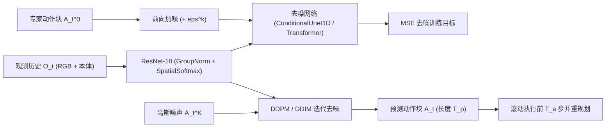
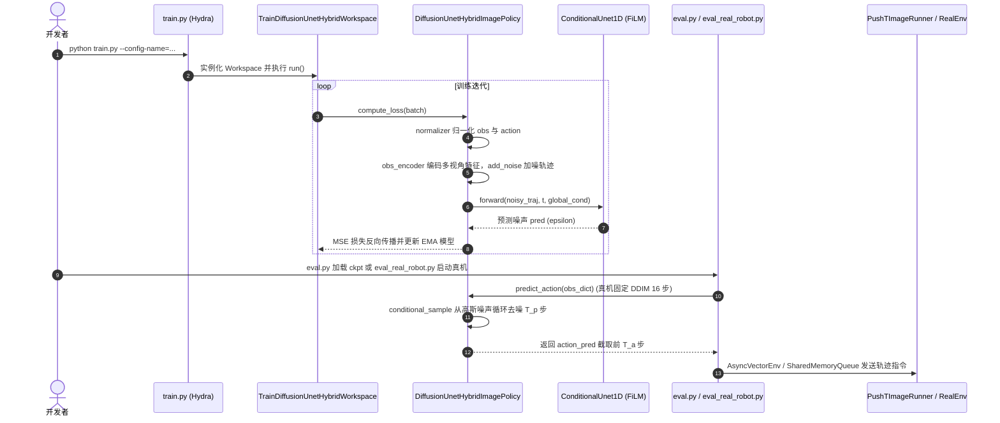
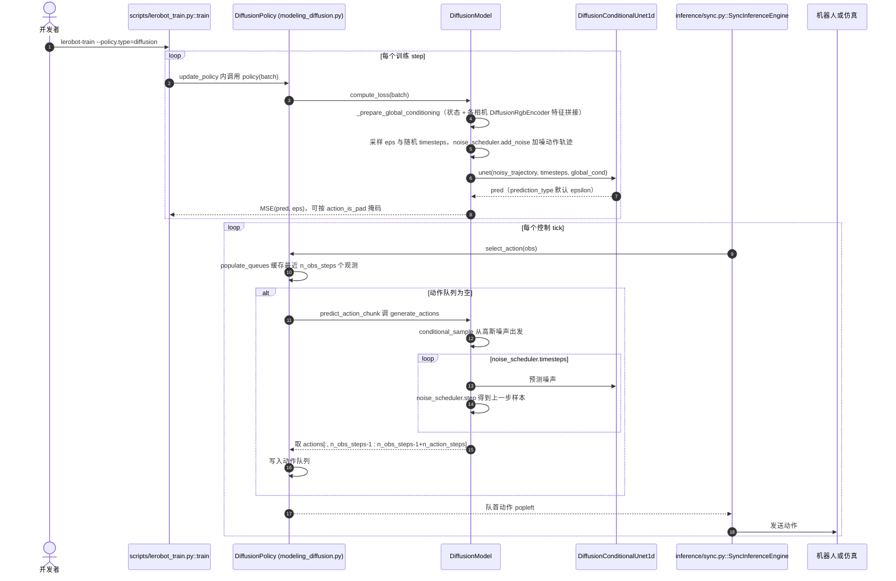

# Diffusion Policy：用去噪生成动作序列

**Diffusion Policy**（*Visuomotor Policy Learning via Action Diffusion*，[arXiv:2303.04137](https://arxiv.org/abs/2303.04137)，IJRR 2025，[项目页](https://diffusion-policy.cs.columbia.edu/)，[代码](https://github.com/real-stanford/diffusion_policy)）由 **哥伦比亚大学 / MIT / Toyota Research Institute** 提出：将去噪扩散概率模型引入机器人视觉运动策略，直接在**动作序列（action chunk）**空间拟合条件动作分布 $p(\mathbf{A}_t \mid \mathbf{O}_t)$ 并结合滚动执行控制。它虽非带语言条件的多模态 VLA，但奠定了 [π₀](./paper-pi0.md)、[RDT-1B](./paper-rdt-1b.md) 等后续模型的动作生成范式。方法综述见 [diffusion-policy](../methods/diffusion-policy.md)。

## 一句话定义

**把视觉运动策略建模为条件动作块分布 $p(\mathbf{A}_t \mid \mathbf{O}_t)$ 的迭代去噪过程，输出多峰且时序连贯的动作轨迹并以滚动窗口执行前缀。**

## 英文缩写速查

| 缩写 | 英文全称 | 简要说明 |
|------|----------|----------|
| DP | Diffusion Policy | 本文提出的视觉运动扩散策略 |
| DDPM | Denoising Diffusion Probabilistic Model | 训练期噪声预测与标准多步去噪模型 |
| DDIM | Denoising Diffusion Implicit Model | 推理期加速采样的隐式去噪调度器 |
| FiLM | Feature-wise Linear Modulation | 将观测特征调制注入 1D U-Net 残差块 |
| IL | Imitation Learning | 模仿学习训练范式 |
| ACT | Action Chunking with Transformers | 并行基于 CVAE 的动作块路线，见 [ACT](./paper-act.md) |
| VLA | Vision-Language-Action | 视觉–语言–动作策略 |
| WAM | World Action Model | 世界预测与动作生成耦合模型 |

## 为什么重要

- **解决多峰与高频抖动难题：** 面对“绕左还是绕右”等多峰专家示教时，确定性 MSE 回归会取失效的中间均值，而隐式能量模型训练困难；Diffusion Policy 通过得分匹配稳定拟合复杂连续分布。
- **确立动作块与滚动重规划协同：** 结合 [Action Chunking](../methods/action-chunking.md) 与 [滚动预测执行](../concepts/receding-horizon-policy-execution.md)，兼顾长程时间一致性与高频闭环反馈纠偏。
- **奠定工程可复用基座：** 官方仓 `real-stanford/diffusion_policy` 提供 CNN 1D U-Net 与 Transformer 两套实现及共享内存真机控制框架，成为 [LeRobot](./lerobot.md)、[DiT-Block Policy](./paper-robotic-dit-ingredients-dit-block-policy.md) 与各类流匹配 VLA 动作头的直接先驱。

## 核心原理

### 核心信息

| 项 | 内容 |
|----|------|
| **机构** | 哥伦比亚大学；麻省理工学院；Toyota Research Institute |
| **出处** | RSS 2023 · International Journal of Robotics Research (IJRR 2025) · arXiv:2303.04137 |
| **输入** | 最近 $T_o$ 步多视角 RGB 图像 + 低维本体状态 $\mathbf{O}_t$ |
| **输出** | 未来 $T_p$ 步连续动作块 $\mathbf{A}_t$，部署执行其中前 $T_a$ 步（$T_a \le T_p$） |
| **去噪骨干** | CNN 版（`ConditionalUnet1D` + FiLM）与 Transformer 版（`TransformerForDiffusion`） |
| **开源** | **已开源** — [real-stanford/diffusion_policy](https://github.com/real-stanford/diffusion_policy) |

### 关键机制

1. **动作得分去噪目标：** 在观测历史 $\mathbf{O}_t$ 条件下，从高斯噪声 $\mathbf{A}_t^K \sim \mathcal{N}(\mathbf{0}, \mathbf{I})$ 出发执行迭代去噪更新：
   $$\mathbf{A}_t^{k-1} = \alpha \left( \mathbf{A}_t^k - \gamma \varepsilon_\theta(\mathbf{O}_t, \mathbf{A}_t^k, k) + \mathcal{N}(\mathbf{0}, \sigma^2 \mathbf{I}) \right)$$
   训练时从数据集中采样真实动作块并加随机时间步 $k$ 的高斯噪声 $\varepsilon^k$，最小化噪声预测均方误差 $\mathcal{L} = \|\varepsilon^k - \varepsilon_\theta(\mathbf{O}_t, \mathbf{A}_t^0 + \varepsilon^k, k)\|^2$。
2. **双去噪骨干对比：**
   - **CNN 版（`ConditionalUnet1D`）：** 使用带时序一维卷积的 [1D U-Net](../methods/unet.md) 与 `ConditionalResidualBlock1D`，通过 **FiLM**（scale/bias）注入时间步与全局观测嵌入；带有平滑归纳偏置，默认超参对大多数操作任务稳定好训。
   - **Transformer 版（`TransformerForDiffusion`）：** 采用 MinGPT 风格的因果自注意力与交叉注意力解码器直接对动作词元去噪；表达复杂高频或速度动作能力强，但对超参与学习率敏感（后由 [DiT-Block Policy](./paper-robotic-dit-ingredients-dit-block-policy.md) 针对性改进）。
3. **视觉编码与归一化稳健性：** 默认以每相机独立 **ResNet-18** 编码图像，并将 **BatchNorm 替换为 GroupNorm** 以兼容 EMA 权重评估与小批量，结合 **SpatialSoftmax** 提取关键点特征与 **CropRandomizer** 裁剪增广；对观测和动作采用基于数据集极值统计的 `LinearNormalizer`（映射至 `[-1, 1]`）。
4. **滚动视野执行（Receding Horizon）：** 策略观测最近 $T_o$ 步预测未来 $T_p$ 步，但实机仅发送 $T_a$ 步（动作执行视野），并在延迟对齐下触发下一轮采样，既抑制单步错误累积又保留闭环响应能力。

### 流程总览

## 评测与实验对比

基于 `arXiv:2303.04137v5` 全文核对结果，核心实证结论如下（完整实验表见原文与[论文来源归档](../../sources/papers/diffusion_policy_arxiv_2303_04137.md)）：

- **跨基准综合提升：** 在涵盖 Robomimic、Push-T、Block-Push 与 Franka Kitchen 的 **15 项仿真与真机任务**对比中，Diffusion Policy 相比此前最强行为克隆基线（LSTM-GMM、IBC、BET）取得了平均 **46.9%** 的相对成功率提升（论文跨任务汇总口径，并非每个任务均提升 46.9 个百分点）。
- **位置控制与多峰优势：** 实验表明扩散模型在**绝对位置控制**（而非仅速度控制）上表现尤为稳健，且在 Push-T 与 Block-Push 等具有明显左右分支对称性的任务上能够保持模式覆盖而不会坍缩到障碍物碰撞均值。
- **方法论与复核审计标注：**
  - **Robomimic 初始状态数量差异（正文 `§5.2` 脚注）：** 论文基准测试原计划采用 50 个随机初始状态，但因评测代码 bug 实际仅使用了 **22 个初始状态**；横比后续论文时必须注意这一初始化口径差异。
  - **DDIM 加速口径区分（`§3.4` vs `Appendix A.4`）：** `§3.4` 以 **100 训练步 / 10 DDIM 推理步**在 NVIDIA RTX 3080 上测得约 **0.1 s** 单次块推理耗时作为算力示例；而 `Appendix A.4` 及官方真机代码 `eval_real_robot.py` 实际配置为 **100 训练步 / 16 DDIM 推理步**，在 Push-T 真机（IoU 与成功率双判据）、杯具翻转（mug flipping）、酱料倾倒与涂抹（sauce pouring/spreading）等真机任务上验证闭环可用。

## 与其他工作对比

| 工作 | 去噪/生成范式 | 骨干与条件注入 | 相对本页演进关系 |
|------|---------------|----------------|------------------|
| [ACT](./paper-act.md) | CVAE + L1 回归 | DETR 风格 Transformer | 并行开启 Action Chunking，但高斯隐变量对强多峰分布表达弱于扩散 |
| [DiT-Block Policy](./paper-robotic-dit-ingredients-dit-block-policy.md) | DDPM / DDIM | 分相机 ResNet + FiLM + **adaLN-Zero** | 针对本页 Transformer 版难训问题给出稳定收敛的 DiT 配方 |
| [RDT-1B](./paper-rdt-1b.md) | DDPM / DPM-Solver++ | 1.2B RDT（QKNorm + RMSNorm + ACI） | 扩展为跨 46 数据集、128D 统一动作空间的双臂扩散基础模型 |
| [π₀](./paper-pi0.md) | Conditional Flow Matching | PaliGemma VLM + 动作专家 | 将多步扩散迭代升级为少量步数流匹配，并接入预训练 VLM 语言理解 |
| [Diffusion Planner](./paper-diffusion-planner-autonomous-driving.md) | DiT 联合轨迹去噪 + 可微能量引导 | MLP-Mixer + Transformer 融合 + MHCA/AdaLN | 将轨迹去噪延展至自动驾驶闭环多车交互规划（输出航迹供控制器跟踪），无需重训分类器即可在采样期注入能量引导 |

## 结论

**Diffusion Policy 将连续控制模仿学习从“逐帧动作回归或难训隐式能量函数”推进到“多步去噪生成动作块”，是现代机器人扩散与流匹配策略的共同起点。**

- **默认选型优先 CNN 骨干：** 在中小规模单任务或少任务操作上，`ConditionalUnet1D`（FiLM 调制）比原生 cross-attention Transformer 更容易复现稳定收敛。
- **控制接口对齐优先位置空间：** 相比直接预测高频末端速度，采用动作块级别的位置目标配合低层跟踪控制器更契合扩散生成的平稳轨迹特性。
- **部署必须权衡视野与步数：** 多步迭代去噪存在固有的延迟成本，实际部署需结合 DDIM 降步（如 10–16 步）、`T_a` 步动作缓冲区与线程异步推理匹配控制周期。
- **评估与跨文献比较须审慎核对口径：** 复现或引用其 Robomimic 数字时须留意 22 个初始状态的源码历史 bug，以及论文举例（10 步）与真机脚本（16 步）的差异。
- **向上升级路径：** 需要语言泛化与大规模跨本体迁移时，应转向结合 VLM 与扩散/流匹配的架构（如 [Dita](./paper-dita-scaling-diffusion-transformer-vla.md)、[RDT-1B](./paper-rdt-1b.md) 或 [π₀](./paper-pi0.md)）。

## 源码运行时序图

### 官方仓库 `real-stanford/diffusion_policy` 运行链

节点直接对照 `train.py`、`eval.py`、`eval_real_robot.py`、`TrainDiffusionUnetHybridWorkspace`、`DiffusionUnetHybridImagePolicy`、`ConditionalUnet1D` 及 `PushTImageRunner` 源码：

### LeRobot 版（固定提交 9e5ee98）函数级时序图

节点来自 LeRobot 源码（路径相对 `src/lerobot/`），已对照阅读 `policies/diffusion/modeling_diffusion.py`、`configuration_diffusion.py`、`scripts/lerobot_train.py`、`inference/sync.py`。

### LeRobot 实现要点

- **身份核对：** LeRobot 文档 `docs/source/policy_diffusion_README.md` 的论文链接指向 Diffusion Policy 项目页，引用为 Chi 等 IJRR 2024 的 *Diffusion Policy: Visuomotor Policy Learning via Action Diffusion*；`DiffusionPolicy` 类 docstring 指向同一论文与 `real-stanford/diffusion_policy`。**本页即 README 中「Diffusion」的 canonical 节点**；[methods/diffusion-policy](../methods/diffusion-policy.md) 是方法综述页。
- **只实现了 UNet 去噪器：** LeRobot 里去噪网络是 `DiffusionConditionalUnet1d`（FiLM 条件，`use_film_scale_modulation=True`），未包含 Transformer 去噪器变体。
- **默认配置（`configuration_diffusion.py`）：** `n_obs_steps=2`、`horizon=64`、`n_action_steps=32`；ResNet-18 + SpatialSoftmax（32 关键点）、每相机独立编码器；`down_dims=(512,1024,2048)`；`DDPM`、`num_train_timesteps=100`、`squaredcos_cap_v2`；`prediction_type=epsilon`、`optimizer_lr=1e-4`。`num_inference_steps` 默认 `None` 时取全长 100 步去噪，可切 `DDIM`。
- **执行方式：** 一次生成 `horizon` 步，保留 `n_action_steps` 步入队列，需满足 `n_action_steps <= horizon - n_obs_steps + 1`；需训练时显式开启 `--ema.type=warmup` 以复现 EMA 评估。

## 工程实践

| 检查项 | 实践说明 |
|--------|----------|
| 训练与评估入口 | 官方仓通过 `python train.py --config-name=<cfg>` 启动 Hydra `TrainDiffusionUnetHybridWorkspace` 或 `TrainDiffusionTransformerHybridWorkspace`；仿真评估执行 `python eval.py --checkpoint <ckpt> -o <dir>`。 |
| 真机低延迟管线 | `eval_real_robot.py` 采用多进程 `SharedMemoryRingBuffer` / `SharedMemoryQueue` 解耦相机抓取、`predict_action` 推理与底层机械臂插值控制，代码中固定 `policy.num_inference_steps = 16`（DDIM）与 `-f <freq>` 控制周期对齐。 |
| 关键网络配置陷阱 | 使用 EMA 模型评估视觉策略时，必须将视觉主干的 BatchNorm 替换为 GroupNorm（或启用训练配置中的 `obs_encoder_group_norm: true`），否则 BatchNorm 统计量在 EMA 权重下会引发评估崩塌。 |
| 数据归一化边界 | 训练前会由数据集计算观测和动作范围统计写入 `LinearNormalizer`；超出训练工作空间边界的外推动作会被截断或失真。 |

## 局限与风险

- **迭代采样延迟预算：** 标准 DDPM / DDIM 多步循环推理需要一定前向开销，对于极高频率的动态双足或力控接触任务仍需借助蒸馏或少步调度器进一步压低延迟。
- **缺乏跨任务语言泛化：** 原生 Diffusion Policy 仅以当前视觉和低维本体为条件，不包含大语言或视觉语言骨干，跨未见指令与未见物体的零样本泛化依赖后续 VLA 扩展。
- **Transformer 变体收敛脆弱性：** 原版 `TransformerForDiffusion` 对学习率、权重衰减拆分与层数极其敏感，在真实高维视觉操作中复现难度显著高于 U-Net 版本。
- **超参耦合度高：** 噪声调度（`squaredcos_cap_v2` vs linear）、观测步数 $T_o$、预测视野 $T_p$ 与执行视野 $T_a$ 的比例直接影响策略震荡与反应速度。

## 与其他页面的关联

- [Diffusion Policy 方法页](../methods/diffusion-policy.md) — 扩散策略核心数学、变体演进与工程选型综述
- [Action Chunking](../methods/action-chunking.md) — 动作分块预测对长程误差累积的缓解机制
- [1D U-Net](../methods/unet.md) — CNN 版 Diffusion Policy 所用时序去噪网络结构
- [Behavior Cloning](../methods/behavior-cloning.md) — 离线示教监督学习范式及其分布偏移背景
- [VLA 视觉语言动作模型](../methods/vla.md) — 将扩散/流匹配动作头接入多模态骨干的通才路线
- [滚动预测执行](../concepts/receding-horizon-policy-execution.md) — DP 滚动执行与 ACT 时间集成对比
- [操作任务（Manipulation）](../tasks/manipulation.md) 与 [移动/腿足（Locomotion）](../tasks/locomotion.md) — 下游典型应用领域
- [DiT-Block Policy](./paper-robotic-dit-ingredients-dit-block-policy.md) — 系统改进本页 Transformer 去噪器训练稳定性的直接续作
- [LeRobot](./lerobot.md) — 开源社区复现 U-Net Diffusion Policy 的标准代码底座
- [扩散与流匹配纵深路线](../../roadmap/depth-robotics-diffusion-dit-flow.md) — 本页在路线中的入门与奠基位置
- [Diffusion Planner（arXiv:2501.15564v2）](./paper-diffusion-planner-autonomous-driving.md) — 面向自动驾驶的 DiT 联合轨迹去噪与无分类器推理期能量引导对照

## 参考来源

- [diffusion_policy_arxiv_2303_04137](../../sources/papers/diffusion_policy_arxiv_2303_04137.md) — `arXiv:2303.04137v5` 全文通读与审计校订
- [real-stanford-diffusion-policy](../../sources/repos/real-stanford-diffusion-policy.md) — 官方代码仓库入口与核心类核对
- [lerobot](../../sources/repos/lerobot.md) — 固定提交 9e5ee98 的 Diffusion 实现与文档
- [具身智能研究室 VLA/WM 阅读路线](../../sources/blogs/wechat_embodied_ai_lab_vla_wm_reading_roadmap_2026-09-02.md)
- [`sources/papers/rcl_awesome_wam_ref_393a36f38d60db8631f4_diffusion-policy-visuomotor-policy-learn.md`](../../sources/papers/rcl_awesome_wam_ref_393a36f38d60db8631f4_diffusion-policy-visuomotor-policy-learn.md) — RCL WAM 策展摘录
- [`sources/papers/rcl_awesome_wam_catalog.md`](../../sources/papers/rcl_awesome_wam_catalog.md) — 列表总表
- [`sources/repos/awesome-world-action-models-rcl.md`](../../sources/repos/awesome-world-action-models-rcl.md)
- [`wechat_xinjiqishijue_embodied_algorithm_stack_2026-11-04.md`](../../sources/blogs/wechat_xinjiqishijue_embodied_algorithm_stack_2026-11-04.md)
- [Diffusion Planner 原文归档（arXiv:2501.15564v2）](../../sources/papers/diffusion_planner_arxiv_2501_15564.md) — 闭环自动驾驶轨迹去噪对照

## 推荐继续阅读

- [官方项目页（diffusion-policy.cs.columbia.edu）](https://diffusion-policy.cs.columbia.edu/)
- [论文预印本（arXiv:2303.04137）](https://arxiv.org/abs/2303.04137) · [IJRR 正式刊](https://journals.sagepub.com/doi/10.1177/02783649241273668)
- [Awesome World-Action Models (RCL) 仓库](https://github.com/rcl-robotics/Awesome-World-Action-Models)
