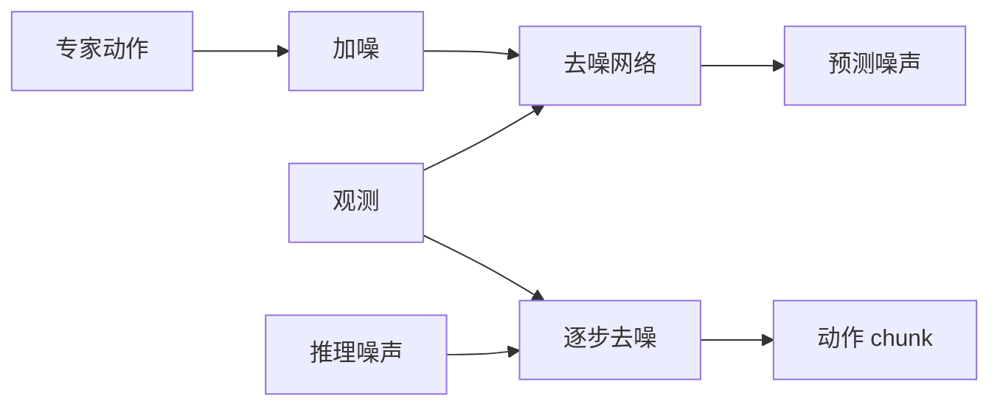
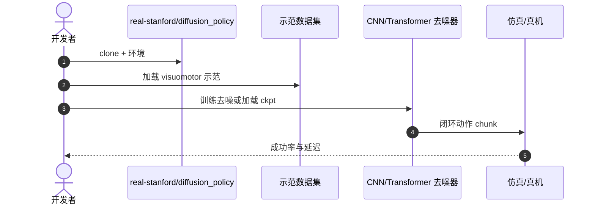
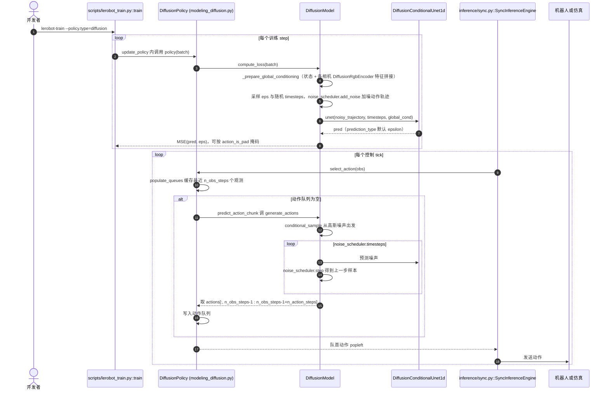

# Diffusion Policy：用去噪生成动作序列

**Diffusion Policy**（*Visuomotor Policy Learning via Action Diffusion*，[arXiv:2303.04137](https://arxiv.org/abs/2303.04137)，[项目页](https://diffusion-policy.cs.columbia.edu/)，[代码](https://github.com/real-stanford/diffusion_policy)）由 **哥伦比亚大学 / MIT** 提出：把扩散模型从图像生成换成 **动作 chunk 去噪**。它不是带语言的严格 VLA，但是 [π₀](./paper-pi0.md) 等 VLA 的动作头前身。方法综述见 [diffusion-policy](../methods/diffusion-policy.md)。

## 一句话定义

**不直接回归下一个动作，而是从噪声里逐步「擦」出一条多峰、平滑的动作轨迹。**

## 英文缩写速查

| 缩写 | 英文全称 | 简要说明 |
|------|----------|----------|
| DP | Diffusion Policy | 本工作 |
| DDPM | Denoising Diffusion Probabilistic Model | 去噪训练目标 |
| IL | Imitation Learning | 训练范式 |
| ACT | Action Chunking Transformer | 并行的 chunk 路线，见 [ACT](./paper-act.md) |

| WAM | World Action Model | 世界预测与动作生成耦合 |
| VLA | Vision-Language-Action | 视觉–语言–动作策略 |
| IDM | Inverse Dynamics Model | 先预测未来再反推动作 |
| WM | World Model | 环境前向预测模型 |

## 为什么重要

- 纳入 [VLA/WM 阅读路线](../../sources/blogs/wechat_embodied_ai_lab_vla_wm_reading_roadmap_2026-09-02.md) 的动作生成基座。
- 同一观测下可有多条合理轨迹（绕左/绕右），GMM/VAE 往往不够。
- CNN 与 Transformer 两种去噪骨干均可。
- **已开源** 训练与评测。

## 核心信息

| 项 | 内容 |
|----|------|
| **机构** | 哥伦比亚大学；麻省理工 |
| **输入** | 视觉观测 + 状态 |
| **输出** | 未来动作序列（chunk） |
| **骨干** | CNN 或 Transformer 去噪器 |
| **开源** | **已开源** [real-stanford/diffusion_policy](https://github.com/real-stanford/diffusion_policy) |

### 流程总览

## 评测

- 多任务 visuomotor 上相对 BC / IBC / LSTM 更稳，尤其多峰场景。
- 去噪步数是 **速度 vs 质量** 主旋钮。
- 表以 [原文](https://arxiv.org/abs/2303.04137) 为准。

## 结论

**动作分布多峰时，先用扩散/流模型，再决定要不要接语言骨干。**

- chunk 预测降低逐步误差累积；部署用 **receding horizon**（执行前缀 \(T_e\)、丢弃后缀、重规划）
- 去噪迭代是延迟税，实时部署要蒸馏或减步
- 本页无语言输入；接 VLM 才变成 VLA 动作头
- [π₀](./paper-pi0.md) 用流匹配把多步税压下去
- 方法选型叙事读 [diffusion-policy](../methods/diffusion-policy.md)

## 源码运行时序图

> 下图是官方仓库 `real-stanford/diffusion_policy` 的**粗粒度示意**（未逐函数对照官方源码）；LeRobot 版的函数级时序图见下一小节。

### LeRobot 版（固定提交 9e5ee98）函数级时序图

节点来自 LeRobot 源码（路径相对 `src/lerobot/`），已对照阅读 `policies/diffusion/modeling_diffusion.py`、`configuration_diffusion.py`、`scripts/lerobot_train.py`、`inference/sync.py`。

## LeRobot 实现要点

- **身份核对：** LeRobot 文档 `docs/source/policy_diffusion_README.md` 的论文链接指向 Diffusion Policy 项目页，引用为 Chi 等 IJRR 2024 的 *Diffusion Policy: Visuomotor Policy Learning via Action Diffusion*（即本页 arXiv:2303.04137 的期刊版）；`DiffusionPolicy` 类 docstring 指向同一论文与 `real-stanford/diffusion_policy`。**本页即 README 中「Diffusion」的 canonical 节点**；[methods/diffusion-policy](../methods/diffusion-policy.md) 是方法综述页，不重复承载 LeRobot 实现说明。
- **只实现了 UNet 去噪器：** LeRobot 里去噪网络是 `DiffusionConditionalUnet1d`（FiLM 条件，`use_film_scale_modulation=True`），未见本页「Transformer 去噪器」变体的实现（`modeling_diffusion.py` 中无对应类）。
- **默认配置（`configuration_diffusion.py` 读到的值）：** `n_obs_steps=2`、`horizon=64`、`n_action_steps=32`；ResNet-18 + SpatialSoftmax（32 关键点）、每相机独立编码器；`down_dims=(512,1024,2048)`；噪声调度 `DDPM`、`num_train_timesteps=100`、`squaredcos_cap_v2`；`prediction_type=epsilon`；`optimizer_lr=1e-4`。`num_inference_steps` 默认 `None`，此时取 `num_train_timesteps`（`DiffusionModel.__init__`），即默认推理 100 步去噪。可选 `DDIM` 调度器。
- **执行方式：** 一次生成 `horizon` 步，只保留从当前观测起的 `n_action_steps` 步放入队列，队列耗尽后再推理，属于 receding horizon 风格；要求 `n_action_steps <= horizon - n_obs_steps + 1`（`select_action` 注释）。
- **EMA：** 文档称参考实现对权重做 EMA 并用 EMA 权重评估，LeRobot 需在训练时加 `--ema.type=warmup` 才复现（`policy_diffusion_README.md`）；默认不开。

## 局限与风险

- **延迟：** 默认多步去噪不适合极高频。
- **非 VLA：** 不要把它当成指令跟随模型。
- **超参：** 噪声日程与 chunk 长度敏感。

## 与其他工作对比

| 工作 | 相对本页 |
|------|----------|
| [ACT](./paper-act.md) | CVAE 回归 chunk，无扩散 |
| [π₀](./paper-pi0.md) | 流匹配 + VLM |
| [OpenVLA](./paper-openvla.md) | 离散 token，非去噪 |

## 关联页面

- [Diffusion Policy 方法页](../methods/diffusion-policy.md)
- [滚动预测执行](../concepts/receding-horizon-policy-execution.md) — DP 经典 RH vs ACT TE
- [π₀](./paper-pi0.md)
- [ACT](./paper-act.md)
- [LeRobot](./lerobot.md) — 本页的 LeRobot 实现所在框架
- [VLA/WM 14 篇路线](../overview/vla-wm-reading-roadmap-14-papers-technology-map.md)

- 列表实体：[Awesome World-Action Models（RCL）](paper-rcl-wam-robot-learning-control-survey.md)
- 技术地图：[RCL Awesome WAM 技术地图](../overview/rcl-awesome-wam-technology-map.md)
- 方法/任务：[generative-world-models.md](../methods/generative-world-models.md)、[manipulation.md](../tasks/manipulation.md)

- [paper-robotic-dit-ingredients-dit-block-policy](./paper-robotic-dit-ingredients-dit-block-policy.md)
- [depth-robotics-diffusion-dit-flow](../../roadmap/depth-robotics-diffusion-dit-flow.md)
- [awesome-world-action-models-rcl](paper-rcl-wam-robot-learning-control-survey.md)
- [vla](../methods/vla.md)
- [locomotion](../tasks/locomotion.md)

## 推荐继续阅读

- [项目页](https://diffusion-policy.cs.columbia.edu/)
- [arXiv:2303.04137](https://arxiv.org/abs/2303.04137)

- [Awesome World-Action Models (RCL) 仓库](https://github.com/rcl-robotics/Awesome-World-Action-Models)
- [原文](https://journals.sagepub.com/doi/10.1177/02783649241273668)

## 参考来源

- [diffusion_policy_arxiv_2303_04137](../../sources/papers/diffusion_policy_arxiv_2303_04137.md)
- [具身智能研究室 VLA/WM 阅读路线](../../sources/blogs/wechat_embodied_ai_lab_vla_wm_reading_roadmap_2026-09-02.md)
- [real-stanford-diffusion-policy](../../sources/repos/real-stanford-diffusion-policy.md)
- [lerobot](../../sources/repos/lerobot.md) — 固定提交 9e5ee98 的 Diffusion 实现与文档

- [`sources/papers/rcl_awesome_wam_ref_393a36f38d60db8631f4_diffusion-policy-visuomotor-policy-learn.md`](../../sources/papers/rcl_awesome_wam_ref_393a36f38d60db8631f4_diffusion-policy-visuomotor-policy-learn.md) — 本条目策展摘录
- [`sources/papers/rcl_awesome_wam_catalog.md`](../../sources/papers/rcl_awesome_wam_catalog.md) — 列表总表
- [`sources/repos/awesome-world-action-models-rcl.md`](../../sources/repos/awesome-world-action-models-rcl.md)
- [`docs/PAPERS.md`](https://github.com/RCL-Robotics/Awesome-World-Action-Models/blob/main/docs/PAPERS.md) — 上游论文目录
- 论文：<https://journals.sagepub.com/doi/10.1177/02783649241273668>
