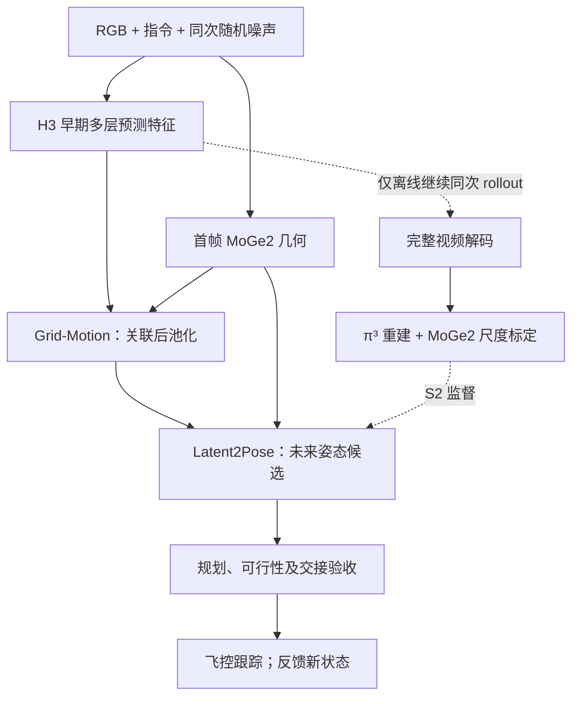
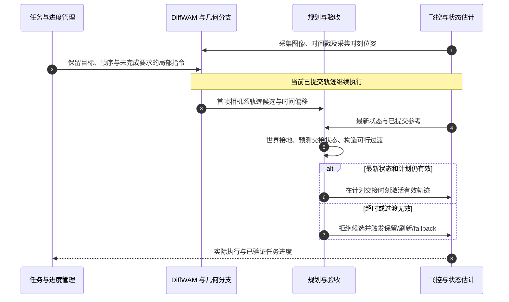

# DiffWAM: A Fast and Efficient Navigation World Action Model（快速高效的导航世界–动作模型）

## 一句话定义

**从视频模型的早期未来表示直接预测相机运动，省掉在线未来视频渲染和多帧重建，再由规划与飞控将候选轨迹变成可执行飞行。** 本页以 arXiv:2609.39763v1 的具体方法章节和表格为准，项目页差异另行标注。

## 英文缩写速查

| 缩写 | 英文全称 | 简要说明 |
|------|----------|----------|
| WAM | World-Action Model | 将世界预测表示用于动作生成 |
| UAV | Unmanned Aerial Vehicle | 无人机平台 |
| GPD | Geometry-Guided Predictive Distillation | 将离线视频重建运动监督转移到直接读出 |
| DiT | Diffusion Transformer | 视频骨干的 Transformer 计算层 |
| VAE | Variational Autoencoder | 本文部署绕开的未来视频解码路径 |
| RMSE | Root Mean Square Error | 时间对齐的全轨迹位置误差 |
| ADE / FDE | Average / Final Displacement Error | 平均位移 / 终点位移误差 |
| P50 / P95 | 50th / 95th Percentile | 延迟分布的中位数 / 95 分位 |

## 为什么重要

生成式视频模型能表达“绕着目标走”等运动，但完整生成后重建太慢。DiffWAM 将昂贵过程留在离线教师端：学生读取早期 latent 特征和当前几何。FastDreamer 再处理另一个独立问题——计算期间无人机仍在运动，候选可用时的状态已经不同于图像采集状态。

该设计对机器人系统的启发是把**预测、几何接地、任务进度、可行性规划、控制跟踪**分开验收，而不是用一次模型输出替代所有模块。

## 核心信息

| 项目 | 核验内容 |
|------|----------|
| 机构 | 浙江大学（Zhejiang University）、Differential Robotics |
| 作者 | Mo Zhu、Yuze Wu、Xijie Huang、Xiao Cui、Fei Gao、Xin Zhou |
| 输入 | 首帧 RGB 与语言指令；实际系统还有状态估计、外参及规划/任务上下文 |
| 模型输出 | 首帧相机系下 38 个未来位置/旋转，加初始 identity pose 共 39；名义五秒范围 |
| 输出含义 | 连续数值的离散时间 pose 序列；不自动连续可微、动力学可行或避障安全 |
| 视频 / 几何 | MiniMax H3、MoGe2；离线教师使用 π³ 重建与尺度标定 |
| 数据 | FlyMirage 约 110K+、NavGen 约 400K；合计 510K+ 训练样本，部分配套数据开放 |
| 实现开放 | 未找到 DiffWAM 专属可运行模型代码、权重及完整 benchmark 下载入口 |

## 核心原理

### 三个计算轴必须分开

| 轴 | 本文取值 | 不是 |
|----|----------|------|
| 视频去噪 schedule | 标准保留索引 0/1/2/3；Flash 仅 0 | 输出轨迹时间或动作头迭代数 |
| DiT 深度 | 零基 block 15/25/35；最后所需 evaluation 在 35 后截断 | “标准模型只跑一次”或“35 个动作” |
| 物理轨迹时间 | 38 个未来时间点，另加初始姿态 | 去噪 timestep |

标准前三次 backbone evaluation 完整推进 latent，第四次截断；Flash 第一轮即截断。抽三个深度特征不代表三次单独前向。S1/S2 中 H3 和 MoGe2 冻结，视频特征前端/因子时空模块也按论文固定配置处理，运动读出和其中的几何 embeddings 可训练。

### Grid-Motion：先关联，再池化

将三深度特征从 5376 投影到 512 维后融合，经固定的空间/时间模块处理。Grid-Motion 在未池化网格上关联当前与 u−1/u−4 的视频 slot，以及当前预测与干净观测 anchor；后者用几何信息构造 value，不能说深度直接进入所有 QK 匹配。

得到 gated residual 后，每个 39-slot 保留 8 个 memory token，共 **312×512**。这些是学习的软对应，不是实测光流，也未显式强制绕圈模板或闭环轨迹。

### Latent2Pose：用首帧几何建立空间与尺度

MoGe2 首帧几何缓存为 8×14 网格，每格含 XYZ、法向、log depth 和有效性，共八通道。有效深度中位数形成共享尺度 s₀（限制在 0.1–100 m，无有效深度时回退单位尺度）。38 个 pose query 经八层 decoder 分别读取 motion memory 和几何，输出 3D 平移与经 Gram–Schmidt 转成旋转矩阵的 6D rotation。

**尺度是估计条件，不是严格物理真值或尺度等变保证。** 摄像机初始坐标轴为右、下、前；映射到机体系/世界系必须保留坐标约定和已标定外参。

### 离线教师如何监督学生

S0 准备视频骨干；S1 用原导航语料轨迹初始化读出；S2 以 **同一次随机 rollout** 的早期特征和完成视频配对。教师继续生成、解码未来视频，经 π³ 重建，再以对应图像的 MoGe2 深度比例标定平移尺度。

学生只见早期特征与首帧几何，优化尺度归一化位置损失与 SO(3) 旋转误差。不同随机 rollout 的轨迹不能混作一个特征的监督；教师参考也会继承生成、重建、单目尺度误差。教师尺度 α 与学生条件尺度 s₀ 作用不同，不能合为一项。

## 流程总览

## 工程实践：FastDreamer 异步交接

并行几何分支与局部指令改写/预测；复用条件路径视觉语言权重以降低另驻大模型的内存开销。旧轨迹执行时准备新 proposal，预算应包括模型、规划、验收、通信及 fallback 余量。

候选必须用**采集时刻的相机位姿**接地到世界，而非激活时刻位姿。规划器预测未来交接状态，保持 reference 位置/速度连续；激活前复核最新状态。任务管理器提供阶段/圈数进度，不能因推理花了一秒就自动删掉新轨迹的一秒前缀；绕圈等自交运动也不能仅凭位置接近判断已经完成。

此图是论文 §4 的行为接口说明，不是已核验源码调用图。低延迟和“候选及时算完”都不能单独保证闭环任务完成。

## 源码运行时序图

**不适用。** 截至 2026-10-12 项目页未列 DiffWAM 专属可运行实现、权重或完整评测包。配套 NavGen/FlyMirage 数据不等于模型代码；不虚构训练脚本、模型检查点或部署命令。

## 实验与评测

### Benchmark 端点成功率（Table 2）

| 方法 | IndoorUAV-VLA % | UAV-FLOW-Sim % | DiffWAM-1000 % |
|------|----------------|----------------|---------------|
| WorldVLN | 39.32 | 80.24 | 58.40 |
| ImagineUAV | 33.78 | 69.65 | 43.20 |
| Fast-WAM-UAV | 35.69 | 71.27 | 52.20 |
| WorldFly | 25.71 | 53.98 | 30.50 |
| DiffWAM | 56.77 | 91.42 | 74.40 |

DiffWAM-1000 为 1000 样本、18 任务类型；划分按场景隔离。端点阈值室内 1 m、室外 3 m，无效预测和超时计失败。这是 endpoint SR，不验证绕圈覆盖、穿越方向或着陆完成；真机九个展示案例也不是总体试验记录，不能算物理飞行成功率。

### 架构与计算消融（Tables 4–6）

论文架构对比报告 RMSE **0.3492 m**、ADE **0.3151 m**、FDE **0.4357 m**、RoE **2.9179°**，无事后位姿/尺度对齐。该架构对比是独立补充设置，不能与主 benchmark 端点表拼成一个统一配置承诺。

| 骨干 evaluations | RMSE m | FDE m | RoE ° |
|------------------|--------|-------|-------|
| 1 | 0.5012 | 0.6865 | 3.7897 |
| 2 | 0.4107 | 0.5883 | 3.1867 |
| 3 | 0.3828 | 0.5653 | 3.7730 |
| 4 | 0.3492 | 0.4357 | 2.9179 |

位置随测试预算改善，旋转不单调。mixed 15/25/35 的位置误差最低，但 middle 23/25/27 的旋转误差更低；不能称某层组合所有指标最优。Table 4 中 DiffWAM 动作头 P50 37.35 ms 也不是完整系统延迟。

### 板卡延迟：archived FastDreamer 配置（Table 3）

| 配置 | P50 / P95 s | 峰值显存 GiB（单卡最大 / 同时合计） |
|------|-------------|-------------------------------------|
| DiffWAM，8×H20 BF16 | 3.605 / 3.820 | 60.33 / 457.67 |
| Flash，8×H20 BF16 | 0.835 / 0.912 | 60.33 / 457.67 |
| DiffWAM，AGX Thor BF16 | 3.796 / 3.851 | 97.60 / 97.60 |
| Flash，AGX Thor BF16 | 1.080 / 1.101 | 97.60 / 97.60 |

每配置 15 requests、热身后三次计时，共 45 次测量，conditioning cache 关闭。输入是已准备图像及 model-ready 指令；包括视频、重叠 MoGe2、特征传输和轨迹预测，但排除指令改写、外部通信、文件输出和下游过渡规划验收。论文明确这些 archived 管线与当前 direct-pose decoder 分开报告。

Flash 优势是所报延迟下降，峰值内存未下降。Orin NX 16 GB 平台使用云辅助 WAM；Thor 128 GB 才是所述全板载系统，不能把 Thor 延迟当成 NX 测量。

## 结论

**DiffWAM 将离线完整视频重建监督蒸馏到直接运动读出，FastDreamer 再解决飞行期间的延迟、坐标和任务连续性问题。**

1. 分别记录骨干 evaluations、DiT 深度和物理姿态时间，标准四次不能写成 Flash 一次。
2. 保留同 rollout 教师配对及尺度来源，教师估计米制参考不等于独立真实运动。
3. 避障与动力学可行性归下游规划/飞控，不归 pose decoder 保证。
4. 模型延迟、整机更新时延、飞行等待时间和任务成功率分开验收。
5. 用轨迹全程指标补充端点 SR；仅到达起终点不能证明完成一圈。

## 对比与局限

| 路线 | 关注的分界 |
|------|------------|
| NavDreamer 生成后重建 | 完整未来视频与 π³ 重建被搬到教师离线路径 |
| [Fast-WAM](./paper-fast-wam.md) | 都读取未来预测表示，但 DiffWAM 面向首帧几何接地的相机轨迹与 UAV 执行 |
| 常规导航/飞控 | DiffWAM 给语言条件 motion proposal；状态估计、约束规划、任务进度与跟踪仍需独立模块 |

项目页将标准配置多处概括为 single-forward，mixed-layer FDE 还写成 0.3151；论文为四次/Flash 一次，FDE 为 0.4357（0.3151 是 ADE）。项目页也混有历史 development-set 表述，本页不将其不同设置拼接到当前结论。

GPD 会继承生成与尺度偏差；动态障碍、安全过渡及 fallback 依赖实际飞行栈。本文未提供足以从精选演示计算真机总体成功率的完整记录。模型实现、权重和 benchmark 发布入口未找到；论文所称配套初始批次数据开放不等于全部 510K+ 样本可获取，第三方骨干许可也需分别核查。

## 关联页面

- [世界–动作模型](../concepts/world-action-models.md)
- [Fast-WAM](./paper-fast-wam.md)
- [导航、SLAM 与自主系统栈](../overview/navigation-slam-autonomy-stack.md)

## 参考来源

- [论文归档](../../sources/papers/diffwam_arxiv_2609_39763.md)
- [项目页及开放核查](../../sources/sites/diffwam.md)

## 推荐继续阅读

- [论文全文](https://arxiv.org/html/2609.39763v1) — §3–4、Tables 2–6
- [官方项目页](https://zzmmzzm.github.io/diffwam.github.io/)
