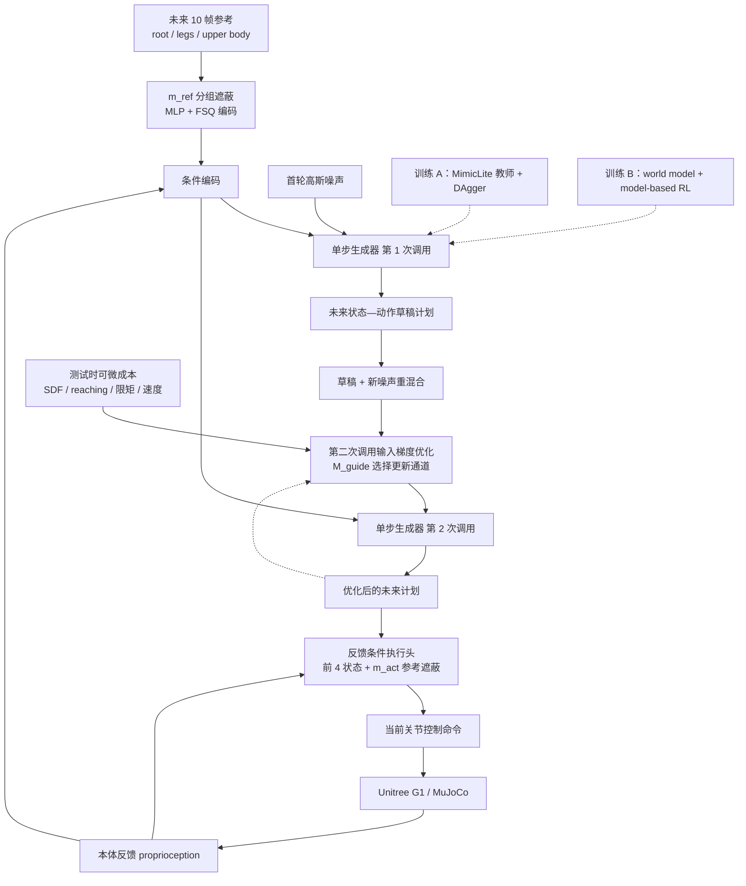

# OneSteer：单步扩散全身控制与可引导的通用人形运动跟踪 / Unlocking Steerable General Humanoid Motion Tracking via One-Step Diffusion Whole-Body Control

## 一句话定义

**OneSteer（旧名 DiffWBC）** 是条件于未来动作参考和本体反馈的 **50 Hz 单步生成式全身控制器**：它预测未来状态—动作计划，用实时反馈执行当前一步，并在测试时通过可微成本更新生成器**输入噪声**、通过身体分组掩码选择性放松参考目标，从而不重新训练权重就调整动作（arXiv:2610.41354v3）。

## 英文缩写速查

| 缩写 | 英文全称 | 简要说明 |
|---|---|---|
| WBC | Whole-Body Control | 多关节全身控制 |
| SDF | Signed Distance Field | 用于测试时碰撞距离成本；真机由 LiDAR 建图 |
| RL | Reinforcement Learning | 教师策略来源或从零训练路线 |
| DAgger | Dataset Aggregation | 访问状态由教师标注并逐步转移控制 |
| FSQ | Finite Scalar Quantization | 将参考时序编码为离散特征 token |
| ONNX | Open Neural Network Exchange | 导出控制模型供 G1 机载端推理 |
| LiDAR | Light Detection and Ranging | 真机障碍物几何地图的传感器 |

## 为什么重要

- 传统确定性跟踪策略接受参考姿态后输出动作；外部优化出的避障参考不一定能被低层跟踪器实现。
- OneSteer 用同一生成器预测短期可执行状态和动作，借助 inverse-dynamics / plan-conditioned action head 将计划与真实反馈闭环结合，使 steer 发生在控制器内部。
- 把同一模型用于**常规跟踪、冻结权重后的任务引导、无仿真失败候选排序**，并在 v3 从「仅普通跟踪真机」扩展到 **G1 真机 LiDAR SDF 避障**。

## 核心信息

| 项目 | 论文 v3（2026-11-11） |
|---|---|
| 主论文 | [OneSteer，arXiv:2610.41354v3](https://arxiv.org/html/2610.41354v3)；v1 于 2026-10-30 题名 DiffWBC |
| 作者 | Yifei Huang、Yazhao Yang、Li Weijia、Tianle Shi、Ji Jin、Zhihui Cai、Zihao Liu、Jianzhuang Zhao、Songlin Dong、Xinyuan Chang、Yihong Gong、Dian Shen、Zhiheng Ma |
| 机构 | 东南大学；南方科技大学；香港理工大学；深圳大学；深圳理工大学（Shenzhen University of Advanced Technology）；西北工业大学；Primotion；西安交通大学 |
| 平台 | Unitree G1，29 个驱动关节；MuJoCo / mjlab；50 Hz |
| 跟踪延迟 | RTX 4090 单生成器调用 3.8 ms；真机双调用普通跟踪 5.3 ms |
| 实时 steering 延迟 | RTX 4090 10.6–13.7 ms；Orin NX 测得 14.4 ms（**离线计时**） |
| 官方项目 | https://onesteer.github.io/ |
| 代码开放 | 截至 2026-11-14，官网写 **Code (coming soon)**；无可核验的训练/推理源码及官方可运行入口 |

## 核心原理

### 1. 参考条件和未来计划

- **输入：** 当前 proprioception、未来 10 帧参考（0.1 s 间隔，每帧 38 维：root 9 / legs 12 / upper body 17）。身体分组经 MLP、FSQ 构成参考 token，可通过 `m_ref` 选择可见组。
- **生成器：** 4 层、宽 512、8 heads、约 22.8M 参数的 Transformer；从高斯噪声与参考条件 **一次前向**预测 24 个计划 token（73 维状态 + 29 维动作目标），覆盖 **0.96 s**。
- **反馈执行：** action head `g_φ(o_k, ŝ_1:4, r_k; m_act)` 使用最新本体状态、前四个计划状态与可见参考计算本 tick 的关节指令；下一 tick 重新规划。**不是直接把预测动作 token 开环逐个下发**。
- **学习目标：** 对真实计划加噪输入做清洁计划 MSE 重建；MimicLite Huge + DAgger 的蒸馏路线，或经 learned world model imagined rollouts 的从零 model-based RL 路线，得到的是不同控制器实例，指标不能混用。

### 2. 测试时梯度引导与三类掩码

- **可微任务成本：** 对障碍 SDF、到达目标、弱电机力矩、托盘姿态、根部速度等计算 `C(X)`；反传到生成器输入 `z`，沿归一化成本梯度下降。模型参数冻结。
- **两次生成 / 稀噪重混合：** 第一次从纯噪声产生草稿；第二次将草稿与新噪声混合，在第二次输入施加两步梯度更新，然后生成最终计划。该 50 Hz 实时设置下 **1.25 m 低杆仿真 clean pass 为 0.90**。两次调用各引导两步、6 步 + line search 等是独立的更高计算预算消融，不是默认实时配置。
- **掩码不能混淆：** `m_ref` 控制输入参考组的可见性；`m_act` 防止执行头把已释放的身体组重新拉回旧参考；`M_guide` 只选择允许修改的生成输入通道。保留的身体组仍应跟踪参考，但不构成硬安全保证。

### 3. 无仿真失效发现

对同一个参考与 proprioception 取 **K=8** 组噪声生成计划，统计预测关节位置的跨样本标准差，按时间取 95 分位数作为困难度分数。此过程不需要对每条候选做物理 rollout；最终失败标签与微调有效性仍通过仿真验证。该指标是经验性风险排序，低分并不保证成功。

## 流程总览

图示两次生成的测试时引导路径；**普通跟踪可只调用一次生成器**，其计划直接传给执行头。虚线代表训练方式，不表示运行时依赖教师。计划回传成本梯度在同一控制 tick 内计算，执行头仅下发当前动作。

## 源码运行时序图

**不适用（官方尚未公开可运行代码）**。2026-11-14 检查项目页只有 Paper / Video，代码入口仍是「Code (coming soon)」；尽管论文说明 ONNX、Jetson Orin NX 和系留 GPU 真机实验，未核验真实 CLI、函数入口或部署调用链，故不能凭方法示意伪造源码时序图。

## 实验与评测

v3 在统一 MuJoCo sim-to-sim harness 评测 **AMASS 150 个 held-out 窗口、BONES 512 个未见演员窗口**；BONES 的 18 条依赖复杂地形片段在平地 harness 中均无法完成。局部误差为**各方法成功片段上的误差**，不应跨不同成功集合直接当成逐片配对误差。

| 项目（v3） | 核对结果 | 验收边界 |
|---|---|---|
| 从零训练，AMASS / BONES local error | **26.5 / 22.6 mm** | AMASS 成功率 96.7%，BONES 96.5%；BONES 优于统一表中各基线的局部误差 |
| 蒸馏版本 BONES | **27.3 mm，成功率 94.9%** | 不与从零模型的更优 tracking 数值混写 |
| 1.25 m 低杆 clean pass | **0.02 → 0.90**（第二次调用引导 2 步） | 仿真 79 条 walking 窗口，闭环参考编辑最高 0.11 |
| 跨栏 feasible / reaching hit | **0.68 / 0.57** | 仿真实时设置；加大引导预算可改善部分任务但增加时延 |
| 左膝弱电机存活 / 托盘球丢失 | **0.71 → 0.79 / 0.16 → 0.08** | 仿真、冻结权重多目标实验 |
| G1 真机普通跟踪 | **27/27** 次不跌倒 | 9 组动作各 3 次，使用松弛安全绳 |
| G1 真机 SDF 引导 | **1.1 m 低杆 4/5**；**12 cm 跨栏 3/3** 不跌倒 | LiDAR 预建并固定地图，**系留 RTX 4090** 执行 steering |
| Orin NX steering 耗时 | 第二次调用引导 **14.4 ms**；双调用均引导 18.2 ms | **离线测得**，不能解释为这两组真机 steering 已在机载端实时运行 |
| 地形扩展：全地形成功率 | **0.43 → 0.90** | 21×21 height scan→36 tokens + RL 微调，88 条跨地形片段 × 6 类地形 × 10 难度，**仅仿真** |
| 噪声计划离散度 failure ranking | top 2% precision **0.91**，全局 AUC **0.83** | 7,884 clips / 537 failures；评测用物理仿真提供真实失败标签 |
| 329 条困难片段定向微调 | 解决 **48±4%** 既有失败；已成功片段退化 **1.8±0.2%** | 3 训练种子；筛查成本较每片 5 次模拟低 11–28 倍 |

## 结论

**OneSteer v3 的关键证据从「仿真中的可引导跟踪」推进到了 G1 真机的低杆/跨栏任务，但代码开放与完整机载部署仍待验证。**

1. **选控制器看两条路径：** 从零 model-based RL 版本在统一跟踪基准上局部误差领先；测试时 steering 主要采用教师蒸馏版，不应把两者最好数值视为同一个 checkpoint。
2. **参考不可行时优先考虑控制器内引导：** 仿真 1.25 m 低杆由 0.02 提至 0.90，闭环参考编辑至多 0.11；比较的是同一评测设置而非普适避障保证。
3. **真实避障已有证据但场景有限：** 真机 1.1 m 低杆 4/5、12 cm 跨栏 3/3；地图在每次实验前固定、引导由系留 RTX 4090 计算。
4. **核对三类 mask 与端到端时延：** 仅给生成器遮蔽参考不足以让执行头释放身体目标，且 Orin NX 数据是离线 timing。
5. **无仿真筛选是数据选择工具：** top 2% precision 0.91，定向微调解决 48±4% 既有失败；不能视为形式化安全验证。
6. **场景适应与任务迁移分开考核：** 地形 token 版需 RL 微调且仅做仿真；给冻结基础模型添加可微成本属于 test-time steering。

## 与其他工作对比

| 方法 | 控制架构 | 与 OneSteer 的差别 |
|---|---|---|
| [SONIC](../methods/sonic-motion-tracking.md) | 确定性通用 tracker | 统一基准的跟踪对照，未在其 tracker 内使用同类测试时噪声梯度成本 |
| [YAHMP](./paper-yahmp.md) | RL 运动跟踪设计消融 | 偏向命令、历史、PD 与残差动作对比，非冻结生成器的计划 steer |
| [BeyondMimic](../methods/beyondmimic.md) | 扩散相关全身控制 | 任务和参考接口不同，不能跨数据集直接比较成功率 |
| [Extreme-RGMT](./paper-extreme-rgmt.md) | 高动态困难动作持续学习 | 采用仿真筛失败；OneSteer 提供基于噪声计划离散度的预筛方式 |

## 工程实践

- **观测 / 执行接口：** 参考输入含 root/legs/upper body，动作头仅使用前四个计划状态和实时本体反馈；29 个 G1 驱动关节的控制模式、PD 参数需在部署前逐项对齐。
- **闭环验证：** 将 nominal tracking（局部误差、存活、足滑）与 steering（避障净通过率、任务命中、执行头真实动作、端到端延迟）分别验收。
- **地图与硬件：** 本文真机 steering 使用**预建的固定 LiDAR SDF** 和**系留 RTX 4090**；把它迁移到机载 Orin NX、动态障碍与在线地图更新不是论文已经完成的证明。
- **开源状态：** 官方项目代码仍未发布。没有可审核的源码运行入口、训练配置或公开权重，当前只能依据论文和演示理解方法。

## 局限与风险

- **策略引导依赖可微成本：** 目标不一定能表达全部动力学与安全要求；参考保留组也不是硬约束。
- **计划与实际执行存在差距：** 执行头不是严格的逆动力学求解器，受实际关节限矩、接触与反馈限制。
- **接触任务短板：** 持续接触力、推拉、开门等需要显式 wrench / tactile 表示，论文把它们列为未来工作。
- **真机覆盖有限：** 已验证普通跟踪与静态地图的低杆/跨栏；弱电机故障、托盘、地形模型及广泛的安全场景主要仍在仿真。
- **版本不可混用：** 2026-10-30 的 v1 题名 **DiffWBC**，BONES 150 窗口、local error 20.1 mm、低杆 clean pass 0.84；2026-11-11 的 v3 正式改名 **OneSteer**，BONES 512 窗口、22.6 mm、实时第二次调用引导 0.90。两版实验口径不同，不能当成同一设置下的性能增减。

## 关联页面

- [SONIC：规模化人形全身运动跟踪](../methods/sonic-motion-tracking.md)
- [YAHMP：G1 通用跟踪设计消融](./paper-yahmp.md)
- [BeyondMimic：扩散引导人形控制](../methods/beyondmimic.md)
- [Extreme-RGMT：困难动作持续学习](./paper-extreme-rgmt.md)
- [Whole-Body Control](../concepts/whole-body-control.md)
- [Diffusion Policy](../methods/diffusion-policy.md)

## 参考来源

- [OneSteer v3 原文通读归档](../../sources/papers/onesteer_arxiv_2610_41354_v3.md) — v3 正文、附录、评测与真机核对
- [官方项目页归档](../../sources/sites/diffwbc-project.md) — 真机/仿真边界、代码状态
- [DiffWBC v1 历史通读](../../sources/papers/diffwbc_arxiv_2610_41354_reading.md) — 同篇论文旧版本，仅用于版本差异
- [DiffWBC v1 机制补充](../../sources/papers/diffwbc_arxiv_2610_41354.md) — v1 原始评测资料
- [OneSteer 论文 HTML v3](https://arxiv.org/html/2610.41354v3)
- [OneSteer 官方项目主页](https://onesteer.github.io/)

## 推荐继续阅读

- [OneSteer 最新 arXiv 版本历史](https://arxiv.org/abs/2610.41354)
- [OneSteer：实机视频、地形与自评实验](https://onesteer.github.io/)
- [SONIC 跟踪基线](../methods/sonic-motion-tracking.md)
- [扩散控制相关：BeyondMimic](../methods/beyondmimic.md)
