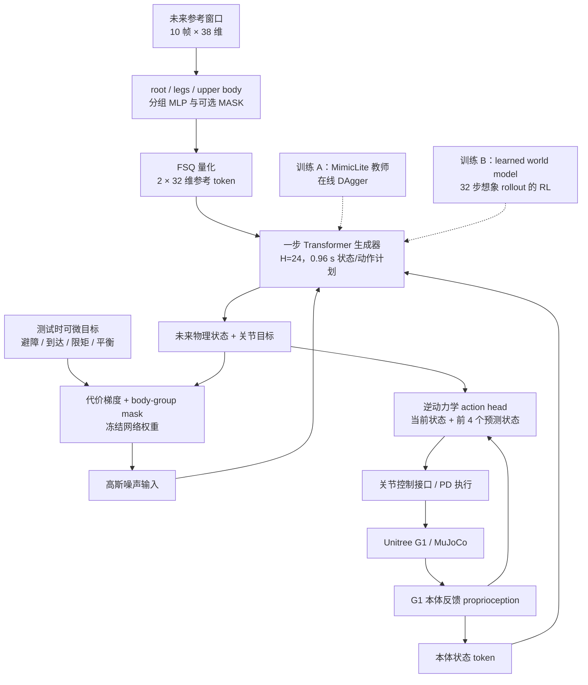

# DiffWBC：单步生成式全身控制与测试时运动引导 / Steerable General Humanoid Motion Tracking

## 一句话定义

**DiffWBC**（*Unlocking Steerable General Humanoid Motion Tracking via One-Step Diffusion Whole-Body Control*，arXiv:2610.41354v1）把 **50 Hz 人形运动跟踪控制器本身**变为生成未来状态与关节动作的单步模型：常规跟踪一次前向执行；遇到新约束时直接用可微代价优化输入噪声，并通过分组遮蔽把部分肢体的控制权让给新目标，而不必改动策略权重。

## 英文缩写速查

| 缩写 | 英文全称 | 简要说明 |
|---|---|---|
| DiffWBC | Diffusion Whole-Body Control | 本文将一步生成、全身跟踪和测试时引导集成在低层控制器 |
| WBC | Whole-Body Control | 人形多关节的全身协调与执行 |
| RL | Reinforcement Learning | 教师 tracker 的来源，或从零训练生成式跟踪器的优化方法 |
| DAgger | Dataset Aggregation | 学生在访问状态上向冻结的 RL 教师请求动作监督 |
| FSQ | Finite Scalar Quantization | 对身体分组的参考时序特征量化为有限 token |
| SDF | Signed Distance Field | 测试时可微的障碍碰撞距离代价 |
| ONNX | Open Neural Network Exchange | 论文报告导出用于统一评测与真机部署的策略模型 |
| GPU | Graphics Processing Unit | 论文训练与推理的计算资源口径 |

## 为什么重要

- **普通运动跟踪器是固定映射：** 遇到低顶棚、跨栏、手臂目标或电机限矩时，通常需改参考轨迹、重新训练，或外挂规划器；后者的运动学结果不一定能被低层动力学跟上。
- **DiffWBC 将规划分布纳入控制器内部：** 从真实本体状态每 20 ms 重规划一次近 1 s 的可执行状态/动作轨迹，避免「外部参考编辑通过了几何检查，实际跟踪却撞上障碍」。
- **一套网络兼顾可靠跟踪、测试时操控与失效诊断：** 生成噪声产生的计划分歧可以筛出跟踪困难片段，减少全量仿真扫描开销。

## 核心信息

| 项目 | 论文 v1 核对结果 |
|---|---|
| 论文 | [DiffWBC，arXiv:2610.41354v1](https://arxiv.org/abs/2610.41354)，2026-10-30 |
| 作者 | Yifei Huang、Yazhao Yang、Weijia Li、Zhiheng Ma、Dian Shen |
| 机构 | 东南大学（Southeast University）；南方科技大学（Southern University of Science and Technology）；香港理工大学（The Hong Kong Polytechnic University）；深圳理工大学（Shenzhen University of Advanced Technology） |
| 机器人 | Unitree G1，29 个驱动关节，50 Hz 控制 |
| 训练 | 蒸馏路径：4 × RTX 4090 × 8 h = **32 GPU-hours**；从零 model-based RL：约 **20 GPU-hours** |
| 推理 | 单张 RTX 4090 测普通跟踪 **3.8 ms**；测试时 steering **20.3–55.1 ms** |
| 项目主页 | https://diffwbc.github.io/（目前沿用匿名展示名 OneSteer） |
| 代码 | **暂未公开**：截至 2026-11-10 项目页显示 “Code (after review)” |

## 核心原理

### 1. 参考输入和身体分组

- **参考窗口：** 未来 10 帧、每 0.1 s 一帧，单帧 38 维：root 9 + legs 12 + upper body 17，含全身 29 维关节角。
- **分组编码：** 三组各自 MLP 对未来参考编码，特征求和后通过 FSQ 得到 2 × 32 维参考 token；另输入当前本体 proprioception。
- **掩码训练：** 单组独立遮蔽概率 0.3，整段参考遮蔽概率 0.1；因此测试时既可跟踪全身轨迹，也可仅锁定某些身体部分并让其他部分执行目标。

### 2. 单步生成器和逆动力学执行头

- **Transformer：** 4 层、hidden 512、8 heads、22.8M 参数。输入为本体 token、2 个参考 token 和 24 个轨迹预测 token。
- **输出：** 每个预测 token 包含 73 维机器人物理状态（含 root 状态及 29 个 q / dq）与 29 个目标关节角；前 16 个控制 tick 稠密覆盖，后 8 个间隔 4 tick，预测视野为 **0.96 s**。
- **学习目标：** 噪声插值 \(x_t=(1-t)x_0+t\epsilon\)，以 \(\mathcal{L}_{gen}=\mathbb{E}\|f_\theta(x_t,c)-x_0\|^2\) 回归清洁轨迹。常规推理直接把初始高斯噪声映射为预测未来，无多步去噪循环。
- **控制动作：** action head \(g_\phi\) 使用当前本体状态与最先的 4 个预测状态转成关节执行命令，底层关节目标/力矩经执行接口作用于 G1；每个 50 Hz tick 都从真实反馈重新生成，**不是整段开环回放**。

### 3. 两种训练方式

1. **冻结教师 + 在线 DAgger：** MimicLite Huge 产生动作标签；4096 并行环境采集学生访问状态与未来真实状态，使用 BONES-SEED、AMASS、LAFAN 共 78,842 条序列（约 170 h）。4 张 RTX 4090 共 8 h，合计 32 GPU-hours。
2. **无教师 model-based RL：** 4096 环境在线收集转移，三层 MLP world model 回归动力学，用 32 步 imagined rollouts 对跟踪与存活奖励反向传播，终端 critic 稳定训练；60k iter，约 20 GPU-hours。**从零版跟踪误差更低，不等于可引导性也更好。**

### 4. 冻结权重的测试时 steering

定义未来计划的可微代价 \(C\)（如全身 SDF 避障、手部目标点、足滑/速度目标、退化电机限矩、托盘角度），通过 \(\nabla_x C(f_\theta(x,c))\) **仅更新输入噪声**；权重 \(\theta\) 保持冻结。body-group mask 决定哪些关节自由度可接受新目标，未放开的部分仍要跟踪参考。

- 默认 **2 次生成 × 每次 2 次梯度下降**；难 reaching 可用 12 步搜索。普通跟踪只需 1 次前向。
- 成本引导主要先改关节位置，未必同步改速度；论文提供 **可选神经 world-model 投影**，让引导计划更符合动力学，再交给闭环 action head 执行。

## 流程总览

此图是 **论文方法层的数据与控制流**，不是未公开的源码架构或可运行调用链。图中普通跟踪走单次生成；引导路径需额外计算梯度并重复生成。

## 源码运行时序图

**不适用（尚无可核验的官方可运行代码）**：截至 2026-11-10 项目页只提供论文相关介绍和视频，代码栏标记 “Code (after review)”。当前无法读取真实训练、推理、ONNX 导出或真机执行入口，不能凭论文示意图杜撰源码时序。后续发布仓库后应补充训练入口、模块调用与 G1 部署时序图。

## 实验与评测

论文统一 MuJoCo sim-to-sim harness，采用官方控制配置与 checkpoint；Table 2 的 AMASS / BONES 各 **150 条 held-out 窗口**。成功标准含骨盆高度偏离参考超过 0.25 m 即失败。

| 项目（论文 v1） | 结果 | 评测边界 |
|---|---|---|
| 从零 DiffWBC，AMASS 局部误差 | **26.5 mm** | 优于表中对照；不代表全部维度最优 |
| 从零 DiffWBC，BONES 局部误差 | **20.1 mm**；success **97.3%** | 统一 150 窗口 sim2sim |
| 蒸馏 DiffWBC，BONES 局部误差 | **24.7 mm** | 与教师 24.4 mm 接近 |
| 1.25 m 低顶棚 clean pass | **0.84**（in-generator）vs **0.10**（闭环参考编辑） | 测试时引导，仿真 |
| 跨栏 feasible pass | **0.68** vs 闭环编辑 **0.57** | 仿真 79 条 walking sequence |
| 空间 reaching hit | **0.75** vs 闭环编辑 **0.60** | 难例引导可达 55.1 ms |
| 左膝 15% 限矩存活 | **0.71 → 0.79** | 冻结权重，仿真 |
| 托盘滚珠丢失率 | **0.17 → 0.08** | 冻结权重，仿真 |
| 噪声 spread 失效诊断 | top 2% precision **0.91**、AUC **0.83** | 7,884 clip 扫描，537 失败 |
| 329 条难例微调 | 修复基础失败 **50%**、已掌握片段退化 **1.9%** | 指定 fine-tune 配方，单种子实验 |

**真机：** 在 Unitree G1 上对 9 条复杂运动各试 3 次，作者报告 27/27 次普通跟踪不摔倒；头顶绳仅作不承重安全保护。**论文没有给出上述 steering 任务的真机结果**。

**推理与频率：** 普通跟踪 3.8 ms 适用于 50 Hz；默认引导 20.3 ms 已接近并略高于严格的 20 ms 控制时隙，12 步引导 55.1 ms 应减频或异步规划，不能以 3.8 ms 作为所有场景的延迟。

## 结论

**DiffWBC 的价值在于把“可微规划”和“物理闭环执行”合并进同一个通用跟踪器；常规跟踪快，但测试时强引导仍受计算与动力学一致性约束。**

1. 先以 **普通单步跟踪（3.8 ms）** 建立 50 Hz G1 baseline，再考虑额外 steering 预算，不能把引导延迟与跟踪延迟混淆。
2. 需要在线避障、到达、退化关节限矩或托盘平衡时，可设计可微 task cost，利用冻结权重的输入噪声梯度；无需为每个目标专门再训练策略。
3. **body-group mask 是任务接口**：让腿或手臂部分释放参考约束，减少新目标与原参考间的冲突。
4. **从零 RL 版 tracking 更准，但 steering 更弱**：Appendix A 显示 1.25 m ceiling 成功率从零版 0.00、蒸馏版 0.84，选择模型须按目标评估。
5. 用 **生成噪声计划离散度** 排序失败难例可免去全量物理 rollout；91% top 2% precision 是特定数据集的筛查质量，并非泛化保证。
6. 目前开源复现不可用；论文的 G1 实机成功仅支撑 **基本跟踪能力**，不能外推到测试时避障/故障补偿的真机安全性。

## 与其他工作对比

| 方法 | 策略形态 | 主要差异 |
|---|---|---|
| [SONIC](../methods/sonic-motion-tracking.md) | 确定性通用 motion tracker | 注重规模化跟踪与多模态指令接口；在 DiffWBC 论文中作为跟踪基线，不具内生 cost-steering |
| [YAHMP](./paper-yahmp.md) | 可复现的消融型 RL 跟踪器 | 强在命令、历史、PD、残差动作的受控比较；DiffWBC 关注冻结权重测试时调制 |
| [BeyondMimic](../methods/beyondmimic.md) | Guided diffusion 运动策略 | 扩散引导与控制相关，但研究的任务/参考接口不同；不可将 benchmark 结果直接跨论文比较 |
| [Extreme-RGMT](./paper-extreme-rgmt.md) | 持续学习高动态跟踪 | 主要通过有针对性训练修复难动作；DiffWBC 用计划 spread 先筛失败难例 |

## 工程实践

- **接口对齐：** 单步预测的 24 token 包含位置、速度与执行动作，action head 只用前 4 个预测状态，务必核对关节命令/PD 增益与 G1 的 29 驱动关节配置。
- **选型评估：** 分开统计 nominal tracking（存活率、local/global error、扭矩/足滑）与 steering（collision-free pass、任务 hit、完整闭环延迟）。
- **监督与泛化：** DAgger 路径使用 MimicLite 教师与大规模动作库；无教师 RL 路径要准备可微 learned world model 与稳定 critic，两者不是可互换的训练成本口径。
- **真机安全：** 新 cost / mask 必须先在 MuJoCo 验证并限制执行关节/力矩；引导步骤可能破坏速度一致性，必要时启用论文提出的 world-model 投影，不能把视觉仿真演示视作安全证明。
- **复现状态：** 论文可读、视频可看，官方训练/推理源码待开放；运行入口、配置和权重尚不可核实。

## 局限与风险

- **跟踪与操控能力存在 trade-off：** scratch 版 local tracking 领先，但 Appendix A 的 steering 弱；不同训练路径不能只看一个误差值。
- **时序预算紧：** 默认 steering 约 20.3 ms，重 cost-gradient 会超过 50 Hz 周期。
- **动力学一致性不天然成立：** 梯度操作先改变关节角，未保证状态速度与接触力一致；可选投影增加计算和实现复杂度，且对改根部轨迹的顶棚任务效果有限。
- **高接触力任务仍未闭环解决：** 论文指出持续接触与不连续接触需要显式 wrench 建模。
- **静态姿态有全局漂移，且教师蒸馏可继承教师误差**。
- **实验边界：** 主要 steer 结果是仿真；没有多平台实机与长期安全评测。官方项目页旧名 OneSteer 的 BONES 数字为 22.6 mm，**与论文 v1 的 20.1 mm 不一致**，本文采用论文 v1 数值。

## 关联页面

- [SONIC：规模化人形全身运动跟踪](../methods/sonic-motion-tracking.md)
- [YAHMP：G1 通用跟踪设计消融](./paper-yahmp.md)
- [BeyondMimic：扩散引导人形控制](../methods/beyondmimic.md)
- [Extreme-RGMT：困难动作持续学习](./paper-extreme-rgmt.md)
- [Whole-Body Control](../concepts/whole-body-control.md)
- [Diffusion Policy](../methods/diffusion-policy.md)

## 参考来源

- [论文全文通读归档](../../sources/papers/diffwbc_arxiv_2610_41354_reading.md) — arXiv v1 §1–§5、Tables 1–6、Appendix A–C 核对与版本差异
- [项目主页归档](../../sources/sites/diffwbc-project.md) — 匿名旧名、开源状态与额外 demo 的边界
- [PR #3590 补充论文通读归档](../../sources/papers/diffwbc_arxiv_2610_41354.md) — 保留独立核对的论文机制与实验口径
- [原论文：DiffWBC，arXiv:2610.41354v1](https://arxiv.org/abs/2610.41354)（2026-10-30）
- [官方项目演示：diffwbc.github.io](https://diffwbc.github.io/)（网站当前标题 OneSteer）

## 推荐继续阅读

- [DiffWBC arXiv HTML 全文（方法、实验和附录）](https://arxiv.org/html/2610.41354)
- [DiffWBC 官方视频与交互示例](https://diffwbc.github.io/)
- [SONIC 的统一运动跟踪对照](../methods/sonic-motion-tracking.md)
- [从跟踪到扩散引导：BeyondMimic](../methods/beyondmimic.md)
