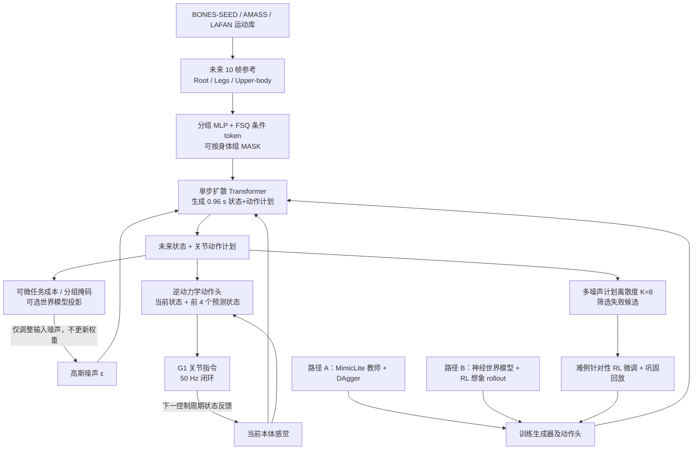

# DiffWBC：单步扩散可操控的人形通用运动跟踪 / Steerable General Humanoid Motion Tracking

**论文：** *DiffWBC: Unlocking Steerable General Humanoid Motion Tracking via One-Step Diffusion Whole-Body Control*（[arXiv:2610.41354v1](https://arxiv.org/html/2610.41354v1)，2026-10-30）；**作者：** Yifei Huang, Yazhao Yang, Weijia Li, Zhiheng Ma, Dian Shen。

## 一句话定义

**DiffWBC** 把人形机器人的通用运动跟踪控制器改为单步生成未来状态-动作计划，再由逆动力学动作头执行；同一冻结模型可以在推理时通过可微成本和身体分组掩码调整动作，并借助不同噪声下的计划分歧发现困难运动。

## 英文缩写速查

| 缩写 | 英文全称 | 简要说明 |
|---|---|---|
| DiffWBC | Diffusion Whole-Body Control | 本文单步扩散式全身运动跟踪及操控器 |
| WBC | Whole-Body Control | 同时协调全身多关节的控制问题 |
| RL | Reinforcement Learning | 教师策略训练与无教师世界模型优化路线 |
| DAgger | Dataset Aggregation | 在线收集学生访问状态并获取教师标签 |
| FSQ | Finite Scalar Quantization | 将身体组参考编码为离散条件 token |
| SDF | Signed Distance Field | 将避障约束写成可微空间距离成本 |
| ONNX | Open Neural Network Exchange | 论文报告的常规跟踪真机部署策略格式 |

## 为什么重要

- **把轨迹生成放在低层闭环内部：** 与“高层修改参考轨迹 → 固定 tracker 追踪”不同，DiffWBC 在控制器内部优化未来物理计划，缓解规划器与执行器的动力学失配。
- **训练后仍能改变目标：** 网络权重不更新，使用可微成本在测试时调整障碍绕行、触及位置、力矩约束或载荷稳定；遮蔽参考中的某些身体组，还可让它们服从新任务。
- **从单点动作变成可自评的生成分布：** 同一条件下采样多份噪声，看计划离散度就能低成本筛出疑难 clip，减少全库物理仿真扫描。

## 核心信息

| 项目 | 论文 v1 事实 |
|---|---|
| 机构 | 东南大学（Southeast University）；南方科技大学（Southern University of Science and Technology）；香港理工大学（The Hong Kong Polytechnic University）；深圳先进技术大学（Shenzhen University of Advanced Technology） |
| 硬件 / 模拟 | Unitree G1（29 个驱动关节）；MuJoCo / mjlab；普通跟踪已真机展示 |
| 控制 / 计划 | 50 Hz 控制（20 ms 周期）；单步生成 0.96 s 预测计划 |
| 模型 | 4 层 Transformer，hidden=512、8 heads、22.8M 参数；独立逆动力学动作头 |
| 训练数据 | BONES-SEED、AMASS、LAFAN，共 78,842 clips、约 170 小时 |
| 训练预算 | MimicLite 教师在线蒸馏：4×RTX 4090 × 8 h = 32 GPU-hours；无教师 model-based RL：约 20 GPU-hours |
| 推理 | RTX 4090 常规跟踪 3.8 ms；默认测试时引导 20.3 ms；复杂引导可达 55.1 ms |
| 开源状态 | 截至 2026-11-10，[项目页](https://diffwbc.github.io/) 写 Code (after review)，未给出可运行官方代码/权重 |

## 核心原理

### 1. 有掩码的多身体组参考接口

每个控制步读取未来 10 帧参考（0.1 s 间隔），每帧 38 维：根部 9、双腿 12、上身 17（合计 29 个驱动关节）。各组经 MLP 及 FSQ 编码，得到两个 32 维条件 token；训练时独立遮蔽各组（概率 0.3）或整段参考（概率 0.1），从而支持稀疏参考和“控制权让给任务成本”。

### 2. 单步轨迹生成 + 逆动力学动作头

Transformer 读取当前本体感觉、参考 token 和 24 个预测 token；预测 token 联合包含未来物理状态（root、关节位置/速度）与 29 维关节动作，时间跨度 0.96 s。训练从噪声插值计划直接回归干净计划：

\[
x_t=(1-t)x_0+t\epsilon,\qquad
\mathcal{L}_{\mathrm{gen}}=\mathbb{E}\lVert f_\theta(x_t,c)-x_0\rVert^2 .
\]

常规推理由高斯噪声**一次前向**预测整段计划；逆动力学头读取当前本体状态与前四个预测状态，给出立即执行的关节控制命令，再依据下一时刻反馈重新规划。不是“每周期多次去噪”的常见扩散控制器。

### 3. 训练路径：教师蒸馏或从头 model-based RL

- **教师蒸馏：** MimicLite Huge 冻结 RL teacher；4096 并行环境在线 DAgger，教师/学生混合执行，监督下一段真实状态与教师动作；2390 次迭代约 32 GPU-hours。
- **从头训练：** 4096 环境收集 transition，三层 MLP 世界模型学习动力学，32 步 imagined rollout 对跟踪和存活奖励反传，终端 critic 稳定优化；约 60k 迭代、20 GPU-hours。两条路线的**最佳跟踪**与**最佳可引导性**并不一致。

### 4. 冻结模型的测试时操控

定义作用于预测轨迹的可微成本（例如机器人 124 个碰撞 capsule 对障碍物的 SDF、手部触及误差、故障后的力矩上限、托盘倾角、速度命令），通过运动学和生成器对**输入噪声**求梯度并下降，不修改策略参数。默认两次生成器调用、每次两步梯度下降；高难触及可能需 12 步。身体掩码限制被操控通道，其余关节维持参考跟踪；可选世界模型投影提升部分关节轨迹的运动学/动力学一致性。

### 5. 利用生成噪声分歧进行自评与修复

固定参考、本体状态，取 K=8 份噪声，比较未来关节角计划的标准差，并以时间维 95 分位作风险分数：不需对每个 clip 执行物理仿真 rollout 即可排序。然后用挑出的 329 条难例强化训练，配合原运动库回放和 consolidation loss 避免遗忘。**高分是经验性失败信号；低分并不能保证真实可执行。**

## 流程总览

## 源码运行时序图

**不适用（截至 2026-11-10）：** 作者项目页虽展示算法与视频，但仍标注 Code (after review)，未提供可执行源码、README 运行入口或公开权重，无法基于真实模块调用绘制源码运行时序图；上述流程为论文机制图，不冒充源代码分析。参见 [开放状态核对](../../sources/sites/diffwbc-project.md)。

## 工程实践

| 关注点 | 核对结果与工程启示 |
|---|---|
| 周期预算 | 常规 3.8 ms/step 可嵌入 20 ms 控制周期；默认 steer 20.3 ms **已略超周期**，55.1 ms 版本须降频或异步处理 |
| 参考设计 | 38 维 × 10 帧、分组 [MASK]，适合把“跟随参考”和“放开某组关节做新目标”分开 |
| 执行接口 | 一步生成规划地平线，由 inverse-dynamics head 处理立即动作；引导仅改计划，不代表开环把整段动作照发 |
| 任务代价 | SDF、末端位置、速度/力矩等必须可微；持续/突变接触需要额外动力学约束 |
| 评估口径 | 同一 MuJoCo sim-to-sim harness、held-out AMASS/BONES；成功率与只对成功片段求的 E_l、E_g 要分开读 |
| 实物证据 | 论文在有安全吊挂的 G1 上验证**普通跟踪**；任务 steer、故障补偿和托盘等数字来自**仿真** |
| 复现条件 | 代码/权重尚未公开；论文方法可用于设计对照，但不能声称已能下载部署 |

## 实验与评测

| 指标 / 场景 | 论文 v1 数据 | 对照 |
|---|---|---|
| BONES，RL from scratch（Table 2） | 成功率 97.3%；局部误差 **20.1 mm**；global median 45.5 mm | 多个 tracker 中局部误差最低；150 held-out windows |
| AMASS，RL from scratch（Table 2） | 成功率 96.7%；局部误差 **26.5 mm** | 150 held-out windows |
| BONES，distilled（Table 2） | 成功率 96.7%；局部误差 24.7 mm | 接近 MimicLite Huge 教师的 24.4 mm |
| 顶棚 1.25 m（Table 3） | 引导 clean pass **0.84** | 教师闭环参考编辑 0.10；仿真 |
| 栏杆与空间触及（Table 3） | 栏杆可行通过 0.68；触及命中 0.75 | 闭环编辑分别 0.57、0.60；仿真 |
| 膝故障 / 托盘（Table 4） | 膝电机降至 15% 力矩：0.71→0.79 生存；丢球 0.17→0.08 | 同一冻结策略引导；仿真 |
| 失败自评（Table 6 / 12） | top 2% precision **91%**，AUC 0.83；329 clip 精调修复原失败约 **50%**，已掌握动作退化约 1.9% | 7,884 片段评估；结果依赖仿真测得的失败标签 |
| G1 真机（§4.2） | 9 类运动 × 3 次试验，**27/27 无摔倒** | 常规跟踪，不是 steer 真机验证 |

## 结论

**DiffWBC 的核心增量是让低层通用跟踪器自身具备可微引导的未来计划，而不是单纯把扩散放到上层动作生成器。**

1. **以常规跟踪作基线**：3.8 ms 的单步生成器达到 50 Hz 跟踪并有 G1 实测，但不能据此声称测试时多步引导也能稳定守住 20 ms 周期。
2. **不要混合两种训练路线的成绩**：从头 RL 获得 BONES 20.1 mm 最佳局部跟踪；附录 A 显示它在顶棚引导上弱于蒸馏版。
3. **对比分层规划优先看“执行后是否碰撞”**：1.25 m 顶棚中，生成器内部操控 0.84 对比闭环改参考 0.10；这是仿真指标。
4. **掩码是可操控接口**：保留腿部参考、放开上身执行触及，或放开腿部服从避障成本，无需额外训练每个任务。
5. **噪声分歧值得用于主动选难例**：top 2% 的失败精度 91%，但低离散度不等于零风险，训练改进仍需真实 rollout 复核。
6. **部署风险主要在延迟与接触**：55.1 ms 的高难引导与持续接触力都超出当前论文展示的直接闭环能力边界。

## 与其他工作对比

| 方法 | 主要区别 |
|---|---|
| [SONIC](../methods/sonic-motion-tracking.md) | 大规模通用运动跟踪的确定性基线；DiffWBC 引入原生可微推理时操控 |
| [MimicLite](./mimiclite.md) | 被当作 RL 教师蒸馏；DiffWBC 接管未来计划生成与逆动力学动作头 |
| [BeyondMimic](../methods/beyondmimic.md) | 两者都支持扩散引导；DiffWBC 特别面向**全身连续参考窗口**、50 Hz 单步控制及身体组让权 |
| [YAHMP](./paper-yahmp.md) | 在 G1 上做可复现的确定性跟踪设计消融；DiffWBC 探索冻结模型的测试时可操控性 |
| [TWIST2](./paper-twist2.md) | 强调可穿戴遥操作/示范采集和分层策略；DiffWBC 强调低层控制器内部计划引导 |

## 局限与风险

- **论文真机范围窄于宣传的可操控范围**：Unitree G1 真机只核对了常规运动跟踪，障碍、故障、平衡与自主修复的效果主要是 MuJoCo 仿真。
- **推理时间没有完全满足 50 Hz 预算**：默认 steer 20.3 ms、难任务可达 55.1 ms；论文建议低频或异步规划，不应写成“所有操作均实时 50 Hz”。
- **梯度引导不自动等于动力学可行**：计划修改可能使根部速度与关节速度不一致；世界模型投影改善部分例子但对顶棚改根部任务无改善。
- **接触与估计仍有限制**：持续受力和离散接触需要更显式的接触力/扳手建模；蒸馏版继承教师近静止全局漂移。
- **自评不是形式安全证明**：它是基于生成噪声方差的风险筛选，失败与否最终通过仿真标注；单次随机种子下的精调收益不能外推成稳定保证。
- **开源与文献版本不一致**：截至 2026-11-10 项目页仍是匿名 OneSteer，Code (after review)；项目页列出的 BONES 局部误差 22.6 mm 与论文 v1 的 20.1 mm 不同，本文以 arXiv v1 为权威口径。

## 关联页面

- [SONIC 通用人形运动跟踪](../methods/sonic-motion-tracking.md)
- [BeyondMimic：扩散引导全身运动](../methods/beyondmimic.md)
- [MimicLite：教师跟踪方案](./mimiclite.md)
- [YAHMP：运动跟踪消融与部署](./paper-yahmp.md)
- [TWIST2：遥操作与通用跟踪](./paper-twist2.md)

## 参考来源

- [DiffWBC arXiv v1 全文通读归档](../../sources/papers/diffwbc_arxiv_2610_41354.md)
- [DiffWBC / OneSteer 项目主页与开源状态核查](../../sources/sites/diffwbc-project.md)
- [论文 arXiv:2610.41354v1 HTML 全文](https://arxiv.org/html/2610.41354v1)
- [官方项目主页](https://diffwbc.github.io/)

## 推荐继续阅读

- [DiffWBC 原始论文 §3 / §4 / Appendix A–C](https://arxiv.org/html/2610.41354v1)
- [DiffWBC 官方项目页与视频](https://diffwbc.github.io/)
- [BeyondMimic 技术路线](../methods/beyondmimic.md)
