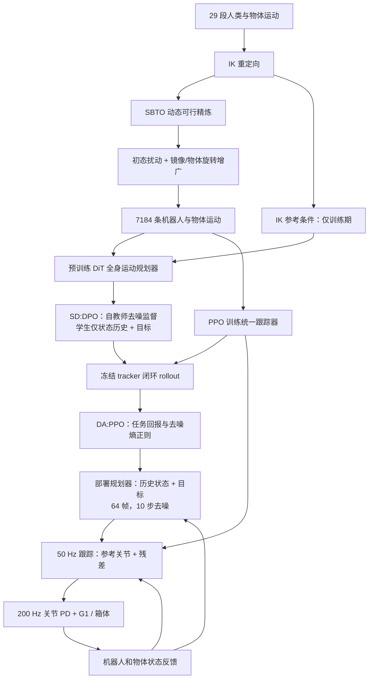

# DiPLO: Self-distilled Diffusion Planning for Loco-manipulation｜DiPLO：面向人形移动操作的自蒸馏扩散规划

## 一句话定义

**DiPLO** 将“先生成机器人与箱子的未来全身运动”与“高频反馈执行”分离：用动力学可行数据预训练扩散规划器与一个全身 RL tracker，再通过 **SD:DPO → DA:PPO**，使部署时仅依据状态历史及目标物体位姿生成可跟踪的搬运、放置运动，而不需逐任务提供完整 IK 参考动作。

## 英文缩写速查

| 缩写 | 英文全称 | 简要说明 |
|---|---|---|
| DiPLO | Self-distilled Diffusion Planning for Loco-manipulation | 本文人形移动操作规划与执行框架 |
| IK | Inverse Kinematics | 人体示范重定向为机器人运动学参考 |
| SBTO | Sampling-Based Trajectory Optimization | 将参考优化为动力学可行轨迹并扩增数据 |
| DiT | Diffusion Transformer | 生成未来机器人–物体状态的规划网络 |
| SD:DPO | Self-Distillation Diffusion Policy Optimization | 自蒸馏移除部署所需的强任务先验 |
| DA:PPO | Diffusion-Augmented Proximal Policy Optimization | 让每个去噪步获得任务回报的扩散强化学习 |
| PPO | Proximal Policy Optimization | 低层跟踪策略训练与规划器后训练的基础算法 |
| PD | Proportional–Derivative | 关节位置闭环执行 |
| SO(3) | Special Orthogonal Group in 3D | 机器人根姿态和物体旋转的扩散空间 |

## 为什么重要

双臂搬箱时，提前规划手、腿、躯干与箱体的协调轨迹，比单独发“走到那里”和“把手抬高”更符合全身耦合任务；但仅靠 IK 重定向动作不保证接触和动力学可行。**DiPLO 的关键取舍是训练时依赖强运动先验，部署时再移除它**，并通过冻结 tracker 的反馈区分“计划能生成”和“计划能完成任务”。

## 核心信息

| 项目 | 已核对事实 |
|---|---|
| 作者 | Shafeef Omar、Sebastian Sanokowski、Elham Daneshmand、Dian Yu、Daniel Cremers、Cordelia Schmid、Majid Khadiv |
| 机构 | 慕尼黑工业大学（TUM）、麦吉尔大学（McGill University）、法国国家信息与自动化研究所（Inria）、TUM 高等研究院 |
| 原文 | [arXiv:2610.24847v1（2026-10-17）](https://arxiv.org/html/2610.24847v1) |
| 项目 | [官方项目页](https://atarilab.github.io/diplo-website/) |
| 机器人 | Unitree G1，29 DoF；真机 pick–carry–place |
| 算法开放状态 | **算法代码与模型权重未见可核验公开入口**；官方网站写 Code soon，网站 GitHub 仅为静态展示源码 |
| 数据开放状态 | 官网写 Dataset soon；GitHub 网站 README 提及 HF 候选链接，实际可获得性待核实 |

## 核心原理

### 1. 生成可执行的训练数据

29 段人体–箱体运动（约 2.7 分钟）先经 IK 重定向，再由 [DynaRetarget / SBTO](../methods/dynaretarget-sbto-motion-retargeting.md) 结合初始扰动精炼为动力学可行运动；镜像和箱体旋转对称性扩充成 **7,184 条机器人–物体轨迹**。这些数据既训练扩散规划器，也分别训练一个可跟踪所有轨迹的 RL tracker。

### 2. 分层运动规划与跟踪

DiT 以历史状态、物体目标和（**仅预训练时**）IK 运动参考为条件，联合预测机器人根部、29 关节及物体的未来运动。状态表示包括根的相对平面位移/朝向、高度、姿态、关节位置和物体位姿；姿态在 SO(3) 上做旋转扩散，而不将旋转简单当成欧氏 6D 向量加噪。

规划块 **64 帧 = 1.28 s**、**10 步去噪**；附录报告 DiT 约 **5.1M** 参数。跟踪器在 **50 Hz** 以规划的参考关节位置加残差，交给 **200 Hz** 关节 PD 控制。论文真机规划器约 **12.5 Hz**：两个频率不能混成“12.5 Hz 直接控关节”。

### 3. 先自蒸馏，后扩散 RL

- **SD:DPO**：teacher 有 IK 参考，student 只看状态历史和目标；从闭环 rollout 采集 student 提案，在相同噪声运动与去噪步上对齐 denoising 预测（teacher 停止梯度；EMA teacher、预训练与 anchor 辅助项）。该阶段不使用任务奖励或 critic，解决“没有参考就容易摔倒/丢箱”的问题。
- **DA:PPO**：冻结 tracker，把去噪过程视为扩散增强 MDP 的一连串决策；将仿真中实际执行的目标回报向去噪步骤传播并做最大熵正则，改善最终箱体位姿达成率。它优化的是**规划器**，并非把 G1 的整个 tracker 端到端重训。

## 流程总览

按论文 Fig. 2 与 §IV 建模；训练时强先验、部署时去先验是不同分支。

## 实验与评测

**指标口径先看清**：论文 §V 中 survival 表示未摔倒、未掉落物体；task success 则是**存活回合中**箱体最终位置误差 ≤15 cm、旋转误差 ≤30° 的比例，并非所有起始回合的无条件成功率。

| Pick–carry–place 消融（Table V） | Survival | Task success |
|---|---:|---:|
| 预训练 student（无 IK 参考） | 57.7 ± 9.2% | 45.4 ± 9.0% |
| + SD:DPO | 100.0 ± 0.0% | 55.1 ± 6.0% |
| + SD:DPO + DA:PPO | **99.5 ± 0.5%** | **98.8 ± 1.2%** |

- **数据增广（Table I）**：一条参考 vs SBTO+对称性，预训练 survival 从 **90.0% 到 96.5%**，DA:PPO 后任务成功率从 **72.3% 到 96.4%**；此实验采用带 IK 参考的另一组设置，不能与表 V 的无参考 98.8% 直接相减。
- **旋转表示（Table II）**：SO(3) 扩散比欧氏 6D 对照 survival **96.5% vs 85.9%**。
- **生成状态 vs 直接生成关节动作（Table III）**：预训练状态扩散 + tracker survival **96.5%**，action diffusion **87.5%**；同训练数据与条件下比较。
- **未见目标（§V-G）**：目标位于距起点 0.5–5 m 的方位/朝向网格，报告 **88%** task success；项目页 20 m 走行属示例演示，不能代替统计评测。
- **真机（Table VII）**：G1 同目标重复 **10/10** 成功、五个不同目标 **5/5** 成功；使用关节编码器/IMU **以及外部动捕提供基座位置和物体位姿**，未经真实世界微调。样本量有限，不推断开放环境成功率。

## 与其他工作对比

- [DynaRetarget](./paper-notebook-dynaretarget-dynamically-feasible-retargeting-us.md)：提供 IK → **SBTO 动态可行参考** 的数据来源；DiPLO 在这些参考上新增**目标条件生成式规划器、自蒸馏与规划器后训练**，并非重复的轨迹优化论文。
- [FORGE](./paper-forge-force-aware-loco-manipulation.md)：用稀疏任务空间命令 + 力感知残差控制；DiPLO 更关注从目标生成整段机器人–物体未来状态，两者输入/控制接口不同。
- 相比直接扩散 **PD 关节动作**，DiPLO 选择生成较低频运动参考，由高频 RL tracker 吸收接触和平衡偏差；代价是额外训练 tracker 并依赖准确状态观测。

## 结论

**DiPLO 的核心价值是“用强运动先验学可执行运动，再蒸馏掉先验，并把规划结果对齐固定执行器”，而不是把低频扩散直接当作人形关节控制器。**

1. 少量演示先做 **IK + SBTO + 对称性** 增广，再训练生成模型；仅从头无参考训练难以获得同等效果。
2. **SD:DPO 提升存活**（57.7% → 100%），**DA:PPO 补目标成功率**（55.1% → 98.8%），不要把两个阶段的作用混为一谈。
3. 对比成绩应同时报告 survival、存活条件任务成功率及目标容差，**98.8% 是作者仿真条件成功率**。
4. 规划与执行频率分开：约 12.5 Hz GPU diffusion planner、50 Hz CPU ONNX tracker、200 Hz PD；tracker 在规划更新之间连续工作。
5. 真机当前需动捕闭环获取箱体位姿；代码/模型未验证公开，复现成本不止一个 DiT checkpoint。

## 工程实践

可用 [DynaRetarget / SBTO](../methods/dynaretarget-sbto-motion-retargeting.md) 已公开的精炼器理解数据环节。阅读或自行实现时先固定：48 维状态特征、10 维目标表示、历史 2 帧/预测 64 帧、SO(3) 旋转扰动、10 步 denoising、冻结 tracker 的状态更新与终止条件；在相同评测容差下分开记录 survival / task success / MPKPE / object errors。

真机接口重点是**外部动捕测得的物体位姿与基座位置**、ONNX tracker 50 Hz、PD 200 Hz 的闭环时序；不要把作者演示直接等同于纯机载感知自动搬运。

## 源码运行时序图

**不适用（2026-11-18 核查）**：官方项目页标记“Code soon”，[Atarilab/diplo-website](https://github.com/Atarilab/diplo-website) 公开的是展示站点源码，非本论文 DiT、SD:DPO、DA:PPO 或部署代码。上述 Mermaid 是**论文验证的数据/控制流**，不是虚构的源码调用时序。

## 局限与风险

- 真机评测只有 15 次尝试，且外部动捕提供基座及物体位姿；未证明无 mocap、视觉遮挡或复杂场景下的同等效果。
- 99% 条件成功率来自所述仿真数据与容差；踢/推拉是**分别预训练的任务模型**，不是同一权重的通用多技能零样本。
- 项目页 “Dataset soon” 与网站 README 中 HF 数据集链接不完全一致；**该 HF 资源可用性未核验**，不可标记完整开源。
- 不同论文的任务成功率/生存率定义各异，不能直接用同一百分数排序。

## 关联页面

- [Loco-Manipulation 任务地图](../tasks/loco-manipulation.md)
- [DynaRetarget（上游动力学精炼）](./paper-notebook-dynaretarget-dynamically-feasible-retargeting-us.md)
- [SBTO 动态可行重定向方法](../methods/dynaretarget-sbto-motion-retargeting.md)
- [FORGE 全身力感知残差控制](./paper-forge-force-aware-loco-manipulation.md)
- [Loco-Manipulation 纵深路线 Stage 4](../../roadmap/depth-loco-manipulation.md)

## 参考来源

- [论文全文核对归档（arXiv v1）](../../sources/papers/diplo-self-distilled-diffusion-planning_arxiv_2610_24847.md)
- [官方项目页与开放状态归档](../../sources/sites/diplo-website.md)
- [arXiv HTML v1](https://arxiv.org/html/2610.24847v1)

## 推荐继续阅读

- [arXiv PDF v1](https://arxiv.org/pdf/2610.24847v1)
- [DiPLO 官方视频与可视化](https://atarilab.github.io/diplo-website/)
- [DynaRetarget 官方项目](https://atarilab.github.io/dynaretarget.io/)
