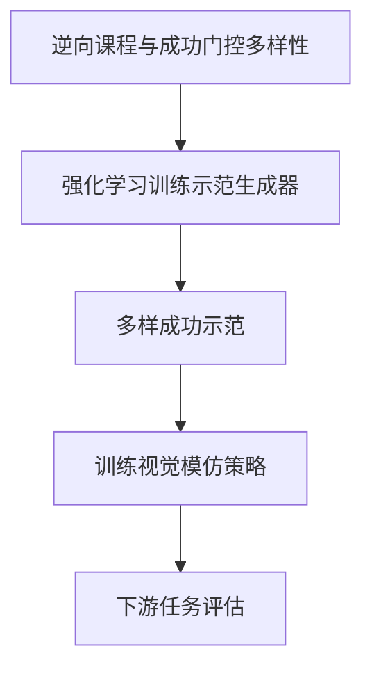
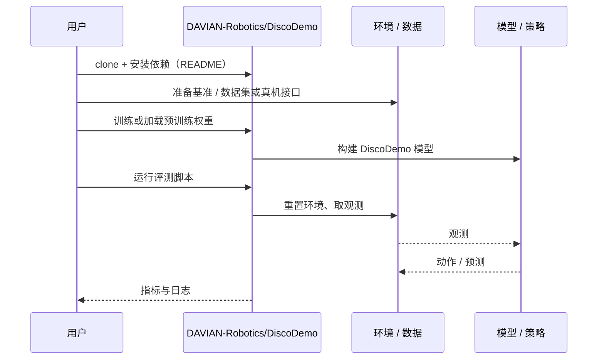

# DiscoDemo（arXiv:2610.32093）

**DiscoDemo**（*DiscoDemo: Discovering Efficient and Diverse Robot Demonstrations for Imitation Learning*，[arXiv:2610.32093](https://arxiv.org/abs/2610.32093)，[项目页](https://davian-robotics.github.io/DiscoDemo/)，[代码](https://github.com/DAVIAN-Robotics/DiscoDemo)）来自 [具身智能小站 2026-10-29 盘点](../../sources/blogs/wechat_embodied_station_58_papers_diverse_demonstrations_2026-10-29.md)，属「示范数据与数据引擎」组。

## 一句话定义

**模仿学习缺的往往不是更多相似轨迹，而是多种可成功的解法。**

## 英文缩写速查

| 缩写 | 英文全称 | 简要说明 |
|------|----------|----------|
| DiscoDemo | DiscoDemo: Discovering Efficient and Diverse Robot Demonstrations for Imitation Learning | 本文方法 / 基准的简称 |

## 为什么重要

- 让强化学习生成多种成功示范。DiscoDemo把强化学习用于数据生成，以逆向课程和多样性目标扩展覆盖，再训练同一个视觉策略；四项仿真和真机任务提供了较清楚的对照。
- 开源结论：**已开源**（步骤 2.5，2026-10-29）。仓库可达（git ls-remote）。项目页 HTTP 200。
- 同期同组工作见 [多样成功示范、触觉工具链与预见式感知：具身智能小站 10-29 期 58 篇阅读坐标](../overview/embodied-station-2026-10-29-58-papers-technology-map.md)。

## 核心机制

| 项 | 内容 |
|----|------|
| **arXiv** | [2610.32093](https://arxiv.org/abs/2610.32093) |
| **开源** | **已开源** |
| **要点** | 模仿学习缺的往往不是更多相似轨迹，而是多种可成功的解法。 |
| **文内指标** | 公众号转述：新增机制是让成功门控的解法多样性参与生成器训练，再把收益落实到下游视觉模仿，而非仅优化RL控制器自身回报；过强多样性也会损害任务能力。 |

## 核心流程图

以下概括本页所述的核心关系；具体实现与评测条件以原论文为准。

## 源码运行时序图

以下为按仓库入口（`DAVIAN-Robotics/DiscoDemo`）推断的通用运行链路；入库日仅核实仓库可达，未逐文件阅读，具体脚本名以 README 为准。

## 实验与评测

- 公众号转述：新增机制是让成功门控的解法多样性参与生成器训练，再把收益落实到下游视觉模仿，而非仅优化RL控制器自身回报；过强多样性也会损害任务能力。
- **读法：** 本页为索引级摘要，依据公众号转述的官方摘要与仓库信息整理；逐项数字与 baseline 以原文 PDF 为准。

## 与其他工作对比

- 横向索引见 [多样成功示范、触觉工具链与预见式感知：具身智能小站 10-29 期 58 篇阅读坐标](../overview/embodied-station-2026-10-29-58-papers-technology-map.md)；同 arXiv 不重复造页。

## 结论

**让强化学习生成多种成功示范：新增机制是让成功门控的解法多样性参与生成器训练，再把收益落实到下游视觉模仿，而非仅优化RL控制器自身回报；过强多样性也会损害任务能力。**

1. 开源边界：**已开源** — 仓库可达（git ls-remote）。项目页 HTTP 200。
2. 核心机制：模仿学习缺的往往不是更多相似轨迹，而是多种可成功的解法。
3. 复现与选型前核对任务协议、硬件与基准口径，勿直接横比公众号摘录数字。

## 关联页面

- [embodied-data-collection-four-layers-taxonomy](../concepts/embodied-data-collection-four-layers-taxonomy.md)
- [imitation-learning](../methods/imitation-learning.md)
- [teleoperation](../tasks/teleoperation.md)
- [embodied-station-2026-10-29-58-papers-technology-map](../overview/embodied-station-2026-10-29-58-papers-technology-map.md)

## 参考来源

- [discodemo_arxiv_2610_32093.md](../../sources/papers/discodemo_arxiv_2610_32093.md)
- [wechat_embodied_station_58_papers_diverse_demonstrations_2026-10-29.md](../../sources/blogs/wechat_embodied_station_58_papers_diverse_demonstrations_2026-10-29.md)
- [arXiv:2610.32093](https://arxiv.org/abs/2610.32093)

## 推荐继续阅读

- [arXiv PDF](https://arxiv.org/pdf/2610.32093)
- [项目页](https://davian-robotics.github.io/DiscoDemo/)
- [https://github.com/DAVIAN-Robotics/DiscoDemo](https://github.com/DAVIAN-Robotics/DiscoDemo)
