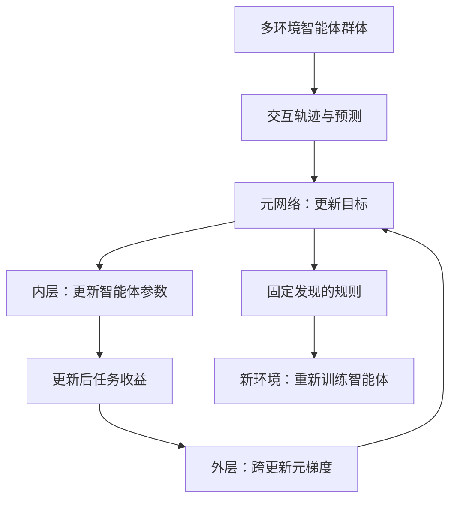
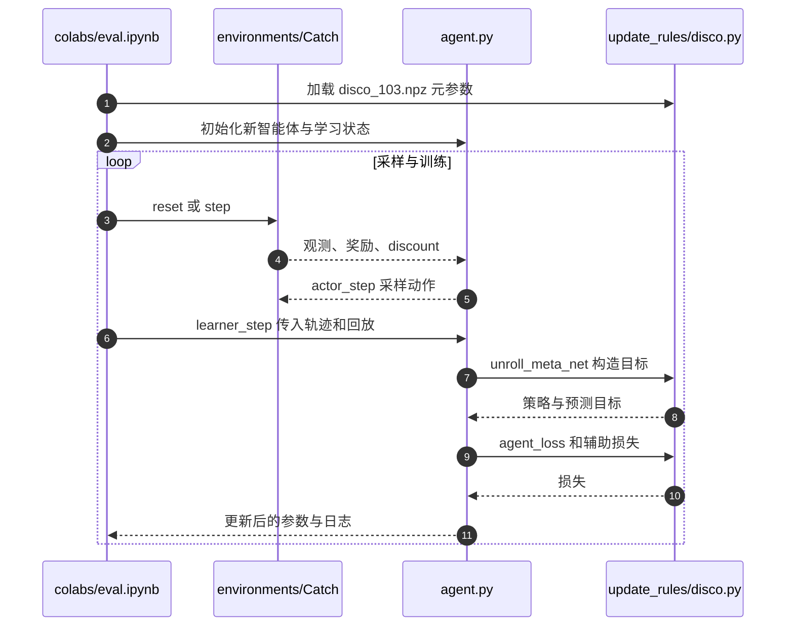

# Discovering state-of-the-art reinforcement learning algorithms / 发现最先进的强化学习算法

## 一句话定义

**DiscoRL 让许多智能体共同教一个元网络“怎样更新才学得更好”，输出可复用的 RL 学习规则，而不是一份通用动作策略。**

## 英文缩写速查

| 缩写 | 英文全称 | 简要说明 |
|---|---|---|
| RL | Reinforcement Learning | 内层智能体通过交互学习任务 |
| DiscoRL | Discovered RL rule（论文方法名） | 自动发现的学习规则，非另一独立缩写展开 |
| KL | Kullback–Leibler Divergence | 策略 / 预测与目标分布的距离 |
| LSTM | Long Short-Term Memory | 元网络的时序处理组件 |
| IQM | Interquartile Mean | 多任务归一化分数的中间四分位均值 |
| PPO | Proximal Policy Optimization | 人工设计策略更新目标的对照方向 |
| TPU | Tensor Processing Unit | 论文大规模发现阶段的计算设备 |

## 为什么重要

通常研究者决定预测什么、如何从奖励构造目标；DiscoRL 把其中一部分设计交给跨任务经验。对机器人学习最有价值的启发是：**环境分布可以成为学习规则的训练数据**，但能否迁移到连续关节动作，需要新的验证。

## 核心信息

| 项目 | 信息 |
|---|---|
| 作者 | Junhyuk Oh、Gregory Farquhar、Iurii Kemaev、Dan A. Calian、Matteo Hessel、Luisa Zintgraf、Satinder Singh、Hado van Hasselt、David Silver |
| 机构 | 谷歌 DeepMind（Google DeepMind） |
| 发表日期 | 2025-10-22，Nature 648, 312–319 |
| 主身份 | DOI 10.1038/s41586-025-09761-x |
| 开放状态 | 最小 JAX 框架、元训练 / 评估 notebook、Disco103 元参数已公开 |

## 核心原理与方法

### 两组参数，两个优化问题

- **θ：任务智能体。** 观测产生策略 π、观测条件预测 y、动作条件预测 z；同时包含固定语义的动作价值 q 和辅助下一状态策略预测 p。
- **η：更新规则。** 元网络读取轨迹中的奖励、终止信号与智能体输出，为 π、y、z 产生训练目标；改变 η 就改变了智能体的学习方式。
- **内层：** 用目标匹配损失更新 θ。**外层：** 检查多次内层更新后的任务收益，通过更新过程反传来改善 η。

简化记为：`θ' = Update(θ, trajectory; η)`，外层优化 `E[Return(θ')]`。目标匹配使用 KL；q、p 的辅助损失另有规定。不是“把 PPO 的学习率自动调一调”，也不是大模型生成 Python 算法代码。

### 预测为什么有用

y、z 没有被硬编码成某一个价值函数或世界状态。论文用预测分析和消融考察其含义：它们包含未来显著事件的信息，并通过未来预测构造当前目标。**辅助预测会参与策略更新**，不能仅当作训练时无关紧要的额外头。

## 流程总览

图中外层闭环属于**算法发现**。固定规则后仍然需要新任务经验和智能体训练；“规则零样本迁移”不等于“策略零样本完成任务”。

## 实验与评测

| 规则 / 场景 | 发现时环境 | 论文结果及读法 |
|---|---|---|
| Disco57 | Atari 57 游戏 | Atari 人类归一化 IQM 13.86；这是聚合归一化分数，不是成功率 |
| Disco57 泛化 | 发现时未见 ProcGen | 报告优于既有公开方法；新智能体仍训练 |
| Disco103 | Atari57 + ProcGen16 + DMLab30 | 共 103 环境；后三类中的 ProcGen、DMLab 不能再称未见 |
| Disco103 泛化 | 未见 Crafter、NetHack、Sokoban | Crafter 达人类水平；Sokoban 接近 MuZero；不是每个任务全面领先 |

比较需同时对齐网络、环境步数、回放比例、种子和算力。Disco57 的发现使用 128 个智能体、1,024 TPUv3 核约 64 小时；Disco103 使用 206 个智能体、2,048 核约 60 小时。论文对元梯度采用跨 20 次内层更新的窗口；这些是发现阶段设置，不是动作频率或部署要求。

## 结论

**这项工作扩大了 RL 算法可被学习的范围，但没有证明一个现成规则能取代所有机器人控制训练算法。**

1. 先辨别权重属于 η 还是 θ：Disco103 文件保存的是更新规则。
2. 比较未见任务时必须列出规则的发现环境，避免把 Disco103 的 ProcGen 表现误读成跨域零样本。
3. 使用既有规则和重新发现规则的成本不同，应分别核算。
4. 机器人探索应从小型仿真对照开始，控制动作接口、奖励、采样预算与网络规模，不直接上真机。

## 源码运行时序图

这是官方评估 notebook 的概念时序，采样与 learner 调用由 notebook 编排。`colabs/meta_train.ipynb` 另外提供 `calculate_meta_gradient` 与 `meta_update`，展开内层学习并优化 η；图中固定 η 的路径不会自动完成元训练。

## 工程实践

1. 先打开官方 [eval notebook](https://github.com/google-deepmind/disco_rl/blob/main/colabs/eval.ipynb)：安装包、解包权重、初始化 Catch 与新智能体，确认回报曲线和张量规格。
2. 再读 `Agent.learner_step` → `DiscoUpdateRule.unroll_meta_net` → `agent_loss`，追踪 rollout 的时间对齐、终止 mask、目标网络和预测目标。
3. 最后看 [meta_train notebook](https://github.com/google-deepmind/disco_rl/blob/main/colabs/meta_train.ipynb)：区分 train rollout / valid rollout、内层梯度与元梯度。默认 Catch 小规模演示不等于重现论文全部成绩。

### 面向 G1 的研究迁移（工程推断，非论文结论）

现有实现以离散动作 logits、类别分布损失和动作索引为核心。G1 常用连续期望关节位置，不能只替换 PPO loss 就完成迁移；需要重做动作分布及动作条件预测接口，验证回放兼容性、元梯度稳定性与仿真任务分布。实时部署仍须单独确认观测接口、输出限幅、推理延迟和底层控制约束。

## 与其他工作对比

| 方法 | 人工指定的核心 | 学习得到的核心 | 不应混淆 |
|---|---|---|---|
| PPO | clipped surrogate 等更新机制 | 任务策略 / 价值参数 | 调参不等于发现新的预测语义 |
| DiscoRL | 网络接口、目标匹配形式、元目标与环境分布 | 目标构造规则及预测语义 | 元网络不是部署动作策略 |
| 世界模型规划 | 动态预测与规划接口 | 环境转移 / 奖励模型 | DiscoRL 的 y、z 不能直接认定为可 rollout 的世界模型 |

## 局限与风险

- 论文核心证据来自游戏任务，未给出 G1 关节控制、接触稳定或 Sim2Real 实验。
- 公共仓库提供最小 harness 与 Catch；大规模环境适配、集群调度与论文成绩不能由安装成功推断。
- README 明确不再主动维护；应固定依赖与源码提交，先做小规模兼容检查。
- 自由预测语义不等于完全可解释；分析支持特定信息关联，不构成通用物理状态含义。
- 此次收录核验文档及源码，**未运行官方训练，也未验证机器人迁移性能**。

## 关联页面

- [Reinforcement Learning](../methods/reinforcement-learning.md)：从手工规则扩展到规则学习。
- [PPO](../methods/ppo.md)：理解内层任务训练的对照算法。
- [Model-Based RL](../methods/model-based-rl.md)：区分预测学习、世界模型与规划。

## 参考来源

- [Nature 论文归档](../../sources/papers/discorl_nature_2025.md)
- [官方项目页核查](../../sources/sites/discorl.md)
- [官方源码与入口](../../sources/repos/disco_rl.md)

## 推荐继续阅读

- [Nature 全文](https://www.nature.com/articles/s41586-025-09761-x)
- [官方项目页](https://google-deepmind.github.io/disco_rl/)
- [官方仓库](https://github.com/google-deepmind/disco_rl)
