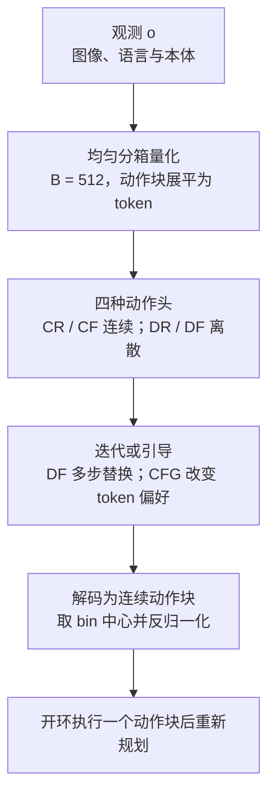

# 离散动作何时能成为好的连续控制器

这篇论文问的是：机器人动作是否必须用连续值预测，还是离散 token 也能做好精细控制。作者在从零训练的单任务策略与多任务 VLA 上系统比较了连续回归（CR）、连续 flow（CF）、离散回归（DR）与离散流（DF）四种动作头，结论是离散动作即使使用最朴素的均匀分箱也能匹配甚至超过连续策略，而离散策略的主要难点在于 token 之间的因子化误差。

## 英文缩写速查

| 缩写 | 英文全称 | 简要说明 |
|------|----------|----------|
| CR | Continuous Regression | 连续回归头：单次前向直接回归动作块 |
| CF | Continuous Flow | 连续 flow matching 动作头：多步积分速度场生成动作块 |
| DR | Discrete Regression | 离散回归头：对每个动作 token 做分类，单次前向 |
| DF | Discrete Flow | 离散流头：多步迭代更新 token，并依赖当前 token 与流时间 |
| CFG | Classifier-Free Guidance | 无分类器引导：组合有条件与无条件预测以改变 token 偏好 |
| VLA | Vision-Language-Action | 视觉-语言-动作模型，本文多任务实验的载体 |

## 为什么重要

- **挑战默认假设：** 机器人基础模型通常假设动作必须用连续向量表示，而语言模型使用离散 token。本文提供了一组受控对比，检验这一假设是否必要。
- **指明瓶颈：** 论文认为离散策略的问题不在量化精度，而在 token 的乘积分布造成的因子化误差；这为后续 tokenizer 与解码器设计指明了方向。
- **实用含义：** 若离散动作可以与连续动作竞争，那么动作与语言、感知共享同一套 token 预测机制会更容易。

## 核心信息

| 项 | 内容 |
|----|------|
| **机构** | Carnegie Mellon University（CMU）；Amazon FAR（Frontier AI & Robotics） |
| **平台 / 数据** | 单任务：RoboMimic；VLA 规模：RoboCasa（仿真）、LIBERO（仿真）、DROID（离线诊断）；真机多任务（Franka 末端位姿命令） |
| **动作表示** | 末端位姿动作块，H 步、每步 M 维；均匀分箱 B = 512，展平为 L = H·M 个 token |
| **开源** | **待发布**：项目页 Code 为 “soon”，页面注明将随论文发表释出代码与权重 |

## 核心原理

### 四种动作头与离散化

- **量化：** 动作归一化后按坐标分箱，解码时取 bin 中心；论文主要使用均匀分箱，并比较了其他 tokenizer 作为对照。
- **CR 与 CF：** 连续回归一次输出动作块；连续 flow 从高斯噪声出发积分速度场。
- **DR 与 DF：** 离散回归对每个 token 做交叉熵分类，单次前向即可输出；离散流从源分布出发，每步按概率替换部分 token，多步迭代得到最终 token。
- **CFG：** 训练时随机丢弃条件，推理时组合有条件与无条件的 logits，使 token 分布更集中。

### 论文提出的解释

- **时间变化与响应性：** 连续回归倾向于过度平滑动作块（jerk ratio 小于 1），离散头更容易表达块内较大的时间变化，对观测变化也更敏感。
- **因子化误差：** 离散回归在每个位置独立预测，不同位置的选择可能组合成不一致的动作；DF 与 CFG 分别通过迭代计算与改变 token 偏好来减少这种不一致。

## 工程实践

| 项 | 建议 |
|----|------|
| 动作离散化 | 先用均匀分箱作为基线：论文显示朴素离散回归已能匹配连续策略；结构化 tokenizer 没有稳定收益 |
| 选择动作头 | 需要快速推理时可先试 DR；追求精度与动作响应时倾向 DF；CFG 对 DR 提升明显（RoboCasa 上 27.1% 到 49.2%） |
| 指标 | 除成功率外，报告动作块的 jerk ratio、状态响应性（responsiveness）与末端误差按时间步的分布 |
| 几何先验 | 显式注入距离或几何信息、用腐蚀过程模拟连续 flow 没有稳定收益，不建议作为首选 |
| 源码运行时序图 | **不适用**（官方代码与权重尚未发布，项目页仅说明将在发表后释出，无法对齐运行入口） |

## 实验与评测

- **RoboCasa（VLA 规模，仿真，论文数字）：** DR 27.1%（无 CFG）升至 49.2%（CFG）；DF 53.9%、CF 52.7%、CR 38.8%。自回归逐 token 变体在无 CFG 时为 42.8%，加 CFG 后与 DR、DF 接近。
- **因子化误差：** DF 的迭代计算使每个动作块的模式不一致预测数相对 DR 降低约 5.28 倍，在迭代次数不少于 10 时平均低于 1，同时 RoboCasa 成功率提高约 4.7 个点（论文 §4，Fig. 4a）。
- **结构化与几何变体（§5）：** 显式几何 DF 为 52.8%，mixture-path DF 为 53.9%；结构化 tokenizer 未超过朴素均匀分箱。
- **真机：** 论文展示了三项真机 VLA 任务（图 1b）；逐项成功率本页未从文本中核实。
- **LIBERO、DROID、RoboMimic：** 论文同时报告了这些基准上的比较，本页只引用了 RoboCasa 的数字。

## 结论

**离散动作的主要障碍是 token 之间的组合一致性，而不是动作精度；只要配合迭代或引导，离散策略可以成为连续策略的有力替代。**

1. **朴素离散化已经够用：** 均匀分箱离散回归在多个设定中匹配或超过连续回归，说明精度不是离散动作的主要短板。
2. **离散头更能表达时间变化：** 相比连续回归的过度平滑，离散头对块内动作变化与观测变化更敏感。
3. **因子化误差是真正的瓶颈：** 独立预测的 token 可能组合出不一致的动作，这一误差与成功率的关系比重建误差更直接。
4. **迭代与引导都能修正：** 离散流的多步计算与 CFG 分别从不同方向降低不一致，二者都能带来明显提升。
5. **几何与结构化 tokenizer 的收益有限：** 在论文的设定下，它们未超过朴素分箱加离散流，后续工作应优先考虑能让耦合动作更易预测的 tokenizer 设计。

## 与其他工作对比

| 对照 | 差异读法 |
|------|----------|
| [VLA](../methods/vla.md) 中的离散动作路线（如 RT 系列的分箱输出） | 论文把离散动作放在同一套对比框架下，与连续动作头做受控比较，而不只是提出新的离散模型 |
| [Diffusion Policy](../methods/diffusion-policy.md) 与连续 flow 策略 | 论文的 CF 基线与连续生成式策略同类；论文结论是离散 flow 在同等设定下更好或相当 |
| [Flow Matching 具身策略](../concepts/flow-matching-embodied-policy.md) | 论文的 DF 把 flow 思路用到离散 token 上，与连续 flow 的差异在于生成空间是离散 token 而非连续向量 |
| [Action Chunking](../methods/action-chunking.md) | 论文的所有头都输出动作块，比较的是块内表示方式，而不是块长度 |

## 局限与风险

- **代码与权重未发布：** 当前只能依据论文与项目页理解设定，复现依赖附录细节。
- **任务范围：** 实验覆盖仿真基准与若干真机任务，长时域、接触丰富的真机任务覆盖有限。
- **指标选择：** 论文使用成功率、重建误差与时间变化等多种指标；单看成功率可能掩盖响应性与平滑性的差异。
- **迭代成本：** DF 与 CFG 需要多次网络评估或两次前向，推理延迟高于单次回归，部署时需要权衡。

## 关联页面

- [生成式机器人控制的关键：迭代计算，而非“加噪”本身](paper-much-ado-about-noising.md) — 同一 “Robot Learning Science” 主题中的第一篇研究
- [VLA](../methods/vla.md) — 本文多任务实验的模型类别
- [Action Chunking](../methods/action-chunking.md) — 动作块输出的基础范式
- [Diffusion Policy](../methods/diffusion-policy.md) — 连续生成式策略的代表对照
- [Flow Matching 具身策略](../concepts/flow-matching-embodied-policy.md) — 连续与离散 flow 的共同背景
- [Diffusion Model](../concepts/diffusion-model.md) — 迭代去噪与离散扩散的背景概念
- [Behavior Cloning](../methods/behavior-cloning.md) — 四种动作头所用的监督学习框架
- [Manipulation](../tasks/manipulation.md) — 任务范畴

## 参考来源

- [discrete_actions_arxiv_2610_20429.md](../../sources/papers/discrete_actions_arxiv_2610_20429.md) — 论文摘录与开源核查（2026-10-15）
- [wechat_embodied_station_robot_31_papers_2026-10-15.md](../../sources/raw/wechat_embodied_station_robot_31_papers_2026-10-15.md) — 文章摘要与链接
- [arXiv:2610.20429](https://arxiv.org/abs/2610.20429) — 原文（提交日期 2026-10-14）

## 推荐继续阅读

- [项目页（含视频与可视化）](https://iscoyizj.github.io/discrete-action-website/) — 论文配套页面（代码待发布）
- [arXiv HTML 版](https://arxiv.org/html/2610.20429v1) — 完整方法与附录
