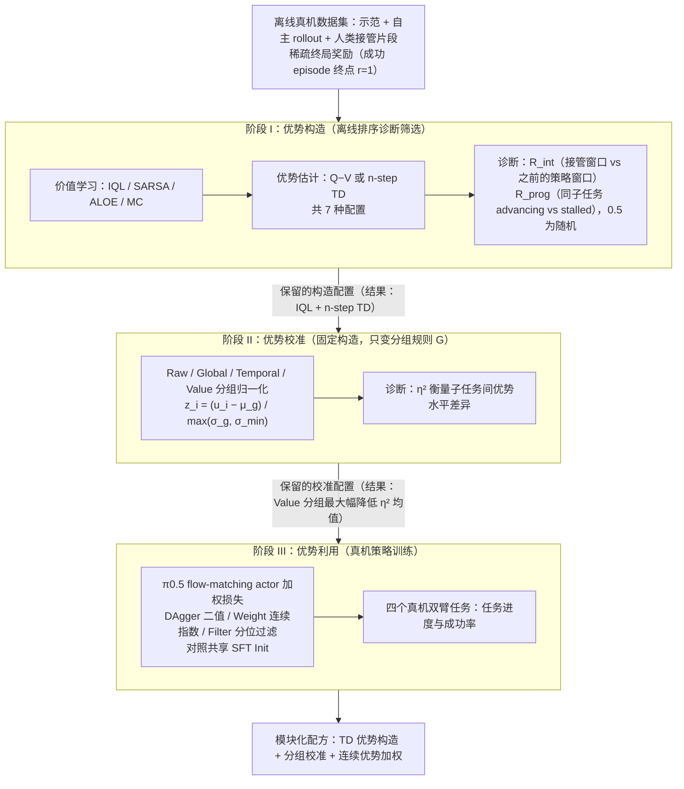

# DissectVLA（arXiv:2609.28161）

**Dissecting Advantage-Guided Post-Training for Vision-Language-Action Policies**（[项目页](https://dissectvla.github.io/)，[arXiv:2609.28161](https://arxiv.org/abs/2609.28161)）来自 [具身智能小站 · 13 篇盘点](../../sources/blogs/wechat_embodied_13_papers_forgetmimic_2026-09-24.md)（2026-09-24）。

## 一句话定义

**把 VLA 优势引导后训练拆成 **构造 / 校准 / 利用** 三阶段，用离线诊断筛设计再少跑真机。**

## 英文缩写速查

| 缩写 | 英文全称 | 简要说明 |
|------|----------|----------|
| VLA | Vision-Language-Action | 视觉–语言–动作策略 |
| RL | Reinforcement Learning | 强化学习 |
| TO | Trajectory Optimization | 轨迹优化 |
| HITL | Human-in-the-Loop | 人在回路 |

## 为什么重要

- 现有 recipe 把 critic 优势构造、分组校准与样本加权揉在一起，难知收益来自哪一环。
- 纳入 [13 篇技术地图](../overview/embodied-13-papers-technology-map.md) 阅读坐标。
- 开源结论（步骤 2.5，2026-09-24）：**待发布**。

## 流程总览

图依据：论文 §IV（Study Design，Stage I–III）、§III-A–C 与 Fig. 2；各阶段“保留配置”取自 §V-B/C 与摘要对结果的概述。

## 核心机制

| 项 | 内容 |
|----|------|
| **arXiv** | [2609.28161](https://arxiv.org/abs/2609.28161) |
| **开源** | **待发布** |
| **要点** | Stage I：IQL + n-step TD 优势；Stage II：Value-based 分组校准（低 η²）；Stage III：连续 advantage weight（非 filter）。 |
| **文内指标** | 四双臂真机任务：mean task progress **+0.42**、success **+0.63** vs SFT init；Weight 条件 mean success **0.74**。 |

## 源码运行时序图

**不适用**（截至 2026-09-24 项目页/论文未提供可运行官方代码；开源状态：**待发布**）。

## 实验与评测

- 四双臂真机任务：mean task progress **+0.42**、success **+0.63** vs SFT init；Weight 条件 mean success **0.74**。
- **读法：** 公众号归纳；逐项 baseline 与协议以 arXiv PDF 为准。

## 与其他工作对比

- 横向索引见 [13 篇技术地图](../overview/embodied-13-papers-technology-map.md)。

## 结论

**先离线筛 construction/calibration，再烧真机做 utilization** — 勿跳阶段混调。

1. 开源边界：**待发布** — 以项目页/仓库实际链接为准（入库日 2026-09-24）。
2. 核心机制：Stage I：IQL + n-step TD 优势；Stage II：Value-based 分组校准（低 η²）；Stage III：连续 advantage weight（非 filter）。…
3. 部署前核对任务协议与硬件条件，勿直接横比公众号摘录数字。

## 关联页面

- [Vla](../methods/vla.md)
- [Universal Post Training Robotics](../concepts/universal-post-training-robotics.md)
- [Manipulation](../tasks/manipulation.md)
- [Embodied 13 Papers Technology Map](../overview/embodied-13-papers-technology-map.md)

## 参考来源

- [13 篇盘点（公众号）](../../sources/blogs/wechat_embodied_13_papers_forgetmimic_2026-09-24.md)
- [Dissecting Advantage-Guided Post-Training for Vision-Language-Action Policies](../../sources/papers/dissect-vla-post-training_arxiv_2609_28161.md)
- [arXiv PDF](https://arxiv.org/pdf/2609.28161)：已通读方法部分（实验与附录以略读为准）：摘要、§I 引言、§III 预备知识、§IV 研究设计（A–C，含 Stage I–III 设定）；§V-A–C 读过，§V 其余与附录略读

## 推荐继续阅读

- [arXiv:2609.28161](https://arxiv.org/abs/2609.28161) — 原文
