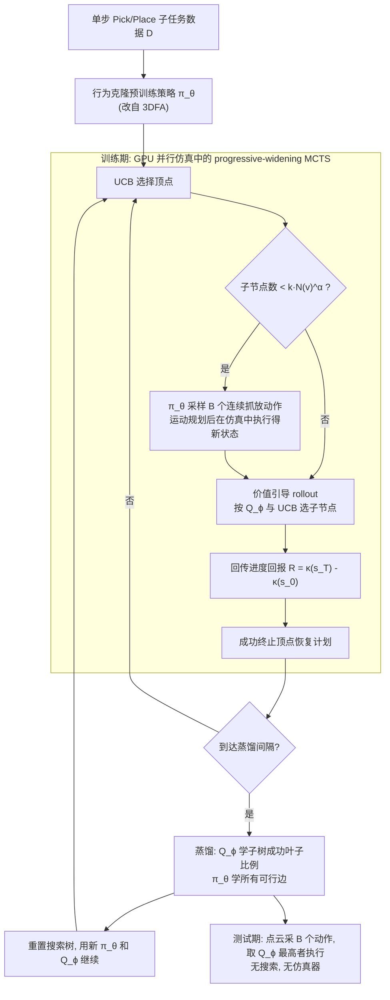

# Distilled Tree Search Rearrangement：通过连续动作空间树搜索蒸馏实现长程多物体重排

**DISCO**（*Long-Horizon Multi-Object Rearrangement via Distilled Tree Search over Continuous Actions*，[arXiv:2610.25785](https://arxiv.org/abs/2610.25785)）出自 CMU 机器人所与 Stanford（Kallol Saha、Yining Hong、Amber Li、Yejin Choi、Maxim Likhachev、David Held），CoRL 2026 Oral。本页依据 arXiv v1 全文（正文与附录 A–D、F，见[来源归档](../../sources/papers/distilled-tree-search-multi-object-rearrangement_arxiv_2610_25785.md)的核对范围）整理，原先收录于 senlanke 10-19–10-23 Manipulation 周报。

## 一句话定义

DISCO 用「学到的策略提出连续抓放动作 + 学到的价值函数打分」引导 progressive-widening MCTS，在 GPU 并行物理仿真里自己搜出长程重排计划，再把搜索树周期性蒸馏回策略与价值函数；部署时只用蒸馏后的点云条件模型直接出动作，不需要仿真器与搜索（摘要、§4）。

## 英文缩写速查

| 缩写 | 英文全称 | 简要说明 |
|------|----------|----------|
| DISCO | Distilled Tree Search over Continuous Actions | 本文方法名（摘要） |
| MCTS | Monte Carlo Tree Search | 蒙特卡洛树搜索（§1、§4.1） |
| PW | Progressive Widening | 随访问数增加才逐步放宽子节点上限，处理连续动作（§4.1） |
| UCB | Upper Confidence Bound | 选子节点的上置信界规则（§4.2） |
| 3DFA | 3D FlowMatch Actor | 本文策略架构的来源，改用点云编码器（§4.1、附录 B.3） |
| BC | Behavior Cloning | 行为克隆，用于预训练初始策略（§4.1） |
| RL-PD | RL with Prior Data | 基线：带先验数据的 SAC（§5.2、附录 A.3） |
| MPPI | Model Predictive Path Integral | 基线：采样式轨迹优化（§5.2） |
| TAMP | Task and Motion Planning | 任务与运动规划，相关工作（§2） |

## 为什么重要

- 作者要解决的问题（§1）：长程多物体重排里行为克隆策略误差累积，短视野监督也学不到早期动作对后续成败的影响；树搜索能推理未来后果，但在连续高维动作空间里计算量大。
- 作者的主张（§1 贡献，作者自述）：只用单步抓放这类短程数据，通过 MCTS 自生成长程计划，就能自举出长程行为，不需要昂贵的长程示范；训练时用搜索，测试时不用。
- 评论（本页判断）：把「搜索当监督源」而不是「在线规划器」，与 AlphaGo 式策略-价值自我改进同构，但落在点云与连续位姿动作上。需要训练时有仿真器与自定义进度度量 κ，这是它的使用门槛。

## 核心原理与流程总览

图依据：§4.1–4.3、Algorithm 1–5、附录 B.1。

**问题设定（§3）。** 状态是各物体 6D 位姿，目标是 0/1 判定函数 G；测试时只有带物体分割标签的点云；动作是目标末端位姿，用运动规划（cuRobo）转成轨迹；训练时才用仿真器 ManiSkill3。仅仿真中定义任务进度 κ，边奖励 r = κ(s') − κ(s)。

**四个部件。**

| 部件 | 做法 | 出处 |
|------|------|------|
| 连续动作 MCTS | 策略采样动作扩展顶点；仅当子节点数 < k·N(v)^α 才继续加子节点（k=2.0、α=0.3） | §4.1、附录 Table 4 |
| 价值引导 rollout | rollout 即树下降：每步批量采样 B=32 个动作，按 UCB 选子节点；未访问子节点先验第一轮是进度奖励，之后是 Q_ϕ | §4.2、附录 B.1–B.2 |
| 价值蒸馏 | 目标 y_i = 子树已访问叶子中成功叶子占比；加权 BCE，权重 log(1+叶子数) | §4.3 式 1 |
| 策略蒸馏 | 用所有产生可行新顶点的边做 flow-matching 训练，而不只用成功计划的边；D 仅用于预训练 | §4.3、附录 F.3 |

附录 B.2 说蒸馏在训练集每完整规划一轮后进行，共 2 轮，之后完全用蒸馏网络；主文只写「每 N_distill 次 MCTS 迭代」。

## 工程实践

- **网络（附录 B.3–B.4）：** 策略是两个独立训练的 rectified-flow 模型（抓取，以及以抓取为条件的放置），输入 4096 点 xyz 点云（目标物体点云，货架与已放物体作上下文），假设有目标物体分割掩码。价值函数看全场景点云加抓放两个位姿 token，输出成功概率。
- **算力（§5.1）：** 单张 RTX 4090；货架任务搜索产生 263,650 个顶点（11,015 个被扩展），耗时 47.7 小时；仿真预算货架 270,000、堆叠 27,000 次调用（附录 Table 4）。
- **数据规模（§5.1、附录 B.6）：** 每任务训练一个共享策略-价值模型，50 个随机化训练实例，15 个留出实例；预训练数据来自几何采样器生成的单步抓放（Table 6 右：全量 D 为 1,776 条，奖励在 1,332 条后基本饱和）。
- **sim2real（附录 B.5）：** 输入只用点云（不用本体与 RGB），训练时加点云噪声（上限 0.01 m）、局部挖洞补均匀点、物体绕竖轴 / 货架全 3D 旋转增强，并做质心与半径归一化。
- **基线公平性（§5.2）：** Beam Search、MPPI 与两个消融只替换训练期的计划生成器；测试时除专门的测试期规划器外，都是「采样动作并取价值最高」，无搜索。
- **代码：** 论文只给项目页，未见代码仓库链接，故无法对照实现。

## 与清单说法的核对

背景：Glen Berseth 的 CoRL 2026 阅读清单（#069，P1，Planning & Compositional Generalization，Oral）对该文的一句话摘要是「Distills MCTS over continuous actions in GPU-parallel simulation into policies for long-horizon multi-object rearrangement.」（据作者说明，摘要由 LLM 据论文摘要起草，排序是作者按个人研究兴趣打分，不是质量评价。）

| 清单说法 | 与论文核对 |
|----------|------------|
| 蒸馏 MCTS | 属实，且是迭代蒸馏（§4.3）。蒸馏的是搜索树，不是只有成功计划：策略用所有可行边训练（附录 F.3、Table 6）。 |
| 连续动作 | 属实：动作是抓取位姿 + 放置位姿（SE(3)），由 progressive widening 处理（§4.1）。仅限末端抓放，非关节空间（§7）。 |
| GPU 并行仿真 | 属实，但只在训练期：ManiSkill3 并行仿真 + GPU 运动规划做批量扩展（§4.2）；测试期不用仿真器（Fig.1）。 |
| 蒸馏进「策略」 | 不完整：蒸馏进的是策略与价值函数两者（摘要、§4.3），测试时靠价值函数从策略采样的候选里选动作（附录 F.2），价值函数是关键部分。 |
| 长程多物体重排 | 属实，但任务是三个仿真任务（Shelf Packing、Object Stacking、Constrained Packing）与两个真机任务，物体数 3–7 个（附录 B.2），较窄（§5.1）。 |
| 未写：真机结果 | 清单摘要未提真机。论文真机仅 Shelf Packing（2/3）与 Table Bussing（1/3），每任务 3 次，基线仅 3DFA（Table 2）。 |

## 局限

**论文自己承认（§7）：** 依赖初始策略，若很少提出可行动作则搜索找不到可蒸馏的长程计划；只评估末端执行器抓放，关节空间与灵巧控制留作未来；对仿真保真度敏感，进度度量错位会偏置搜索；尚未结合基础模型或 VLA。

**本页读到的未验证之处（评论，非论文结论）：**

- 真机样本极小：每任务 3 次试验，2/3 与 1/3 的成功率不足以支撑统计结论（Table 2）；真机基线只有 3DFA，未与其他搜索 / RL 方法在真机上对比。
- 仿真留出集只有 15 个实例（§5.1），而 Table 1 的置信区间标注为 32 个环境种子平均，二者关系正文没解释；Table 6 左的成功率区间很宽（52.8±38.9 对 32.3±24.9）。
- 训练需要手写任务专属进度度量 κ（货架：装入体积占比；堆叠：塔高比；附录 C）与成功判据，以及目标物体分割掩码（附录 B.3）；跨任务通用性未测，每个任务单独训练一个模型（§1）。
- Constrained Packing 的成功判据由作者改写，并统一了执行接口（附录 A.5、C.3），与 Points2Plans 原指标不完全可比。DISCO 的 85.9% 与 SPOT 约 84.7%（Fig.5 目视读数）差距在误差范围内，文中措辞是「comparable」。
- 训练代价高：货架任务单次搜索 47.7 小时（§5.1）；论文没给基线的等价算力对比，仅用仿真预算作图（Fig.4）。
- 附录 Table 3 的 RL-PD 超参（critic 学习率 0.1、actor 0.01）数值异常，是否为笔误未核实；RL-PD 的调参投入论文没有说明。
- 仅 2 轮蒸馏（附录 Table 4），更多轮数是否继续提升未知。

## 关联页面

- [Manipulation周报技术地图](../overview/senlanke-weekly-2026-10-19-23-manipulation-technology-map.md)：同周论文索引
- [manipulation](../tasks/manipulation.md)：操作任务总览
- [模仿学习](../methods/imitation-learning.md)、[行为克隆](../methods/behavior-cloning.md)：初始策略与 DISCO 对比的基线类别
- [SAC](../methods/sac.md)：RL-PD 基线所基于的算法
- [模型预测控制](../methods/model-predictive-control.md)：MPPI 基线的相邻概念
- [Flow Matching 具身策略](../concepts/flow-matching-embodied-policy.md)：策略头使用的 flow-matching 训练
- [进度奖励建模](../concepts/progress-reward-modeling.md)、[奖励设计](../concepts/reward-design.md)：进度奖励 κ 的相邻话题
- [cuRobo](../entities/curobo.md)：运动规划器
- [ManiSkill3 GPU 并行仿真](../entities/paper-notebook-maniskill3-gpu-parallelized-robotics-simulation.md)：仿真平台
- [vla](../methods/vla.md)：论文自述尚未结合 VLA

## 参考来源

- [来源归档（通读）](../../sources/papers/distilled-tree-search-multi-object-rearrangement_arxiv_2610_25785.md)
- [senlanke 周报归档](../../sources/blogs/wechat_senlanke_weekly_manipulation_2026-10-19_23.md)
- [arXiv:2610.25785](https://arxiv.org/abs/2610.25785)
- 项目页：<https://distilled-search.github.io>

## 继续阅读

- [arXiv PDF](https://arxiv.org/pdf/2610.25785)：附录 D–F 有蒸馏消融与成功概率目标的推导
- 论文对比的测试期规划器：SPOT、Points2Plans、eRDTransformer、Pair-wise RD（§5.2 引用 [9][10][65][66]）
