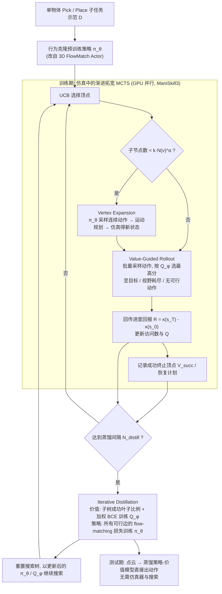

# Distilled Tree Search Rearrangement：通过连续动作空间树搜索蒸馏实现长程多物体重排

**Distilled Tree Search Rearrangement**（*Long-Horizon Multi-Object Rearrangement via Distilled Tree Search over Continuous Actions*，[arXiv:2610.25785](https://arxiv.org/abs/2610.25785)）收录于 senlanke「具身运控lab」10-19–10-23 前沿论文动态（Manipulation）。本页依据**周报条目 + arXiv 摘要页**整理，流程图依据论文方法部分（见参考来源），未逐页核对实验数字；指标与结论以论文为准。

## 一句话定义

**Distilled Tree Search Rearrangement：通过连续动作空间树搜索蒸馏实现长程多物体重排——提出 DISCO（连续动作树搜索蒸馏）。使用 Progressive-Widening MCTS 在物理仿真中生成长程计划，由学习到的策略提出连续动作，价值函数评估任务进度；随后将搜索结果周期性蒸馏到 Policy-Value Model，使下一轮搜索获得更好的动作候选和价值估计。最终部署时直接执行蒸馏后的策略，无需在线仿真搜索。在仿真和真实多物体重排任务中，DISCO 优于论文比较的行为克隆、强化学习及搜索基线。论文获 CoRL 2026 Oral。**

## 英文缩写速查

| 缩写 | 英文全称 | 简要说明 |
|------|----------|----------|
| VLA | Vision-Language-Action | 视觉–语言–动作模型 |
| IL | Imitation Learning | 模仿学习 |

## 为什么重要

- 周报所述待解决的问题：长程物体重排需要考虑当前动作对后续操作的影响。树搜索能够规划未来，但在连续高维动作空间中直接搜索计算成本很高。

## 流程总览

图依据：论文 §4.1–4.3 / Fig.2 / Algorithm 1

## 核心机制

| 项 | 内容 |
|----|------|
| **arXiv** | [2610.25785](https://arxiv.org/abs/2610.25785) · [PDF](https://arxiv.org/pdf/2610.25785) |
| **作者（arXiv）** | Kallol Saha, Yining Hong, Amber Li, Yejin Choi, Maxim Likhachev, David Held |
| **机构（周报所述，未逐条核实）** | 待核实（作者：Kallol Saha、Yining Hong、Yejin Choi、Maxim Likhachev、David Held 等）。 |
| **arXiv 评论栏** | Accepted at CoRL 2026 (Oral). Project page: this https URL |
| **开源** | arXiv 摘要页/评论给出项目页或外链（https://distilled-search.github.io）；未发现代码仓库链接（2026-10-26） |
| **周报所述创新点** | 提出 DISCO（连续动作树搜索蒸馏）。使用 Progressive-Widening MCTS 在物理仿真中生成长程计划，由学习到的策略提出连续动作，价值函数评估任务进度；随后将搜索结果周期性蒸馏到 Policy-Value Model，使下一轮搜索获得更好的动作候选和价值估计。最终部署时直接执行蒸馏后的策略，无需在线仿真搜索。在仿真和真实多物体重排任务中，DISCO 优于论文比较的行为克隆、强化学习及搜索基线。论文获 CoRL 2026 Oral。 |

### arXiv 摘要节选（英文原文）

> Despite recent advances in policy learning, long-horizon manipulation remains difficult because learned policies must avoid compounding errors while preserving future feasibility. While search-based planning can explicitly reason over such future consequences, it quickly becomes expensive in high-dimensional continuous action spaces.

## 源码运行时序图

**不适用**：arXiv 摘要页/评论给出项目页或外链（https://distilled-search.github.io）；未发现代码仓库链接，无可对齐的官方代码流程。

## 实验与评测

- 周报与摘要给出的数字/场景已写入上表「创新点」与摘要节选；其余实验细节、基线与成功率定义请回到论文正文。
- 读法：先对齐任务设定、传感器与成功定义（仿真/真机），再解读 headline 数字，勿跨论文直接比较。

## 与其他工作对比

| 维度 | 读法 |
|------|------|
| **同周对照** | 见 [Manipulation周报技术地图](../overview/senlanke-weekly-2026-10-19-23-manipulation-technology-map.md)，按方向浏览同期论文 |
| **开源状态** | arXiv 摘要页/评论给出项目页或外链（https://distilled-search.github.io）；未发现代码仓库链接 |

## 结论

**Distilled Tree Search Rearrangement：通过连续动作空间树搜索蒸馏实现长程多物体重排。**

1. 本页是入库级摘要，复现前请核对论文正文、附录与代码仓库。
2. 指标须连同实验条件解读。
3. 关注 arXiv 版本更新与代码发布。

## 关联页面

- [senlanke-weekly-2026-10-19-23-manipulation-technology-map](../overview/senlanke-weekly-2026-10-19-23-manipulation-technology-map.md)
- [manipulation](../tasks/manipulation.md)
- [vla](../methods/vla.md)

## 参考来源

- [distilled-tree-search-multi-object-rearrangement_arxiv_2610_25785.md](../../sources/papers/distilled-tree-search-multi-object-rearrangement_arxiv_2610_25785.md)
- [wechat_senlanke_weekly_manipulation_2026-10-19_23.md](../../sources/blogs/wechat_senlanke_weekly_manipulation_2026-10-19_23.md)
- [arXiv:2610.25785](https://arxiv.org/abs/2610.25785)
- [arXiv PDF](https://arxiv.org/pdf/2610.25785)：已通读方法部分（实验与附录以略读为准）：摘要、§1 引言、§3 问题设定、§4 DISCO（4.1 连续动作 MCTS / 4.2 价值引导 rollout / 4.3 迭代蒸馏，含 Algorithm 1）、§5 实验设定与表 1

## 推荐继续阅读

- [arXiv PDF](https://arxiv.org/pdf/2610.25785)
