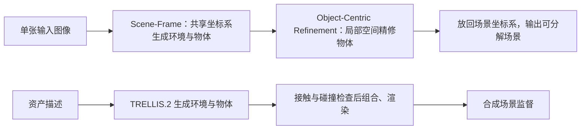

# DistScene

## 一句话定义

DistScene 从单张图像生成共享坐标系中的环境与独立物体，再用场景上下文精修局部几何。

## 英文缩写速查

| 缩写 | 英文全称 | 简要说明 |
|------|----------|----------|
| DiT | Diffusion Transformer | DistScene 的稀疏体素场景生成骨干网络。 |
| VLM | Vision-Language Model | 项目页描述的自蒸馏数据流程用其生成资产描述。 |
| CD | Chamfer Distance | 论文用来衡量生成场景几何差异的指标，越低越好。 |
| LoRA | Low-Rank Adaptation | 论文用它微调预训练的 TRELLIS.2 生成器。 |
| IoU | Intersection over Union | MIDI-test 中用于评估物体边界框重叠。 |

## 为什么重要

许多单图到 3D 的方法优先恢复物体，环境常作为空背景或后处理结果。DistScene 把地面、墙面等环境作为独立生成组件，与物体共享场景坐标系；这让环境几何能够约束物体的相对位置与支撑关系。对机器人仿真而言，这提供了从单图生成可分解场景资产的研究方向，项目页也展示了导入导航模拟器的示例。

## 方法栈与流程总览

### 1. Object-to-Scene Distillation：补训练数据

论文用 LLM 生成包含物体及大致尺寸的结构化场景描述，再由 TRELLIS.2 单独生成物体和具有几何细节的环境。场景装配程序检查物体与环境的接触以及物体间碰撞，调整布局并渲染条件图像。论文报告构造约 **125k** 个合成场景（约 **70k** 个物体、**46k** 个空场景），不依赖现成场景数据集或人工场景标注。

### 2. Scene-Frame Generation：先对齐整体关系

场景表示为一个环境组件和多个物体组件。场景生成器在统一稀疏体素空间中联合生成组件，使物体的位置、尺度和场景布局在同一坐标系下学习。它使用稀疏 DiT，并以 TRELLIS.2 的图像到 3D 先验初始化；论文采用 LoRA 微调，秩为 32。

### 3. Object-Centric Refinement：再补局部细节

整体场景中的单个物体占用体素较少，直接生成会损失细节。方法将物体重定位、归一化到局部空间，以输入图像和场景潜变量为条件提升有效分辨率，之后通过逆变换放回原场景位置。精修依赖场景上下文，以保持物体与输入图像及整体布局对应。

## 实验与评测

论文分别报告室内 MIDI-test、Gen3DSR-test 与户外 UrbanScene3D 的几何指标：

- **MIDI-test：** DistScene 的场景级 CD 为 **0.0877**，对照 3D-Fixer 的 **0.1295**，相对降低 **32.2%**；场景 F-score 从 **65.08%** 提升至 **71.59%**。
- **Gen3DSR-test：** 场景级 CD **0.0958**，F-score **79.68%**；3D-Fixer 为 **0.1027 / 77.97%**。
- **UrbanScene3D：** CD-L1 **0.0772**，F-score **0.722**；论文报告优于其比较的 Extend3D（**0.0832 / 0.680**）。
- **效率：** 1024 分辨率配置场景生成约 **36.4 秒**，局部精修约 **38.5 秒/物体**，峰值显存约 **21.8 GB**；512 分辨率精修配置为 **5.7 秒/场景 + 3.3 秒/物体**、约 **18.0 GB**。

这些结果衡量几何重建和用户偏好，不是机器人导航成功率或物理仿真有效性的证明。

## 与其他工作对比

- [WonderWorld](paper-sa-2406-09394-wonderworld-interactive-3d-scene-generation-from.md) 从单图生成可交互场景；DistScene 的重点是显式生成环境组件、独立物体以及场景条件局部精修。
- [SimFoundry](paper-simfoundry-real2sim-scene-generation.md) 面向真实场景重建及策略训练 / 评测的 Real2Sim 管线；DistScene 面向单图组合式场景生成，论文主要验证几何质量。
- 二者适合放在场景资产链的不同位置比较：输入来源、物理属性、可复现训练入口和下游任务成功率需分别核查。

## 工程实践

- **输入 / 输出：** 单张 RGB 图像 → 环境与多个独立物体组成的 3D 场景。
- **项目页演示：** 提供交互预览、渲染演示和场景到导航仿真的例子；项目页说明预览压缩至原始生成结果约 10%。
- **资源开放状态（2026-10-24）：** 代码、checkpoint 与数据集均标为 “come soon”；目前可访问论文与网页演示，未发现官方训练或推理仓库链接。
- **仿真边界：** 项目页展示导航模拟器导入结果，但公开材料没有提供足以复现的仿真资产、碰撞体配置、材质 / 摩擦参数或控制基准。因此不能仅凭网页演示认定输出已达到可训练或可评测的 sim-ready 标准。可参照 [Real2Sim 纵深路线](../../roadmap/depth-real2sim.md) 单独检查可碰撞性、物理属性和 rollout 稳定性。

## 源码运行时序图

**不适用：** 截至 2026-10-24，官方项目页仍将代码标为 “come soon”，未公开可运行的训练、推理或部署入口。

## 结论

**一句话总判：DistScene 的核心价值是把环境几何纳入单图组合式生成，使整体布局和局部物体精度能在同一场景表示中兼顾；现阶段公开证据主要支持几何质量提升。**

1. 评估其技术贡献时，重点看共享场景坐标系与场景条件精修，不要只看视觉演示。
2. MIDI-test 的场景 CD 相对 3D-Fixer 降低 32.2%，这是明确的几何指标改进，不代表导航或操作成功率提升。
3. 高分辨率结果有明显算力成本；根据算力预算选择 512 或 1024 配置，并考虑逐物体精修耗时。
4. 若用于机器人仿真，先验证碰撞几何、物理参数、可加载格式与任务 rollout；代码和数据发布前复现路径仍不完整。

## 局限与风险

- 当前论文报告的主结果是单图场景几何评测，项目页的导航仿真演示尚不能替代公开、可复现的机器人任务评测。
- 代码、checkpoint 和训练数据尚未发布；数据生成与推理细节无法独立复现。
- 场景布局合理不等于物理属性正确；表面几何仍需碰撞、接触和材质参数验证。

## 关联页面

- [Real2Sim 纵深路线](../../roadmap/depth-real2sim.md)
- [SimFoundry](paper-simfoundry-real2sim-scene-generation.md)
- [WonderWorld](paper-sa-2406-09394-wonderworld-interactive-3d-scene-generation-from.md)
- [仿真评测基础设施](../concepts/simulation-evaluation-infrastructure.md)

## 参考来源

- [论文摘要与方法摘录](../../sources/papers/distscene.md)
- [官方项目页与开放状态核查](../../sources/sites/distscene.md)
- [arXiv:2610.06960](https://arxiv.org/abs/2610.06960)

## 推荐继续阅读

- [DistScene 官方项目页](https://coolbeam.github.io/DistScene/)
- [arXiv HTML 全文](https://arxiv.org/html/2610.06960v1)
