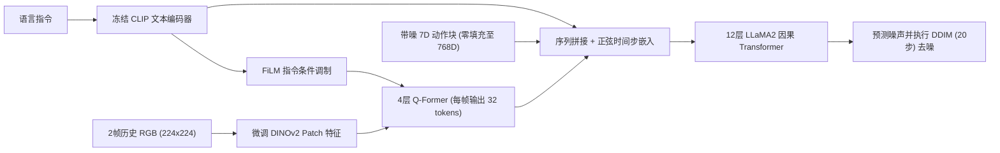
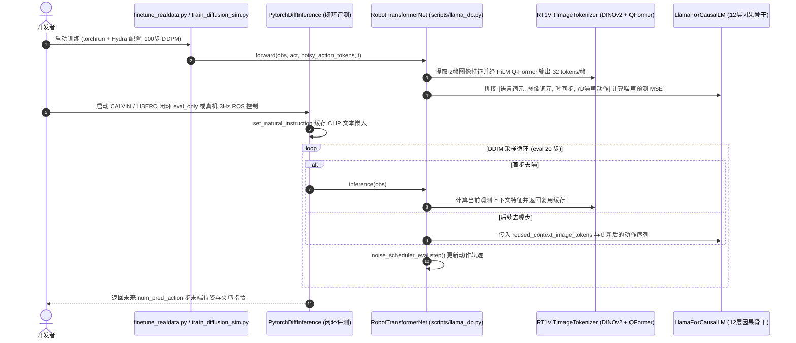

# Dita：可扩展的扩散 Transformer 通才 VLA

**Dita**（*Dita: Scaling Diffusion Transformer for Generalist Vision-Language-Action Policy*，[arXiv:2503.19757](https://arxiv.org/abs/2503.19757)，[项目页](https://robodita.github.io/)，[代码](https://github.com/RoboDita/Dita)）由 **侯智、张天怡、熊雨文、蒲恒俊、赵成阳** 等提出（上海人工智能实验室、浙江大学、清华大学、香港中文大学 MMLab、北京大学、商汤科技、中科院 HKISI 等；Yuntao Chen 通讯）。该工作由早期预印本 [*Diffusion Transformer Policy*](https://arxiv.org/abs/2410.15959)（`arXiv:2410.15959v6`）演进而来，核心思路是将 VLA 的动作生成从“离散动作词元”或“单特征向量 + 小 MLP 扩散头”升级为**整座因果 Transformer 在动作块空间上的 in-context 扩散去噪**。

## 一句话定义

**用 334M 参数的 LLaMA2 风格因果 Transformer 把语言指令、Q-Former 视觉特征与带噪连续动作块拼在同一序列做 in-context 扩散去噪，从而以单目第三人称输入实现跨本体预训练与高效真机迁移。**

## 英文缩写速查

| 缩写 | 英文全称 | 简要说明 |
|------|----------|----------|
| Dita | Diffusion Transformer (Generalist VLA) | 本文提出的轻量级可扩展扩散 VLA 架构 |
| VLA | Vision-Language-Action | 视觉–语言–动作多模态策略 |
| OXE | Open X-Embodiment | 跨本体大型机器人预训练数据集 |
| DP | Diffusion Policy | 连续动作块 DDPM 去噪范式 |
| Q-Former | Query Transformer | 结合 FiLM 语言调制的视觉特征查询瓶颈层 |
| LoRA | Low-Rank Adaptation | 参数高效微调方式（强方差真机任务中弱于全参微调） |

## 为什么重要

- **轻量级纯扩散 VLA 的架构样板：** 仅使用 **334M 总参数 / 221M 可训练参数**，既避开了 [OpenVLA](./paper-openvla.md)（7B）动作 256-bin 离散化在精细旋转控制上的量化误差与统计依赖，也突破了 [Octo](./paper-octo.md) 仅靠单一融合嵌入 + 小型 3 层 MLP 扩散头的表达瓶颈。
- **直接验证“大去噪骨干 vs 浅层扩散头”的优劣：** 在严格控制相似预训练权重的 CALVIN 与 ManiSkill2 对照中，直接作为序列骨干去噪的 in-context DiT 在收敛速度、长程连胜与新相机视角泛化上全面超越 3 层 MLP、U-Net1D 与 Transformer 扩散头。
- **完整梳理少样本真机微调的边界条件：** 在 Franka 10-shot 实验中公开对比全参微调与 LoRA（约 11M 可训参数），揭示当视觉背景/光照剧烈变化且叠加图像增广时，全参微调比低秩适配显著更鲁棒。

## 核心原理

### 核心信息

| 项 | 内容 |
|----|------|
| **机构** | 上海人工智能实验室；浙江大学；清华大学；香港中文大学 MMLab；北京大学；商汤科技；中科院 HKISI |
| **出处与演进** | `arXiv:2503.19757v2`（2025，*Dita* 正式扩展版）← 源自 `arXiv:2410.15959v6`（2024，*Diffusion Transformer Policy*） |
| **参数规模** | **334M 总参数 / 221M 可训练参数**（12 层从头训 LLaMA2，`hidden_size=768`、12 头） |
| **感知与编码** | 冻结 **CLIP** 文本编码器 + 全参微调 **DINOv2**（`224×224` 第三视角 RGB）+ 4 层从头训 **FiLM Q-Former**（每帧压缩至 32 个视觉 token） |
| **动作与采样** | 7D 末端动作（3 平移 + 3 旋转 + 1 夹爪，零填充对齐词元维）；OXE 预训练设 `DDPM 1000 步 / DDIM 20 步`，`2` 帧历史 + `16` 帧轨迹（15 步动作） |
| **开源** | **已开源 (MIT)** — [RoboDita/Dita](https://github.com/RoboDita/Dita) 与 Google Drive 预训练/对照权重 |

### 核心机制

1. **指令感知视觉词元压缩（DINOv2 + FiLM Q-Former）：** 由于预训练于网络图像的 DINOv2 与真实机器人桌面存在域差异，Dita 对 DINOv2 全参数联合微调；随后用深度为 4 的 Q-Former 提取每帧 32 个紧凑特征词元，并在每个 Q-Former 块内部以 **FiLM** 注入冻结 CLIP 文本向量，筛选出与当前指令高度相关的细粒度空间特征（避免后续 Transformer 序列过长）。
2. **In-Context 条件扩散（LLaMA2 因果骨干）：** 不同于 [DiT-Block Policy](./paper-robotic-dit-ingredients-dit-block-policy.md) 的 adaLN-Zero 解码器或 Octo 的先融合再 MLP 扩散头，Dita 将语言词元、历史图像词元、正弦时间步嵌入以及零填充至 768 维的带噪 7D 连续动作块直接沿序列维度拼接，送入 12 层因果 Transformer 进行前向预测噪声；噪声仅施加在 7D 动作向量上，以最小化预测噪声的 MSE 为训练目标。
3. **版本演进差异（`2410.15959v6` → `2503.19757v2`）：**
   - 前序 `2410.15959v6`（DTP）采用 OXE `batch_size=8902`、`T=100`、`traj=32`、`shuffle_buffer=128000`；
   - `2503.19757v2`（Dita）将 OXE 预训练调整为 `batch_size=8192`（32× A100，100K 步）、`DDPM T_train=1000` / `DDIM T_eval=20`、`2` 帧观测 + `16` 帧轨迹、`shuffle_buffer=256000`（Table 11 证实加大 buffer 使 SimplerEnv `coke can` 由 `71.2%/73.6%` 跃升至 `83.7%/85.5%`），并补充了 LIBERO 双视角（`Dita w/ wrist`）、Droid 预训练、Table 12 DDIM 步数消融与 App. C.3 全参 vs LoRA 分析。

### 流程总览

## 评测与实验对比

以下数值均严格核自扩展版论文 **`arXiv:2503.19757v2`** 正文表 Table 1–5 与附录表 Table 6–12：

### 1) SimplerEnv 零样本评测（Table 1, Google Robot）

| 方法 | `coke can` (match / variant) | `move near` (match / variant) | `drawer` (match / variant) | 版本演进备注 |
|------|------------------------------|-------------------------------|----------------------------|--------------|
| RT-1-X | 56.7% / 49.0% | 31.7% / 32.3% | **59.7%** / 29.4% | 论文对照基准 |
| Octo-Base | 17.0% / 0.6% | 4.2% / 3.1% | 22.7% / 1.1% | 浅层 MLP 扩散头 |
| OpenVLA-7B | 16.3% / 54.5% | 46.2% / 47.7% | 35.6% / 17.7% | 离散动作词元 |
| **Dita (`2503.19757v2`)** | **83.7% / 85.5%** | **76.0% / 73.0%** | 46.3% / **37.5%** | `2410.15959v6` 为 `72.7/60.0` 与 `56.7/57.5` |

- **DDIM 步数消融（Table 12, Pick Coke）：** 20 步取得最优 `83.7%` (match) / `85.5%` (variant)；减半至 **10 步**仍维持 `82.7% / 85.3%`；极限压缩至 **2 步**仍保留约 `70.4%`（Move Near 51.6% / 65.0%），说明动作空间紧凑使推理效率并未受 in-context 序列拖垮。

### 2) LIBERO、CALVIN 与 ManiSkill2（Table 2–5, Table 6–9）

- **LIBERO（Table 2 & Table 6）：** 仅用第三视角图像时，**Dita 平均 82.4%**（Spatial `84.2%`, Object `96.3%`, Goal `85.4%`, Long `63.8%`），优于 OpenVLA-7B（`76.5%`, Long `53.7%`）、Octo（`75.1%`）与从零训 Diffusion Policy（`72.4%`）；加入腕部相机后 **`Dita w/ wrist` 跃升至平均 92.3%**（Spatial `97.4%`, Object `94.8%`, Goal `93.2%`, Long `83.6%`）。附录 Table 6 还发现改用 Droid 预训练时 `Dita (Droid)` 在 LIBERO-LONG 提升至 **77.93%**（OXE 为 `63.8%`），反映 334M 容量对全量异构 OXE 的承载边界。
- **CALVIN ABC→D（Table 3 & Table 7，仅静态 S-RGB）：** `Dita` 平均连胜长度达 **3.61**（5 步任务完成率 `50.0%`；无预训练基线 `2.38`，OXE 预训练增益 `+1.23`；同参数 3 层 MLP 扩散头 `3.16`）。Table 7 加入图像增广后 `Dita w/aug` 提升至 **3.78**（5 步 `69.0%`）；无预训练下 Table 9 对比 `adaLN DiT`（`1.45`）、`Unet1D head`（`1.80`）、`Transformer head`（`1.72`），Dita 达 **2.38**（12 层版本 2.56，24 层 2.61）。
- **ManiSkill2 300K 随机相机视角（Table 4 & Table 5）：** 5 任务平均 **65.8%**（vs MLP 扩散头 `58.6%`、RT-1 离散动作 `30.2%`），其中 PickSingleYCB 高出扩散头 20%、PickClutterYCB 高出 12%。Table 5 证明 **2 帧观测**最优（增至 3 帧视觉词元过多导致难收敛，均分骤降至 `35.4%`），且随轨迹长度由 2 增至 32 均分稳步升至 **65.8%**。

### 3) Franka 真机 10-shot 与微调对比（§5 & App. C.3）

- **10-shot 双步复杂任务：** 单第三视角 3 Hz 闭环下，Dita 在涵盖抓取放置、倒豆/倒水、叠碗/套娃、旋转插笔与开关抽屉的两步长程任务取得 **63.8%** 平均成功率（第二阶段贡献近半），超越 Octo-base、OpenVLA-7B 与 Diffusion Head 基线。
- **全参微调 vs LoRA（App. C.3）：** 由于 Dita 可训参数仅 **221M**，LoRA 仅更新约 **5%（~11M）**参数，在叠加背景/光照/干扰物变化与图像增广时完全无法收敛，而**全参微调可保留 20% 成功率**且对多步方差场景更稳健。

## 与其他工作对比

| 维度 | Dita（本文） | [OpenVLA](./paper-openvla.md) | [Octo](./paper-octo.md) | [RDT-1B](./paper-rdt-1b.md) |
|------|--------------|-------------------------------|-------------------------|-----------------------------|
| 动作建模 | 因果 Transformer **in-context 扩散** | LLaMA-2 7B 自回归 **256-bin 离散动作** | Transformer 融合嵌入 + **小 MLP 扩散头** | 28 层 RDT（QKNorm + RMSNorm + ACI） |
| 视觉–语言先验 | 冻结 CLIP + 微调 DINOv2 + FiLM Q-Former | SigLIP + DINOv2 + 7B LLM | 轻量 ViT + T5 | 冻结 SigLIP + 冻结 T5-XXL |
| 可训参数规模 | **334M（221M 可训）** | 7B（常用 LoRA 微调） | 27M / 93M | 1.2B（另有 170M 版） |
| 核心优势域 | 单第三视角跨环境、少样本高精度旋转与长期一致 | 语义泛化与海量微调生态 | 极低部署开销、快速实验基线 | 双臂强多模态与百万级跨本体物理表征 |

## 结论

**Dita 证明无需 7B 参数量，仅以 334M 的因果 LLaMA2 Transformer 在连续动作块上做 in-context 扩散，就能在视觉细腻操作与跨视角泛化上显著优于“离散动作 VLM”和“浅层 MLP 扩散头”。**

- **模型选型指南：** 需要连续 7D 末端轨迹与强多视角/抗扰动能力时，可直接基于 `RoboDita/Dita` 公开 checkpoint（OXE 或 Droid 预训练版）微调，避免 7B 离散模型在 10-shot 小样本下因动作分箱统计失真导致旋转失败。
- **真机微调优先全参而非 LoRA：** 221M 可训参数在单卡/多卡上完全可承受全参微调；一旦引入环境光照或背景增广，应参考 App. C.3 直接关闭 LoRA（`use_lora=false`）。
- **观测历史切忌贪多：** ManiSkill2 消融（Table 5）显示 2 帧观测（`#obs=2`）是视觉判别力与序列长度的最佳折中，3 帧以上反而损害收敛。
- **注意学术引用版本对齐：** 正式对比与引用请标明扩展版 `arXiv:2503.19757v2`（*Dita*），避免将前序 `2410.15959v6`（*DTP*）在早期 buffer 配置下的 SimplerEnv 旧数直接混标。

## 源码运行时序图

节点对照 `RoboDita/Dita` 仓库 `scripts/train_diffusion_oxe.py`、`scripts/train_diffusion_sim.py`、`scripts/finetune_realdata.py`、`scripts/llama_dp.py`、`scripts/vision_tokenizers/vit_tokenizer.py` 与 `scripts/close_loop_eval_diffusion_{calvin,libero}.py`：

## 工程实践

| 项 | 仓库配置与操作要点 |
|----|--------------------|
| 依赖与环境 | Python 3.9 + PyTorch 2 + CUDA 12.1；CALVIN 闭环需额外安装仓库独立的 `requirements_calvin.txt` 与对应环境；LIBERO 需按 OpenVLA 修改版脚本重新生成无 noop 示范集。 |
| 关键代码路径 | 模型主体在 `scripts/llama_dp.py`（`RobotTransformerNet`），推理时可通过环境变量 `DENOISING_STEPS` 覆写 DDIM 步数，且在采样循环中自动缓存 `reused_context_image_tokens` 避免重复前向 DINOv2 与 Q-Former。 |
| 训练与微调区分 | OXE 预训练（`train_diffusion_oxe.py`）依赖 S3 `openx` 权限及 32× A100 规模；多数用户直接下载 README 中的 Google Drive checkpoint，运行 `finetune_realdata.py`（pkl 数据，建议全参微调）或 `train_diffusion_sim.py`（CALVIN/LIBERO/ManiSkill2）。 |
| 模型体量对照 | 官方仓库另公开了同等参数预算的 `Diffusion MLP Head` 权重（`use_action_head_diff` 分支含 `DenoisingMLP`），方便本地复现 Table 3/4 中的核心对照。 |

## 局限与风险

- **OXE 预训练算力与容量边界：** 32× A100 规模与 TFRecord/S3 流式读取门槛较高；且 334M 参数规模在面对全量高度异构 OXE 时仍有容量上限（例如仅针对目标领域更近的 Droid 预训练后 LIBERO-LONG 反超 OXE 预训练模型 14 个百分点）。
- **单相机真机视场与遮挡风险：** 主力真机实验仅部署单一第三人称 RealSense D435i（3 Hz），在深度精确插拔或强臂部遮挡场景仍需引入腕部相机（对应 LIBERO 表中 `Dita w/ wrist` 提升 +9.9% 的规律）。
- **预印本跨版本口径混淆风险：** `2410.15959` 与 `2503.19757` 在 SimplerEnv 分数、shuffle buffer 与动作序列长度设置上不同，评测对比时须锁定对应 checkpoint 与论文版本号。

## 与其他页面的关联

- [VLA 视觉语言动作模型](../methods/vla.md) — 通才具身策略架构谱系与设计权衡
- [Diffusion Policy](../methods/diffusion-policy.md) — 动作块扩散生成的理论起点
- [Action Chunking](../methods/action-chunking.md) — 长轨迹预测对多步任务连贯性的作用（对应 Table 5）
- [操作任务（Manipulation）](../tasks/manipulation.md) — SimplerEnv、LIBERO、CALVIN 与 Franka 桌面操作主战场景
- [Diffusion Transformer 概念页](../concepts/diffusion-transformer.md) — DiT 结构演化脉络
- [OpenVLA](./paper-openvla.md) 与 [Octo](./paper-octo.md) — 同阶段跨本体 VLA 的离散词元与浅层扩散头代表对照
- [RDT-1B](./paper-rdt-1b.md) — 另一条主打双臂与 1.2B 参数规模的扩散 Transformer 路线
- [ScaleDP](./paper-scaledp-scaling-diffusion-transformer-policy.md) — 对比单任务深度缩放与本文 OXE 通才预训练路线
- [扩散与流匹配纵深路线](../../roadmap/depth-robotics-diffusion-dit-flow.md) — 路线中展示“in-context DiT VLA”核心代表页

## 参考来源

- [dita_arxiv_2410_15959.md](../../sources/papers/dita_arxiv_2410_15959.md) — `arXiv:2503.19757v2` 与 `arXiv:2410.15959v6` 全文通读、两代演进核对及附录数据归档
- [robodita_dita.md](../../sources/repos/robodita_dita.md) — `RoboDita/Dita` 核心类与推理优化细节核对
- [robodita-github-io.md](../../sources/sites/robodita-github-io.md) — 官方项目页与早期项目页核查

## 推荐继续阅读

- [论文扩展版（arXiv:2503.19757v2）](https://arxiv.org/abs/2503.19757) · [早期预印本（arXiv:2410.15959v6）](https://arxiv.org/abs/2410.15959)
- [官方代码仓库（RoboDita/Dita）](https://github.com/RoboDita/Dita) · [官方项目页（robodita.github.io）](https://robodita.github.io/)
- [SimplerEnv 评测基准](https://github.com/simpler-env/SimplerEnv)
