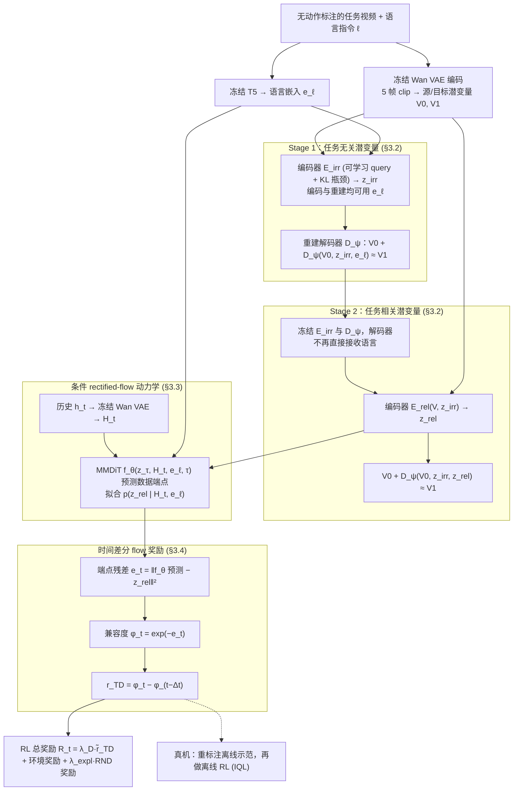

# DiTaR（arXiv:2610.14159）

**DiTaR**（*Disentangling Task-Relevant Latent Dynamics for Reward Modeling*，[arXiv:2610.14159](https://arxiv.org/abs/2610.14159)，[项目页](https://ditarr.github.io/)）来自 [具身智能小站 2026-10-14 盘点](../../sources/blogs/wechat_embodied_station_41_papers_streamingwam_2026-10-14.md)，属「策略与后训练」组。

## 一句话定义

**先从多帧视频解耦任务相关潜在动态，再以历史与语言条件流模型构造方向性稠密奖励。**

## 英文缩写速查

| 缩写 | 英文全称 | 简要说明 |
|------|----------|----------|
| RM | Reward Model | 奖励模型 |
| FM | Flow Matching | 流匹配 |
| RL | Reinforcement Learning | 强化学习 |

## 为什么重要

- 奖励模型应追踪任务变化而非画面变化；视觉干扰会破坏奖励可靠性。
- 开源结论：**待发布**（步骤 2.5，2026-10-14）。项目页列出 GitHub 链接（phai-lab/DiTaR），入库日 ls-remote 不可达，按待发布处理。
- 同期同组工作见 [流式动作块与世界模型记忆：具身智能小站 10-14 期 41 篇阅读坐标](../overview/embodied-station-2026-10-14-41-papers-technology-map.md)。

## 流程总览

图依据：论文 §3.1–3.4 / Fig.2

## 核心机制

| 项 | 内容 |
|----|------|
| **arXiv** | [2610.14159](https://arxiv.org/abs/2610.14159) |
| **开源** | **待发布** |
| **要点** | 仿真及真机离线重标注。 |
| **文内指标** | 以原文为准。 |

## 源码运行时序图

**不适用（待发布）** — 项目页列出 GitHub 链接（phai-lab/DiTaR），入库日 ls-remote 不可达，按待发布处理。 不编造运行脚本；代码公开后再补。

## 实验与评测

- 以原文为准。
- **读法：** 本页为索引级摘要，依据公众号转述的官方摘要与仓库信息整理；逐项数字与 baseline 以原文 PDF 为准。

## 与其他工作对比

- 横向索引见 [流式动作块与世界模型记忆：具身智能小站 10-14 期 41 篇阅读坐标](../overview/embodied-station-2026-10-14-41-papers-technology-map.md)；同 arXiv 不重复造页。

## 结论

**视频奖励模型先解耦任务相关动态，再谈稠密化。**

1. 开源边界：**待发布** — 项目页列出 GitHub 链接（phai-lab/DiTaR），入库日 ls-remote 不可达，按待发布处理。
2. 核心机制：仿真及真机离线重标注。
3. 复现与选型前核对任务协议、硬件与基准口径，勿直接横比公众号摘录数字。

## 关联页面

- [reinforcement-learning](../methods/reinforcement-learning.md)
- [inverse-reinforcement-learning](../methods/inverse-reinforcement-learning.md)
- [robot-data-supervision-signal-types](../concepts/robot-data-supervision-signal-types.md)
- [embodied-station-2026-10-14-41-papers-technology-map](../overview/embodied-station-2026-10-14-41-papers-technology-map.md)

## 参考来源

- [ditar_task_relevant_latent_dynamics_reward_arxiv_2610_14159.md](../../sources/papers/ditar_task_relevant_latent_dynamics_reward_arxiv_2610_14159.md)
- [wechat_embodied_station_41_papers_streamingwam_2026-10-14.md](../../sources/blogs/wechat_embodied_station_41_papers_streamingwam_2026-10-14.md)
- [arXiv:2610.14159](https://arxiv.org/abs/2610.14159)
- [arXiv PDF](https://arxiv.org/pdf/2610.14159)：已通读方法部分（实验与附录以略读为准）：§3 方法（§3.1–3.4）；离线 RL 重标注设定仅略读

## 推荐继续阅读

- [arXiv PDF](https://arxiv.org/pdf/2610.14159)
- [项目页](https://ditarr.github.io/)
