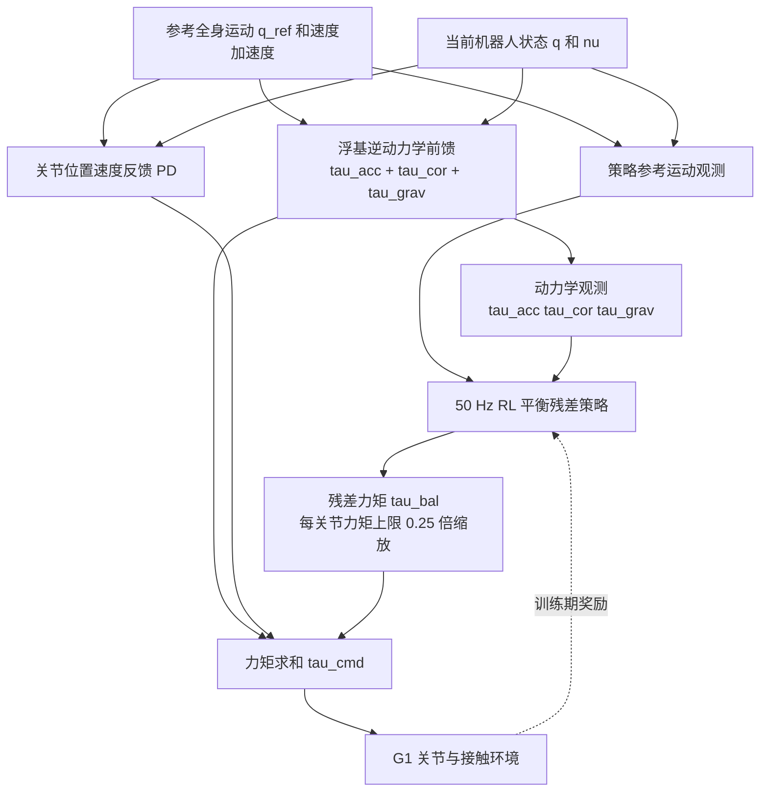

# DKWBC：解耦动作跟踪与平衡的人形全身控制（Decoupling Motion Tracking and Balancing for Humanoid Whole-Body Control）

**论文：** [arXiv:2611.09605v1](https://arxiv.org/abs/2611.09605)（2026-11-06）  
**机构：** 浙江大学（Zhejiang University）、蚂蚁灵波科技（Robbyant / Ant Group）、香港大学（The University of Hong Kong）  
**项目页：** [DKWBC](https://robbyant-research.github.io/DKWBC/)；[GitHub（项目展示仓库）](https://github.com/robbyant-research/DKWBC)

## 一句话定义

**DKWBC 将“参考动作跟踪”与“接触扰动下维持平衡”拆开：逆动力学前馈 + 关节 PD 生成名义跟踪力矩，RL 策略只输出额外平衡残差力矩，两者相加后执行。** 论文验证了在多动作、外载荷与外力扰动下的跟踪收益；它不是单靠解析动力学就能保证动态可行的控制器。

## 英文缩写速查

| 缩写 | 英文全称 | 简要说明 |
|---|---|---|
| DKWBC | Decoupling Motion Tracking and Balancing for Humanoid Whole-Body Control | 论文提出的混合全身控制框架 |
| WBC | Whole-Body Control | 全身多关节协调控制 |
| ID | Inverse Dynamics | 按当前状态和参考加速度计算名义前馈关节力矩 |
| PD | Proportional–Derivative | 关节位置和速度误差反馈 |
| RL | Reinforcement Learning | 在仿真接触反馈中学习平衡残差 |
| MPJPE | Mean Per-Joint Position Error | 多关节跟踪位置误差，本文单位 mm |
| MPJVE | Mean Per-Joint Velocity Error | 多关节跟踪速度误差，本文单位 m/s |

## 为什么重要

- **跟踪不等于平衡。** 同一姿态在不同参考加速度、重力与接触状态下需要不同力矩；位置目标 RL 策略需要同时隐式学习运动动力学与接触平衡（论文 I、III-A）。
- **把已知物理量交给解析模型。** 模型驱动分支每步计算加速度、科氏/离心、重力项；RL 主要学习接触、载荷、扰动以及模型误差下的补偿（III-B/C）。
- **输出语义不同。** RL 直接输出残差关节力矩而不是经高频 PD 伺服转成力矩的位置目标，降低与解析跟踪模块职责重叠的可能（III-C）。

## 核心原理

### 流程总览

以下模块和流向依据论文 III-A～III-C 与图 2，虚线表示训练阶段反馈；本图不是源码调用图。

**核心力矩接口**（III-B，式 3–7）：

\[
\tau_{\mathrm{id}} = \tau_{\mathrm{acc}}+\tau_{\mathrm{cor}}+\tau_{\mathrm{grav}},\quad
\tau_{\mathrm{trk}}=\tau_{\mathrm{id}}+\tau_{\mathrm{pd}},\quad
\tau_{\mathrm{cmd}}=\tau_{\mathrm{trk}}+\tau_{\mathrm{bal}}.
\]

1. **名义跟踪分支（式 3–6）。** 从参考运动差分求速度，使用三帧高斯滤波（标准差 0.75 帧）平滑速度后求参考加速度；在当前机器人状态上运行浮基递归 Newton–Euler 逆动力学，分出 \(\tau_{\mathrm{acc}}\)、\(\tau_{\mathrm{cor}}\)、\(\tau_{\mathrm{grav}}\)。再加位置/速度 PD 误差反馈。接触与外力项没有被显式求解。
2. **平衡残差（式 7）。** actor 使用参考运动、本体观测以及三个前馈力矩分量；以 **50 Hz** 直接预测关节残差力矩，输出按各关节最大力矩的 **0.25** 倍缩放并在两次策略更新间保持。训练沿用模仿跟踪的 RL 奖励（III-C）。
3. **职责边界。** 前馈力矩不是传感器测得的真实接触力；平衡残差也不等于明确的外力估计。动态不可行的动作参考仍需靠反馈与 RL 补偿（III-A、II）。

## 实验与评测

| 项目 | DKWBC | 对照 / 说明 | 原文 |
|---|---|---|---|
| 训练数据缩放 | 使用 BONES-SEED 2、4、8、16、32、64、128 小时子集 | 对重训的 SONIC，各规模成功率更高、MPJPE 更低；曲线来自四个检查点均值 | IV-A，图 3 |
| LAFAN 无额外载荷 | **98.95%** 成功率，**26.59 mm** MPJPE | 同设定 BeyondMimic coupled：97.67%，34.06 mm | IV-C，表 2 |
| BONES-SEED test-content 扰动 | **92.18%** 成功率，**33.65 mm** MPJPE | coupled：90.30%，42.07 mm | IV-C，表 2 |
| 最大手部外力 | **24.68 mm** 上身 MPJPE，**99.54%** 成功率 | FALCON 83.51 mm / 99.08%；ResMimic 54.96 mm / 100% | IV-B，表 1 |
| 单独 ID+PD 跟踪模块 | **4.45 mm** MPJPE | 是不含 RL 的模块评测，不是完整真机系统误差 | IV-C，表 3 |
| 实机 | Unitree G1：深蹲、带载行走与复杂动作演示 | 同一 checkpoint；非大样本成功率统计 | IV-B，图 5 |

**测试边界：** 训练动捕在筛选后为 128.53 小时；test-content 为 3,145 条 / 6.031 h，test-repetition 为 3,019 条 / 6.002 h（IV-A）。外力测试包含 217 条 G1 重定向动作；受试扰动由双手施加，\(\alpha_g\in\{0,0.5,1\}\)（IV-B）。

## 与其他工作对比

| 工作 | 动作接口 / 分工 | 与 DKWBC 的对比（数字为本文表 1–2） |
|------|----------------|-----------------------------------|
| [BeyondMimic](../methods/beyondmimic.md) | RL 输出位置目标，跟踪与平衡耦合在一个策略里 | 同预算 coupled 对照：LAFAN 97.67% / 34.06 mm vs DKWBC 98.95% / 26.59 mm |
| [SONIC](../methods/sonic-motion-tracking.md) | 规模化动捕跟踪预训练通用策略 | 本文按 BONES-SEED 2–128 h 子集重训对比，DKWBC 各规模成功率更高、MPJPE 更低 |
| [FALCON](./paper-loco-manip-161-109-falcon.md) | 上下肢双 agent + 力课程 | 最大手部外力下上身 MPJPE 83.51 mm vs 24.68 mm |
| [ResMimic](./paper-resmimic.md) | GMT 先验 + 残差策略 | 同测试 54.96 mm、成功率 100%（略高于 DKWBC 99.54%）；DKWBC 残差为直接关节力矩而非位置目标 |

## 结论

**DKWBC 的实质贡献是把已知的运动动力学负担从 RL 中剥离，并用直接力矩残差处理平衡；当前证据支持仿真跟踪精度与泛化收益及 G1 实机可行性，不等于已证明复杂操作任务的接触力控制。**

1. 关注**同设置 coupled 对照**（表 2），比跨论文横向比成功率更可信。
2. 更强外力下（表 1）跟踪误差优势明显，但 ResMimic 的成功率仍有 100% 配置，勿宣称全指标第一。
3. 若复现，优先检查**参考加速度平滑、逆动力学模型、PD 增益、残差力矩限幅和 50 Hz 保持**；这些共同决定执行稳定性。
4. 论文仅对 **G1** 真实硬件给出演示；没有跨平台迁移成功率与真实载荷精度统计。
5. 官方公开的是**项目网站仓库**，目前尚不能按公开训练/部署代码直接复现。

## 工程实践

- **数据链：** G1 重定向动作 → 参考速度/加速度 → 动力学前馈；运行时须保证 \(\mathrm{SO}(3)\) 姿态差分、关节序列、浮基质量惯性参数与驱动电机力矩约束一致。
- **调试顺序：** 先在无接触干扰的跟踪任务中量测 ID/PD 误差，再逐步加入外力扰动与残差策略，分别绘制 \(\tau_{\mathrm{id}}\)、\(\tau_{\mathrm{pd}}\)、\(\tau_{\mathrm{bal}}\) 的时间序列，避免把饱和误判为学习失败。
- **真机安全：** 本工作直接输出关节力矩残差，部署前需额外验证电流/力矩峰值、执行器限幅、通信周期、急停与接触状态稳定性；论文实验结果不代替硬件安全审查。
- **代码开放状态（2026-11-10）：** [项目页](https://robbyant-research.github.io/DKWBC/) 链到 [robbyant-research/DKWBC](https://github.com/robbyant-research/DKWBC)，但官方仓库 README 标注它是 *Official project page*，默认分支为 `gh-pages`；尚未检出算法训练、推理或部署入口，暂不能按论文源码复现。

## 源码运行时序图

**不适用（暂缺官方可运行算法源码）。** 公开仓库是项目展示页面，尚无可核对的 `train` / `eval` / 真机 runtime 入口；上面的流程图仅基于论文方法，待实际开源后再读取运行代码并补充 Mermaid `sequenceDiagram`。

## 局限与风险

- **参考物理可行性：** 模型项基于名义动力学与运动学参考，参考动作有可能动态不可行；RL 补偿无法自动保证任意接触任务可行。
- **结果口径：** 表 2 是同预算仿真对照，表 1 是外力仿真，图 5 是 G1 定性展示；不应合并为单一真机成功率。
- **数据筛选：** 训练动作手工去除了不合适动作，不能推论未筛选全数据集或跨机型泛化。
- **开源限制：** 现有展示页不包含能复核算法实现的公开训练/部署源码。未经代码审计不能把公式直接作为量产控制方案。

## 关联页面

- [Whole-Body Control](../concepts/whole-body-control.md)：解析 WBC 与学习式力矩残差如何组合。
- [残差策略学习](../methods/residual-policy-learning.md)：不同 residual 的动作空间与基线接口。
- [人形运动控制](../tasks/humanoid-locomotion.md)：全身动作跟踪与平衡任务。
- [ForPC：力感知推车](./paper-forpc-cart-pushing.md)：冻结 locomotion prior + 任务级残差；目标是推车而非通用动作跟踪。
- [STEP：感知式人形步态](./paper-step-spatiotemporal-humanoid-locomotion.md)：侧重地形深度 + 本体表征预测，主要动作接口为位置目标。
- [ResMimic](./paper-resmimic.md)、[YAHMP](./paper-yahmp.md)：残差策略与力交互的相关工作。

## 参考来源

- [DKWBC arXiv v1 全文通读归档](../../sources/papers/dkwbc_arxiv_2611_09605.md)
- [DKWBC 官方项目页归档](../../sources/sites/dkwbc.md)
- [DKWBC 官方 GitHub 开源状态归档](../../sources/repos/dkwbc.md)
- [arXiv 论文 v1](https://arxiv.org/abs/2611.09605)

## 推荐继续阅读

- [官方 HTML 全文（公式、表 1–4）](https://arxiv.org/html/2611.09605v1)
- [DKWBC 项目页（G1 实机视频）](https://robbyant-research.github.io/DKWBC/)
- [ForPC 论文对照](./paper-forpc-cart-pushing.md)
