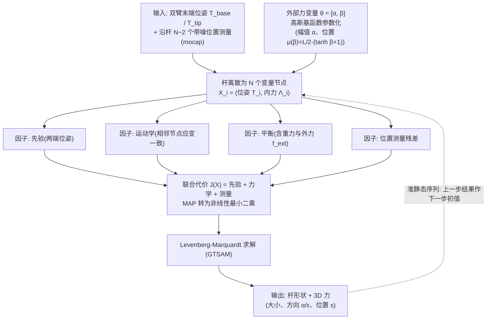

# 可变形线性物体 3D 力估计：基于因子图的双臂可变形线状物体三维受力估计

**可变形线性物体 3D 力估计**（*3D-Force Estimation for Dual-arm Manipulation of Deformable Linear Objects via Factor Graphs*，[arXiv:2610.35058](https://arxiv.org/abs/2610.35058)）收录于 senlanke「具身运控lab」10-26–10-30 前沿论文动态（Manipulation）。本页依据**周报条目 + arXiv 摘要页**整理，流程图依据论文方法部分（见参考来源），未逐页核对实验数字；指标与结论以论文为准。

## 一句话定义

**可变形线性物体 3D 力估计：基于因子图的双臂可变形线状物体三维受力估计——使用因子图建立物体形状、力学约束和传感器测量之间的概率关系。在重建线状物体三维形状的同时，估计外力的大小、方向和作用位置，减少对专用应变传感器的依赖。**

## 英文缩写速查

| 缩写 | 英文全称 | 简要说明 |
|------|----------|----------|
| VLA | Vision-Language-Action | 视觉–语言–动作模型 |
| IL | Imitation Learning | 模仿学习 |

## 为什么重要

- 周报所述待解决的问题：电缆、绳索等可变形线状物体没有直接驱动关节，难以通过机器人执行器信息推断物体内部或外部受到的力。

## 流程总览

图依据：论文 §II–III（Fig.2 因子图）、§IV-B（准静态轨迹与 warm-start）

## 核心机制

| 项 | 内容 |
|----|------|
| **arXiv** | [2610.35058](https://arxiv.org/abs/2610.35058) · [PDF](https://arxiv.org/pdf/2610.35058) |
| **作者（arXiv）** | Delucchi, Annika, Di Paola, Vincenzo, Quadrelli, Bruno Marco, Zoppi, Matteo |
| **机构（周报所述，未逐条核实）** | 热那亚大学、喷气推进实验室。 |
| **arXiv 评论栏** | （无） |
| **开源** | arXiv 摘要页与评论未见代码或项目页链接（仅核对 arXiv 摘要页，不代表未发布）（2026-11-02） |
| **周报所述创新点** | 使用因子图建立物体形状、力学约束和传感器测量之间的概率关系。在重建线状物体三维形状的同时，估计外力的大小、方向和作用位置，减少对专用应变传感器的依赖。 |

### arXiv 摘要节选（英文原文）

> Estimating forces acting on Deformable Linear Objects (DLOs) is challenging due to their underactuated nature. However, reliable contact estimation is crucial to precisely control them and enable safe manipulation tasks.

## 源码运行时序图

**不适用**：arXiv 摘要页与评论未见代码或项目页链接（仅核对 arXiv 摘要页，不代表未发布），无可对齐的官方代码流程。

## 实验与评测

- 周报与摘要给出的数字/场景已写入上表「创新点」与摘要节选；其余实验细节、基线与成功率定义请回到论文正文。
- 读法：先对齐任务设定、传感器与成功定义（仿真/真机），再解读 headline 数字，勿跨论文直接比较。

## 与其他工作对比

| 维度 | 读法 |
|------|------|
| **同周对照** | 见 [Manipulation周报技术地图](../overview/senlanke-weekly-2026-10-26-30-manipulation-technology-map.md)，按方向浏览同期论文 |
| **开源状态** | arXiv 摘要页与评论未见代码或项目页链接（仅核对 arXiv 摘要页，不代表未发布） |

## 结论

**可变形线性物体 3D 力估计：基于因子图的双臂可变形线状物体三维受力估计。**

1. 本页是入库级摘要，复现前请核对论文正文、附录与代码仓库。
2. 指标须连同实验条件解读。
3. 关注 arXiv 版本更新与代码发布。

## 关联页面

- [senlanke-weekly-2026-10-26-30-manipulation-technology-map](../overview/senlanke-weekly-2026-10-26-30-manipulation-technology-map.md)
- [manipulation](../tasks/manipulation.md)
- [vla](../methods/vla.md)

## 参考来源

- [dlo-3d-force-estimation-factor-graphs_arxiv_2610_35058.md](../../sources/papers/dlo-3d-force-estimation-factor-graphs_arxiv_2610_35058.md)
- [wechat_senlanke_weekly_manipulation_2026-10-26_30.md](../../sources/blogs/wechat_senlanke_weekly_manipulation_2026-10-26_30.md)
- [arXiv:2610.35058](https://arxiv.org/abs/2610.35058)
- [arXiv PDF](https://arxiv.org/pdf/2610.35058)：已通读方法部分（实验与附录以略读为准）：§I–§V（§II Kirchhoff 模型、§III 因子图与力参数化、§IV 仿真设定与结果）

## 推荐继续阅读

- [arXiv PDF](https://arxiv.org/pdf/2610.35058)
