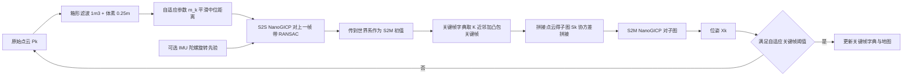

# DLO：Direct LiDAR Odometry（arXiv:2110.00605）

**DLO**（*Direct LiDAR Odometry: Fast Localization with Dense Point Clouds*，[arXiv:2110.00605](https://arxiv.org/abs/2110.00605)）由 Kenny Chen、Brett T. Lopez、Ali-akbar Agha-mohammadi、Ankur Mehta 完成（UCLA 与 NASA JPL，属 JPL Team CoSTAR 在 DARPA 地下挑战赛中的工作），发表于 IEEE RA-L 2022。官方代码 [vectr-ucla/direct_lidar_odometry](https://github.com/vectr-ucla/direct_lidar_odometry)。

> 注意：本页的 DLO 指「直接激光里程计」。本库另有若干 `paper-dlo-*` 页面里的 DLO 指可变形线状物（Deformable Linear Object），与本页无关。

## 一句话定义

**不提特征、不做畸变校正、只对点云做箱形滤波与 0.25 m 体素下采样，用 scan-to-scan 加 scan-to-map 两级 GICP 求位姿，并通过「关键帧字典 + 关键帧空间子图 + NanoGICP 数据结构复用」把计算量压到低于一个 CPU 核的纯前端激光里程计。**

## 英文缩写速查

| 缩写 | 英文全称 | 简要说明 |
|------|----------|----------|
| DLO | Direct LiDAR Odometry | 本文方法：直接使用稠密点云的激光里程计 |
| LO | LiDAR Odometry | 激光里程计，估计机器人自身运动 |
| ICP | Iterative Closest Point | 迭代最近点配准 |
| GICP | Generalized ICP | 点到面 / 面到面的广义 ICP，每点带协方差 |
| NanoGICP | NanoGICP | 本文自研求解器：FastGICP 加 NanoFLANN，支持跨对象共享 kd 树与协方差 |
| S2S / S2M | Scan-to-Scan / Scan-to-Map | 相邻帧配准 / 当前帧对子图配准 |
| APE | Absolute Pose Error | 绝对位姿误差 |
| ME | （论文未展开） | 表 III 的列名，下含 rmse；缩写含义论文未说明 |
| kd-tree | k-dimensional tree | 最近邻搜索用的树结构 |
| RANSAC | Random Sample Consensus | 随机采样一致性，用于 S2S 外点剔除 |
| IMU | Inertial Measurement Unit | 惯性测量单元，本文仅选用其陀螺做旋转先验 |
| NeBula | Networked Belief-aware Perceptual Autonomy | JPL 自主框架，DLO 为其 CoSTAR 机队的主状态估计组件（引言） |

## 为什么重要

- 现代激光雷达点数多，近邻搜索和法线计算会拖垮低功耗处理器并导致丢帧（引言）；DLO 把「算得快」直接当作精度来源：论文称速度与精度之间有联系（I 引言）。
- 子图不是在点云里按半径找点，而是在关键帧空间里找关键帧再拼点云，检索量从数十万点降到几百个关键帧点（II-E，作者自述）。
- 在 Urban Circuit 的 Alpha / Beta 两条赛道上，作者报告 DLO 的 APE 与 CPU 核数均低于 BLAM、Cartographer、LIO-Mapping、LOAM、LOCUS（表 III，数字取自 LOCUS 论文）。
- 本库阅读视角：与 [LeGO-LOAM](./lego-loam.md)、[LIO-SAM](./lio-sam.md)、[FAST-LIO](./fast-lio.md) 的路线不同，DLO 不依赖特征提取，也不做紧耦合 IMU 因子图。

## 核心机制

### 流程总览

### 关键点（均出自论文 II 节）

| 环节 | 论文做法 | 章节 |
|------|----------|------|
| 预处理 | 仅 1 m³ 箱形滤波去机身点 + 0.25 m 体素；平均约 10,000 点 / 帧；不校正运动畸变；不提特征 | II-B |
| S2S | GICP 对相邻两帧，协方差用 10 近邻；RANSAC 剔除外点；无 IMU 时初值为单位阵 | II-C1，图 2 |
| S2M | 把 S2S 结果传到世界系作为初值，对子图做 GICP，输出最终位姿 | II-C2 |
| IMU 先验 | 仅陀螺积分得到旋转，平移为零；松耦合；平移先验留作未来工作 | II-D |
| 关键帧字典 | 关键帧位置组成点云用于检索，每个关键帧链接到其扫描点云（键值字典） | II-E |
| 子图 | K 个最近邻关键帧 + L 个凸包关键帧的点云拼接（实验 10 + 10）；重复关键帧只用一次 | II-E1 |
| 自适应关键帧 | 用到原点中位距离的指数平滑 m_k（α=0.95，β=0.05）选平移阈值 10 / 5 / 1 / 0.5 m，旋转阈值固定 30 度 | II-E2 |
| 子图协方差 | 把各关键帧已算协方差拼接近似，不对子图逐次重算 | II-F1 |
| 数据结构复用 | 8 个元素里只显式构建 2 棵 kd 树，S2S 目标树沿用上一帧源树；S2M 目标树仅在子图变化时重建；协方差每帧只算一次 | II-F2，表 I |
| NanoGICP | FastGICP 的配准加 NanoFLANN 建树，两个实例间按算法 1 共享 | II-F3 |

## 实验结果（论文报告的主要数字）

| 实验 | 结果 | 章节 |
|------|------|------|
| 子图方式（Alpha，4 核 i7 1.30 GHz） | 半径法 r=10 m：74.2 ms，37.5% CPU；关键帧静态阈值：21.6 ms，10.2%；自适应：19.1 ms，9.1% | III-A1 |
| 数据复用 | 全无复用 69.8 ms，丢帧 9.37%；仅复用 kd 树丢 4.51%；仅复用协方差 0%；全复用 21.9 ms，9.5% CPU，0% 丢帧 | III-A2，表 II |
| NanoGICP 收敛时间（100 次对齐均值） | 42.53 ms，对 FastGICP 72.88 ms、PCL GICP 178.24 ms | III-A3，图 7 |
| Alpha（757.4 m）APE max / mean / std，ME rmse | DLO 0.40 / 0.18 / 0.06 / 0.19 m；LOCUS 0.63 / 0.26 / 0.18 / 0.28 | III-B，表 III |
| Beta（631.5 m） | DLO 0.50 / 0.16 / 0.09 / 0.19 m；LOCUS 1.20 / 0.58 / 0.39 / 0.48 | 表 III |
| CPU 核数 max / mean | DLO 0.92 / 0.62；LOCUS 3.39 / 2.72；LIO-Mapping 1.80 / 1.53 | 表 III |
| 野外 | 洛杉矶废弃地铁 850 m 以上端到端漂移 10 cm；矿洞自主飞行 348 m 稳定跟踪 | III-C |

## 工程实践

- 输入为 `sensor_msgs::PointCloud2`，IMU 可选；有 IMU 时用于初始重力对齐，启动前需静止 3 秒让其标定并对齐（官方 README，仅静态阅读，未运行）。
- README 称在 Ubuntu 18.04 + ROS Melodic 与 Ubuntu 20.04 + ROS Noetic 上验证，依赖 PCL 1.10 以上、Eigen 3.3.7 以上、OpenMP、C++14；MIT 许可。
- README 假设激光与 IMU 坐标系重合，论文 II-A 同样如此假设，实际安装时需物理上靠近安装。
- 输出：服务可保存 `.pcd` 地图与 KITTI 格式轨迹（README）。
- 论文平台：Ouster OS1（20 Hz）与 Velodyne VLP-16（10 Hz），机载为 Intel NUC7i7DNBE 1.9 GHz（II-B，III-C）。
- 本库作者判断（推测）：它是前端，用于长期建图需自行接后端与回环；论文未给出此类组合的结果。

## 局限与未验证之处

论文自己承认：

- 仅前端：无回环、无后端；v1 把「回环」列为未来工作，v3 结论改为「更紧的 IMU 融合与运动畸变校正」。
- 不做运动畸变校正；IMU 只用陀螺旋转先验，没有平移先验（II-B，II-D）。
- LIO-SAM 与 LVI-SAM 因标定敏感与输入要求严格未参与比较（III-B）。

本库读后看到的未验证之处：

- 表 III 的基线数字与真值取自 LOCUS 论文，不是作者在同一设置下复现（III-B）。
- 组件消融只在 Alpha 一条序列、单一 CPU 上做；其中「速度促成精度」是作者的解释（用「likely」「can explain」措辞），论文没有控制实验单独证明。
- 野外 10 cm 漂移与 348 m 飞行是定性单次结果，论文未给真值或重复次数。
- 没有高速机动、快速旋转或大畸变场景的专门测试；论文也明确不校正畸变。
- 本页对论文的核对限于正文与表格；未运行官方代码，也未核对源码是否与论文逐字一致。

## 与综述文章说法的核对

综述《激光雷达 SLAM 算法最新综述》写：「NASA 提出基于稠密点云快速定位的直接激光里程计，将关键帧和相关联点云储存在字典中……NanoGICP……具有跨对象数据共享功能……能够在高速条件下实时处理稠密点云数据，提高定位精度」。核对结果：

- 「NASA」：作者单位为 UCLA 与 NASA JPL，论文说明工作部分在 JPL 为 DARPA 地下挑战赛完成，说成 NASA 提出基本成立，但第一、二、四作者的署名单位是 UCLA。
- 关键帧与点云存于字典、NanoGICP 跨对象数据共享：与 II-E、II-F 一致。
- 「减少子图重复信息」：论文的论据是检索量与重复计算下降，并未单独量化「重复信息」。
- 「高速条件下」：论文测的是 10 Hz 与 20 Hz 激光雷达在算力受限平台上的「实时」，没有机器人高速运动的实验，措辞易误导。
- 「提高定位精度」：在 Alpha / Beta 两个基准上，作者报告了优于所列基线的 APE，成立但见上文局限。

## 与其他工作对比

| 工作 | 关注点 | 与 DLO 的区别 |
|------|--------|---------------|
| LOCUS（表 III 主要对照） | 多传感器激光里程计，用于 DARPA 地下挑战 | Alpha / Beta 上 APE mean 0.26 / 0.58 m、CPU 2.72 核，DLO 为 0.18 / 0.16 m、0.62 核；基线数字取自 LOCUS 论文而非同设置复现（III-B） |
| [LOAM](./paper-loam-lidar-odometry-and-mapping.md) / [A-LOAM](./paper-a-loam.md) | 曲率特征点 + 点到线 / 面配准 | 需要特征提取；DLO 直接用稠密点云做 GICP，不提特征 |
| [CT-ICP](./paper-ct-icp.md) | 帧内连续时间双位姿去畸变 + 高程图回环 | 同为稠密 scan-to-map，但 CT-ICP 在优化中去畸变并带回环；DLO 不校正畸变、无回环，主打低算力 |
| [LIO-SAM](./lio-sam.md) | 因子图紧耦合 IMU | DLO 只用陀螺旋转先验松耦合；LIO-SAM 因标定敏感未参与比较（III-B） |

## 结论

**DLO 把「算得快」作为精度来源：关键帧字典子图 + 数据结构复用的 NanoGICP，让稠密点云激光里程计在单核以下的 CPU 占用下实时运行。**

1. 全复用配置每帧 21.9 ms、9.5% CPU、0% 丢帧，无复用时丢帧 9.37%（表 II）。
2. Urban Circuit Alpha / Beta 上 APE mean 0.18 / 0.16 m，CPU 平均 0.62 核，均优于所列基线（表 III）。
3. 关键帧空间检索把子图构建从半径法的 74.2 ms 降到 19.1 ms（III-A1）。
4. 局限：只是前端，无回环、无后端、不校正畸变；基线数字转引自 LOCUS，消融只在一条序列上，野外结果为定性单次。

## 关联页面

- [激光雷达里程计融合](../methods/lidar-odometry-fusion.md)
- [状态估计](../concepts/state-estimation.md)
- [激光雷达感知](../concepts/lidar-sensing.md)
- [LeGO-LOAM](./lego-loam.md)：基于特征的对照路线
- [LIO-SAM](./lio-sam.md)：紧耦合因子图路线，DLO 论文未能测试
- [LVI-SAM](./paper-lvi-sam.md)
- [FAST-LIO](./fast-lio.md)
- [Cartographer](./cartographer.md)：DLO 论文的基线之一

## 参考来源

- [原文归档：DLO（arXiv:2110.00605）](../../sources/papers/dlo-direct-lidar-odometry_arxiv_2110_00605.md)
- 论文：[arXiv:2110.00605v3](https://arxiv.org/abs/2110.00605v3)；IEEE RA-L 2022，DOI 10.1109/LRA.2022.3142739
- 官方仓库：[vectr-ucla/direct_lidar_odometry](https://github.com/vectr-ucla/direct_lidar_odometry)

## 继续阅读

- [激光雷达里程计融合](../methods/lidar-odometry-fusion.md)
- [LIO-SAM](./lio-sam.md)
- [FAST-LIO](./fast-lio.md)
