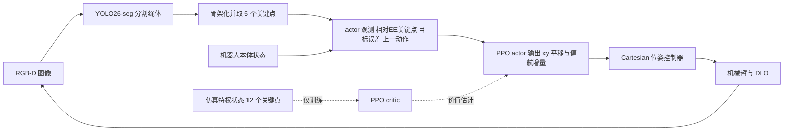

# DLO 关键点定位的强化学习实证研究（arXiv:2611.07261）

**An Empirical Study of Reinforcement Learning for Keypoint Positioning of Deformable Linear Objects**（[arXiv:2611.07261](https://arxiv.org/abs/2611.07261)，v1，cs.RO，2026-11-05），作者 Vinay Rodrigues、Sara Zeynalpour、Gokhan Solak、Sebastian Hjorth、Arash Ajoudani，机构为意大利技术研究院（IIT）HRII 实验室（热那亚）。逐段核对记录见 [来源归档](../../sources/papers/dlo-keypoint-rl-empirical-study_arxiv_2611_07261.md)。

## 一句话定义

**用 PPO 学习「平面内一端被机械臂抓住的线状物体」的关键点到位（单点 / 双点），并系统比较训练栈、观测设计与鲁棒性，最后不做真机微调直接用 RGB-D 关键点估计完成零样本迁移的实证研究。**

## 英文缩写速查

| 缩写 | 英文全称 | 简要说明 |
|------|----------|----------|
| DLO | Deformable Linear Object | 可变形线状物体（缆线、软管、绳） |
| PPO | Proximal Policy Optimization | 本文唯一使用的 RL 算法 |
| MP | MuJoCo Playground | GPU 并行的 JAX 版 MuJoCo/MJX 训练框架 |
| MJX | MuJoCo XLA | MuJoCo 的 JAX 原生后端 |
| SB3 / SBX | Stable-Baselines3 / Stable-Baselines Jax | PyTorch 版与 JAX 版 PPO 实现 |
| EE | End-Effector | 末端执行器 |
| SR | Success Rate | 成功率 |
| AUC | Area Under the Curve | 此处指学习曲线下面积 |
| N+DR(+D) | Noise + Domain Randomization (+ Disturbance) | 论文的仿真评测条件：观测噪声与延迟、域随机化、外部扰动 |
| Optuna / TPE | — / Tree-structured Parzen Estimator | 本文调参所用工具与采样器 |

## 为什么重要

- DLO 无法用单个位姿表示，EE 一处的运动会引起全身形变，传统建模与数据学习都吃力（§I）。
- 本文把关注点从「又一个算法」移到「完整训练系统」：作者自述此前工作没有同时考察训练系统效率、单/多点跟踪、一策略多长度、扰动恢复与基于视觉的闭环部署（§I）。
- 对做 DLO 或其他仿真重的接触操作的人，最可迁移的是两条工程结论：GPU 并行仿真比单纯换 JAX 学习器更能提速；非对称 critic + 相对关键点观测在保持可部署性的同时提升学习效率（§IV-A、IV-B、§V）。

## 核心机制

### 方法栈要点

- **任务（§II-A、§III）：** 一端刚性抓在 EE 上，Cartesian 控制器限制 EE 只做 xy 平移与绕 z 偏航；准静态；10 Hz 策略、1 kHz 仿真、每回合至多 200 步。动作 a = (Δx, Δy, Δψ 的归一化量) ∈ [-1, 1]^3。
- **观测（§II-C）：** actor 只看 Nπ = 5 个视觉可得关键点（含 EE 端与自由端）相对 EE 的位置与速度、自由端绝对位置、目标误差、上一动作；critic 另得 NV = 12 个关键点及限幅 / 边界违例指示（特权信息）。
- **奖励（§II-C）：** 目标距离 + 进度项（λprog = 10）+ 平滑正则 + 事件项（成功与超时终止 150，离开目标区 16）；双点任务先追自由端，进入 0.03 m 目标区后再追 EE 端关键点。
- **训练（§II-D）：** MP 内的 JAX PPO，actor 2 层 / critic 3 层，256 单元，SiLU；每回合随机化摩擦（0.5 到 0.8）、刚度与阻尼缩放（0.95 到 1.05），观测加噪声并最多延迟一个控制步，扰动任务另加外力。弯曲 / 扭转刚度固定不随机（MP 插件不支持）。
- **感知（§II-B、§IV-D）：** 微调 YOLO26-seg 分割绳体，骨架化后等间距取 5 个关键点，深度投影到桌面平面。

### 流程总览

图中 critic 分支只在仿真训练时存在，部署时只保留 actor（§II-A）。

### 关键结果（作者报告，均带出处）

| 实验 | 结果 | 出处 |
|------|------|------|
| 三套训练栈，5 个留出种子 Final SR | SB3+mj 0.860±0.108，SBX+mj 0.880±0.110，MP 0.950±0.032 | Table II |
| 同一约 240 min 预算内的交互量 | MP 约为 CPU 栈 13 倍（1024 个 MJX 环境 vs 4 个 CPU 环境） | §IV-A-3 |
| 观测消融（单点，约 2000 万步，2 种子） | 相对 EE 表示优于基座系绝对表示；非对称优于对称；相对+非对称最优 | §IV-B，Fig. 5 |
| 单点仿真（250 回合 / 条件） | Basic 249，N+DR 241（96.4%），N+DR+D 245（98.0%） | Table III |
| 双点仿真 | Basic 231（92.4%），N+DR 222（88.8%） | Table III |
| 变长度单策略（0.300 / 0.375 / 0.450 m） | 84.4% / 86.0% / 86.4% | Fig. 8 |
| 零样本真机（各 10 次，硅胶导管） | 单点 9/10，扰动恢复 10/10，双点 8/10 | Table IV |

## 工程实践

- **复现要点（作者设定）：** 每个训练栈用 Optuna + TPE 分别调参（每 trial 3 个种子，搜索空间与选定值见 Table I）；调参用 A100 80GB，其余实验用 V100 32GB 与 8 核 CPU（§IV-A）。论文未给出代码链接（来源归档注明未发现）。
- **真机栈（§IV-D）：** Franka Emika Panda、固定桌面、头顶 [RealSense D435i](./intel-realsense.md) 30 Hz、ArUco 外参标定、ROS 集成；策略 10 Hz，与仿真一致，不改网络。关联硬件页 [Franka Research 3](./franka-research-3.md) 是同厂商的较新型号，不是论文所用型号。
- **感知指标（§IV-D-2）：** mask 精度 98.81%，召回 99.13%，mAP@0.5 99.48%，mAP@0.5:0.95 79.30%，29.8 FPS。
- **作者总结的失败模式（§IV-D-4）：** 机器人造成的遮挡、导管高柔顺释放弹性能造成突然偏转、感知延迟造成过冲。

## 局限

**论文自己承认或写明的：**
- 范围限于平面、准静态、一端被抓、单一任务族；未来工作才考虑复杂形状控制、三维操作、对未见 DLO / 环境 / 任务配置的泛化（§III、§V）。
- 变长度实验只是训练分布内的评估，不是对未见长度的外推（§IV-C）。
- 弯曲与扭转刚度没有随机化（§II-D）；真机失败源于遮挡、材料弹性与延迟（§IV-D-4）。
- 三套训练栈在学习实现、仿真后端、并行度和硬件上同时不同，作者明确说这不是对单个算法或仿真器的受控比较（§I）。

**我看到的未验证之处（本页判断，非论文结论）：**
- 真机每任务只有 10 次，用的是同一根 0.004 m 硅胶导管，成功率置信区间很宽；仿真变长度的 84% 到 86% 明显低于同类单点定长设定下的 96.4% 到 99.6%，论文给出的是「三长度相当」的结论，对这一落差没有直接解释（推测：与联合训练多长度提高难度有关，论文未验证）。
- 观测消融只有单点任务、2 个种子、曲线结论，没有数值表；「相对 + 非对称最优」的统计显著性未给。
- 三套栈的比较只覆盖 SB3 / SBX / MP 这一组合；MP 的优势是否来自 GPU 并行本身，而非 JAX 学习器之外的其他差异，论文以「同一墙钟预算」回答，未做单因素拆分。文中预算写约 240 min，Fig. 4 横轴到 200 min，细节差异我没有对上（来源归档未发现解释）。
- 未与非 RL 的 DLO 基线（模型预测控制、几何控制等）做对比，因而「RL 是否优于经典方法」不在本文结论内。

## 关联页面

- [操作任务总览](../tasks/manipulation.md)
- [PPO](../methods/ppo.md) 与 [强化学习](../methods/reinforcement-learning.md)
- [Sim2Real](../concepts/sim2real.md)、[域随机化](../concepts/domain-randomization.md)、[特权训练](../concepts/privileged-training.md)、[奖励设计](../concepts/reward-design.md)
- [接触丰富操作](../concepts/contact-rich-manipulation.md)
- [MuJoCo Playground](./mujoco-playground.md)、[MuJoCo](./mujoco.md)、[Stable-Baselines3](./stable-baselines3.md)
- 同类 DLO / 绳体论文：[RopeFormer](./paper-ropeformer.md)、[DLO 三维力估计（因子图）](./paper-dlo-3d-force-estimation-factor-graphs.md)

## 参考来源

- [来源归档：dlo-keypoint-rl-empirical-study_arxiv_2611_07261.md](../../sources/papers/dlo-keypoint-rl-empirical-study_arxiv_2611_07261.md)
- [arXiv:2611.07261](https://arxiv.org/abs/2611.07261)

## 推荐继续阅读

- [arXiv PDF（v1）](https://arxiv.org/pdf/2611.07261v1)
- [MuJoCo Playground](./mujoco-playground.md)：本文选用的 GPU 并行训练框架
- [RopeFormer](./paper-ropeformer.md)：另一条绳体操作路线，便于对照
