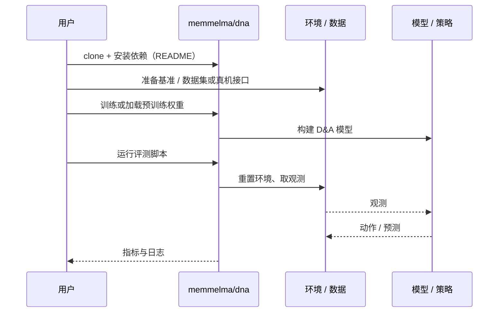

# D&A（arXiv:2611.03622）

**D&A**（*D&A: Decoupling Description and Assessment Enables VLMs as Zero-Shot Robotic Reward Models*，[arXiv:2611.03622](https://arxiv.org/abs/2611.03622)，[项目页](https://weirdlabuw.github.io/dna)，[代码](https://github.com/memmelma/dna)）来自 [具身智能小站 2026-11-04 盘点](../../sources/blogs/wechat_embodied_station_57_papers_da_reward_model_failure_2026-11-04.md)，属「奖励学习与策略后训练」组。

## 一句话定义

**机器人奖励模型容易把动作不断发生误当成任务持续推进。**

## 英文缩写速查

| 缩写 | 英文全称 | 简要说明 |
|------|----------|----------|
| D&A | D&A: Decoupling Description and Assessment Enables VLMs as Zero-Shot Robotic Reward Models | 本文方法 / 基准的简称 |
| VLM | Vision-Language Model | 视觉语言模型 |

## 为什么重要

- 别让奖励模型把失败看成进步。D&A先描述视频中的实际变化，再按明确成功标准评分，让失败识别与部分进度有据可查。
- 开源结论：**已开源**（步骤 2.5，2026-11-04）。仓库可达（git ls-remote）。项目页 HTTP 200。
- 同期同组工作见 [VLM 奖励评估、动作动力学与开放权重机器人智能体：具身智能小站 11-04 期 57 篇阅读坐标](../overview/embodied-station-2026-11-04-57-papers-technology-map.md)。

## 核心机制

| 项 | 内容 |
|----|------|
| **arXiv** | [2611.03622](https://arxiv.org/abs/2611.03622) |
| **开源** | **已开源** |
| **要点** | 机器人奖励模型容易把动作不断发生误当成任务持续推进。 |
| **文内指标** | 公众号转述：在 RBM-EVAL-OOD 同一 Gemini 3.7 Flash 消融中，Kendall τα 由 0.486 升至 0.626（不是机器人成功率）；消融表明仅拆分描述 / 评估两阶段仍不够，还要保证描述不遗漏任务相关对象；部署还需考虑 VLM 时延、费用与语义幻觉；同一描述还可用于生成纠错反馈。 |

## 源码运行时序图

以下为按仓库入口（`memmelma/dna`）推断的通用运行链路；入库日仅核实仓库可达，未逐文件阅读，具体脚本名以 README 为准。

## 实验与评测

- 公众号转述：在 RBM-EVAL-OOD 同一 Gemini 3.7 Flash 消融中，Kendall τα 由 0.486 升至 0.626（不是机器人成功率）；消融表明仅拆分描述 / 评估两阶段仍不够，还要保证描述不遗漏任务相关对象；部署还需考虑 VLM 时延、费用与语义幻觉；同一描述还可用于生成纠错反馈。
- **读法：** 本页为索引级摘要，依据公众号转述的官方摘要与仓库信息整理；逐项数字与 baseline 以原文 PDF 为准。

## 与其他工作对比

- 横向索引见 [VLM 奖励评估、动作动力学与开放权重机器人智能体：具身智能小站 11-04 期 57 篇阅读坐标](../overview/embodied-station-2026-11-04-57-papers-technology-map.md)；同 arXiv 不重复造页。

## 结论

**别让奖励模型把失败看成进步：将任务相关对象落地、客观轨迹描述与显式成功标准串成奖励估计流程，以任务完成条件替代视频内部时间顺序；同一描述还可用于生成纠错反馈。**

1. 开源边界：**已开源** — 仓库可达（git ls-remote）。项目页 HTTP 200。
2. 核心机制：机器人奖励模型容易把动作不断发生误当成任务持续推进。
3. 复现与选型前核对任务协议、硬件与基准口径，勿直接横比公众号摘录数字。

## 关联页面

- [vla](../methods/vla.md)
- [imitation-learning](../methods/imitation-learning.md)
- [reinforcement-learning](../methods/reinforcement-learning.md)
- [simulation-evaluation-infrastructure](../concepts/simulation-evaluation-infrastructure.md)
- [embodied-station-2026-11-04-57-papers-technology-map](../overview/embodied-station-2026-11-04-57-papers-technology-map.md)

## 参考来源

- [dna_arxiv_2611_03622.md](../../sources/papers/dna_arxiv_2611_03622.md)
- [wechat_embodied_station_57_papers_da_reward_model_failure_2026-11-04.md](../../sources/blogs/wechat_embodied_station_57_papers_da_reward_model_failure_2026-11-04.md)
- [arXiv:2611.03622](https://arxiv.org/abs/2611.03622)

## 推荐继续阅读

- [arXiv PDF](https://arxiv.org/pdf/2611.03622)
- [项目页](https://weirdlabuw.github.io/dna)
- [https://github.com/memmelma/dna](https://github.com/memmelma/dna)
