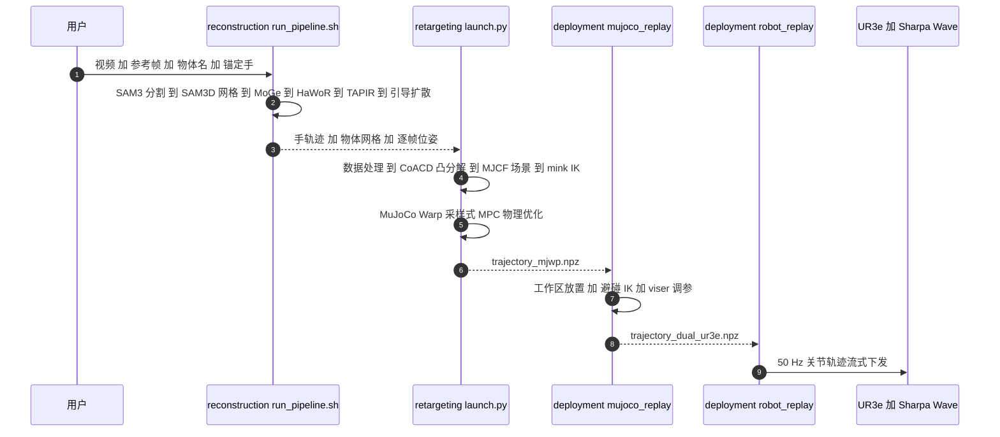

# Do as I Do：从日常人类视频生成灵巧操作数据

**Do as I Do**（*Do as I Do: Dexterous Manipulation Data from Everyday Human Videos*，[arXiv:2606.19333](https://arxiv.org/abs/2606.19333)，[项目页](https://do-as-i-do.com/)）由 UC Berkeley 的 Paliwal、Etukuru、Liang、Abbeel、Shafiullah 与 Malik 提出：把互联网、第一人称与生成视频中的单目 RGB 人类操作视频，先重建成 4D 手–物交互，再在物理仿真里优化出灵巧手可执行的动作，作为「机器人完备」的操作数据；真机部署使用 Sharpa Wave 手。

## 一句话定义

**Do as I Do = 单目人类视频 → 4D 手–物重建（HaWoR 追手 + SAM 3D 引导扩散追物体）→ MuJoCo Warp 采样式动力学重定向 → 灵巧手 / 机械臂可执行轨迹。**

## 英文缩写速查

| 缩写 | 英文全称 | 简要说明 |
|------|----------|----------|
| HOI | Hand-Object Interaction | 手–物交互；本文重建与重定向的对象 |
| SPIDER | Scalable Physics-Informed Dexterous Retargeting | 本文重定向所基于的采样式动力学感知重定向框架，也是表 3 的「退火采样」基线 |
| MPPI | Model Predictive Path Integral | 采样式模型预测控制；本文重定向优化器为 MPPI 式 |
| SAM 3D | SAM 3D: 3Dfy Anything in Images | 由单帧生成物体网格；本文把它改造为引导扩散式 6D 跟踪器 |
| MJWarp | MuJoCo Warp | GPU 加速的 MuJoCo 物理引擎，承担重定向并行 rollout |
| F-5 / F-10 / CD | F-score（阈值 5 与 10）/ Chamfer Distance | 表 2 的物体重建指标；F-score 的阈值单位以论文附录为准，本页未核实 |
| IK | Inverse Kinematics | 手臂与手指的逆运动学（mink）；用于运动学参考与部署 |

## 核心信息

| 项 | 内容 |
|----|------|
| **机构** | 加州大学伯克利分校（UC Berkeley）；全文致谢注明 Abbeel 同时任 Amazon Scholar，但该工作与 Amazon 无关 |
| **作者** | Bhawna Paliwal\*、Haritheja Etukuru\*、William Liang\*（\* 同等贡献）、Pieter Abbeel、Nur Muhammad "Mahi" Shafiullah、Jitendra Malik |
| **arXiv** | [2606.19333](https://arxiv.org/abs/2606.19333)；v1 2026-06-17（摘要页仅列 v1） |
| **平台** | Sharpa Wave（22 DoF）+ UR3e 双臂，50 Hz 下发；仿真为 MuJoCo Warp |
| **Sharpa 关系** | 署名仅 UC Berkeley；Sharpa 是真机手部硬件平台，文章把它归为「他队基于 Sharpa 硬件」的自上而下路线对照 |
| **开源** | **已开源（仅代码，MIT）**：[malik-group/do-as-i-do](https://github.com/malik-group/do-as-i-do)；数据与权重发布未见说明 |

## 为什么重要

- **数据瓶颈：** 遥操作受限于操作员水平、成本与系统透明度；仿真探索受限于环境与奖励设计。互联网人类视频量大但多是单目 RGB，缺深度、缺手关键点标注，也没有机器人动作。
- **不做限制性假设：** 论文强调不假设抓取先验、不限物体类别（任意刚体）、不要专用传感器，视频可为第一/第三人称、野外互联网或生成视频。
- **「视频 → 真机」的首条完整管线（作者表述）：** 作者称这是迄今所知第一条能从互联网视频走到真实灵巧手 rollout 的流水线；该说法为论文自述，未经第三方核实。
- **在 Sharpa 学术线中的位置（文章转述）：** 张凯峰把 Malik 团队的工作归为「自上而下」（先重建人类交互，再由仿真补全接触），与 Dex-X 同方向；Bohg/Liu 团队（SimToolReal、Play2Perfect）归为「自下而上」。见 [夏帕机器人](./sharpa-robotics.md)。
- **带来一份数据过滤清单：** 作者基于 100DOH 估计，互联网「手–物交互」片段里真正能用于灵巧操作学习的只有约 4%–5%，不过滤会有约 20 倍的数据代价。

## 流程总览

## 核心机制（方法）

### 1）重建（论文 Sec 3.1）

- **模块化分解：** HaWoR 追手；SAM 3 做分割；MoGe 给深度与内参；SAM 3D 由单帧生成物体网格。
- **把 SAM 3D 改造成跟踪器：** 用引导 flow-matching 扩散，让形状锚定到规范网格、位姿朝上一帧引导；位姿引导强度由 BootsTAPIR 二维点跟踪自适应决定。每帧采样 25 个候选位姿，用加权 SE(3) 距离聚类选择，避免精确似然评分（论文估计需约 8.7k 次前后向）；论文称聚类选择与似然选择相当，最多快 30 倍。
- **对齐：** 逐帧最小二乘解尺度，使物体对齐到手；用 GeoCalib 做重力对齐。

### 2）动力学重定向（论文 Sec 3.2）

在 SPIDER 的采样式优化框架上做 MPPI 式优化，核函数随迭代与预测时域退火，从广探索转向局部精修；设置为 0.5 s 重规划、3 s 视野、1024 个样本、32 次迭代、仿真步长 0.005 s。针对重建参考含噪，加入三个组件：

| 组件 | 解决什么 | 做法 |
|------|----------|------|
| Warmup 步 | 含噪首帧可能给出无法恢复的初始状态（如没抓住物体） | 在参考前补 H 个 warmup 步：物体被固定在原位，手可自由调整，之后释放物体开始正常跟踪 |
| 随机力扰动 | 采样 rollout 陷入局部极小（如指尖上勉强平衡的不稳定接触） | 对采样 rollout 加随机外力，鼓励对小扰动鲁棒的控制 |
| 转换奖励 | 物体「静置 ↔ 在手」切换处，含噪参考下纯跟踪奖励太软 | 对失败的静置到在手 / 在手到静置转换给恒定惩罚 |

成功判据：平均位置误差小于 0.1 m 且平均旋转误差小于 0.5 rad。

### 3）真机回放

重建结果仍在视频相机坐标系，部署前需在仿真中手动对齐初始位姿（x、y、z、yaw），再算臂 IK；轨迹先在 MuJoCo 数字孪生里验证，再经 UR3e + Sharpa Wave 回放。

## 源码运行时序图

图下说明：复现主路径是 `reconstruction/run_pipeline.sh` → `retargeting/launch.py --task <视频名> --raw-dir ../reconstruction/<视频名>` → `deployment/mujoco_replay/replay_retarget.py` → `deployment/robot_replay/`。仓库自带 whisking 示例可免重跑回放；真机段需要专有的 Sharpa Wave SDK。

## 实验与评测

**重建（论文 Table 2，自报）：**

| 方法 | DexYCB F-5 / F-10 / CD | HOI4D F-5 / F-10 / CD |
|------|------------------------|------------------------|
| FoundationPose | 0.69 / 0.89 / 0.89 | 0.71 / 0.91 / 0.49 |
| Any6D | 0.69 / 0.88 / 0.97 | 0.71 / 0.91 / 0.50 |
| **Do as I Do** | **0.71 / 0.93 / 0.66** | **0.72 / 0.91 / 0.49** |

评测时提供真值手以隔离物体级表现；论文另比较了 HO、IHOI、HORSE、MCC-HO、G-HOP 等联合手–物重建方法（均更弱，HOI4D 上 G-HOP 的 F-5 为 0.69）。另有 150 条野外视频的人评：67% 选本文物体跟踪、18% 选 FoundationPose、15% 平局（每视频 3 名志愿者）。

**重定向（论文 Table 3，成功率，自报）：**

| 配置 | 655 条野外重建参考 | OakInk2（1,352 条干净 MoCap 双手轨迹） |
|------|-------------------|----------------------------------------|
| Annealed Sampling（SPIDER 基线） | 0.25 | 0.72 |
| + Warmup | 0.66 | 0.77 |
| + Perturbation | 0.67 | 0.79 |
| + Transition Reward（完整） | **0.71** | **0.81** |

论文称主要增益来自 warmup；扰动对定量指标影响小但改善定性效果（如更自然的抓法）；转换奖励提升取放成功。

**真机（论文 Sec 4.4，自报）：** 流水线共产出 500 条人工核验轨迹（互联网 53%、第一人称 31%、生成视频 16%）；真机展示 10 个动作——whisking、pouring、dusting、squeezing、tamping、erasing、stirring、hammering、spreading、picking，覆盖 tripod、power、ventral、parallel extension 等抓型。论文以胶片图与项目页视频定性展示，未报告这 10 个动作的真机成功率。

**文章转述：** 文章称「655 条野外视频重建结果上，重定向成功率从此前方法的 25% 提升到 71%，并在 Sharpa Wave 上完成搅拌、倾倒、擦除等 10 项真机任务」，与论文表 3 与 Sec 4.4 一致；其中「此前方法」对应表中的 SPIDER 退火采样基线。

**数据过滤 playbook（论文 Sec 4.5，100DOH，自报）：** 2,000 个 10 秒片段中仅 187 个（9%）含有意义的手–物交互；其中 41 个手或物体出画、29 个无活动或跨镜头、14 个相机运动、10 个因 SAM 3D 失败、另 10 个其他原因；最终仅 83 个（4%）通过重建质量检查，最好情形约 107 个（约 5%）。

## 与其他工作对比

| 对象 | 差异 |
|------|------|
| [SPIDER](../methods/spider-physics-informed-dexterous-retargeting.md) | Do as I Do 的重定向直接建立在 SPIDER 之上；新增 warmup、力扰动、转换奖励以适应含噪重建参考，表 3 中 SPIDER 即 25% 基线 |
| [OmniHOI](./paper-omnihoi.md) | OmniHOI 页的端到端对照表在其自己的 60 段 XHand 协议下报告 Do as I Do 为 25% 成功率；协议与指标不同，不可与本页 71% 直接比较 |
| [GALATEA](./paper-galatea.md) | 同属「视频想象或人类视频 → 仿真 RL 对齐 → 控制器」的自上而下思路；GALATEA 从扩散生成视频出发并蒸馏出单一控制器，Do as I Do 输出的是逐段轨迹数据，不是单一策略 |
| [EgoScale](./paper-sa-2602-16710-egoscale-scaling-dexterous-manipulation-with-div.md) | EgoScale 用人类第一人称数据验证规模效应并训练策略；Do as I Do 解决的是「如何把野外单目 RGB 变成机器人动作数据」这一上游步骤 |
| [EgoDex](./paper-notebook-egodex-learning-dexterous-manipulation-from-larg.md) | EgoDex 是 Vision Pro 第一视角数据集加手轨迹预测基准，依赖专用采集设备；Do as I Do 只要单目 RGB 视频 |
| [SimToolReal](./simtoolreal.md) | 文章把 SimToolReal 归为「自下而上」的对照：不依赖人类视频，用程序化工具在仿真里训策略 |

## 结论

**Do as I Do 的真影响指标是「含噪单目重建下，动力学感知重定向还能不能成功」（655 条野外参考上 25%→71%，自报），而不是重建分数的小幅领先；真机侧只是 10 个动作的定性证明。**

1. **warmup 是最大增益项** — 表 3 中 0.25→0.66 几乎全来自 warmup；复现时先保证首帧不好时手有机会重新抓取。
2. **71% 是仿真重定向成功率** — 判据为位置误差小于 0.1 m、旋转误差小于 0.5 rad，不是真机任务成功率；论文未报告真机成功率。
3. **25% 的基线是 SPIDER 退火采样** — 在干净 MoCap 的 OakInk2 上同一基线本就 72%，提升到 81%；增益在含噪参考上最大。
4. **数据要先过滤再用** — 100DOH 抽样只有约 4% 的片段通过重建质检，不过滤有约 20 倍浪费。
5. **刚体与手–物二元假设** — 不能处理铰接物体与场景约束；人类意图里的手–场景交互被丢弃。
6. **接触力来自仿真补全** — 视频没有力信息，接触靠物理引擎补出；仿真近似动力学会限制真机上限。
7. **复现按「重建 → 重定向 → 部署」三段推进** — 重建段需 ≥32 GB 显存与受限权重，真机段需专有 Sharpa Wave SDK；只想要轨迹数据可停在重定向段。

## 常见误区与局限

- **误区：10 项真机任务 = 10 项任务成功率。** 论文只展示 10 个动作的回放，没有成功率统计；初始位姿还需手动对齐。
- **误区：它是 Sharpa 论文。** 署名只有 UC Berkeley；Sharpa 提供手部硬件，文章把它当「他队」工作。
- **局限（作者自述）：** 假设刚体与较准的单目度量深度；单目下难分「真接触」与「遮挡」；只重建手与单个物体，不含场景、障碍与铰接；仿真近似动力学。
- **局限（本页补充）：** 重建指标用的是物体级跟踪（评测时提供真值手）；500 条人工核验轨迹的筛选标准与耗时论文未量化；未报告下游用这些数据训练策略的效果，即「数据好用」尚缺策略级证据。

## 复现边界

| 项 | 结论（2026-10-16 核查：项目页 + GitHub README / LICENSE / 各目录 README） |
|----|------|
| 项目页 | [do-as-i-do.com](https://do-as-i-do.com/)：头部有 Paper、Code 链接；页内无数字结果，仅视频 |
| 代码 | **已开源**：[malik-group/do-as-i-do](https://github.com/malik-group/do-as-i-do)，MIT；含 `reconstruction/`、`retargeting/`、`deployment/` 与带作者修改的 git 子模块 |
| 数据 / 权重 | 仓库 README 未提及 655 条重建、500 条核验轨迹或检查点发布；模型权重需自行从各上游仓库获取 |
| 重建环境 | 需 NVIDIA GPU ≥ 32 GB 显存；需带访问权限的 HuggingFace 账号（SAM 3、SAM 3D Objects 仓库）与 MANO 下载；SAM 3 分割为点选 GUI，需 X 显示 |
| 重定向环境 | 需 NVIDIA GPU + CUDA（MuJoCo Warp）；conda 环境，Python 3.12 |
| 真机 | 专有 Sharpa Wave 手 SDK **不随仓库提供**，需自行放入 `robot_replay/Sharpa/` 并配置机器人 IP 与手序列号 |
| 源码运行时序图 | 见上文「源码运行时序图」 |

## 关联页面

- [夏帕机器人（Sharpa Robotics）](./sharpa-robotics.md) — 文章对三条路线与 Sharpa Wave 平台的整体叙述
- [SPIDER](../methods/spider-physics-informed-dexterous-retargeting.md) — 本文重定向的基础框架
- [OmniHOI](./paper-omnihoi.md) — 另一条从视频到灵巧手的路线，其表中含 Do as I Do 对照
- [GALATEA](./paper-galatea.md) — 同 Sharpa 文章中的自上而下对照
- [EgoScale](./paper-sa-2602-16710-egoscale-scaling-dexterous-manipulation-with-div.md) — 人类数据规模化路线
- [SimToolReal](./simtoolreal.md) — 自下而上对照（Bohg / Liu 团队）
- [运动重定向管线](../concepts/motion-retargeting-pipeline.md) — 重定向通用背景
- [灵巧操作数据采集指南](../queries/dexterous-data-collection-guide.md) — 采数通道选型
- [Manipulation（操作任务）](../tasks/manipulation.md)

## 参考来源

- [do_as_i_do_arxiv_2606_19333.md](../../sources/papers/do_as_i_do_arxiv_2606_19333.md) — 原始摘录（arXiv 摘要、项目页、仓库核查、文章转述）
- [wechat_sharpa_dexterous_manipulation_2026-10-16.md](../../sources/blogs/wechat_sharpa_dexterous_manipulation_2026-10-16.md) — 机器之心采访稿来源页
- [arXiv:2606.19333](https://arxiv.org/abs/2606.19333)
- [项目页](https://do-as-i-do.com/)
- [官方仓库](https://github.com/malik-group/do-as-i-do)

## 推荐继续阅读

- [arXiv PDF](https://arxiv.org/pdf/2606.19333)
- SPIDER 原论文（arXiv:2511.09484）— 重定向基础框架
- [SAM 3D 论文](https://arxiv.org/abs/2511.16624) — 单帧物体网格生成
